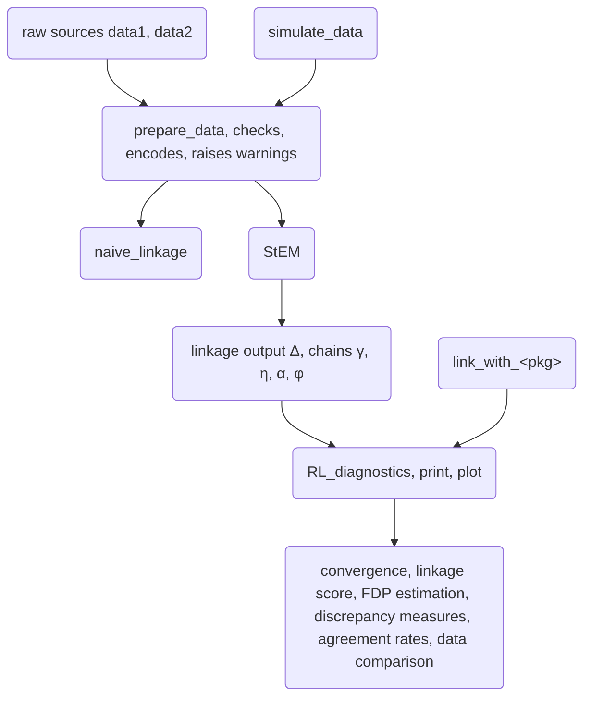
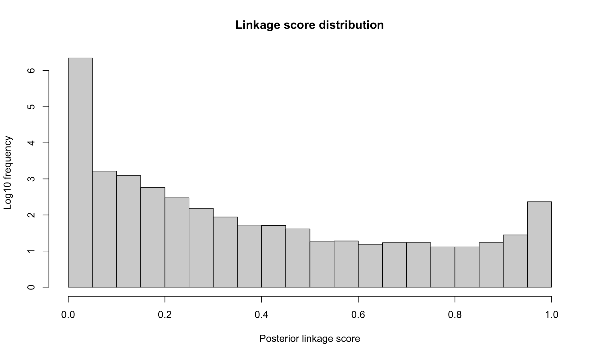
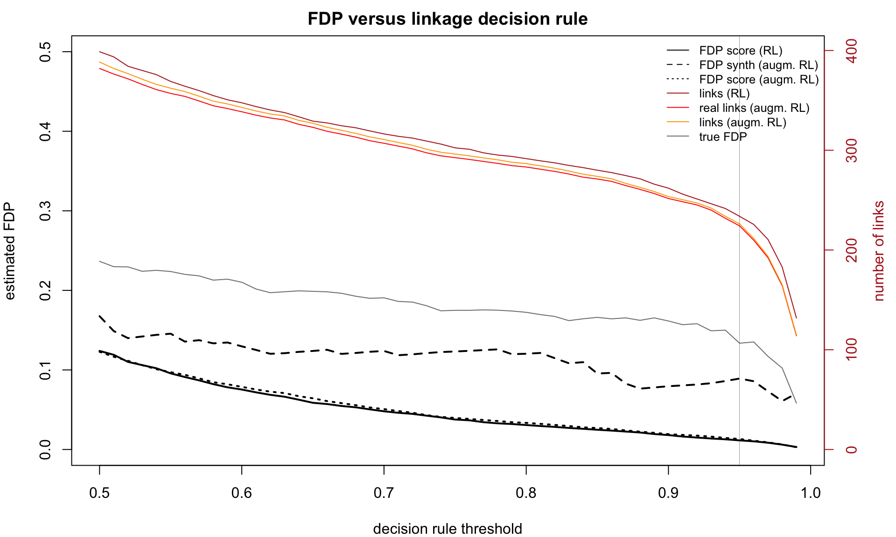
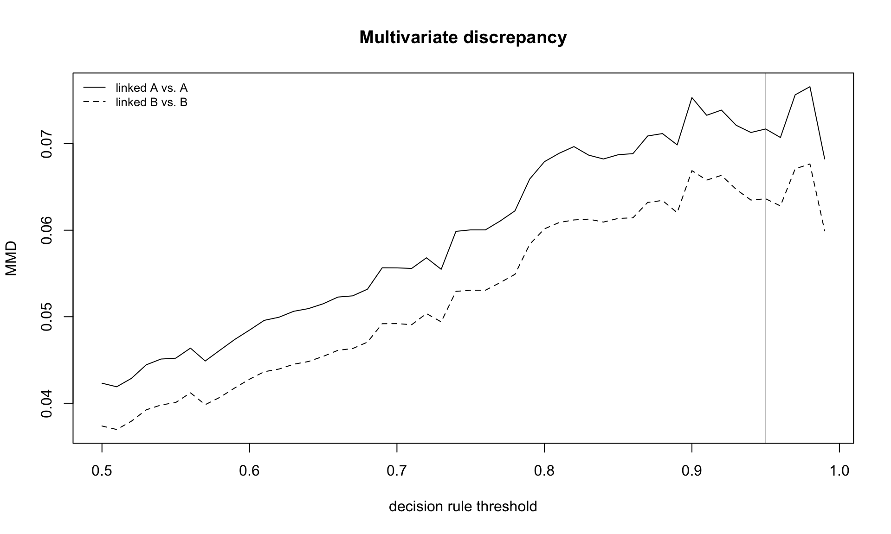
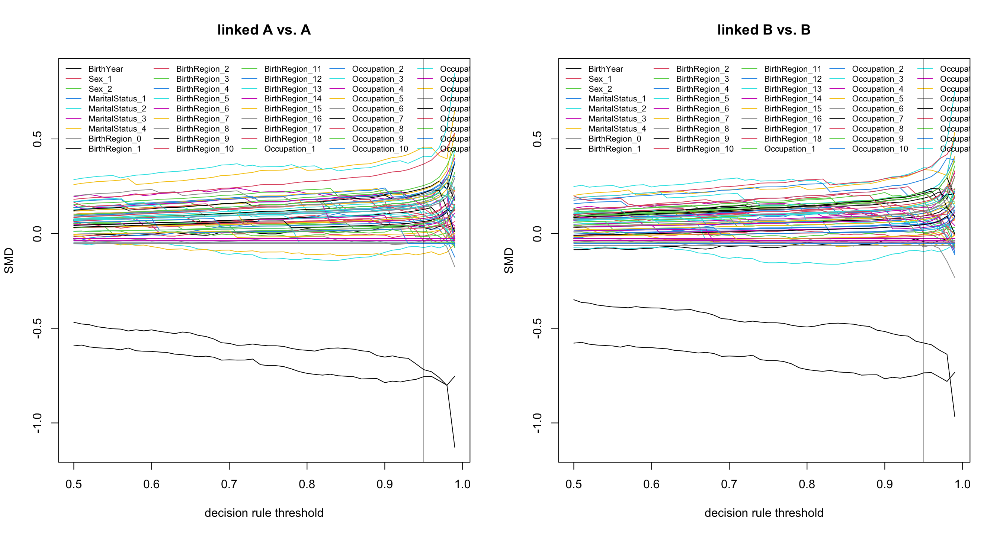
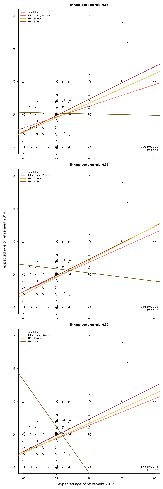

# FlexRL: an R package for Flexible Record Linkage and Linked Data Quality Assessment

## 1 Introduction

Researchers and statistical agencies increasingly combine data sources
that do not share a unique identifier ([Cleaton et al.
2024](#ref-Cleaton_Splink_2024); [Laidler et al.
2025](#ref-Laidler_NHSE_2025); [Kramer
2026](#ref-Kramer_Destatis_2026)). Record linkage connects records
referring to the same entity across sources based on Partially
Identifying Variables (PIVs) (e.g. birth year, sex, postal code or
product code, brand and category). Each PIV has limited discriminative
power on its own and may be missing, incorrectly recorded or change over
time. Record linkage underpins the production of official statistics,
enables the reuse of administrative and registry data for research
([Collaborative et al. 2020](#ref-opensafely2020); [Pontesilli et al.
2021](#ref-perined_linkage_2021); [Cooney et al.
2023](#ref-cooneyhealthcare_2023)) and improves data quality through
linkage and deduplication.

Linked data sets become the study sample for downstream analyses, where
linkage errors may propagate ([JC and KL 2020](#ref-reflexRL_2020);
[Wang et al. 2022](#ref-Wang_Slawski_linked_2022); [Vo et al.
2024](#ref-CoxLinkedData_2024); [Robach et al.
2026](#ref-CRLrobachetal26)). Errors arise when missing links between
entities that appear in both sources or when falsely linking records
from distinct entities. These errors cannot be reduced simultaneously
and may bias the conclusions drawn from linked data ([Wang et al.
2022](#ref-Wang_Slawski_linked_2022); [JC and KL
2020](#ref-reflexRL_2020); [Robach et al. 2026](#ref-CRLrobachetal26)).
A stricter decision rule reduces falsely linked pairs but misses more
links. Practitioners therefore need not only record linkage methods, but
also tools to quantify linkage errors and appraise their consequences
for statistical analysis.

Two main probabilistic approaches to record linkage have developed
through times. First, the traditional mixture model ([Fellegi and Sunter
1969](#ref-FS_RL_1969); [Jaro 1989](#ref-jaro_RL_matching_1989); [Larsen
1999](#ref-Larsen_mixture_1999); [Fortini et al.
2001](#ref-fortini_bay_RL_2001); [Sadinle
2017](#ref-sadinle_bay_bipartite_RL_2017)) treats linkage as a
classification problem between pairs of records that are similar and
pairs that are not. Second, the hierarchical entity resolution framework
([Tancredi and Liseo 2011](#ref-tancredi_bay_RL_2011); [Steorts
2015](#ref-steorts2015); [Steorts et al. 2016](#ref-smered2016);
[Marchant et al. 2021](#ref-dblink_2021),
[2023](#ref-marchantsteorts2023)) models the data generation process,
considering observed values as potentially distorted versions of true
latent values. The latter framework uses all the information contained
in the records and is therefore more flexible but more computationally
demanding. It has been implemented in `R` for entity resolution
(clustering records from a single file into entities) rather than for
linkage between two data sources.

We address this gap with the *FlexRL* `R` package, which makes two
contributions. First, it implements the hierarchical record linkage
model proposed by Robach, van der Pas, et al.
([2025](#ref-RLrobachetal25)). The model is fitted with a stochastic
expectation maximisation (StEM) algorithm that accounts for registration
errors and temporal changes in PIVs. Its architecture and efficient
`Rcpp` backend support scalability to large data sets and a wide range
of applications: health monitoring studies, survey waves, census and
administrative records or data from different retailers. Second, it
provides tools to assess the quality of the linked data, which quantify
the linkage error and sample selection. *FlexRL* implements two
estimators of the False Discovery Proportion (FDP): one derived from
linkage scores ([Belin and Rubin 1995](#ref-belin_rubin_1995); [Resnick
and Asher 2019](#ref-measurementError_2019); [Enamorado et al.
2019](#ref-fastLink_paper_2019)) and one based on synthetic data
([Robach, Hof, et al. 2025](#ref-FDProbachetal25)). *FlexRL* measures
the divergence of the linked sample from the original sources using
standardised mean differences, overlap of supports, maximum mean
discrepancy and agreement rates. These tools only need the linked pairs
and, when available, their linkage scores. They therefore apply to the
output of any linkage method and *FlexRL* provides wrappers for several
existing `R` packages.

The *FlexRL* package is aimed at practitioners, statistical agencies and
researchers who need to link data sources without a unique identifier or
who want to measure the error and the sample selection induced by record
linkage. It builds on three lines of work: the biases that linkage
errors cause in inference ([Lahiri and Larsen
2005](#ref-Lahiri_Larsen_linked_2005); [Tancredi and Liseo
2015](#ref-Tancredi_Liseo_linked_2015); [JC and KL
2020](#ref-reflexRL_2020); [Wang et al.
2022](#ref-Wang_Slawski_linked_2022); [Robach et al.
2026](#ref-CRLrobachetal26)); the need for linked data quality control
in practice ([Harron et al. 2017](#ref-eval_linkage_17); [Harron K
2020](#ref-datalinkagequal2020); [Lam et al.
2024](#ref-linkage_bias_datasynthesis24); [Laidler et al.
2025](#ref-Laidler_NHSE_2025)); advances in record linkage methodology
([Sadinle 2017](#ref-sadinle_bay_bipartite_RL_2017); [Marchant et al.
2023](#ref-marchantsteorts2023); [Robach, van der Pas, et al.
2025](#ref-RLrobachetal25)). By combining record linkage and diagnostics
in a practical tool, it helps evaluate whether inference can be
conducted on linked data.

Throughout the paper, we motivate and illustrate the main components of
*FlexRL* on the 2012 and 2014 waves of the [Survey on Household Income
and
Wealth](https://www.bancaditalia.it/statistiche/tematiche/indagini-famiglie-imprese/bilanci-famiglie/distribuzione-microdati/index.html)
(SHIW), conducted and made available by the Bank of Italy for research
purposes. [Section 2](#sec-setup) introduces the notation, the modelling
paradigms, the existing software and demonstrates the potential of
*FlexRL*. [Section 3](#sec-model) presents the record linkage model
implemented in *FlexRL* and its estimation on a subset of the SHIW. On
the resulting linked data, [Section 4](#sec-inference) describes the
diagnostic tools *FlexRL* provides, and illustrates the impact of
linkage errors on a socio-economic regression analysis.
[Section 5](#sec-scalability) demonstrates the scalability of *FlexRL*
approach to record linkage on the SHIW. [Section 6](#sec-discussion)
concludes.

## 2 The record linkage problem

### 2.1 Setup and notation

We consider two overlapping samples $`\mathcal A`$ and $`\mathcal B`$
from the same population with $`N_{\mathcal A}`$ and
$`N_{\mathcal B} \geq N_{\mathcal A}`$ records. Both sources record the
same $`K`$ categorical PIVs, indexed by $`k = 1, \dots, K`$ with $`N_k`$
possible values each. Index $`i`$ refers to a record in $`\mathcal A`$
and index $`j`$ to a record in $`\mathcal B.`$ For PIV $`k`$, we denote
by $`G^{\mathcal A}_{i,k}`$ the registered (observed) value and by
$`H^{\mathcal A}_{i,k}`$ the true (latent) value in record
$`i \in \mathcal A.`$ We define $`G^{\mathcal B}_{j,k}`$ and
$`H^{\mathcal B}_{j,k}`$ analogously. Registered values differ from true
values because of registration errors: missing values or mistakes
(e.g. typographical errors). We write $`\textbf{G}`$ and $`\textbf{H}`$
for the collections of all registered and all true values. True values
may also differ between the two data collections. This is the case for
*dynamic* PIVs like postal code. Whereas *stable* PIVs like birth year
cannot change. For an entity recorded in both sources, the true values
of stable PIVs are therefore identical in $`\mathcal A`$ and
$`\mathcal B`$ and any disagreement between their registered values is
due to registration errors. We elaborate on dynamic PIVs later.

The object of interest is the linkage matrix
$`\boldsymbol{\Delta} \in \{0,1\}^{N_{\mathcal A} \times N_{\mathcal B}}`$,
with $`\Delta_{i,j} = 1`$ if records $`i \in \mathcal A`$ and
$`j \in \mathcal B`$ refer to the same entity. We assume that there is
no duplicate within a data source. Thus, each record forms a link with
at most one record in the other data source:
$`\sum_j \Delta_{i,j} \leq 1`$ for all $`i`$ and
$`\sum_i \Delta_{i,j} \leq 1`$ for all $`j.`$ This is the one-to-one
assignment constraint, also referred to as bipartite matching ([Sadinle
2017](#ref-sadinle_bay_bipartite_RL_2017)). We denote by
$`\gamma \in (0,1)`$ the probability that a record from $`\mathcal A`$
forms a link with a record from $`\mathcal B`$, that is, the overlap
between the sources as a fraction of the smaller data set.

Since record linkage is imperfect, the linked data contain two types of
error: false positives (pairs declared linked while referring to
distinct entities) and false negatives (true links that are missed). The
non-links in the Cartesian product $`\mathcal A \times \mathcal B`$ are
far more numerous than the links and are rarely of interest. The useful
summaries are therefore the False Discovery Proportion (FDP) among the
linked data (complement of precision or positive predictive value) and
the sensitivity (also called recall, complement of miss rate). The two
errors affect inference differently: falsely linked pairs contaminate
the inference and missed links induce sample selection ([JC and KL
2020](#ref-reflexRL_2020); [Robach et al. 2026](#ref-CRLrobachetal26)).

### 2.2 Modelling paradigms

Linkage methods can be grouped into four paradigms ([SB et al.
2014](#ref-review_methods_2014); [Binette and Steorts
2022](#ref-Binette_Steorts_2022)). Deterministic (rule based) linkage
declares a link when records agree on a set of variables, exactly or up
to a tolerance. Supervised methods train a classifier on pairs whose
linkage status is known ([Mudgal et al.
2018](#ref-DeepMatcher_method_2018)); such labelled pairs are seldom
available. The two remaining paradigms are unsupervised and
probabilistic, and differ in what they model:

#### 2.2.1 Paradigm 1: classification of comparison vectors

The traditional approach ([Fellegi and Sunter 1969](#ref-FS_RL_1969);
[Dunn 1946](#ref-bookoflife); [Newcombe et al. 1959](#ref-newcombe1959);
[Tepping 1968](#ref-Tepping1968)) reduces the data to comparison
vectors. For each pair $`(i,j) \in \mathcal A \times \mathcal B`$, a
vector $`\boldsymbol{c}_{i,j} = (c_{i,j,1}, \dots, c_{i,j,K})`$ records
whether elements $`G^{\mathcal A}_{i,k}`$ and $`G^{\mathcal B}_{j,k}`$
for $`k = 1, \dots, K`$ agree or how similar they are. The pairs of
records are split into the set of matched $`M`$ and the set of unmatched
$`U.`$ The comparison vectors follow a two components mixture:
``` math
 \begin{aligned}
P(\boldsymbol{c}_{i,j}) &= \gamma \; m(\boldsymbol{c}_{i,j}) + (1-\gamma) \; u(\boldsymbol{c}_{i,j}), \\
m(\boldsymbol{c}) &= P(\boldsymbol{c} \mid M), \\
u(\boldsymbol{c}) &= P(\boldsymbol{c} \mid U),
\end{aligned}  \qquad(1)
```
where $`\gamma`$ in this paradigm is the proportion of links among all
pairs. Under the assumption that the $`K`$ comparisons are independent
given the linkage status, $`m`$ and $`u`$ factorise over
$`k \in \{1, \dots, K\}.`$ The parameters are then estimated with an EM
algorithm ([Jaro 1989](#ref-jaro_RL_matching_1989); [Larsen
1999](#ref-Larsen_mixture_1999)). Pairs are classified by thresholding
the ratios $`m(\boldsymbol{c}_{i,j}) / u(\boldsymbol{c}_{i,j})`$ or the
posterior linkage probabilities. Bayesian versions place a prior on the
linkage matrix $`\boldsymbol{\Delta}`$ to enforce the one-to-one
assignment constraint ([Fortini et al. 2001](#ref-fortini_bay_RL_2001);
[Sadinle 2017](#ref-sadinle_bay_bipartite_RL_2017)) or a prior on a
partition of the records when there are more than two sources or
duplicates ([Aleshin-Guendel and Sadinle
2023](#ref-multifilepartitioningrecordlinkage)). The computations are
simple and fast, but memory intensive because they operate on
$`N_{\mathcal A} \times N_{\mathcal B}`$ comparison vectors. Scaling to
large data sets may therefore require blocking, which compares only
pairs that agree on some variables ([R. C. Steorts et al.
2014](#ref-blocking_methods_2014)). This paradigm treats pairs as
independent although they share records, and the reduction to comparison
vectors discards part of the information contained in the records.

#### 2.2.2 Paradigm 2: hierarchical modelling

The second family models how the data were generated ([Tancredi and
Liseo 2011](#ref-tancredi_bay_RL_2011); [Steorts
2015](#ref-steorts2015); [Steorts et al. 2016](#ref-smered2016);
[Marchant et al. 2021](#ref-dblink_2021),
[2023](#ref-marchantsteorts2023); [Robach, van der Pas, et al.
2025](#ref-RLrobachetal25)). Registered values $`\textbf{G}`$ are seen
as distorted versions of latent true values $`\textbf{H}`$, which define
the linkage structure $`\boldsymbol{\Delta}.`$ The joint model reads
``` math
 P(\textbf{G}, \textbf{H}, \boldsymbol{\Delta}) = P(\textbf{G} \mid \textbf{H}) P(\textbf{H} \mid \boldsymbol{\Delta}) P(\boldsymbol{\Delta}),  \qquad(2)
```
with a model for registration errors $`P(\textbf{G} \mid \textbf{H})`$,
a model for underlying true values
$`P(\textbf{H} \mid \boldsymbol{\Delta})`$ and a model for the linkage
structure $`P(\boldsymbol{\Delta}).`$ Since records are never reduced to
pairwise comparisons, the model can separate missing values, mistakes
and changes over time, and it does not need blocking to fit in memory.
However, it is more computationally demanding.

### 2.3 Existing software

In `Python`, *recordlinkage* ([Bruin 2019](#ref-PYRL_de_bruin_j_2019)),
*Splink* ([Linacre et al. 2022](#ref-splink_2022)) and *NameMatch*
([Jelveh et al. 2022](#ref-PYRL_namematch)) implement Paradigm 1. We
list the main `R` packages for the task considered here in
[Table 1](#tbl-packages). Paradigm 2 is only available in `R` through
methods for entity resolution ([R. Steorts et al.
2014](#ref-smered16software); [Marchant et al. 2021](#ref-dblink_2021),
[2023](#ref-marchantsteorts2023)). These methods cluster records from a
single file, possibly containing duplicates, into entities.

| Package | Paradigm | Estimation | Linkage structure | PIVs dynamics | Quality tools |
|----|----|----|----|----|----|
| *fedmatch* ([Friedrichs et al. 2023](#ref-fedmatchmanual); [Cohen et al. 2021](#ref-fedmatch_article)) | comparison vectors | push relabel maximum flow | many-to-many | no | no |
| *diyar* ([Nsonwu 2023](#ref-diyarmanual)) | comparison vectors | multistage weights comparisons, fixed score level parameters | clusters | no | no |
| *reclin2* ([van der Laan 2025](#ref-reclin2manual)) | comparison vectors, supervised | EM, machine learning | one-to-one post hoc | no | no |
| *fastLink* ([Enamorado et al. 2019](#ref-fastLink_paper_2019); [Ted Enamorado 2023](#ref-fastLinkmanual)) | comparison vectors | EM | one-to-one post hoc | no | no |
| *BRL* ([Sadinle 2020](#ref-brlmanual); [Sadinle 2017](#ref-sadinle_bay_bipartite_RL_2017)) | comparison vectors | Bayesian, bipartite prior, Gibbs sampler | one-to-one in model | no | no |
| *multilink* ([Aleshin-Guendel 2023](#ref-multilinkmanual); [Aleshin-Guendel and Sadinle 2023](#ref-multifilepartitioningrecordlinkage)) | comparison vectors | Bayesian, partition prior, Gibbs sampler | clusters, one-to-one in model | no | no |
| *FlexRL* ([Robach and Hof 2026](#ref-flexrlmanual)) | hierarchical | stochastic EM | one-to-one in model | yes | yes |

Table 1: Record linkage packages on `CRAN` compared with *FlexRL*. The
*FlexRL* package diagnostic tools apply to all these packages.

To our knowledge, no `R` package implements Paradigm 2 for the linkage
of two sources under the one-to-one assignment constraint or models the
dynamics of PIVs over time. While the *postlink* package ([Bukke et al.
2026](#ref-postlink26)) develops statistical tools for post-linkage data
analysis, no record linkage package provides tools to assess the quality
of the linked data and their suitability for inference.

The *FlexRL* package is available from the Comprehensive R Archive
Network (`CRAN`) or from the package `GitHub` repository alongside
documentation and vignettes describing its functionality. *FlexRL* is
also available as a module in `JASP 1.0`. The implementation of *FlexRL*
relies on `Rcpp` for the backend samplers, *Matrix* for the sparse
likelihood and linkage matrix, and other standard `R` packages. The
diagnostic tools apply to any record linkage output in the required
format, with built-in wrappers for *BRL*, *diyar*, *fastLink*,
*fedmatch*, *multilink* and *reclin2*. [Figure 1](#fig-workflow) shows
the workflow, which follows the structure of [Section 3](#sec-model) and
[Section 4](#sec-inference): the data are prepared, linked with
[`StEM()`](https://robachowyk.github.io/FlexRL/reference/StEM.md) and
the linked data quality is assessed with
[`RL_diagnostics()`](https://robachowyk.github.io/FlexRL/reference/RL_diagnostics.md).
We elaborate on each component along the article.



Figure 1: Workflow of *FlexRL*.

### 2.4 Demonstration

#### 2.4.1 Simulation study

As a preliminary demonstration of the functionalities of *FlexRL*, we
simulate data with the package
[`simulate_data()`](https://robachowyk.github.io/FlexRL/reference/simulate_data.md)
function. This function synthesises two files with a given overlap,
given rates of mistakes and missing values per PIV and file, and given
hazard coefficients for structured PIVs, useful to explore and compare
record linkage methods. Here, we generate two data sets of 350 and 400
records, with 300 entities common to both. Entities are represented by
four PIVs. We distort the data in each file with 2% of mistakes and 0.5%
of missing values; one of the PIVs undergoes temporal changes.

|  | Naive | BRL | multilink | fastLink | reclin2 | diyar | fedmatch | FlexRL (dynamics) | FlexRL (no dynamic) |
|:---|:--:|:--:|:--:|:--:|:--:|:--:|:--:|:--:|:--:|
| TP | 174.00 | 166.00 | 177.00 | 155.00 | 170.00 | 33.00 | 187.00 | 200.00 | 163.00 |
| FP | 78.00 | 34.00 | 45.00 | 44.00 | 65.00 | 1.00 | 160.00 | 35.00 | 32.00 |
| FN | 126.00 | 134.00 | 123.00 | 145.00 | 130.00 | 267.00 | 113.00 | 100.00 | 137.00 |
| sensitivity | 0.58 | 0.55 | 0.59 | 0.52 | 0.57 | 0.11 | 0.62 | 0.67 | 0.54 |
| FDP | 0.31 | 0.17 | 0.20 | 0.22 | 0.28 | 0.03 | 0.46 | 0.15 | 0.16 |
| est. FDP score | NA | 0.19 | NA | 0.31 | 0.39 | NA | 0.11 | 0.16 | 0.16 |
| est. FDP\* score | NA | 0.20 | NA | 0.32 | 0.40 | NA | 0.11 | 0.17 | 0.17 |
| est. FDP\* synth | NA | 0.16 | 0.29 | 0.23 | 0.40 | 0.00 | NA | 0.40 | 0.34 |
| max SMD | NA | 0.15 | 0.09 | 0.16 | 0.20 | 0.66 | 0.15 | 0.12 | 0.20 |
| min support IoU | NA | 0.86 | 0.86 | 0.86 | 0.86 | 0.86 | 0.86 | 0.86 | 0.86 |
| max MMD | NA | 0.01 | 0.00 | 0.01 | 0.01 | 0.13 | 0.01 | 0.01 | 0.01 |
| time (secs) | 0.12 | 1.17 | 28.86 | 1.54 | 0.26 | 1.67 | 1.91 | 81.05 | 63.45 |
| memory (Mb) | 1.50 | 51.20 | 147.40 | 24.90 | 76.90 | 108.70 | 39.90 | 107.10 | 83.10 |

Table 2: Linkage performance of competing record linkage methods on
simulated data, with linked data quality assessed through *FlexRL*.

This short simulation study demonstrates the potential of the *FlexRL*
package. In [Table 2](#tbl-demonstration), we compare the methods
presented in [Table 1](#tbl-packages) to the *FlexRL* record linkage
algorithm with and without modelling PIVs dynamics in terms of
sensitivity and FDP. Since *FlexRL* provides linked data quality
diagnostics for all methods, we additionally report three estimates of
the FDP along with measures of the divergence of the linked sample from
the data sources. Details are deferred to later sections;
[Section 4.2](#sec-fdp) presents the FDP estimators implemented in the
package and [Section 4.3](#sec-representativeness) discusses the
measures of divergence.

When appropriate, modelling PIVs dynamics improves record linkage by
increasing sensitivity (more true links are recovered) while keeping the
FDP under control ([Robach, van der Pas, et al.
2025](#ref-RLrobachetal25)). [Table 2](#tbl-demonstration) also shows
the differences in computational time and in memory usage between the
methods. More details over this demonstration showcasing the utility of
accounting for PIVs dynamics are given in the package vignette ‘Linkage
and Diagnostics with FlexRL’ available through
[`vignette('FlexRL-RL-vignette', 'FlexRL')`](https://robachowyk.github.io/FlexRL/articles/FlexRL-RL-vignette.md)
or the [online
documentation](https://robachowyk.github.io/FlexRL/index.html).

## 3 The hierarchical model estimation

### 3.1 Data preparation and PIVs configuration

The record linkage model requires each PIV $`k`$ to be categorical,
encoded by integers $`1, \dots, N_k`$ with missing values coded as
$`0.`$ The PIVs must cover a common support across the two sources. The
smaller source should be labelled as $`\mathcal A.`$

As a first step in the workflow represented in
[Figure 1](#fig-workflow), the
[`prepare_data()`](https://robachowyk.github.io/FlexRL/reference/prepare_data.md)
function which we will describe validates the PIVs configuration, labels
the data sources and encodes the PIVs. When a unique identifier is
available, like in simulation studies or in benchmark record linkage
data such as the SHIW, it also returns the set of true links. This set
may be used to evaluate linkage performance.

The function
[`naive_linkage()`](https://robachowyk.github.io/FlexRL/reference/naive_linkage.md)
links records that agree exactly on all PIVs (a missing value matching
any value when `na_match = TRUE`), without enforcing the one-to-one
constraint. When the true links are known, the performance of this
deterministic linkage indicates the discriminative power of the PIVs and
the difficulty of the task. The FDP of the naive linkage reflects how
many records share the same combination of PIV values.

The package distinguishes three kinds of PIVs, which determine how the
components of the complete data likelihood of [Equation 3](#eq-flexrl)
are used:

- *Stable*: the true values do not change (e.g. birth year). The PIV is
  used to form candidate pairs (we elaborate on candidate pairs in
  [Section 3.2](#sec-estimation)) and its probability of mistake may be
  bounded (for example by $`0.10`$) for algorithm stability ([Robach,
  van der Pas, et al. 2025](#ref-RLrobachetal25)).
- *Dynamic*: the true values may change (e.g. postal code between two
  survey waves):
  - *Flexible*: changes cannot be modelled, typically because
    registration dates are not available. The PIV is still used to form
    candidate pairs, but its probability of mistake should not be
    bounded, so that the registration model absorbs both mistakes and
    changes.
  - *Structured*: changes are modelled by the survival function of
    [Equation 4](#eq-survival). The PIV is not used to form candidate
    pairs. Registration dates are needed in both sources and covariates
    for the hazard may be supplied. Mistakes cannot be distinguished
    from temporal changes, so the probability of mistake should be fixed
    (for example at $`0.02`$), unless enough linked pairs have time gaps
    near zero, where changes are not plausible and mistakes can be
    estimated without confusion. Estimating the changes also requires
    variation in the time gaps among linked pairs.

To illustrate the usage of the *FlexRL* package throughout the paper, we
consider the Emilia-Romagna regional subset of the SHIW data. The record
linkage task can be validated in this example where the linkage
structure can be reconstructed. The 2012 and 2014 waves respectively
cover 1502 and 1538 individuals, with 912 individuals observed in both
waves. In [Section 4](#sec-inference), we analyse a regression of the
expected age of retirement in 2014 on the expected age of retirement in
2012.

To link the two survey waves, we use the following variables: year and
region of birth, sex, marital status, working status and branch of
activity. The strong association between working status and branch of
activity violates the PIVs independence assumption of the method and may
degrade the record linkage performance ([Robach, van der Pas, et al.
2025](#ref-RLrobachetal25)). We thus combine these variables into a
single variable ‘occupation’. Although marital status and occupation are
‘dynamic’ PIVs, we do not have enough information to model their
temporal changes and set them as ‘flexible’ in the configuration:

``` r

PIVs_config <- list(BirthYear     = list(dynamics        = "stable", 
                                         bound_mistakes  = c(0.10, 0.10), 
                                         fix_mistakes    = c(NA, NA)),
                    Sex           = list(dynamics        = "stable",
                                         bound_mistakes  = c(0.10, 0.10),
                                         fix_mistakes    = c(NA, NA)),
                    MaritalStatus = list(dynamics        = "flexible",
                                         bound_mistakes  = c(NA, NA),
                                         fix_mistakes    = c(NA, NA)),
                    BirthRegion   = list(dynamics        = "stable", 
                                         bound_mistakes  = c(0.10, 0.10), 
                                         fix_mistakes    = c(NA, NA)),
                    Occupation    = list(dynamics        = "flexible", 
                                         bound_mistakes  = c(NA, NA), 
                                         fix_mistakes    = c(NA, NA)))

PIVs <- names(PIVs_config)
```

We prepare the two data sources for the
[`StEM()`](https://robachowyk.github.io/FlexRL/reference/StEM.md) record
linkage algorithm with the
[`prepare_data()`](https://robachowyk.github.io/FlexRL/reference/prepare_data.md)
function, which takes as inputs the data sources and their label
`df2012`, `df2014`, `'2012'`, `'2014'`; the PIVs configuration
`PIVs_config`; a logical `same_mistakes` describing whether the
parameters fitting the probability of mistakes among PIVs should be the
same between data sources (`TRUE` when the data are sampled from a same
source population); a potential record identifier variable `uniq_id`
when available; a logical `restrict_support_intersection` to restrict
the data to common support (the
[`StEM()`](https://robachowyk.github.io/FlexRL/reference/StEM.md)
function may raise errors when setting to `FALSE`).

``` r

prep_data <- prepare_data(df2012, df2014, "2012", "2014", PIVs_config, 
                          same_mistakes = TRUE, uniq_id = "ID")
```

    '2014' is the larger source, saved as B; '2012' saved as A.

This function outputs a list suited for
[`StEM()`](https://robachowyk.github.io/FlexRL/reference/StEM.md), where
data sources have been encoded and labelled as `encodedA` and
`encodedB`. It additionally includes the number of unique values per PIV
`n_values`, the validated `PIVs_config`, the logical `same_mistakes` and
a data set of indices of true links `true_pairs` when `uniq_id` was
provided. It alerts the user to potential issues, including inconsistent
configurations, strongly associated PIVs and values outside the common
support. For instance, the following warnings appear on the
Emilia-Romagna subsets of the 2012 and 2014 waves of the SHIW data:

    PIV 'BirthYear': values out of the common support in data1 [1920, 1912] in data2 [2013, 2014].

    PIVs 'Occupation' and 'Sex' are associated (Cramer's V = 0.32 in data1, 0.35 in data2); FlexRL assumes conditional independence between PIVs, consider merging or dropping one.

Among the true links, known in this application, there are some
registration errors or temporal changes in the PIVs. As a consequence
the true links do not necessarily carry the exact same information in
their records. With the `RL_agreement` function, the user can see the
proportion of agreements among pairs of records (for example among
linked pairs of records or, in the case presented below, among true
links).

        BirthYear           Sex MaritalStatus   BirthRegion    Occupation
             0.99          1.00          0.98          0.99          0.82 

In [Table 3](#tbl-illustration), we compare the record linkage methods
mentioned in [Table 1](#tbl-packages) on this regional subset of the
SHIW data. Memory usage is of the same order of magnitude on these
relatively small data sets for all methods.

|             |  Naive  |  BRL   | multilink | fastLink |  reclin2  | diyar  | fedmatch | FlexRL |
|:------------|:-------:|:------:|:---------:|:--------:|:---------:|:------:|:--------:|:------:|
| TP          | 710.00  | 152.00 |  290.00   |  452.00  |  721.00   | 20.00  |  510.00  | 293.00 |
| FP          | 3494.00 | 23.00  |  421.00   |  865.00  | 339232.00 |  0.00  |  969.00  | 104.00 |
| FN          | 188.00  | 746.00 |  608.00   |  446.00  |  177.00   | 878.00 |  388.00  | 605.00 |
| sensitivity |  0.79   |  0.17  |   0.32    |   0.50   |   0.80    |  0.02  |   0.57   |  0.33  |
| FDP         |  0.83   |  0.13  |   0.59    |   0.66   |   1.00    |  0.00  |   0.66   |  0.26  |
| time (secs) |  0.33   | 17.83  |  1118.58  |  34.20   |   0.83    | 11.24  |   9.13   | 854.66 |
| memory (Mb) |  8.30   | 511.70 |  1799.10  | 2139.60  |  1016.80  | 723.00 |  222.10  | 307.60 |

Table 3: Comparison of record linkage methods on the SHIW in
Emilia-Romagna.

### 3.2 StEM estimation

The *FlexRL* hierarchical model for record linkage adapts
[Equation 2](#eq-hier) to two sources under the one-to-one assignment
constraint. For non-linked records, the true values are independent
draws from the population distribution. For a linked pair $`(i,j)`$,
$`\boldsymbol H^{\mathcal B}_{j,k}`$ is a copy of
$`\boldsymbol H^{\mathcal A}_{i,k}`$ except when $`k`$ is a dynamic PIV,
whose values may have changed between the two registrations. The
registered values are versions of the true values distorted by
registration errors.

With parameters
$`\boldsymbol{\theta} = (\gamma, \boldsymbol{\eta}, \boldsymbol{\alpha}, \boldsymbol{\phi})`$,
the complete data likelihood factorises as
``` math
 \begin{aligned}
    \mathcal{L}_{\boldsymbol{\theta}} \big( \textbf{G}^{\mathcal{A}}, \textbf{G}^{\mathcal{B}}, \textbf{H}^{\mathcal{A}}, \textbf{H}^{\mathcal{B}}, \boldsymbol{\Delta} \big)
    = & \underbrace{\mathcal{L}_{\boldsymbol{\phi}^{\mathcal A}} \big( \textbf{G}^{\mathcal{A}} \mid \textbf{H}^{\mathcal{A}} \big)
    \mathcal{L}_{\boldsymbol{\phi}^{\mathcal B}} \big( \textbf{G}^{\mathcal{B}} \mid \textbf{H}^{\mathcal{B}} \big)}_{\text{registration errors}} \\ & \underbrace{\mathcal{L}_{\boldsymbol{\alpha}, \boldsymbol{\eta}} \big( \textbf{H}^{\mathcal{B}} \mid \textbf{H}^{\mathcal{A}}, \boldsymbol{\Delta} \big)}_{\text{changes over time}} \underbrace{\mathcal{L}_{\boldsymbol{\eta}} \big( \textbf{H}^{\mathcal{A}} \big)}_{\text{true values}} \\ & \underbrace{\mathcal{L}_{\gamma} \big( \boldsymbol{\Delta} \big)}_{\text{linkage}} .
\end{aligned}  \qquad(3)
```
Each component is developed in the original methodological paper
([Robach, van der Pas, et al. 2025](#ref-RLrobachetal25)).

Notably, the changes over time are modelled with a survival function,
representing the probability that true values have not changed between
data collections. By default, the package uses an exponential model with
proportional hazards. For a dynamic *structured* PIV $`k`$ whose changes
are modelled and a linked pair $`(i,j)`$ with time gap
$`t_{i,j} = |t^{\mathcal B}_j - t^{\mathcal A}_i|`$:
``` math
    P\big(H^{\mathcal B}_{j,k} = H^{\mathcal A}_{i,k} \mid t_{i,j}, \boldsymbol{x}_{i,j}, \Delta_{i,j} = 1\big) = S_{\boldsymbol{\alpha}_k}(\boldsymbol{x}_{i,j}, t_{i,j}) = \exp\big\{ - \exp(\boldsymbol{x}_{i,j}^{T} \boldsymbol{\alpha}_k) t_{i,j} \big\},
 \qquad(4)
```
where $`\boldsymbol{x}_{i,j}`$ contains an intercept and, optionally,
covariates from either data source that explain the hazard of change
(for example age or income for a relocation) and
$`\boldsymbol{\alpha}_k`$ contains the log hazard coefficients. The user
can choose another survival model, such as a Weibull, a Gompertz, a
piecewise constant hazard or any custom model.

The likelihood of the observed data is given by
[Equation 3](#eq-flexrl), summed over all values of the latent
$`\textbf{H}`$ and $`\boldsymbol{\Delta}.`$*FlexRL*
[`StEM()`](https://robachowyk.github.io/FlexRL/reference/StEM.md)
function maximises the likelihood with a stochastic EM algorithm
([Celeux and Diebolt 1986](#ref-celeux_diebolt_SEM)). The E-step draws
the latent variables from their distribution given the current
parameters with a Gibbs sampler and the M-step maximises the resulting
complete data likelihood. [Algorithm 1](#alg-stem) summarises the
procedure.

**Algorithm 1**  

``` text
Input: encoded sources G_A, G_B; PIV configuration;
       N_StEM iterations (burn-in N0_StEM); N_Gibbs iterations (burn-in N0_Gibbs)
Initialise θ = (γ, η, α, φ)
for StEM iter = 1, ..., N_StEM do
    Δ ← 0
    # stochastic E-step
    for Gibbs iter = 1, ..., N_Gibbs do
        draw H_A, H_B | G_A, G_B, Δ, θ, x, t
        form candidate pairs (i,j) such that H_A[i,k] = H_B[j,k] for all stable or flexible k
        for each non-linked candidate pair: propose to link
        for each linked pair: propose to break the link
        accept each proposal with the likelihood of the model
        if Gibbs iter > N0_Gibbs then
            store: count of linked data, true values crosstab, agreements G = H, x, t
        end if
    end for
    # M-step
    update and store θ = (γ, η, α, φ)
end for
θ_hat ← average of θ over StEM iter > N0_StEM
run further Gibbs iterations at θ_hat to build D_hat:
D_hat[i,j] ← proportion of iterations in which (i,j) is linked
```

Stochastic EM for record linkage.

#### 3.2.1 Initialisation

The probability $`\gamma`$ is drawn uniformly in $`(0.2, 0.8)`$, the
distributions of each PIV $`k`$, $`\boldsymbol\eta_k`$, are uniform over
the $`N_k`$ values, the probabilities of mistakes are drawn in
$`(0.03, 0.20)`$ and the probabilities of missing values are set to the
observed proportions. For structured PIVs, the log baseline hazard is
drawn between $`0.01`$ and $`1`$ per time unit and the covariate
coefficients near $`0.`$ The user can supply other starting values.

#### 3.2.2 Stochastic E-step

Given $`\boldsymbol{\theta}`$, the Gibbs sampler alternates two blocks.
First, the true values are drawn. For a non-linked record
$`H^{\mathcal A}_{i,k}`$ or $`H^{\mathcal B}_{j,k}`$ is drawn from
$`\boldsymbol\eta_k`$ weighted by the registration model. For a linked
pair $`(H^{\mathcal A}_{i,k}, H^{\mathcal B}_{j,k})`$ is drawn jointly
among the $`N_k \times N_k`$ possible values, from $`\boldsymbol\eta_k`$
weighted by the registration model and the survival model. Second, the
linkage is updated. Candidate pairs are the pairs whose sampled true
values agree on all PIVs that are not structured. For these, we compute
the log likelihood contribution of the pair when linked,
$`\log \mathcal L^{L}_{i,j}`$, and of the two records when not linked,
$`\log \mathcal L^{\mathcal A}_i + \log \mathcal L^{\mathcal B}_j.`$ A
sequential sweep over the candidate pairs then proposes to create or
break links. A proposal is accepted with probability
$`\mathcal L_{\text{new}} / (\mathcal L_{\text{old}} + \mathcal L_{\text{new}})`$,
where the two log likelihoods differ by
$`\log \mathcal L^{L}_{i,j} - \log \mathcal L^{\mathcal A}_i - \log \mathcal L^{\mathcal B}_j`$
and by the contributions from changes in the linkage matrix.

Restricting the sweep to candidate pairs keeps the algorithm light in
memory: likelihood contributions are computed only for these pairs and
for the remaining non-linked records in each data source, which together
represent the estimated unique entities in the population.

#### 3.2.3 M-step

The summary statistics averaged over the Gibbs draws after burn-in give
the parameters updates. Thanks to the factorisation of
[Equation 3](#eq-flexrl), $`\gamma`$, $`\boldsymbol{\eta}`$ and
$`\boldsymbol{\phi}`$ have separate closed form updates, and
$`\boldsymbol{\alpha}`$ is obtained by numerical optimisation. Optional
bounds on the probabilities of a mistake are applied at this stage. A
warning is displayed when a bound is reached in many iterations,
suggesting that the bound is too tight or that the PIV is dynamic.

### 3.3 Linkage scores and decision rule

Based on the StEM chains of estimates, we build an estimate of the set
of parameters, $`\widehat{\boldsymbol{\theta}}`$, by averaging the post
burn-in elements in the sequence. These are used to sample further
linkage matrices that are averaged to return a probabilistic estimate of
$`\boldsymbol{\Delta}`$ as a final output, namely
$`\widehat{\boldsymbol{D}}`$, whose entries $`\widehat{D}_{i,j}`$ are
the posterior probabilities for the pair $`(i,j)`$ to be linked, which
we call the linkage scores. A decision rule on each entry
$`\xi \in [0.5,1)`$ then defines the final set of linked data
$`\mathcal{D} = \{(i,j) ; \widehat{D}_{i,j} > \xi\}.`$ Since the scores
of a record sum to at most one, a threshold of at least $`0.5`$ ensures
the one-to-one assignment ([Tancredi and Liseo
2011](#ref-tancredi_bay_RL_2011); [Sadinle
2017](#ref-sadinle_bay_bipartite_RL_2017)). The choice of $`\xi`$ is the
subject of the upcoming [Section 4](#sec-inference).

Note that, probabilistic record linkage methods estimate
$`\boldsymbol{\Delta}`$ in comparable ways, by classifying pairs
according to their linkage scores. Although these scores may be on
different scales (e.g. likelihood ratios, log odds, posterior
probabilities), they can be mapped to a probability scale. Hereafter, we
take linkage scores to be posterior linkage probabilities in $`[0,1]`$
and treat all the methods listed in [Table 1](#tbl-packages) in the same
way.

### 3.4 Record linkage with `StEM()`

[`StEM()`](https://robachowyk.github.io/FlexRL/reference/StEM.md) runs
[Algorithm 1](#alg-stem). Its main arguments are:

- `data`: a list, typically the output of
  [`prepare_data()`](https://robachowyk.github.io/FlexRL/reference/prepare_data.md),
  with the encoded sources `encodedA` and `encodedB`, the number of
  distinct values of each PIV `n_values` (excluding missing values), a
  logical indicating whether both sources share the registration error
  parameters `same_mistakes`, and the PIVs configuration `PIVs_config`.
- `StEM_iter`, `StEM_burnin`, `gibbs_iter`, `gibbs_burnin`: the numbers
  of iterations of the outer StEM algorithm and of the inner Gibbs
  sampler, and their burn-in periods. `gibbs_burnin = 0` sets the
  burn-in automatically: the sampler runs until the number of links
  changes by fewer than 10 for 10 consecutive iterations, with a maximum
  of 500 iterations.
- `model_dynamics`: the survival model for structured PIVs, by default
  the exponential model of [Equation 4](#eq-survival). It is only used
  if a PIV is declared structured in `PIVs_config`.
- `n_post_sample`: the number of posterior draws used to compute the
  linkage scores.
- Starting values for $`\gamma`$ and for the agreement probabilities
  $`1-\boldsymbol\phi`$ can be supplied.
- For long runs, `new_directory` and `save_info_iter = TRUE` save the
  environment after each StEM iteration, and `music_on = TRUE` plays a
  short tune when the algorithm finishes running.

The function returns `Delta`, a data frame with columns `i` (indices in
$`\mathcal A`$), `j` (indices in $`\mathcal B`$) and `x` (scores
$`\widehat{D}_{i,j}`$) for every pair with a positive score, and the
four chains: `gamma` (a vector of length `StEM_iter`), `eta` (one
`StEM_iter`$`\times N_k`$ matrix per PIV), `alpha` (one matrix per
structured PIV, with `StEM_iter` rows and one column per parameter of
the survival model) and `phi` (one `StEM_iter`$`\times 4`$ matrix per
PIV: agreement in $`\mathcal A`$, in $`\mathcal B`$, missing in
$`\mathcal A`$, in $`\mathcal B`$).

We run the *FlexRL* `StEM` algorithm for record linkage as follows:

``` r

fit <- StEM(data = prep_data)
```

### 3.5 Computational aspects

The two latent variable samplers are implemented with `Rcpp`. To draw
the true values, `sampleH()` goes through the $`N_k^2`$ joint values
once per PIV $`k`$ for linked pairs and through the $`N_k`$ values once
per PIV $`k`$ for non-linked records. `sampleD()` performs the
sequential sweep over candidate pairs and stores the linkage as a hash
map, so that the cost of a sweep is nearly linear in the number of
candidate pairs and the memory is linear in the number of links built
rather than in $`N_{\mathcal A} \times N_{\mathcal B}.`$

Candidate pairs are found by hashing the pattern of sampled true values
on the PIVs that are not structured, an operation linear in
$`N_{\mathcal A} + N_{\mathcal B}`$, and their likelihood contributions
are stored in a sparse matrix. Memory therefore grows with the number of
records and of candidate pairs, not with
$`N_{\mathcal A} \times N_{\mathcal B}.`$ Running time grows with the
number of records; the number of candidate pairs, larger when PIVs have
few levels; the number of PIVs and their numbers of levels; the number
of structured PIVs, whose survival model is estimated at each iteration;
the number of iterations. All random draws use the random number
generator of `R`, so that
[`set.seed()`](https://rdrr.io/r/base/Random.html) makes a run
reproducible.

## 4 Inference on linked data

### 4.1 Impact of linkage errors on linear regression

Suppose we are interested in estimating the association between $`X`$
recorded in $`\mathcal A`$ and $`Y`$ recorded in $`\mathcal B`$, for
instance through the slope $`\beta`$ of the linear regression
$`Y = X\beta + \varepsilon`$, with $`\mathbb E[\varepsilon]=0`$ and
$`\mathbb E[X \varepsilon]=0`$, so that
``` math
\widehat \beta = \operatorname{Cov}(X,Y)/\operatorname{Var}(X). \qquad(5)
```
The target is $`\beta`$ in the population of entities present in both
sources. The analyst only observes the linked data
$`\mathcal{D} = \{(i,j) ; \widehat{D}_{i,j} > \xi\}`$ with $`X_i`$ from
$`\mathcal A`$ and $`Y_j`$ from $`\mathcal B.`$$`Y_j`$ equals $`Y_i`$
for truly linked pairs but belongs to another entity for falsely linked
records. Among the linked data, a proportion $`1-\text{FDP}`$ (that may
in reality depend on $`X`$) carries the correct $`Y`$ and a proportion
$`\text{FDP}`$ carries a spurious one. Below we denote by
$`\widehat{\boldsymbol{\Delta}}`$ the estimator of
$`\boldsymbol{\Delta}`$, with $`\widehat{\Delta}_{i,j} = 1`$ for pairs
$`(i,j)`$ in $`\mathcal{D}.`$ Truly linked pairs of records (true
positives, TP) are thus denoted
$`\{ \widehat{\boldsymbol{\Delta}} = 1, \boldsymbol{\Delta} = 1 \}`$ and
falsely linked pairs of records (false positives, FP)
$`\{ \widehat{\boldsymbol{\Delta}} = 1, \boldsymbol{\Delta} = 0 \}.`$
Heuristically,
``` math
 \begin{aligned}
    \mathbb E[ Y \mid X, \widehat{\boldsymbol{\Delta}} = 1 ] & = (1-\text{FDP}) \cdot \mathbb E[ Y \mid X, \widehat{\boldsymbol{\Delta}} = 1, \boldsymbol{\Delta} = 1 ] + \text{FDP} \cdot \mathbb E[ Y \mid X, \widehat{\boldsymbol{\Delta}} = 1, \boldsymbol{\Delta} = 0] \\
    & = (1-\text{FDP}) \cdot \mathbb E_{TP}[ Y \mid X ] + \text{FDP} \cdot \mathbb E_{FP}[ Y \mid X ],
\end{aligned} 
```
where $`\mathbb E_{TP}`$ and $`\mathbb E_{FP}`$ denote expectations
among truly and falsely linked pairs.

Let us recast $`\widehat\beta`$ accordingly. If $`X`$ has the same mean
and variance among all data in $`\mathcal{A}`$, then $`\widehat\beta`$
is a mixture of $`\widehat\beta_{TP}`$ and $`\widehat\beta_{FP}`$,
defined like in [Equation 5](#eq-beta-hat-0) for the subsets of TP and
FP,
``` math
    \widehat\beta = (1-\text{FDP}) \cdot \widehat\beta_{TP} + \text{FDP} \cdot \widehat\beta_{FP}.
 \qquad(6)
```
Linkage errors are often assumed to occur at random, in which case
$`\mathbb E_{FP}[ Y \mid X ] = \mathbb E_{FP}[ Y ]`$ and
$`\widehat\beta_{FP} = 0.`$ However, the PIVs, often demographic, are
likely to be associated with variables of interest in the analysis, so
it is more realistic to consider an association between $`X`$ and $`Y`$
among falsely linked pairs. Hence, the error of the analysis splits into
two parts:
``` math
    \widehat\beta - \beta = \underbrace{(\widehat\beta_{TP} - \beta)}_{\text{sampling bias}} \:\:\: + \underbrace{(\widehat\beta - \widehat\beta_{TP})}_{\text{contamination bias}}.
 \qquad(7)
```
Missed links may cause sample selection and falsely linked data may
cause measurement error in the linked variables ([Wang et al.
2022](#ref-Wang_Slawski_linked_2022); [JC and KL
2020](#ref-reflexRL_2020); [Robach et al. 2026](#ref-CRLrobachetal26)).

#### 4.1.1 Linkage decision rule trade-off

Raising the threshold $`\xi`$ on the linkage scores reduces the number
of falsely linked pairs, which lowers the FDP and hence the
contamination bias. Falsely linked data would distort the signal in
proportion to the FDP. Indeed, from [Equation 6](#eq-beta-hat) we
derive:
``` math
    \underbrace{\widehat\beta - \widehat\beta_{TP}}_{\text{contamination bias}} = \text{FDP} (\widehat\beta_{FP} - \widehat\beta_{TP}).
 \qquad(8)
```

However, raising the threshold $`\xi`$ also selects fewer and more
atypical records, which may increase the sampling bias due to the
implicit record linkage selection. Indeed, the chance of being linked
may be related to $`X`$ and as a consequence:
``` math
    \underbrace{\widehat\beta_{TP} - \beta}_{\text{sampling bias}} = \frac{\operatorname{Cov}_{TP}(X,\varepsilon)}{\operatorname{Var}_{TP}(X)}.
 \qquad(9)
```

These aspects motivate the complementary tools we develop in *FlexRL* to
quantify these two biases. Estimating the FDP (see
[Section 4.2](#sec-fdp)) and evaluating the divergence of the linked
sample from the data sources (see
[Section 4.3](#sec-representativeness)) over a range of values of
$`\xi`$ may help users appraise this trade-off.

### 4.2 False discovery proportion

For the decision rule $`\xi \in [0.5, 1)`$, the FDP is
$`\text{FDP}(\xi) = \text{FP}(\xi) / \{\text{TP}(\xi) + \text{FP}(\xi)\}`$
where $`\text{TP}(\xi)`$ and $`\text{FP}(\xi)`$ are the numbers of truly
and falsely linked pairs. In real data applications this quantity is
unknown. Linkage errors can be estimated from the scores of the linkage
model ([Belin and Rubin 1995](#ref-belin_rubin_1995); [Resnick and Asher
2019](#ref-measurementError_2019); [Enamorado et al.
2019](#ref-fastLink_paper_2019)), from synthetic data ([Lam et al.
2024](#ref-linkage_bias_datasynthesis24); [Robach, Hof, et al.
2025](#ref-FDProbachetal25)) or from a separate model under conditions
on the distribution of the number of records per entity ([Blakely and
Salmond 2002](#ref-sensitivity_2002); [Dasylva and Goussanou
2020](#ref-sensitivity_2020), [2022](#ref-DG_esterror22)). *FlexRL*
implements the first two estimation procedures. We focus on the FDP
because it drives the contamination bias of
[Equation 8](#eq-beta-contamination); the sampling bias is addressed by
the diagnostics of [Section 4.3](#sec-representativeness). The
estimators are provided as functions of $`\xi`$, together with the
linked sample size available for inference, so that the user can choose
a threshold controlling the estimated FDP (and hopefully, the true
underlying FDP).

#### 4.2.1 Score based estimator

If the linkage model is well calibrated, $`\widehat{D}_{i,j}`$ should
represent the probability that the pair $`(i,j)`$ is a true link, and
the expected number of truly linked pairs among linked data is
$`\sum_{(i,j)} \widehat{D}_{i,j} \mathbb 1 \{\widehat{D}_{i,j} > \xi\}.`$
Therefore
``` math
    \widehat{\text{FDP}}(\xi) = 1 - \frac{\sum_{(i,j)} \widehat{D}_{i,j} \mathbb 1 \{\widehat{D}_{i,j} > \xi\}}{\sum_{(i,j)} \mathbb 1 \{\widehat{D}_{i,j} > \xi\}} .
 \qquad(10)
```
This estimator comes at no extra cost for any method that returns
linkage scores, but it is only as good as the linkage model. The
calibration of the scores is affected by missing values and mistakes,
the size of the overlap between the sources, the number of entities in
the population, the discriminative power of the PIVs, their changes over
time, and their marginal and joint distributions.

#### 4.2.2 Synthetic data estimator

An estimator that does not rely on linkage scores can be computed with
synthetic data ([Robach, Hof, et al. 2025](#ref-FDProbachetal25)).
Source $`\mathcal B`$ is augmented with $`N_{\text{synth}}`$ synthetic
records, drawn from a generative model fitted on the PIVs of
$`\mathcal B`$—for example *arf* ([Watson et al. 2023](#ref-arf_2023)),
*synthpop* ([Nowok et al. 2016](#ref-synthpop_2016)) or *mice* ([Buuren
and Groothuis-Oudshoorn 2011](#ref-mice_2011)). Synthetic records by
definition do not form a link in $`\mathcal A`$, so synthetic links can
represent false positives when links and non-links have similar
distributions ([Robach, Hof, et al. 2025](#ref-FDProbachetal25)). Then
$`\text{FP}(\xi)`$ is estimated by scaling the number of synthetic links
by $`N_{\mathcal B} / N_{\text{synth}}`$ and, like for the score based
estimator, $`\text{TP}(\xi) + \text{FP}(\xi)`$ is estimated by the
number of (real) linked pairs
$`N_{\text{real}}(\xi) = \sum_{(i,j)} \mathbb 1 \{\widehat{D}_{i,j} > \xi\}`$:
``` math
    \widehat{\text{FDP}}_{\text{synth}}(\xi) = \frac{\text{FP}_{\text{synth}}(\xi) \cdot N_{\mathcal B} / N_{\text{synth}}}{N_{\text{real}}(\xi)}.
 \qquad(11)
```
The procedure is repeated over several synthetic draws and the results
are averaged. The estimator does not depend on the linkage model, but it
depends on the quality of the data synthesis.

### 4.3 Representativeness of the linked sample

As explained in [Section 4.1](#sec-linkage-error), the linked sample may
differ from the data sources in ways the analyst cannot see ([JC and KL
2020](#ref-reflexRL_2020); [Wang et al.
2022](#ref-Wang_Slawski_linked_2022); [Robach et al.
2026](#ref-CRLrobachetal26)). In particular, we appraise the sampling
bias of [Equation 9](#eq-beta-sampling) by comparing the distributions
of variables of interest between the linked data (‘selected’ through
record linkage) and the original data sources. For any decision rule
$`\xi \in [0.5, 1)`$, *FlexRL* compares each source with its linked
subset using the following measures, computed on sets of variables
$`\mathcal V_{\mathcal A}`$ and $`\mathcal V_{\mathcal B}`$ available in
sources $`\mathcal A`$ and $`\mathcal B`$ respectively:

- *Agreement rates*: the proportion of linked pairs whose records agree
  on $`v`$, for each variable
  $`v \in \mathcal V_{\mathcal A} \cap \mathcal V_{\mathcal B}`$ (such
  as the PIVs).
- *Standardised mean differences*:
  $`(\text{mean}(v_{\text{linked}}) - \text{mean}(v_{\text{source}})) / \text{sd}(v_{\text{source}})`$,
  for a continuous variable $`v`$ in a given set; the same quantity is
  computed for the indicator of each level when $`v`$ is categorical.
- *Overlap of supports*: the intersection over union of the sets of
  values taken in the linked sample and in the source, for a variable
  $`v`$ in a given set.
- *Maximum mean discrepancy*: a multivariate measure of the difference
  between the linked sample and the source, computed jointly over a
  given set of variables, with a Gaussian kernel and the median
  heuristic for the bandwidth ([Gretton et al. 2012](#ref-gretton2012)).

These quantities are computed over a grid of values of $`\xi.`$ They are
built on the declared pairs and, when available, their linkage scores;
they therefore apply to any linkage method.

### 4.4 Diagnostics

[`RL_diagnostics()`](https://robachowyk.github.io/FlexRL/reference/RL_diagnostics.md)
gathers the tools of [Section 4.2](#sec-fdp) and
[Section 4.3](#sec-representativeness), summarised in
[Table 4](#tbl-diagnostics), and returns an S3 object of class
`RL_diagnostics`, with `print` and `plot` methods. All measures are
computed over a grid of thresholds $`\xi \in [0.5,1)`$ (when the linkage
method allows it by returning scores) or for a fixed threshold when
specified. Each diagnostic can also be computed on its own. We present
all commands hereafter but show only some outputs. Further details on
these diagnostic tools are given in the package vignette ‘Linkage and
Diagnostics with FlexRL’ available through
[`vignette('FlexRL-RL-vignette', 'FlexRL')`](https://robachowyk.github.io/FlexRL/articles/FlexRL-RL-vignette.md)
or the [online
documentation](https://robachowyk.github.io/FlexRL/index.html).

| Diagnostic | Computation | Display |
|----|----|----|
| Convergence | [`plot_StEM_convergence()`](https://robachowyk.github.io/FlexRL/reference/plot_StEM_convergence.md) on the chains returned by [`StEM()`](https://robachowyk.github.io/FlexRL/reference/StEM.md) | `plot(x, 'convergence')` |
| Linkage scores | [`plot_linkage_scores()`](https://robachowyk.github.io/FlexRL/reference/plot_linkage_scores.md) | `plot(x, 'scores')` |
| FDP estimation | [`compute_RL_FDP_score()`](https://robachowyk.github.io/FlexRL/reference/compute_RL_FDP_score.md) ([Equation 10](#eq-fdp-model)), [`compute_augmRL_FDP_synth()`](https://robachowyk.github.io/FlexRL/reference/compute_augmRL_FDP_synth.md) ([Equation 11](#eq-fdp-synth)) | `plot(x, 'FDP')` |
| Discrepancy measures | [`smd()`](https://robachowyk.github.io/FlexRL/reference/smd.md), [`support_iou()`](https://robachowyk.github.io/FlexRL/reference/support_iou.md), [`mmd()`](https://robachowyk.github.io/FlexRL/reference/mmd.md), [`RL_agreement()`](https://robachowyk.github.io/FlexRL/reference/RL_agreement.md) | `plot(x, 'discrepancy')` |
| Data comparison | [`plot_distributions()`](https://robachowyk.github.io/FlexRL/reference/plot_distributions.md) on each source and its linked subset | `plot(x, 'distributions')` |

Table 4: Diagnostics performed by
[`RL_diagnostics()`](https://robachowyk.github.io/FlexRL/reference/RL_diagnostics.md).

The function takes several arguments as input. The record linkage output
`fit`, the data sources `encodedA` and `encodedB`, the set of variables
of interest to compare `compare_vars`, their type `vars_type_cont`
(`TRUE` if continuous) and the `PIVs` are passed to
[`RL_diagnostics()`](https://robachowyk.github.io/FlexRL/reference/RL_diagnostics.md),
which computes FDP estimates and discrepancy measures that characterise
the linked sample across a grid of thresholds $`\xi.`$

``` r

compare_vars <- c("BirthYear", "Sex", "MaritalStatus", 
                  "BirthRegion", "Occupation")

vars_type_cont <- list(BirthYear = TRUE, Sex = FALSE, MaritalStatus = FALSE,
                       BirthRegion = FALSE, Occupation = FALSE)

diag <- RL_diagnostics(fit, prep_data$encodedA, prep_data$encodedB,
                       compare_vars, vars_type_cont, PIVs,
                       true_pairs = prep_data$true_pairs, FDP_estimation = TRUE,
                       RL_method = "FlexRL", data = prep_data,
                       n_repeats = 5)
```

The FDP estimation is optional (`FDP_estimation = TRUE`) since it can be
time consuming. For a given `RL_method`, it is repeated `n_repeats`
times and the estimates are averaged.
[`compute_RL_FDP_score()`](https://robachowyk.github.io/FlexRL/reference/compute_RL_FDP_score.md)
returns the score based estimate on the original task.
[`compute_augmRL_FDP_synth()`](https://robachowyk.github.io/FlexRL/reference/compute_augmRL_FDP_synth.md)
adds `n_synth` records generated by `synth_method` to $`\mathcal B`$,
links the augmented sources as an auxiliary task and computes both the
score based and the synthetic data estimates on it. Similar score based
estimates on the original and augmented tasks support the use of the
synthetic data estimator. [Table 2](#tbl-demonstration) reported these
three estimates as ‘est. FDP score’, ‘est. FDP\* score’, ‘est. FDP\*
synth’.

The `plot(x, type)` method for an object of class `RL_diagnostics` draws
the plots listed in [Table 4](#tbl-diagnostics), with `type` being one
of `'convergence'`, `'scores'`, `'FDP'`, `'discrepancy'` and
`'distributions'`. With the `'convergence'` plots, we could verify that
the StEM chains have stabilised.

``` r

plot(diag, 'convergence')
```

With the `'scores'` plot, we can analyse the distribution of the linkage
scores of the `fit` as shown in [Figure 2](#fig-scores).

``` r

plot(diag, 'scores')
```



Figure 2: Distribution of the linkage scores.

Albeit bimodal, the distribution of linkage scores produced by the
record linkage algorithm does not indicate where to set the threshold
$`\xi.`$ The FDP estimation results and the divergence plots may help
further. In [Figure 3](#fig-tradeoff) we show the `'FDP'` plot and some
of the `'discrepancy'` plots for the MMD and the SMD. Similar plots for
the overlap of supports and the agreement rate are usually displayed by
`plot(diag, 'discrepancy')`.

``` r

plot(diag, 'FDP')
```



``` r

plot(diag, 'discrepancy')
```





Figure 3: Estimated FDP and discrepancy measures against the decision
rule threshold.

The graphics from [Figure 3](#fig-tradeoff) show how each linkage
decision rule affects linked data quality. They illustrate the trade-off
of [Section 4.1](#sec-linkage-error): as the threshold $`\xi`$
increases, the estimated FDP diminishes while the divergence of the
linked sample from the sources grows. Ideally, we choose an appropriate
threshold for inference at the elbow of the divergence curves, provided
that the estimated FDP at that level is reasonable. For our example, we
choose $`\xi = 0.95`$ as indicated by the vertical line in
[Figure 3](#fig-tradeoff).

With the `'distributions'` plots, we could compare the distribution of
the linked data and of the data sources at the selected threshold—for
example $`\xi = 0.95.`$

``` r

plot(diag, 'distributions', threshold = 0.95)
```

The [`print()`](https://rdrr.io/r/base/print.html) method for an S3
object of class `RL_diagnostics` reports the linked sample size, the FDP
estimates, the true FDP and sensitivity when available, and the
discrepancy measures.

``` r

print(diag, threshold = 0.95)
```

      Linked pairs  (score > 0.95):  232

      FDP           (true pairs):    0.13
      Sensitivity   (true pairs):    0.22

      FDP score estimate (RL task):            min threshold 0.50: FDP ~ 0.12
                                                   threshold 0.95: FDP ~ 0.01
                                               max threshold 0.99: FDP ~ 0.00
      FDP score estimate (augmented RL task):  min threshold 0.50: FDP ~ 0.12
                                                   threshold 0.95: FDP ~ 0.01
                                               max threshold 0.99: FDP ~ 0.00
      FDP synth estimate (augmented RL task):  min threshold 0.50: FDP ~ 0.17
                                                   threshold 0.95: FDP ~ 0.09
                                               max threshold 0.99: FDP ~ 0.07

      Multivariate MMD  (linked A vs. A):  0.07

      Multivariate MMD  (linked B vs. B):  0.06

      SMD BirthYear                          (linked A vs. A):  0.03
      SMD Sex values: {1, 2}                 (linked A vs. A):  -0.01, 0.01
      SMD MaritalStatus values: {3, 4, ...}  (linked A vs. A):  0.20, -0.11, ...
      SMD BirthRegion values: {7, 17, ...}   (linked A vs. A):  0.46, -0.72, ...
      SMD Occupation values: {7, 25, ...}    (linked A vs. A):  -0.76, 0.25, ...

      SMD BirthYear                          (linked B vs. B):  -0.04
      SMD Sex values: {1, 2}                 (linked B vs. B):  -0.00, 0.00
      SMD MaritalStatus values: {2, 3, ...}  (linked B vs. B):  -0.09, 0.14, ...
      SMD BirthRegion values: {13, 17, ...}  (linked B vs. B):  0.35, -0.58, ...
      SMD Occupation values: {7, 10, ...}    (linked B vs. B):  -0.74, 0.29, ...

Figure 4: Example of output from the
[`print()`](https://rdrr.io/r/base/print.html) method at threshold 0.95.

Throughout the diagnostics, the record linkage is run by wrappers with a
common form, `link_with_<pkg>(dataA, dataB, ...)`, returning the indices
of linked pairs and their linkage score. Wrappers exist for *FlexRL*,
*fastLink*, *BRL*, *reclin2*, *multilink*, *diyar* and *fedmatch*. That
way, the diagnostic tools apply to any of these methods in a similar
fashion.

On the illustrative example developed along this article, we regress the
expected age of retirement in 2014 on the expected age of retirement in
2012. The tools presented so far help identify a suitable linkage
threshold by assessing the trade-off between contamination and sampling
bias. In [Figure 5](#fig-example), a low threshold $`\xi=0.55`$ yields a
linked data estimate in \$\color{#FF7256}{\text{orange}}\$ affected by
contamination bias (due to noisy falsely linked data, estimate in
\$\color{#8B6914}{\text{dark yellow}}\$; see
[Equation 8](#eq-beta-contamination)). Conversely, a high threshold
$`\xi=0.99`$ yields a linked data estimate in
\$\color{#FF7256}{\text{orange}}\$ affected by sampling bias (due to
atypical truly linked data, estimate in \$\color{#FFC125}{\text{light
yellow}}\$; see [Equation 9](#eq-beta-sampling)). Using the diagnostic
tools we choose $`\xi = 0.95`$ yielding a linked data estimate in
\$\color{#FF7256}{\text{orange}}\$ closer to the truth represented in
\$\color{#B22222}{\text{red}}.\$



Figure 5: Regression analysis.

## 5 Scalability

In [Table 3](#tbl-illustration) of [Section 3](#sec-model), we compared
record linkage methods on the SHIW in Emilia-Romagna. Despite
heterogeneous linkage performance, running time and memory usage, all
methods compared ran at that scale. To complete our investigation, we
demonstrate the scalability of *FlexRL* and examine that of other record
linkage methods on the complete SHIW data sets, with and without
regional blocking. Note that blocking on the region assumes that this
variable is free of registration errors and is stable.

        BirthYear           Sex MaritalStatus   BirthRegion    Occupation
             0.99          1.00          0.98          1.00          0.82 

[Table 5](#tbl-scalability) presents the comparative study without
blocking; ‘Not Available’ results indicate memory errors.
[Table 6](#tbl-scalability-block) shows the results with blocking on the
Italian regions. More details over this data application showcasing the
scalability of *FlexRL* are given in the package vignette ‘Scalable
Record Linkage with FlexRL’ available through
[`vignette('FlexRL-RL-block-vignette', 'FlexRL')`](https://robachowyk.github.io/FlexRL/articles/FlexRL-RL-block-vignette.md)
or the [online
documentation](https://robachowyk.github.io/FlexRL/index.html).

|             | BRL | multilink | fastLink | reclin2 | diyar | fedmatch | FlexRL  |
|:------------|:---:|:---------:|:--------:|:-------:|:-----:|:--------:|:-------:|
| TP          | NA  |    NA     | 5041.00  |   NA    |  NA   | 5057.00  | 4556.00 |
| FP          | NA  |    NA     | 11195.00 |   NA    |  NA   | 14154.00 | 8099.00 |
| FN          | NA  |    NA     | 5527.00  |   NA    |  NA   | 5511.00  | 6012.00 |
| sensitivity | NA  |    NA     |   0.48   |   NA    |  NA   |   0.48   |  0.43   |
| FDP         | NA  |    NA     |   0.69   |   NA    |  NA   |   0.74   |  0.64   |
| time (mins) | NA  |    NA     |   8.00   |   NA    |  NA   |   5.00   |  13.00  |

Table 5: Comparison of record linkage methods on the complete SHIW data
application.

|             |  BRL   | multilink | fastLink |  reclin2  | diyar  | fedmatch | FlexRL |
|:------------|:------:|:---------:|:--------:|:---------:|:------:|:--------:|:------:|
| TP          | 79.00  |  137.00   |  247.00  |  450.00   | 16.00  |  264.00  | 147.00 |
| FP          | 22.40  |  270.70   |  563.20  | 204638.70 |  0.60  |  656.10  | 66.00  |
| FN          | 438.00 |  380.00   |  270.00  |   68.00   | 502.00 |  253.00  | 371.00 |
| sensitivity |  0.26  |   0.36    |   0.55   |   0.89    |  0.06  |   0.58   |  0.36  |
| FDP         |  0.24  |   0.58    |   0.63   |   0.97    |  0.02  |   0.67   |  0.30  |
| time (mins) |  3.38  |  206.10   |   4.65   |   0.18    |  2.32  |   2.05   | 185.50 |

Table 6: Comparison of record linkage methods on the complete SHIW data
application with regional blocking.

## 6 Discussion

This article presented *FlexRL*: an `R` package for probabilistic record
linkage of two overlapping data sources using a hierarchical model that
accounts for registration errors and accommodates temporal changes in
Partially Identifying Variables (PIVs). *FlexRL* provides tools for
assessing the quality of the resulting linked data. These diagnostics
are independent of the linkage method and thus apply broadly. These
tools are essential for using record linkage in practice, where
potential linkage errors and induced sample selection cannot be observed
directly.

To draw the attention to the implications of linkage quality for
statistical analysis, *FlexRL* provides two complementary tools as
functions of the linkage threshold. First, the estimated False Discovery
Proportion (FDP), which quantifies contamination among the linked pairs.
Second, the divergence of the linked sample from the source populations,
which captures potential sampling bias. Examining these quantities
jointly makes the trade-off between contamination and sampling bias
explicit and provides users with information to select a linkage
decision rule in light of its potential consequences for subsequent
inference.

Several directions follow naturally from this work. On the computational
side, the memory footprint is nearly linear in the number of links but
the running time could be further improved, as it scales with the number
of records, candidate pairs, PIVs, their levels and configurations. On
the modelling side, the linkage model currently assumes independence of
PIVs given the true values, no duplicates within a source, categorical
PIVs; extensions would broaden the range of applications. Finally, the
diagnostic estimators and the proposed quality measures, whose validity
rests on the assumptions underlying their estimation, would benefit from
further theoretical and empirical investigation.

Notwithstanding these considerations, *FlexRL* provides a framework that
connects record linkage to linked data quality assessment. It provides a
scalable and reliable solution to record linkage in terms of memory
usage and performance on a variety of scenarios. It enables record
linkage to reach practice, helping researchers and practitioners not
only to link data, but also quantify and communicate the extent to which
linkage decisions may affect downstream inference.

Aleshin-Guendel, Serge. 2023. *Multifile Record Linkage and Duplicate
Detection*. <https://CRAN.R-project.org/package=multilink>.

Aleshin-Guendel, Serge, and Mauricio Sadinle. 2023. “Multifile
Partitioning for Record Linkage and Duplicate Detection.” *Journal of
the American Statistical Association* 118 (543): 1786–95.
<https://doi.org/10.1080/01621459.2021.2013242>.

Belin, Thomas R., and Donald B. Rubin. 1995. “A Method for Calibrating
False-Match Rates in Record Linkage.” *Journal of the American
Statistical Association* 90 (430): 694–707.
<http://www.jstor.org/stable/2291082>.

Binette, Olivier, and Rebecca C. Steorts. 2022. “(Almost) All of Entity
Resolution.” *Science Advances* 8 (12): eabi8021.
<https://doi.org/10.1126/sciadv.abi8021>.

Blakely, Tony, and Clare Salmond. 2002. “Probabilistic Record Linkage
and a Method to Calculate the Positive Predictive Value.” *International
Journal of Epidemiology* 31 (6): 1246–52.
<https://doi.org/10.1093/ije/31.6.1246>.

Bruin, Jonathan de. 2019. *Python Record Linkage Toolkit: A Toolkit for
Record Linkage and Duplicate Detection in Python*.
<https://doi.org/10.5281/zenodo.3559043>.

Bukke, Priyanjali, Gauri Kamat, Jiahao Cui, Roee Gutman, and Martin
Slawski. 2026. *Postlink: Post-Linkage Data Analysis*.
<https://postlink-group.github.io/postlink/>.

Buuren, Stef van, and Karin Groothuis-Oudshoorn. 2011. “Mice:
Multivariate Imputation by Chained Equations in r.” *Journal of
Statistical Software* 45 (3): 1–67.
<https://doi.org/10.18637/jss.v045.i03>.

Celeux, G., and J. Diebolt. 1986. “L’algorithme SEM : Un Algorithme
d’apprentissage Probabiliste Pour La Reconnaissance de Mélange de
Densités.” *Revue de Statistiques Appliquées* 34 (2): 35–52.
<http://www.numdam.org/item/RSA_1986__34_2_35_0/>.

Cleaton, M, J Hall, R Shipsey, Z White, and K Xhaferaj. 2024. “A Case
Study of Using Splink: Census Duplicate Matching.” *Proceedings of
Statistics Canada Symposium 2022. Data Disaggregation: Building a More
Representative Data Portrait of Society*.

Cohen, Gregory J., Jacob Dice, Melanie Friedrichs, et al. 2021. “The
U.S. Syndicated Loan Market: Matching Data.” *Journal of Financial
Research* 44 (4): 695–723.
https://doi.org/<https://doi.org/10.1111/jfir.12261>.

Collaborative, OpenSAFELY, Elizabeth Williamson, Alex J Walker, et al.
2020. “OpenSAFELY: Factors Associated with COVID-19-Related Hospital
Death in the Linked Electronic Health Records of 17 Million Adult NHS
Patients.” *MedRxiv*, 2020–05.

Cooney, Tab, Sandie Yu, Shailaja Daral, et al. 2023. “Healthcare
Resource Use for Pediatric Low-Grade Glioma Care: A Cohort of Linked
Electronic Health Records and Claims Data.” *Journal of Clinical
Oncology* 41 (16_suppl): 10038–38.
[https://doi.org/10.1200/JCO.2023.41.16\\suppl.10038](https://doi.org/10.1200/JCO.2023.41.16\_suppl.10038).

Dasylva, Abel, and Arthur Goussanou. 2020. “Estimating Linkage Errors
Under Regularity Conditions.” *Proceedings of the Survey Research
Methods Section*.

Dasylva, Abel, and Arthur Goussanou. 2022. “On the Consistent Estimation
of Linkage Errors Without Training Data.” *Japanese Journal of
Statistics and Data Science* 5.
<https://doi.org/10.1007/s42081-022-00153-3>.

Dunn, H. L. 1946. “Record Linkage.” *American Journal of Public Health
and the Nations Health* 36 (12): 1412–16.

Enamorado, Ted, Benjamin Fifield, and Kosuke Imai. 2019. “Using a
Probabilistic Model to Assist Merging of Large-Scale Administrative
Records.” *American Political Science Review* 113 (2): 353–71.
<https://doi.org/10.1017/S0003055418000783>.

Fellegi, I. P., and A. B. Sunter. 1969. “A Theory for Record Linkage.”
*Journal of the American Statistical Association* 64 (328): 1183–210.

Fortini, M., B. Liseo, A. Nuccitelli, and M. Scanu. 2001. “On Bayesian
Record Linkage.” *Research in Official Statistics* 4 (6): 185–98.

Friedrichs, Melanie, Chris Webster, Blake Marsh, Jacob Dice, and Seung
Lee. 2023. *Fedmatch: Fast, Flexible, and User-Friendly Record Linkage
Methods*. <https://CRAN.R-project.org/package=fedmatch>.

Gretton, Arthur, Karsten M. Borgwardt, Malte J. Rasch, Bernhard
Schölkopf, and Alexander Smola. 2012. “A Kernel Two-Sample Test.”
*Journal of Machine Learning Research* 13: 723–73.

Harron K, Goldstein H, Doidge JC. 2020. “Assessing Data Linkage Quality
in Cohort Studies.” *Annals of Human Biology* 47: 218–26.
<https://doi.org/10.1080/03014460.2020.1742379>.

Harron, Katie L, James C Doidge, Hannah E Knight, et al. 2017. “A Guide
to Evaluating Linkage Quality for the Analysis of Linked Data.”
*International Journal of Epidemiology* 46 (5): 1699–710.
<https://doi.org/10.1093/ije/dyx177>.

Jaro, M. A. 1989. “Advances in Record-Linkage Methodology as Applied to
Matching the 1985 Census of Tampa, Florida.” *Journal of the American
Statistical Association* 84 (406): 414–20.

JC, Doidge, and Harron KL. 2020. “Reflections on Modern Methods: Linkage
Error Bias.” *International Journal of Epidemiology*, ahead of print,
April. <https://doi.org/10.1093/ije/dyaa028>.

Jelveh, Zubin, Melissa McNeill, and Tzu-Yun Lin. 2022. *NameMatch*.
<https://github.com/urban-labs/namematch>.

Kramer, René. 2026. “Towards Scalable Probabilistic Linkage of
Administrative Population Data in Germany: Insights from a Method Test
with Splink.” *International Journal of Population Data Science* 11 (4).
<https://doi.org/10.23889/ijpds.v11i4.3814>.

Lahiri, P., and Michael D. Larsen. 2005. “Regression Analysis with
Linked Data.” *Journal of the American Statistical Association* 100
(469): 222–30. <http://www.jstor.org/stable/27590532>.

Laidler, Jonny, Amaia Imaz Blanco, and Divya Balasubramanian. 2025.
“Probabilistic Linkage Pipeline Improving Linkage Quality and
Explainability in Healthcare.” *International Journal of Population Data
Science* 10 (4). <https://doi.org/10.23889/ijpds.v10i4.3271>.

Lam, Joseph, Andy Boyd, Robin Linacre, Ruth Blackburn, and Katie Harron.
2024. “Generating Synthetic Identifiers to Support Development and
Evaluation of Data Linkage Methods.” *International Journal of
Population Data Science* 9 (1).
<https://doi.org/10.23889/ijpds.v9i1.238910.23889/ijpds.v7i3.1794>.

Larsen, M. D. 1999. “Multiple Imputation Analysis of Records Linked
Using Mixture Models.” *Proceedings of the Survey Methods Section,
Statistical Society of Canada Annual Meeting* 63: 65–71.

Linacre, Robin, Sam Lindsay, Theodore Manassis, et al. 2022. “Splink:
Free Software for Probabilistic Record Linkage at Scale.” *International
Journal of Population Data Science* 7 (3).
<https://doi.org/10.23889/ijpds.v7i3.1794>.

Marchant, N. G., A. Kaplan, D. N. Elazar, B. I. P. Rubinstein, and R. C.
Steorts. 2021. “D-Blink: Distributed End-to-End Bayesian Entity
Resolution.” *Journal of Computational and Graphical Statistics* 30 (2):
406--421.

Marchant, N. G., B. I. P. Rubinstein, and R. C. Steorts. 2023. “Bayesian
Graphical Entity Resolution Using Exchangeable Random Partition Priors.”
*Journal of Survey Statistics and Methodology* 11 (3): 569–96.

Mudgal, Sidharth, Han Li, Theodoros Rekatsinas, et al. 2018. “Deep
Learning for Entity Matching: A Design Space Exploration.” *Proceedings
of the 2018 International Conference on Management of Data* (New York,
NY, USA), SIGMOD ’18, 19–34. <https://doi.org/10.1145/3183713.3196926>.

Newcombe, Howard B., James M. Kennedy, S. J. Axford, and A. P. James.
1959. “Automatic Linkage of Vital Records.” *Science* 130 (3381):
954–59. <https://doi.org/10.1126/science.130.3381.954>.

Nowok, Beata, Gillian M. Raab, and Chris Dibben. 2016. “Synthpop:
Bespoke Creation of Synthetic Data in r.” *Journal of Statistical
Software* 74 (11): 1–26. <https://doi.org/10.18637/jss.v074.i11>.

Nsonwu, Olisaeloka. 2023. *Diyar: Record Linkage and Epidemiological
Case Definitions in ’r’*.
<https://olisansonwu.github.io/diyar/index.html>.

Pontesilli, M, M H Hof, A C J Ravelli, et al. 2021. “Effect of parental
and ART treatment characteristics on perinatal outcomes.” *Human
Reproduction* 36 (6): 1640–65. <https://doi.org/10.1093/humrep/deab008>.

Resnick, Dean, and Jana Asher. 2019. “Measurement of Type i and Type II
Record Linkage Error.” *Using and Linking Administrative and Auxiliary
Data*, Government statistics section, September.
<https://ww2.amstat.org/meetings/proceedings/2019/data/assets/pdf/1199462.pdf>.

Robach, Kayané, and Michel H Hof. 2026. *FlexRL: Flexible Record Linkage
and Inference on Linked Data*.
<https://CRAN.R-project.org/package=flexrl>.

Robach, Kayané, Michel H. Hof, and Mark A. van de Wiel. 2025. “False
Discovery Estimation in Record Linkage.” *Statistics in Medicine* 44
(23-24): e70292. https://doi.org/<https://doi.org/10.1002/sim.70292>.

Robach, Kayané, Mark A van de Wiel, Michel H Hof, and Stéphanie L van
der Pas. 2026. *Causal Record Linkage*. [h](https://h).

Robach, Kayané, Stéphanie L van der Pas, Mark A van de Wiel, and Michel
H Hof. 2025. “A Flexible Model for Record Linkage.” *Journal of the
Royal Statistical Society Series C: Applied Statistics*, February,
qlaf016. <https://doi.org/10.1093/jrsssc/qlaf016>.

Sadinle, M. 2017. “Bayesian Estimation of Bipartite Matchings for Record
Linkage.” *Journal of the American Statistical Association* 112 (518):
600–612.

Sadinle, Mauricio. 2020. *Beta Record Linkage*.
<https://CRAN.R-project.org/package=BRL>.

SB, Dusetzina, Tyree S, Meyer AM, Meyer A, Green L, and Carpenter WR.
2014. “Linking Data for Health Services Research: A Framework and
Instructional Guide \[Internet\].” In *Agency for Healthcare Research
and Quality (US)*. Https://www.ncbi.nlm.nih.gov/books/NBK253312/.
<https://www.ncbi.nlm.nih.gov/books/NBK253312/>.

Steorts, R. C. 2015. “Entity Resolution with Empirically Motivated
Priors.” *Bayesian Analysis* 10 (4): 849–75.

Steorts, R. C., R. Hall, and S. E. Fienberg. 2016. “A Bayesian Approach
to Graphical Record Linkage and Deduplication.” *Journal of the American
Statistical Association* 111 (516): 1660–72.

Steorts, R. C., S. L. Ventura, M. Sadinle, and S. E. Fienberg. 2014. *A
Comparison of Blocking Methods for Record Linkage*. Springer
International Publishing.

Steorts, Rebecca, Rob Hall, and Stephen Fienberg. 2014. “SMERED: A
Bayesian Approach to Graphical Record Linkage and De-duplication.” In
*Proceedings of the Seventeenth International Conference on Artificial
Intelligence and Statistics*, edited by Samuel Kaski and Jukka Corander,
vol. 33. Proceedings of Machine Learning Research. PMLR.
<https://proceedings.mlr.press/v33/steorts14.html>.

Tancredi, A., and B. Liseo. 2011. “A Hierarchical Bayesian Approach to
Record Linkage and Population Size Problems.” *The Annals of Applied
Statistics* 5 (2B).

Tancredi, Andrea, and Brunero Liseo. 2015. “Regression Analysis with
Linked Data: Problems and Possible Solutions.” *Statistica* 75 (1):
19–35. <https://doi.org/10.6092/issn.1973-2201/5821>.

Ted Enamorado, Kosuke Imai, Ben Fifield. 2023. *fastLink: Fast
Probabilistic Record Linkage with Missing Data*.
<https://CRAN.R-project.org/package=fastLink>.

Tepping, B. J. 1968. “A Model for Optimum Linkage of Records.” *Journal
of the American Statistical Association* 63: 1321–32.

van der Laan, Jan. 2025. *Reclin2: Record Linkage Toolkit*.
<https://github.com/djvanderlaan/reclin2>.

Vo, Thanh Huan, Valérie Garès, Li-Chun Zhang, et al. 2024. “Cox
Regression with Linked Data.” *Statistics in Medicine* 43 (2): 296–314.
https://doi.org/<https://doi.org/10.1002/sim.9960>.

Wang, Zhenbang, Emanuel Ben-David, Guoqing Diao, and Martin Slawski.
2022. “Regression with Linked Datasets Subject to Linkage Error.” *WIREs
Computational Statistics* 14 (4): e1570.
https://doi.org/<https://doi.org/10.1002/wics.1570>.

Watson, David S., Kristin Blesch, Jan Kapar, and Marvin N. Wright. 2023.
*Adversarial Random Forests for Density Estimation and Generative
Modeling*. Https://arxiv.org/abs/2205.09435.
<https://CRAN.R-project.org/package=arf>.
