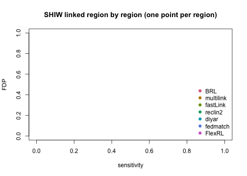

``` r
library(FlexRL)
#> If you are happy with FlexRL, please cite us! If you are unhappy, please cite us anyway (and feel free to complain as well).
```

`FlexRL` is a package proposing flexible probabilistic **R**ecord **L**inkage with diagnostic tools for downstream inference on linked data. The record linkage algorithm `StEM()` uses a **St**ochastic **E**xpectation **M**aximisation approach to combine 2 data sources and outputs the set of records referring to the same entities.

More details on the [record linkage methodology](https://doi.org/10.1093/jrsssc/qlaf016); on the [false discovery proportion estimation](https://doi.org/10.1002/sim.70292); and on the potential risks of downstream inference on linked data (Robach et al., in preparation).

Several other algorithms for record linkage are available in R. The `link_with_*()` wrappers of FlexRL run them through one common interface, so that the same diagnostics and false discovery proportion (FDP) estimators apply to all of them: `link_with_FlexRL()`, `link_with_BRL()`, `link_with_fastLink()`, `link_with_multilink()`, `link_with_reclin2()`, `link_with_diyar()`, `link_with_fedmatch()`. Each wrapper takes the two encoded sources and a named list of arguments forwarded to the underlying package, and returns a list with `idxA`, `idxB` (row indices of the linked records in dataA and dataB) and `LinkScore` (the linkage scores, `NULL` when the package does not return any).

This vignette runs these wrappers on the same pipeline for:
- a regional subset of the [NLTCS](https://www.icpsr.umich.edu/web/NACDA/studies/9681/versions/V5) data (1982 and 1994 waves)
- the [SHIW](https://www.bancaditalia.it/statistiche/tematiche/indagini-famiglie-imprese/bilanci-famiglie/distribuzione-microdati/index.html) data (2012 and 2014 waves) data with and without regional blocking

## One pipeline for all the wrappers


``` r
wrapper_args <- function(method, prep_data, ...) {
  PIVs <- names(prep_data$PIVs_config)
  args <- c(...)
    switch(method,
         FlexRL    = c(list(data = prep_data),
                       args[intersect(names(args), names(formals(FlexRL::StEM)))]),
         BRL       = c(list(flds = PIVs, types = rep("bi", length(PIVs)), nIter = 1000),
                       args[intersect(names(args), c(names(formals(BRL::compareRecords)), names(formals(BRL::bipartiteGibbs))))]),
         fastLink  = c(list(varnames = PIVs, tol.em = 1e-06, threshold.match = 0.5, return.all = TRUE, n.cores = 1),
                       args[intersect(names(args), names(formals(fastLink::fastLink)))]),
         multilink = c(list(types = rep("bi", length(PIVs)), breaks = stats::setNames(as.list(rep(NA, length(PIVs))), PIVs),
                            duplicates = c(0, 0), n_iter = 1000, max_cc_size = 50),
                       args[intersect(names(args), c(names(formals(multilink::create_comparison_data)),
                                                     names(formals(multilink::reduce_comparison_data)),
                                                     names(formals(multilink::specify_prior)),
                                                     names(formals(multilink::gibbs_sampler)),
                                                     names(formals(multilink::find_bayes_estimate)),
                                                     names(formals(multilink::relabel_bayes_estimate))))]),
         reclin2   = c(list(on = PIVs, formula = stats::as.formula(paste("~", paste(PIVs, collapse = "+"))),
                            type = "mpost", add = TRUE, variable = "selected", score = "mpost", threshold = 0.5),
                       args[intersect(names(args), c(names(formals(reclin2::pair)),
                                                     names(formals(reclin2::compare_pairs)),
                                                     names(formals(reclin2::problink_em)),
                                                     names(formals(stats::predict)),
                                                     names(formals(reclin2::select_threshold))))]),
         diyar     = c(list(probabilistic = TRUE, return_weights = TRUE),
                       args[intersect(names(args), c(names(formals(diyar::prob_score_range)),
                                                     names(formals(diyar::links_wf_probabilistic))))]),
         fedmatch  = c(list(by = PIVs, match_type = "multivar", unique_key_1 = "unique_key_A",
                            unique_key_2 = "unique_key_B", multivar_settings = fedmatch::build_multivar_settings(
                              compare_type = rep("indicator", length(PIVs)),
                              wgts = rep(1 / length(PIVs), length(PIVs)))),
                       args[intersect(names(args), names(formals(fedmatch::merge_plus)))])
  )
}

run_wrapper <- function(method, prep_data, arguments) {
  PIVs <- names(prep_data$PIVs_config)
  link_with <- get(paste0("link_with_", method), envir = asNamespace("FlexRL"))
  if (method == "diyar") {
    prep_data$encodedA <- prep_data$encodedA[, c(PIVs, "local_id", "source")]
    prep_data$encodedB <- prep_data$encodedB[, c(PIVs, "local_id", "source")]
  }
  tryCatch(link_with(prep_data$encodedA, prep_data$encodedB, arguments),
           error = function(e) {
             if (grepl("cannot allocate|memory|bad_alloc|too large|long vectors", conditionMessage(e), ignore.case = TRUE)) {
               message(method, ": memory error (", conditionMessage(e), "), results reported as NA")
               return(NULL)
             }
             stop(e)
           })
}

evaluate_linkage <- function(fit, true_pairs, threshold = 0.5) {
  if (is.null(fit)) return(rep(NA_real_, 5))
  delta_result <- data.frame(idxA = fit$idxA, idxB = fit$idxB)
  if (!is.null(fit$LinkScore)) delta_result <- delta_result[fit$LinkScore > threshold, , drop = FALSE]
  linked_pairs   <- do.call(paste, c(delta_result, list(sep = "_")))
  true_positive  <- length(intersect(linked_pairs, true_pairs))
  false_positive <- length(setdiff(linked_pairs, true_pairs))
  false_negative <- length(setdiff(true_pairs, linked_pairs))
  c(TP = true_positive, FP = false_positive, FN = false_negative,
    sensitivity = true_positive / (true_positive + false_negative),
    FDP = false_positive / (true_positive + false_positive))
}

results_rows <- c("TP", "FP", "FN", "sensitivity", "FDP",
                  "est. FDP score", "est. FDP score \u22C6",
                  "est. FDP synth \u22C6", "max SMD", "min support IoU", 
                  "max MMD")

run_all_wrappers <- function(prep_data, PIVs_type, methods, FDP_estimation = TRUE,
                             maxIter4CV = 3, n_repeats = 5, ...) {
  args <- list(...)
  op <- options()
  on.exit(options(op))
  PIVs <- names(prep_data$PIVs_config)
  true_pairs <- do.call(paste, c(prep_data$true_pairs, list(sep = "_")))
  df_results <- data.frame(matrix(NA, nrow = length(results_rows), ncol = 0))
  rownames(df_results) <- results_rows
  naive_fit <- naive_linkage(PIVs = PIVs, encodedA = prep_data$encodedA, encodedB = prep_data$encodedB)
  df_results[1:5, "Naive"] <- evaluate_linkage(list(idxA = naive_fit[[1]], idxB = naive_fit[[2]]), true_pairs)
  for (method in methods) {
    arguments <- wrapper_args(method, prep_data, args)
    fit <- run_wrapper(method, prep_data, arguments)
    df_results[1:5, method] <- evaluate_linkage(fit, true_pairs)
    if (is.null(fit) || length(fit$idxA) == 0) next
    encodedA <- prep_data$encodedA
    encodedB <- prep_data$encodedB
    if (method == "diyar") {
      encodedA <- encodedA[, c(PIVs, "local_id", "source")]
      encodedB <- encodedB[, c(PIVs, "local_id", "source")]
    }
    diag <- do.call(RL_diagnostics, c(list(fit, encodedA, encodedB, PIVs, PIVs_type, PIVs,
                                           true_pairs = prep_data$true_pairs, FDP_estimation = FDP_estimation,
                                           RL_method = method, data = prep_data, maxIter4CV = maxIter4CV, n_repeats = n_repeats),
                                      arguments))
    if (FDP_estimation) {
      df_results[6, method] <- diag$FDP_measures$curve$RL_FDP_score[1]
      df_results[7, method] <- diag$FDP_measures$curve$augmRL_FDP_score[1]
      df_results[8, method] <- diag$FDP_measures$curve$augmRL_FDP_synth[1]
    }
    df_results[9,  method] <- max(diag$discrepancy_measures[1, grep("smd", names(diag$discrepancy_measures))])
    df_results[10, method] <- min(diag$discrepancy_measures[1, grep("iou", names(diag$discrepancy_measures))])
    df_results[11, method] <- max(diag$discrepancy_measures[1, grep("mmd", names(diag$discrepancy_measures))])
  }
  df_results
}

show_results <- function(df_results) {
  cat("Record Linkage\n");      print(df_results[1:5, ],  2)
  cat("\nFDP estimation\n");    print(df_results[6:8, ],  2)
  cat("\nLinked divergence\n"); print(df_results[9:11, ], 2)
}

methods <- c("FlexRL", "BRL", "multilink", "fastLink", "reclin2", "diyar", "fedmatch")
```

We will fill a table of results throughout the vignette, gathering for each record linkage method: linkage performance, data quality diagnostics: FDP estimation, measures of divergence of linked data from sources.

## Regional subset of the NLTCS data

We use 4 **P**artially **I**dentifying **V**ariable**s** to link the records: sex, birth month and birth year are `stable`, the state code may change over time but we cannot model these changes so we set this variable as `flexible`.


``` r
df1982 <- read.csv("ex-reg-NLTCS-82.csv", row.names = 1)
df1994 <- read.csv("ex-reg-NLTCS-94.csv", row.names = 1)

PIVs_config <- list(
  SEX       = list(dynamics = "stable",   bound_mistakes = c(0.10, 0.10), fix_mistakes = c(NA, NA)),
  DOB_MONTH = list(dynamics = "stable",   bound_mistakes = c(0.10, 0.10), fix_mistakes = c(NA, NA)),
  DOB_YEAR  = list(dynamics = "stable",   bound_mistakes = c(0.10, 0.10), fix_mistakes = c(NA, NA)),
  STATE     = list(dynamics = "flexible", bound_mistakes = c(NA, NA),     fix_mistakes = c(NA, NA)))
PIVs_type <- list(SEX = FALSE, DOB_MONTH = TRUE, DOB_YEAR = TRUE, STATE = FALSE)
```

`prepare_data()` removes the records for which the linking variables are outside of the common support, checks that PIVs are not strongly associated with each other (which may degrade record linkage performance), maps PIV values to natural numbers and encodes missing values as 0. The StEM algorithm denotes the smallest source as `A` and the largest as `B`. The true pairs are known from the identifier ID (they are indexed on the rows of `encodedA` and `encodedB`, after the support restriction).


``` r
prep_data <- prepare_data(df1982, df1994, "1982", "1994", PIVs_config, same_mistakes = TRUE, uniq_id = "ID")
#> '1982' is the larger source, saved as B; '1994' saved as A.

c(n_A = nrow(prep_data$encodedA), n_B = nrow(prep_data$encodedB), n_links = nrow(prep_data$true_pairs))
#>     n_A     n_B n_links 
#>     491     901     332

prep_data$n_values
#>       SEX DOB_MONTH  DOB_YEAR     STATE 
#>         2        12        28         9
```


``` r
df_results_NLTCS <- run_all_wrappers(prep_data, PIVs_type, methods)
```


``` r
show_results(df_results_NLTCS)
#> Record Linkage
#>              Naive FlexRL     BRL multilink fastLink reclin2   diyar fedmatch
#> TP          320.00 218.00 211.000    221.00   265.00  320.00 126.000   266.00
#> FP          163.00  34.00  13.000     26.00    78.00  163.00   5.000   223.00
#> FN           12.00 114.00 121.000    111.00    67.00   12.00 206.000    66.00
#> sensitivity   0.96   0.66   0.636      0.67     0.80    0.96   0.380     0.80
#> FDP           0.34   0.13   0.058      0.11     0.23    0.34   0.038     0.46
#> 
#> FDP estimation
#>                  Naive FlexRL   BRL multilink fastLink reclin2 diyar fedmatch
#> est. FDP score      NA   0.16 0.152       NaN     0.30    0.49   NaN    0.075
#> est. FDP score ⋆    NA   0.17 0.165       NaN     0.31    0.25   NaN    0.073
#> est. FDP synth ⋆    NA   0.11 0.093      0.13     0.40    0.32 0.039      NaN
#> 
#> Linked divergence
#>                 Naive FlexRL   BRL multilink fastLink reclin2 diyar fedmatch
#> max SMD            NA  0.183 0.155     0.133    0.141   0.177  0.43   0.1125
#> min support IoU    NA  0.875 0.875     0.875    0.875   0.875  0.88   0.8750
#> max MMD            NA  0.016 0.014     0.012    0.016   0.025  0.03   0.0093
```

## Full SHIW data


We use 5 **P**artially **I**dentifying **V**ariable**s** to link the records: birth year, sex, birth region  are `stable`, marital status and occupation are `flexible`. The occupation is built by combining the working status and the branch of activity together as one PIV. We create such variable because the high association level between working status and branch of activity may damage the record linkage performance.


``` r
df2012 <- comp[comp$ANNO == 2012, var_of_interest]
df2014 <- comp[comp$ANNO == 2014, var_of_interest]
df2012 <- df2012[!df2012$ID %in% df2012$ID[duplicated(df2012$ID)], ]
df2014 <- df2014[!df2014$ID %in% df2014$ID[duplicated(df2014$ID)], ]

PIVs_config <- list(
  ANASC          = list(dynamics = "stable", bound_mistakes = c(0.10, 0.10), fix_mistakes = c(NA, NA)),
  SESSO          = list(dynamics = "stable", bound_mistakes = c(0.10, 0.10), fix_mistakes = c(NA, NA)),
  STACIV         = list(dynamics = "flexible", bound_mistakes = c(NA, NA), fix_mistakes = c(NA, NA)),
  NASCREG        = list(dynamics = "stable", bound_mistakes = c(0.10, 0.10), fix_mistakes = c(NA, NA)),
  SETTP11QUALP10 = list(dynamics = "flexible", bound_mistakes = c(NA, NA), fix_mistakes = c(NA, NA)))
PIVs_type <- list(ANASCI = TRUE, SESSO = FALSE, STACIV = FALSE, NASCREG = FALSE, SETTP11QUALP10 = FALSE)

PIVs_config_full <- c(PIVs_config,
  list(IREG = list(dynamics = "flexible", bound_mistakes = c(NA, NA), fix_mistakes = c(NA, NA))))
PIVs_type_full <- c(PIVs_type, IREG = FALSE)

prep_data_full <- prepare_data(df2012, df2014, "2012", "2014", PIVs_config_full, same_mistakes = TRUE, uniq_id = "ID")
#> '2012' is the larger source, saved as B; '2014' saved as A.
true_pairs_full <- do.call(paste, c(prep_data_full$true_pairs, list(sep = "_")))
```


``` r
df_results_full <- data.frame(matrix(NA, nrow = 6, ncol = 0))
rownames(df_results_full) <- c("TP", "FP", "FN", "sensitivity", "FDP", "minutes")
for (method in methods) {
  t0 <- Sys.time()           
  args <- list(StEM_iter = 15, StEM_burnin = 7, gibbs_iter = 15, gibbs_burnin = 7, 
               n_post_sample = 100, n_iter = 500, max_cc_size = 50, n.cores = 4)
  fit <- run_wrapper(method, prep_data_full, wrapper_args(method, prep_data_full, args))
  df_results_full[1:5, method] <- evaluate_linkage(fit, true_pairs_full)
  df_results_full[6, method] <- if (is.null(fit)) NA else round(as.numeric(Sys.time() - t0, units = "mins"))
}

# on Apple M1 Max ARM chip, 8-core CPU, 32 GB of memory
# fastLink: memory error / multilink: memory error / BRL: memory error / diyar: memory error

# we reduce the number of iterations of FlexRL to gain in computational time
```


``` r
cat("Record Linkage performance on large files")
#> Record Linkage performance on large files
round(df_results_full,2)
#>              FlexRL BRL multilink               fastLink reclin2 diyar fedmatch
#> TP          4478.00  NA        NA  5027.0000000000000000      NA    NA  5057.00
#> FP          7919.00  NA        NA 11209.0000000000000000      NA    NA 14154.00
#> FN          6090.00  NA        NA  5541.0000000000000000      NA    NA  5511.00
#> sensitivity    0.42  NA        NA     0.4800000000000000      NA    NA     0.48
#> FDP            0.64  NA        NA     0.6899999999999999      NA    NA     0.74
#> minutes      181.00  NA        NA     8.0000000000000000      NA    NA     6.00
```

Note that when methods do not ensure the one-to-one assignment constraint the number of False Positives may be high due to many-to-many falsely linked pairs of records.

## Loop over the regions of the SHIW data with blocking

Blocking on the region code `IREG` splits the task into 20 smaller ones. Within a region, `IREG` is constant and the linkage uses the 4 other PIVs. Region 2 is the regional subset used above.


``` r
regions <- sort(unique(c(df2012$IREG, df2014$IREG)))
results_IREG <- list()
for (r in regions) {
  block2012 <- df2012[df2012$IREG == r, ]
  block2014 <- df2014[df2014$IREG == r, ]
  prep_data_r <- prepare_data(block2012, block2014, "2012", "2014", PIVs_config, same_mistakes = TRUE, uniq_id = "ID")
  true_pairs_r <- do.call(paste, c(prep_data_r$true_pairs, list(sep = "_")))
  for (method in methods) {
    t0 <- Sys.time()
    fit <- run_wrapper(method, prep_data_r, wrapper_args(method, prep_data_r))
    results_IREG[[length(results_IREG) + 1]] <- data.frame(
      IREG = r, n_A = nrow(prep_data_r$encodedA),
      n_B = nrow(prep_data_r$encodedB), n_links = length(true_pairs_r),
      method = method, sprintf("%.2f",t(evaluate_linkage(fit, true_pairs_r))),
      seconds = round(as.numeric(Sys.time() - t0, units = "secs")))
  }
}

results_IREG <- do.call(rbind, results_IREG)
```


``` r
cat("Record Linkage on regional subsets")
#> Record Linkage on regional subsets
results_IREG
#>     IREG  n_A  n_B n_links    method
#> 1      1 1360 1495     645    FlexRL
#> 2      1 1360 1495     645    FlexRL
#> 3      1 1360 1495     645    FlexRL
#> 4      1 1360 1495     645    FlexRL
#> 5      1 1360 1495     645    FlexRL
#> 6      1 1360 1495     645       BRL
#> 7      1 1360 1495     645       BRL
#> 8      1 1360 1495     645       BRL
#> 9      1 1360 1495     645       BRL
#> 10     1 1360 1495     645       BRL
#> 11     1 1360 1495     645 multilink
#> 12     1 1360 1495     645 multilink
#> 13     1 1360 1495     645 multilink
#> 14     1 1360 1495     645 multilink
#> 15     1 1360 1495     645 multilink
#> 16     1 1360 1495     645  fastLink
#> 17     1 1360 1495     645  fastLink
#> 18     1 1360 1495     645  fastLink
#> 19     1 1360 1495     645  fastLink
#> 20     1 1360 1495     645  fastLink
#> 21     1 1360 1495     645   reclin2
#> 22     1 1360 1495     645   reclin2
#> 23     1 1360 1495     645   reclin2
#> 24     1 1360 1495     645   reclin2
#> 25     1 1360 1495     645   reclin2
#> 26     1 1360 1495     645     diyar
#> 27     1 1360 1495     645     diyar
#> 28     1 1360 1495     645     diyar
#> 29     1 1360 1495     645     diyar
#> 30     1 1360 1495     645     diyar
#> 31     1 1360 1495     645  fedmatch
#> 32     1 1360 1495     645  fedmatch
#> 33     1 1360 1495     645  fedmatch
#> 34     1 1360 1495     645  fedmatch
#> 35     1 1360 1495     645  fedmatch
#> 36     2   44   53      24    FlexRL
#> 37     2   44   53      24    FlexRL
#> 38     2   44   53      24    FlexRL
#> 39     2   44   53      24    FlexRL
#> 40     2   44   53      24    FlexRL
#> 41     2   44   53      24       BRL
#> 42     2   44   53      24       BRL
#> 43     2   44   53      24       BRL
#> 44     2   44   53      24       BRL
#> 45     2   44   53      24       BRL
#> 46     2   44   53      24 multilink
#> 47     2   44   53      24 multilink
#> 48     2   44   53      24 multilink
#> 49     2   44   53      24 multilink
#> 50     2   44   53      24 multilink
#> 51     2   44   53      24  fastLink
#> 52     2   44   53      24  fastLink
#> 53     2   44   53      24  fastLink
#> 54     2   44   53      24  fastLink
#> 55     2   44   53      24  fastLink
#> 56     2   44   53      24   reclin2
#> 57     2   44   53      24   reclin2
#> 58     2   44   53      24   reclin2
#> 59     2   44   53      24   reclin2
#> 60     2   44   53      24   reclin2
#> 61     2   44   53      24     diyar
#> 62     2   44   53      24     diyar
#> 63     2   44   53      24     diyar
#> 64     2   44   53      24     diyar
#> 65     2   44   53      24     diyar
#> 66     2   44   53      24  fedmatch
#> 67     2   44   53      24  fedmatch
#> 68     2   44   53      24  fedmatch
#> 69     2   44   53      24  fedmatch
#> 70     2   44   53      24  fedmatch
#> 71     3 2103 2140     918    FlexRL
#> 72     3 2103 2140     918    FlexRL
#> 73     3 2103 2140     918    FlexRL
#> 74     3 2103 2140     918    FlexRL
#> 75     3 2103 2140     918    FlexRL
#> 76     3 2103 2140     918       BRL
#> 77     3 2103 2140     918       BRL
#> 78     3 2103 2140     918       BRL
#> 79     3 2103 2140     918       BRL
#> 80     3 2103 2140     918       BRL
#> 81     3 2103 2140     918 multilink
#> 82     3 2103 2140     918 multilink
#> 83     3 2103 2140     918 multilink
#> 84     3 2103 2140     918 multilink
#> 85     3 2103 2140     918 multilink
#> 86     3 2103 2140     918  fastLink
#> 87     3 2103 2140     918  fastLink
#> 88     3 2103 2140     918  fastLink
#> 89     3 2103 2140     918  fastLink
#> 90     3 2103 2140     918  fastLink
#> 91     3 2103 2140     918   reclin2
#> 92     3 2103 2140     918   reclin2
#> 93     3 2103 2140     918   reclin2
#> 94     3 2103 2140     918   reclin2
#> 95     3 2103 2140     918   reclin2
#> 96     3 2103 2140     918     diyar
#> 97     3 2103 2140     918     diyar
#> 98     3 2103 2140     918     diyar
#> 99     3 2103 2140     918     diyar
#> 100    3 2103 2140     918     diyar
#> 101    3 2103 2140     918  fedmatch
#> 102    3 2103 2140     918  fedmatch
#> 103    3 2103 2140     918  fedmatch
#> 104    3 2103 2140     918  fedmatch
#> 105    3 2103 2140     918  fedmatch
#> 106    4  437  541     229    FlexRL
#> 107    4  437  541     229    FlexRL
#> 108    4  437  541     229    FlexRL
#> 109    4  437  541     229    FlexRL
#> 110    4  437  541     229    FlexRL
#> 111    4  437  541     229       BRL
#> 112    4  437  541     229       BRL
#> 113    4  437  541     229       BRL
#> 114    4  437  541     229       BRL
#> 115    4  437  541     229       BRL
#> 116    4  437  541     229 multilink
#> 117    4  437  541     229 multilink
#> 118    4  437  541     229 multilink
#> 119    4  437  541     229 multilink
#> 120    4  437  541     229 multilink
#> 121    4  437  541     229  fastLink
#> 122    4  437  541     229  fastLink
#> 123    4  437  541     229  fastLink
#> 124    4  437  541     229  fastLink
#> 125    4  437  541     229  fastLink
#> 126    4  437  541     229   reclin2
#> 127    4  437  541     229   reclin2
#> 128    4  437  541     229   reclin2
#> 129    4  437  541     229   reclin2
#> 130    4  437  541     229   reclin2
#> 131    4  437  541     229     diyar
#> 132    4  437  541     229     diyar
#> 133    4  437  541     229     diyar
#> 134    4  437  541     229     diyar
#> 135    4  437  541     229     diyar
#> 136    4  437  541     229  fedmatch
#> 137    4  437  541     229  fedmatch
#> 138    4  437  541     229  fedmatch
#> 139    4  437  541     229  fedmatch
#> 140    4  437  541     229  fedmatch
#> 141    5 1181 1319     750    FlexRL
#> 142    5 1181 1319     750    FlexRL
#> 143    5 1181 1319     750    FlexRL
#> 144    5 1181 1319     750    FlexRL
#> 145    5 1181 1319     750    FlexRL
#> 146    5 1181 1319     750       BRL
#> 147    5 1181 1319     750       BRL
#> 148    5 1181 1319     750       BRL
#> 149    5 1181 1319     750       BRL
#> 150    5 1181 1319     750       BRL
#> 151    5 1181 1319     750 multilink
#> 152    5 1181 1319     750 multilink
#> 153    5 1181 1319     750 multilink
#> 154    5 1181 1319     750 multilink
#> 155    5 1181 1319     750 multilink
#> 156    5 1181 1319     750  fastLink
#> 157    5 1181 1319     750  fastLink
#> 158    5 1181 1319     750  fastLink
#> 159    5 1181 1319     750  fastLink
#> 160    5 1181 1319     750  fastLink
#> 161    5 1181 1319     750   reclin2
#> 162    5 1181 1319     750   reclin2
#> 163    5 1181 1319     750   reclin2
#> 164    5 1181 1319     750   reclin2
#> 165    5 1181 1319     750   reclin2
#> 166    5 1181 1319     750     diyar
#> 167    5 1181 1319     750     diyar
#> 168    5 1181 1319     750     diyar
#> 169    5 1181 1319     750     diyar
#> 170    5 1181 1319     750     diyar
#> 171    5 1181 1319     750  fedmatch
#> 172    5 1181 1319     750  fedmatch
#> 173    5 1181 1319     750  fedmatch
#> 174    5 1181 1319     750  fedmatch
#> 175    5 1181 1319     750  fedmatch
#> 176    6  459  513     238    FlexRL
#> 177    6  459  513     238    FlexRL
#> 178    6  459  513     238    FlexRL
#> 179    6  459  513     238    FlexRL
#> 180    6  459  513     238    FlexRL
#> 181    6  459  513     238       BRL
#> 182    6  459  513     238       BRL
#> 183    6  459  513     238       BRL
#> 184    6  459  513     238       BRL
#> 185    6  459  513     238       BRL
#> 186    6  459  513     238 multilink
#> 187    6  459  513     238 multilink
#> 188    6  459  513     238 multilink
#> 189    6  459  513     238 multilink
#> 190    6  459  513     238 multilink
#> 191    6  459  513     238  fastLink
#> 192    6  459  513     238  fastLink
#> 193    6  459  513     238  fastLink
#> 194    6  459  513     238  fastLink
#> 195    6  459  513     238  fastLink
#> 196    6  459  513     238   reclin2
#> 197    6  459  513     238   reclin2
#> 198    6  459  513     238   reclin2
#> 199    6  459  513     238   reclin2
#> 200    6  459  513     238   reclin2
#> 201    6  459  513     238     diyar
#> 202    6  459  513     238     diyar
#> 203    6  459  513     238     diyar
#> 204    6  459  513     238     diyar
#> 205    6  459  513     238     diyar
#> 206    6  459  513     238  fedmatch
#> 207    6  459  513     238  fedmatch
#> 208    6  459  513     238  fedmatch
#> 209    6  459  513     238  fedmatch
#> 210    6  459  513     238  fedmatch
#> 211    7  670  710     321    FlexRL
#> 212    7  670  710     321    FlexRL
#> 213    7  670  710     321    FlexRL
#> 214    7  670  710     321    FlexRL
#> 215    7  670  710     321    FlexRL
#> 216    7  670  710     321       BRL
#> 217    7  670  710     321       BRL
#> 218    7  670  710     321       BRL
#> 219    7  670  710     321       BRL
#> 220    7  670  710     321       BRL
#> 221    7  670  710     321 multilink
#> 222    7  670  710     321 multilink
#> 223    7  670  710     321 multilink
#> 224    7  670  710     321 multilink
#> 225    7  670  710     321 multilink
#> 226    7  670  710     321  fastLink
#> 227    7  670  710     321  fastLink
#> 228    7  670  710     321  fastLink
#> 229    7  670  710     321  fastLink
#> 230    7  670  710     321  fastLink
#> 231    7  670  710     321   reclin2
#> 232    7  670  710     321   reclin2
#> 233    7  670  710     321   reclin2
#> 234    7  670  710     321   reclin2
#> 235    7  670  710     321   reclin2
#> 236    7  670  710     321     diyar
#> 237    7  670  710     321     diyar
#> 238    7  670  710     321     diyar
#> 239    7  670  710     321     diyar
#> 240    7  670  710     321     diyar
#> 241    7  670  710     321  fedmatch
#> 242    7  670  710     321  fedmatch
#> 243    7  670  710     321  fedmatch
#> 244    7  670  710     321  fedmatch
#> 245    7  670  710     321  fedmatch
#> 246    8 1479 1524     898    FlexRL
#> 247    8 1479 1524     898    FlexRL
#> 248    8 1479 1524     898    FlexRL
#> 249    8 1479 1524     898    FlexRL
#> 250    8 1479 1524     898    FlexRL
#> 251    8 1479 1524     898       BRL
#> 252    8 1479 1524     898       BRL
#> 253    8 1479 1524     898       BRL
#> 254    8 1479 1524     898       BRL
#> 255    8 1479 1524     898       BRL
#> 256    8 1479 1524     898 multilink
#> 257    8 1479 1524     898 multilink
#> 258    8 1479 1524     898 multilink
#> 259    8 1479 1524     898 multilink
#> 260    8 1479 1524     898 multilink
#> 261    8 1479 1524     898  fastLink
#> 262    8 1479 1524     898  fastLink
#> 263    8 1479 1524     898  fastLink
#> 264    8 1479 1524     898  fastLink
#> 265    8 1479 1524     898  fastLink
#> 266    8 1479 1524     898   reclin2
#> 267    8 1479 1524     898   reclin2
#> 268    8 1479 1524     898   reclin2
#> 269    8 1479 1524     898   reclin2
#> 270    8 1479 1524     898   reclin2
#> 271    8 1479 1524     898     diyar
#> 272    8 1479 1524     898     diyar
#> 273    8 1479 1524     898     diyar
#> 274    8 1479 1524     898     diyar
#> 275    8 1479 1524     898     diyar
#> 276    8 1479 1524     898  fedmatch
#> 277    8 1479 1524     898  fedmatch
#> 278    8 1479 1524     898  fedmatch
#> 279    8 1479 1524     898  fedmatch
#> 280    8 1479 1524     898  fedmatch
#> 281    9 1363 1500     711    FlexRL
#> 282    9 1363 1500     711    FlexRL
#> 283    9 1363 1500     711    FlexRL
#> 284    9 1363 1500     711    FlexRL
#> 285    9 1363 1500     711    FlexRL
#> 286    9 1363 1500     711       BRL
#> 287    9 1363 1500     711       BRL
#> 288    9 1363 1500     711       BRL
#> 289    9 1363 1500     711       BRL
#> 290    9 1363 1500     711       BRL
#> 291    9 1363 1500     711 multilink
#> 292    9 1363 1500     711 multilink
#> 293    9 1363 1500     711 multilink
#> 294    9 1363 1500     711 multilink
#> 295    9 1363 1500     711 multilink
#> 296    9 1363 1500     711  fastLink
#> 297    9 1363 1500     711  fastLink
#> 298    9 1363 1500     711  fastLink
#> 299    9 1363 1500     711  fastLink
#> 300    9 1363 1500     711  fastLink
#> 301    9 1363 1500     711   reclin2
#> 302    9 1363 1500     711   reclin2
#> 303    9 1363 1500     711   reclin2
#> 304    9 1363 1500     711   reclin2
#> 305    9 1363 1500     711   reclin2
#> 306    9 1363 1500     711     diyar
#> 307    9 1363 1500     711     diyar
#> 308    9 1363 1500     711     diyar
#> 309    9 1363 1500     711     diyar
#> 310    9 1363 1500     711     diyar
#> 311    9 1363 1500     711  fedmatch
#> 312    9 1363 1500     711  fedmatch
#> 313    9 1363 1500     711  fedmatch
#> 314    9 1363 1500     711  fedmatch
#> 315    9 1363 1500     711  fedmatch
#> 316   10  658  687     384    FlexRL
#> 317   10  658  687     384    FlexRL
#> 318   10  658  687     384    FlexRL
#> 319   10  658  687     384    FlexRL
#> 320   10  658  687     384    FlexRL
#> 321   10  658  687     384       BRL
#> 322   10  658  687     384       BRL
#> 323   10  658  687     384       BRL
#> 324   10  658  687     384       BRL
#> 325   10  658  687     384       BRL
#> 326   10  658  687     384 multilink
#> 327   10  658  687     384 multilink
#> 328   10  658  687     384 multilink
#> 329   10  658  687     384 multilink
#> 330   10  658  687     384 multilink
#> 331   10  658  687     384  fastLink
#> 332   10  658  687     384  fastLink
#> 333   10  658  687     384  fastLink
#> 334   10  658  687     384  fastLink
#> 335   10  658  687     384  fastLink
#> 336   10  658  687     384   reclin2
#> 337   10  658  687     384   reclin2
#> 338   10  658  687     384   reclin2
#> 339   10  658  687     384   reclin2
#> 340   10  658  687     384   reclin2
#> 341   10  658  687     384     diyar
#> 342   10  658  687     384     diyar
#> 343   10  658  687     384     diyar
#> 344   10  658  687     384     diyar
#> 345   10  658  687     384     diyar
#> 346   10  658  687     384  fedmatch
#> 347   10  658  687     384  fedmatch
#> 348   10  658  687     384  fedmatch
#> 349   10  658  687     384  fedmatch
#> 350   10  658  687     384  fedmatch
#> 351   11  762  872     486    FlexRL
#> 352   11  762  872     486    FlexRL
#> 353   11  762  872     486    FlexRL
#> 354   11  762  872     486    FlexRL
#> 355   11  762  872     486    FlexRL
#> 356   11  762  872     486       BRL
#> 357   11  762  872     486       BRL
#> 358   11  762  872     486       BRL
#> 359   11  762  872     486       BRL
#> 360   11  762  872     486       BRL
#> 361   11  762  872     486 multilink
#> 362   11  762  872     486 multilink
#> 363   11  762  872     486 multilink
#> 364   11  762  872     486 multilink
#> 365   11  762  872     486 multilink
#> 366   11  762  872     486  fastLink
#> 367   11  762  872     486  fastLink
#> 368   11  762  872     486  fastLink
#> 369   11  762  872     486  fastLink
#> 370   11  762  872     486  fastLink
#> 371   11  762  872     486   reclin2
#> 372   11  762  872     486   reclin2
#> 373   11  762  872     486   reclin2
#> 374   11  762  872     486   reclin2
#> 375   11  762  872     486   reclin2
#> 376   11  762  872     486     diyar
#> 377   11  762  872     486     diyar
#> 378   11  762  872     486     diyar
#> 379   11  762  872     486     diyar
#> 380   11  762  872     486     diyar
#> 381   11  762  872     486  fedmatch
#> 382   11  762  872     486  fedmatch
#> 383   11  762  872     486  fedmatch
#> 384   11  762  872     486  fedmatch
#> 385   11  762  872     486  fedmatch
#> 386   12  977 1142     455    FlexRL
#> 387   12  977 1142     455    FlexRL
#> 388   12  977 1142     455    FlexRL
#> 389   12  977 1142     455    FlexRL
#> 390   12  977 1142     455    FlexRL
#> 391   12  977 1142     455       BRL
#> 392   12  977 1142     455       BRL
#> 393   12  977 1142     455       BRL
#> 394   12  977 1142     455       BRL
#> 395   12  977 1142     455       BRL
#> 396   12  977 1142     455 multilink
#> 397   12  977 1142     455 multilink
#> 398   12  977 1142     455 multilink
#> 399   12  977 1142     455 multilink
#> 400   12  977 1142     455 multilink
#> 401   12  977 1142     455  fastLink
#> 402   12  977 1142     455  fastLink
#> 403   12  977 1142     455  fastLink
#> 404   12  977 1142     455  fastLink
#> 405   12  977 1142     455  fastLink
#> 406   12  977 1142     455   reclin2
#> 407   12  977 1142     455   reclin2
#> 408   12  977 1142     455   reclin2
#> 409   12  977 1142     455   reclin2
#> 410   12  977 1142     455   reclin2
#> 411   12  977 1142     455     diyar
#> 412   12  977 1142     455     diyar
#> 413   12  977 1142     455     diyar
#> 414   12  977 1142     455     diyar
#> 415   12  977 1142     455     diyar
#> 416   12  977 1142     455  fedmatch
#> 417   12  977 1142     455  fedmatch
#> 418   12  977 1142     455  fedmatch
#> 419   12  977 1142     455  fedmatch
#> 420   12  977 1142     455  fedmatch
#> 421   13  454  493     311    FlexRL
#> 422   13  454  493     311    FlexRL
#> 423   13  454  493     311    FlexRL
#> 424   13  454  493     311    FlexRL
#> 425   13  454  493     311    FlexRL
#> 426   13  454  493     311       BRL
#> 427   13  454  493     311       BRL
#> 428   13  454  493     311       BRL
#> 429   13  454  493     311       BRL
#> 430   13  454  493     311       BRL
#> 431   13  454  493     311 multilink
#> 432   13  454  493     311 multilink
#> 433   13  454  493     311 multilink
#> 434   13  454  493     311 multilink
#> 435   13  454  493     311 multilink
#> 436   13  454  493     311  fastLink
#> 437   13  454  493     311  fastLink
#> 438   13  454  493     311  fastLink
#> 439   13  454  493     311  fastLink
#> 440   13  454  493     311  fastLink
#> 441   13  454  493     311   reclin2
#> 442   13  454  493     311   reclin2
#> 443   13  454  493     311   reclin2
#> 444   13  454  493     311   reclin2
#> 445   13  454  493     311   reclin2
#> 446   13  454  493     311     diyar
#> 447   13  454  493     311     diyar
#> 448   13  454  493     311     diyar
#> 449   13  454  493     311     diyar
#> 450   13  454  493     311     diyar
#> 451   13  454  493     311  fedmatch
#> 452   13  454  493     311  fedmatch
#> 453   13  454  493     311  fedmatch
#> 454   13  454  493     311  fedmatch
#> 455   13  454  493     311  fedmatch
#> 456   14  280  299     183    FlexRL
#> 457   14  280  299     183    FlexRL
#> 458   14  280  299     183    FlexRL
#> 459   14  280  299     183    FlexRL
#> 460   14  280  299     183    FlexRL
#> 461   14  280  299     183       BRL
#> 462   14  280  299     183       BRL
#> 463   14  280  299     183       BRL
#> 464   14  280  299     183       BRL
#> 465   14  280  299     183       BRL
#> 466   14  280  299     183 multilink
#> 467   14  280  299     183 multilink
#> 468   14  280  299     183 multilink
#> 469   14  280  299     183 multilink
#> 470   14  280  299     183 multilink
#> 471   14  280  299     183  fastLink
#> 472   14  280  299     183  fastLink
#> 473   14  280  299     183  fastLink
#> 474   14  280  299     183  fastLink
#> 475   14  280  299     183  fastLink
#> 476   14  280  299     183   reclin2
#> 477   14  280  299     183   reclin2
#> 478   14  280  299     183   reclin2
#> 479   14  280  299     183   reclin2
#> 480   14  280  299     183   reclin2
#> 481   14  280  299     183     diyar
#> 482   14  280  299     183     diyar
#> 483   14  280  299     183     diyar
#> 484   14  280  299     183     diyar
#> 485   14  280  299     183     diyar
#> 486   14  280  299     183  fedmatch
#> 487   14  280  299     183  fedmatch
#> 488   14  280  299     183  fedmatch
#> 489   14  280  299     183  fedmatch
#> 490   14  280  299     183  fedmatch
#> 491   15 1939 2160    1069    FlexRL
#> 492   15 1939 2160    1069    FlexRL
#> 493   15 1939 2160    1069    FlexRL
#> 494   15 1939 2160    1069    FlexRL
#> 495   15 1939 2160    1069    FlexRL
#> 496   15 1939 2160    1069       BRL
#> 497   15 1939 2160    1069       BRL
#> 498   15 1939 2160    1069       BRL
#> 499   15 1939 2160    1069       BRL
#> 500   15 1939 2160    1069       BRL
#> 501   15 1939 2160    1069 multilink
#> 502   15 1939 2160    1069 multilink
#> 503   15 1939 2160    1069 multilink
#> 504   15 1939 2160    1069 multilink
#> 505   15 1939 2160    1069 multilink
#> 506   15 1939 2160    1069  fastLink
#> 507   15 1939 2160    1069  fastLink
#> 508   15 1939 2160    1069  fastLink
#> 509   15 1939 2160    1069  fastLink
#> 510   15 1939 2160    1069  fastLink
#> 511   15 1939 2160    1069   reclin2
#> 512   15 1939 2160    1069   reclin2
#> 513   15 1939 2160    1069   reclin2
#> 514   15 1939 2160    1069   reclin2
#> 515   15 1939 2160    1069   reclin2
#> 516   15 1939 2160    1069     diyar
#> 517   15 1939 2160    1069     diyar
#> 518   15 1939 2160    1069     diyar
#> 519   15 1939 2160    1069     diyar
#> 520   15 1939 2160    1069     diyar
#> 521   15 1939 2160    1069  fedmatch
#> 522   15 1939 2160    1069  fedmatch
#> 523   15 1939 2160    1069  fedmatch
#> 524   15 1939 2160    1069  fedmatch
#> 525   15 1939 2160    1069  fedmatch
#> 526   16 1130 1354     683    FlexRL
#> 527   16 1130 1354     683    FlexRL
#> 528   16 1130 1354     683    FlexRL
#> 529   16 1130 1354     683    FlexRL
#> 530   16 1130 1354     683    FlexRL
#> 531   16 1130 1354     683       BRL
#> 532   16 1130 1354     683       BRL
#> 533   16 1130 1354     683       BRL
#> 534   16 1130 1354     683       BRL
#> 535   16 1130 1354     683       BRL
#> 536   16 1130 1354     683 multilink
#> 537   16 1130 1354     683 multilink
#> 538   16 1130 1354     683 multilink
#> 539   16 1130 1354     683 multilink
#> 540   16 1130 1354     683 multilink
#> 541   16 1130 1354     683  fastLink
#> 542   16 1130 1354     683  fastLink
#> 543   16 1130 1354     683  fastLink
#> 544   16 1130 1354     683  fastLink
#> 545   16 1130 1354     683  fastLink
#> 546   16 1130 1354     683   reclin2
#> 547   16 1130 1354     683   reclin2
#> 548   16 1130 1354     683   reclin2
#> 549   16 1130 1354     683   reclin2
#> 550   16 1130 1354     683   reclin2
#> 551   16 1130 1354     683     diyar
#> 552   16 1130 1354     683     diyar
#> 553   16 1130 1354     683     diyar
#> 554   16 1130 1354     683     diyar
#> 555   16 1130 1354     683     diyar
#> 556   16 1130 1354     683  fedmatch
#> 557   16 1130 1354     683  fedmatch
#> 558   16 1130 1354     683  fedmatch
#> 559   16 1130 1354     683  fedmatch
#> 560   16 1130 1354     683  fedmatch
#> 561   17  264  276     193    FlexRL
#> 562   17  264  276     193    FlexRL
#> 563   17  264  276     193    FlexRL
#> 564   17  264  276     193    FlexRL
#> 565   17  264  276     193    FlexRL
#> 566   17  264  276     193       BRL
#> 567   17  264  276     193       BRL
#> 568   17  264  276     193       BRL
#> 569   17  264  276     193       BRL
#> 570   17  264  276     193       BRL
#> 571   17  264  276     193 multilink
#> 572   17  264  276     193 multilink
#> 573   17  264  276     193 multilink
#> 574   17  264  276     193 multilink
#> 575   17  264  276     193 multilink
#> 576   17  264  276     193  fastLink
#> 577   17  264  276     193  fastLink
#> 578   17  264  276     193  fastLink
#> 579   17  264  276     193  fastLink
#> 580   17  264  276     193  fastLink
#> 581   17  264  276     193   reclin2
#> 582   17  264  276     193   reclin2
#> 583   17  264  276     193   reclin2
#> 584   17  264  276     193   reclin2
#> 585   17  264  276     193   reclin2
#> 586   17  264  276     193     diyar
#> 587   17  264  276     193     diyar
#> 588   17  264  276     193     diyar
#> 589   17  264  276     193     diyar
#> 590   17  264  276     193     diyar
#> 591   17  264  276     193  fedmatch
#> 592   17  264  276     193  fedmatch
#> 593   17  264  276     193  fedmatch
#> 594   17  264  276     193  fedmatch
#> 595   17  264  276     193  fedmatch
#> 596   18  501  554     362    FlexRL
#> 597   18  501  554     362    FlexRL
#> 598   18  501  554     362    FlexRL
#> 599   18  501  554     362    FlexRL
#> 600   18  501  554     362    FlexRL
#> 601   18  501  554     362       BRL
#> 602   18  501  554     362       BRL
#> 603   18  501  554     362       BRL
#> 604   18  501  554     362       BRL
#> 605   18  501  554     362       BRL
#> 606   18  501  554     362 multilink
#> 607   18  501  554     362 multilink
#> 608   18  501  554     362 multilink
#> 609   18  501  554     362 multilink
#> 610   18  501  554     362 multilink
#> 611   18  501  554     362  fastLink
#> 612   18  501  554     362  fastLink
#> 613   18  501  554     362  fastLink
#> 614   18  501  554     362  fastLink
#> 615   18  501  554     362  fastLink
#> 616   18  501  554     362   reclin2
#> 617   18  501  554     362   reclin2
#> 618   18  501  554     362   reclin2
#> 619   18  501  554     362   reclin2
#> 620   18  501  554     362   reclin2
#> 621   18  501  554     362     diyar
#> 622   18  501  554     362     diyar
#> 623   18  501  554     362     diyar
#> 624   18  501  554     362     diyar
#> 625   18  501  554     362     diyar
#> 626   18  501  554     362  fedmatch
#> 627   18  501  554     362  fedmatch
#> 628   18  501  554     362  fedmatch
#> 629   18  501  554     362  fedmatch
#> 630   18  501  554     362  fedmatch
#> 631   19 1524 1625    1010    FlexRL
#> 632   19 1524 1625    1010    FlexRL
#> 633   19 1524 1625    1010    FlexRL
#> 634   19 1524 1625    1010    FlexRL
#> 635   19 1524 1625    1010    FlexRL
#> 636   19 1524 1625    1010       BRL
#> 637   19 1524 1625    1010       BRL
#> 638   19 1524 1625    1010       BRL
#> 639   19 1524 1625    1010       BRL
#> 640   19 1524 1625    1010       BRL
#> 641   19 1524 1625    1010 multilink
#> 642   19 1524 1625    1010 multilink
#> 643   19 1524 1625    1010 multilink
#> 644   19 1524 1625    1010 multilink
#> 645   19 1524 1625    1010 multilink
#> 646   19 1524 1625    1010  fastLink
#> 647   19 1524 1625    1010  fastLink
#> 648   19 1524 1625    1010  fastLink
#> 649   19 1524 1625    1010  fastLink
#> 650   19 1524 1625    1010  fastLink
#> 651   19 1524 1625    1010   reclin2
#> 652   19 1524 1625    1010   reclin2
#> 653   19 1524 1625    1010   reclin2
#> 654   19 1524 1625    1010   reclin2
#> 655   19 1524 1625    1010   reclin2
#> 656   19 1524 1625    1010     diyar
#> 657   19 1524 1625    1010     diyar
#> 658   19 1524 1625    1010     diyar
#> 659   19 1524 1625    1010     diyar
#> 660   19 1524 1625    1010     diyar
#> 661   19 1524 1625    1010  fedmatch
#> 662   19 1524 1625    1010  fedmatch
#> 663   19 1524 1625    1010  fedmatch
#> 664   19 1524 1625    1010  fedmatch
#> 665   19 1524 1625    1010  fedmatch
#> 666   20  826  827     478    FlexRL
#> 667   20  826  827     478    FlexRL
#> 668   20  826  827     478    FlexRL
#> 669   20  826  827     478    FlexRL
#> 670   20  826  827     478    FlexRL
#> 671   20  826  827     478       BRL
#> 672   20  826  827     478       BRL
#> 673   20  826  827     478       BRL
#> 674   20  826  827     478       BRL
#> 675   20  826  827     478       BRL
#> 676   20  826  827     478 multilink
#> 677   20  826  827     478 multilink
#> 678   20  826  827     478 multilink
#> 679   20  826  827     478 multilink
#> 680   20  826  827     478 multilink
#> 681   20  826  827     478  fastLink
#> 682   20  826  827     478  fastLink
#> 683   20  826  827     478  fastLink
#> 684   20  826  827     478  fastLink
#> 685   20  826  827     478  fastLink
#> 686   20  826  827     478   reclin2
#> 687   20  826  827     478   reclin2
#> 688   20  826  827     478   reclin2
#> 689   20  826  827     478   reclin2
#> 690   20  826  827     478   reclin2
#> 691   20  826  827     478     diyar
#> 692   20  826  827     478     diyar
#> 693   20  826  827     478     diyar
#> 694   20  826  827     478     diyar
#> 695   20  826  827     478     diyar
#> 696   20  826  827     478  fedmatch
#> 697   20  826  827     478  fedmatch
#> 698   20  826  827     478  fedmatch
#> 699   20  826  827     478  fedmatch
#> 700   20  826  827     478  fedmatch
#>     sprintf....2f...t.evaluate_linkage.fit..true_pairs_r... seconds
#> 1                                                    197.00    2332
#> 2                                                    117.00    2332
#> 3                                                    448.00    2332
#> 4                                                      0.31    2332
#> 5                                                      0.37    2332
#> 6                                                     62.00      18
#> 7                                                     21.00      18
#> 8                                                    583.00      18
#> 9                                                      0.10      18
#> 10                                                     0.25      18
#> 11                                                   153.00    1115
#> 12                                                   399.00    1115
#> 13                                                   492.00    1115
#> 14                                                     0.24    1115
#> 15                                                     0.72    1115
#> 16                                                   321.00       2
#> 17                                                   812.00       2
#> 18                                                   324.00       2
#> 19                                                     0.50       2
#> 20                                                     0.72       2
#> 21                                                   632.00       1
#> 22                                                 25520.00       1
#> 23                                                    13.00       1
#> 24                                                     0.98       1
#> 25                                                     0.98       1
#> 26                                                    47.00      11
#> 27                                                     5.00      11
#> 28                                                   598.00      11
#> 29                                                     0.07      11
#> 30                                                     0.10      11
#> 31                                                   402.00      11
#> 32                                                   958.00      11
#> 33                                                   243.00      11
#> 34                                                     0.62      11
#> 35                                                     0.70      11
#> 36                                                    22.00      22
#> 37                                                     1.00      22
#> 38                                                     2.00      22
#> 39                                                     0.92      22
#> 40                                                     0.04      22
#> 41                                                    22.00       0
#> 42                                                    10.00       0
#> 43                                                     2.00       0
#> 44                                                     0.92       0
#> 45                                                     0.31       0
#> 46                                                    23.00       1
#> 47                                                    10.00       1
#> 48                                                     1.00       1
#> 49                                                     0.96       1
#> 50                                                     0.30       1
#> 51                                                    21.00       1
#> 52                                                    14.00       1
#> 53                                                     3.00       1
#> 54                                                     0.88       1
#> 55                                                     0.40       1
#> 56                                                    23.00       0
#> 57                                                    50.00       0
#> 58                                                     1.00       0
#> 59                                                     0.96       0
#> 60                                                     0.68       0
#> 61                                                    10.00       0
#> 62                                                     0.00       0
#> 63                                                    14.00       0
#> 64                                                     0.42       0
#> 65                                                     0.00       0
#> 66                                                    22.00       0
#> 67                                                    22.00       0
#> 68                                                     2.00       0
#> 69                                                     0.92       0
#> 70                                                     0.50       0
#> 71                                                   278.00    7881
#> 72                                                   144.00    7881
#> 73                                                   640.00    7881
#> 74                                                     0.30    7881
#> 75                                                     0.34    7881
#> 76                                                    41.00      38
#> 77                                                    12.00      38
#> 78                                                   877.00      38
#> 79                                                     0.04      38
#> 80                                                     0.23      38
#> 81                                                   121.00    3576
#> 82                                                   585.00    3576
#> 83                                                   797.00    3576
#> 84                                                     0.13    3576
#> 85                                                     0.83    3576
#> 86                                                   450.00       5
#> 87                                                  1383.00       5
#> 88                                                   468.00       5
#> 89                                                     0.49       5
#> 90                                                     0.75       5
#> 91                                                   911.00       1
#> 92                                                 54782.00       1
#> 93                                                     7.00       1
#> 94                                                     0.99       1
#> 95                                                     0.98       1
#> 96                                                    54.00      20
#> 97                                                     1.00      20
#> 98                                                   864.00      20
#> 99                                                     0.06      20
#> 100                                                    0.02      20
#> 101                                                  545.00      20
#> 102                                                 1558.00      20
#> 103                                                  373.00      20
#> 104                                                    0.59      20
#> 105                                                    0.74      20
#> 106                                                   73.00     590
#> 107                                                   28.00     590
#> 108                                                  156.00     590
#> 109                                                    0.32     590
#> 110                                                    0.28     590
#> 111                                                   81.00       2
#> 112                                                   28.00       2
#> 113                                                  148.00       2
#> 114                                                    0.35       2
#> 115                                                    0.26       2
#> 116                                                   96.00      74
#> 117                                                   83.00      74
#> 118                                                  133.00      74
#> 119                                                    0.42      74
#> 120                                                    0.46      74
#> 121                                                  141.00       4
#> 122                                                  233.00       4
#> 123                                                   88.00       4
#> 124                                                    0.62       4
#> 125                                                    0.62       4
#> 126                                                  228.00       0
#> 127                                                16275.00       0
#> 128                                                    1.00       0
#> 129                                                    1.00       0
#> 130                                                    0.99       0
#> 131                                                   10.00       3
#> 132                                                    0.00       3
#> 133                                                  219.00       3
#> 134                                                    0.04       3
#> 135                                                    0.00       3
#> 136                                                  157.00       3
#> 137                                                  280.00       3
#> 138                                                   72.00       3
#> 139                                                    0.69       3
#> 140                                                    0.64       3
#> 141                                                  198.00    2379
#> 142                                                   94.00    2379
#> 143                                                  552.00    2379
#> 144                                                    0.26    2379
#> 145                                                    0.32    2379
#> 146                                                  154.00      13
#> 147                                                   32.00      13
#> 148                                                  596.00      13
#> 149                                                    0.21      13
#> 150                                                    0.17      13
#> 151                                                  266.00     619
#> 152                                                  410.00     619
#> 153                                                  484.00     619
#> 154                                                    0.35     619
#> 155                                                    0.61     619
#> 156                                                  365.00      23
#> 157                                                  710.00      23
#> 158                                                  385.00      23
#> 159                                                    0.49      23
#> 160                                                    0.66      23
#> 161                                                  598.00       1
#> 162                                               341135.00       1
#> 163                                                  152.00       1
#> 164                                                    0.80       1
#> 165                                                    1.00       1
#> 166                                                    4.00      12
#> 167                                                    0.00      12
#> 168                                                  746.00      12
#> 169                                                    0.01      12
#> 170                                                    0.00      12
#> 171                                                  349.00       8
#> 172                                                  832.00       8
#> 173                                                  401.00       8
#> 174                                                    0.47       8
#> 175                                                    0.70       8
#> 176                                                   87.00     589
#> 177                                                   50.00     589
#> 178                                                  151.00     589
#> 179                                                    0.37     589
#> 180                                                    0.36     589
#> 181                                                   92.00       2
#> 182                                                   37.00       2
#> 183                                                  146.00       2
#> 184                                                    0.39       2
#> 185                                                    0.29       2
#> 186                                                  122.00      70
#> 187                                                   84.00      70
#> 188                                                  116.00      70
#> 189                                                    0.51      70
#> 190                                                    0.41      70
#> 191                                                  153.00       3
#> 192                                                  202.00       3
#> 193                                                   85.00       3
#> 194                                                    0.64       3
#> 195                                                    0.57       3
#> 196                                                  236.00       0
#> 197                                                 2752.00       0
#> 198                                                    2.00       0
#> 199                                                    0.99       0
#> 200                                                    0.92       0
#> 201                                                    6.00       3
#> 202                                                    0.00       3
#> 203                                                  232.00       3
#> 204                                                    0.03       3
#> 205                                                    0.00       3
#> 206                                                  169.00       3
#> 207                                                  289.00       3
#> 208                                                   69.00       3
#> 209                                                    0.71       3
#> 210                                                    0.63       3
#> 211                                                  129.00     953
#> 212                                                   55.00     953
#> 213                                                  192.00     953
#> 214                                                    0.40     953
#> 215                                                    0.30     953
#> 216                                                   80.00       4
#> 217                                                   32.00       4
#> 218                                                  241.00       4
#> 219                                                    0.25       4
#> 220                                                    0.29       4
#> 221                                                  132.00     179
#> 222                                                  151.00     179
#> 223                                                  189.00     179
#> 224                                                    0.41     179
#> 225                                                    0.53     179
#> 226                                                  210.00       3
#> 227                                                  337.00       3
#> 228                                                  111.00       3
#> 229                                                    0.65       3
#> 230                                                    0.62       3
#> 231                                                  316.00       0
#> 232                                                 6320.00       0
#> 233                                                    5.00       0
#> 234                                                    0.98       0
#> 235                                                    0.95       0
#> 236                                                   34.00       5
#> 237                                                    2.00       5
#> 238                                                  287.00       5
#> 239                                                    0.11       5
#> 240                                                    0.06       5
#> 241                                                  227.00       4
#> 242                                                  443.00       4
#> 243                                                   94.00       4
#> 244                                                    0.71       4
#> 245                                                    0.66       4
#> 246                                                  304.00    2796
#> 247                                                   89.00    2796
#> 248                                                  594.00    2796
#> 249                                                    0.34    2796
#> 250                                                    0.23    2796
#> 251                                                  156.00      18
#> 252                                                   23.00      18
#> 253                                                  742.00      18
#> 254                                                    0.17      18
#> 255                                                    0.13      18
#> 256                                                  290.00    1143
#> 257                                                  421.00    1143
#> 258                                                  608.00    1143
#> 259                                                    0.32    1143
#> 260                                                    0.59    1143
#> 261                                                  452.00      35
#> 262                                                  865.00      35
#> 263                                                  446.00      35
#> 264                                                    0.50      35
#> 265                                                    0.66      35
#> 266                                                  721.00       1
#> 267                                               339232.00       1
#> 268                                                  177.00       1
#> 269                                                    0.80       1
#> 270                                                    1.00       1
#> 271                                                   20.00      14
#> 272                                                    0.00      14
#> 273                                                  878.00      14
#> 274                                                    0.02      14
#> 275                                                    0.00      14
#> 276                                                  510.00      13
#> 277                                                  969.00      13
#> 278                                                  388.00      13
#> 279                                                    0.57      13
#> 280                                                    0.66      13
#> 281                                                  198.00    2564
#> 282                                                   81.00    2564
#> 283                                                  513.00    2564
#> 284                                                    0.28    2564
#> 285                                                    0.29    2564
#> 286                                                   43.00      18
#> 287                                                   13.00      18
#> 288                                                  668.00      18
#> 289                                                    0.06      18
#> 290                                                    0.23      18
#> 291                                                  107.00    1075
#> 292                                                  371.00    1075
#> 293                                                  604.00    1075
#> 294                                                    0.15    1075
#> 295                                                    0.78    1075
#> 296                                                  343.00      34
#> 297                                                  857.00      34
#> 298                                                  368.00      34
#> 299                                                    0.48      34
#> 300                                                    0.71      34
#> 301                                                    8.00       1
#> 302                                               188790.00       1
#> 303                                                  703.00       1
#> 304                                                    0.01       1
#> 305                                                    1.00       1
#> 306                                                   27.00      12
#> 307                                                    0.00      12
#> 308                                                  684.00      12
#> 309                                                    0.04      12
#> 310                                                    0.00      12
#> 311                                                  338.00      10
#> 312                                                 1025.00      10
#> 313                                                  373.00      10
#> 314                                                    0.48      10
#> 315                                                    0.75      10
#> 316                                                  117.00     977
#> 317                                                   53.00     977
#> 318                                                  267.00     977
#> 319                                                    0.30     977
#> 320                                                    0.31     977
#> 321                                                   70.00       4
#> 322                                                   14.00       4
#> 323                                                  314.00       4
#> 324                                                    0.18       4
#> 325                                                    0.17       4
#> 326                                                  119.00     159
#> 327                                                  139.00     159
#> 328                                                  265.00     159
#> 329                                                    0.31     159
#> 330                                                    0.54     159
#> 331                                                  206.00       6
#> 332                                                  359.00       6
#> 333                                                  178.00       6
#> 334                                                    0.54       6
#> 335                                                    0.64       6
#> 336                                                  321.00       0
#> 337                                               102152.00       0
#> 338                                                   63.00       0
#> 339                                                    0.84       0
#> 340                                                    1.00       0
#> 341                                                    2.00       5
#> 342                                                    0.00       5
#> 343                                                  382.00       5
#> 344                                                    0.01       5
#> 345                                                    0.00       5
#> 346                                                  238.00       4
#> 347                                                  420.00       4
#> 348                                                  146.00       4
#> 349                                                    0.62       4
#> 350                                                    0.64       4
#> 351                                                  137.00    1326
#> 352                                                   53.00    1326
#> 353                                                  349.00    1326
#> 354                                                    0.28    1326
#> 355                                                    0.28    1326
#> 356                                                  111.00       6
#> 357                                                   38.00       6
#> 358                                                  375.00       6
#> 359                                                    0.23       6
#> 360                                                    0.26       6
#> 361                                                  182.00     220
#> 362                                                  213.00     220
#> 363                                                  304.00     220
#> 364                                                    0.37     220
#> 365                                                    0.54     220
#> 366                                                  249.00       8
#> 367                                                  422.00       8
#> 368                                                  237.00       8
#> 369                                                    0.51       8
#> 370                                                    0.63       8
#> 371                                                  394.00       1
#> 372                                               135933.00       1
#> 373                                                   92.00       1
#> 374                                                    0.81       1
#> 375                                                    1.00       1
#> 376                                                    4.00       6
#> 377                                                    0.00       6
#> 378                                                  482.00       6
#> 379                                                    0.01       6
#> 380                                                    0.00       6
#> 381                                                  251.00       5
#> 382                                                  511.00       5
#> 383                                                  235.00       5
#> 384                                                    0.52       5
#> 385                                                    0.67       5
#> 386                                                  150.00    1565
#> 387                                                   68.00    1565
#> 388                                                  305.00    1565
#> 389                                                    0.33    1565
#> 390                                                    0.31    1565
#> 391                                                   40.00      10
#> 392                                                   13.00      10
#> 393                                                  415.00      10
#> 394                                                    0.09      10
#> 395                                                    0.25      10
#> 396                                                  125.00     513
#> 397                                                  235.00     513
#> 398                                                  330.00     513
#> 399                                                    0.27     513
#> 400                                                    0.65     513
#> 401                                                  240.00      16
#> 402                                                  567.00      16
#> 403                                                  215.00      16
#> 404                                                    0.53      16
#> 405                                                    0.70      16
#> 406                                                  375.00       0
#> 407                                                 3911.00       0
#> 408                                                   80.00       0
#> 409                                                    0.82       0
#> 410                                                    0.91       0
#> 411                                                    6.00       9
#> 412                                                    0.00       9
#> 413                                                  449.00       9
#> 414                                                    0.01       9
#> 415                                                    0.00       9
#> 416                                                  254.00       7
#> 417                                                  722.00       7
#> 418                                                  201.00       7
#> 419                                                    0.56       7
#> 420                                                    0.74       7
#> 421                                                  149.00     688
#> 422                                                   36.00     688
#> 423                                                  162.00     688
#> 424                                                    0.48     688
#> 425                                                    0.19     688
#> 426                                                  142.00       2
#> 427                                                   24.00       2
#> 428                                                  169.00       2
#> 429                                                    0.46       2
#> 430                                                    0.14       2
#> 431                                                  164.00      56
#> 432                                                   95.00      56
#> 433                                                  147.00      56
#> 434                                                    0.53      56
#> 435                                                    0.37      56
#> 436                                                  197.00       3
#> 437                                                  203.00       3
#> 438                                                  114.00       3
#> 439                                                    0.63       3
#> 440                                                    0.51       3
#> 441                                                  310.00       0
#> 442                                                17730.00       0
#> 443                                                    1.00       0
#> 444                                                    1.00       0
#> 445                                                    0.98       0
#> 446                                                   39.00       3
#> 447                                                    0.00       3
#> 448                                                  272.00       3
#> 449                                                    0.13       3
#> 450                                                    0.00       3
#> 451                                                  198.00       3
#> 452                                                  255.00       3
#> 453                                                  113.00       3
#> 454                                                    0.64       3
#> 455                                                    0.56       3
#> 456                                                  108.00     348
#> 457                                                   26.00     348
#> 458                                                   75.00     348
#> 459                                                    0.59     348
#> 460                                                    0.19     348
#> 461                                                  100.00       1
#> 462                                                   21.00       1
#> 463                                                   83.00       1
#> 464                                                    0.55       1
#> 465                                                    0.17       1
#> 466                                                  113.00      18
#> 467                                                   44.00      18
#> 468                                                   70.00      18
#> 469                                                    0.62      18
#> 470                                                    0.28      18
#> 471                                                  131.00       2
#> 472                                                  106.00       2
#> 473                                                   52.00       2
#> 474                                                    0.72       2
#> 475                                                    0.45       2
#> 476                                                  182.00       0
#> 477                                                 7282.00       0
#> 478                                                    1.00       0
#> 479                                                    0.99       0
#> 480                                                    0.98       0
#> 481                                                    2.00       1
#> 482                                                    0.00       1
#> 483                                                  181.00       1
#> 484                                                    0.01       1
#> 485                                                    0.00       1
#> 486                                                  137.00       2
#> 487                                                  143.00       2
#> 488                                                   46.00       2
#> 489                                                    0.75       2
#> 490                                                    0.51       2
#> 491                                                  110.00    4127
#> 492                                                  119.00    4127
#> 493                                                  959.00    4127
#> 494                                                    0.10    4127
#> 495                                                    0.52    4127
#> 496                                                   25.00      35
#> 497                                                   22.00      35
#> 498                                                 1044.00      35
#> 499                                                    0.02      35
#> 500                                                    0.47      35
#> 501                                                   69.00    2247
#> 502                                                  648.00    2247
#> 503                                                 1000.00    2247
#> 504                                                    0.06    2247
#> 505                                                    0.90    2247
#> 506                                                  276.00      70
#> 507                                                 1526.00      70
#> 508                                                  793.00      70
#> 509                                                    0.26      70
#> 510                                                    0.85      70
#> 511                                                 1069.00       2
#> 512                                              1572964.00       2
#> 513                                                    0.00       2
#> 514                                                    1.00       2
#> 515                                                    1.00       2
#> 516                                                    1.00      21
#> 517                                                    0.00      21
#> 518                                                 1068.00      21
#> 519                                                    0.00      21
#> 520                                                    0.00      21
#> 521                                                  280.00      14
#> 522                                                 1659.00      14
#> 523                                                  789.00      14
#> 524                                                    0.26      14
#> 525                                                    0.86      14
#> 526                                                  146.00    2263
#> 527                                                   68.00    2263
#> 528                                                  537.00    2263
#> 529                                                    0.21    2263
#> 530                                                    0.32    2263
#> 531                                                   46.00      13
#> 532                                                   12.00      13
#> 533                                                  637.00      13
#> 534                                                    0.07      13
#> 535                                                    0.21      13
#> 536                                                  112.00     526
#> 537                                                  470.00     526
#> 538                                                  571.00     526
#> 539                                                    0.16     526
#> 540                                                    0.81     526
#> 541                                                  266.00      23
#> 542                                                  774.00      23
#> 543                                                  417.00      23
#> 544                                                    0.39      23
#> 545                                                    0.74      23
#> 546                                                  681.00       1
#> 547                                               404295.00       1
#> 548                                                    2.00       1
#> 549                                                    1.00       1
#> 550                                                    1.00       1
#> 551                                                    9.00      10
#> 552                                                    1.00      10
#> 553                                                  674.00      10
#> 554                                                    0.01      10
#> 555                                                    0.10      10
#> 556                                                  290.00       8
#> 557                                                  840.00       8
#> 558                                                  393.00       8
#> 559                                                    0.42       8
#> 560                                                    0.74       8
#> 561                                                  125.00     374
#> 562                                                   46.00     374
#> 563                                                   68.00     374
#> 564                                                    0.65     374
#> 565                                                    0.27     374
#> 566                                                  115.00       1
#> 567                                                   41.00       1
#> 568                                                   78.00       1
#> 569                                                    0.60       1
#> 570                                                    0.26       1
#> 571                                                  122.00      13
#> 572                                                   78.00      13
#> 573                                                   71.00      13
#> 574                                                    0.63      13
#> 575                                                    0.39      13
#> 576                                                  130.00       1
#> 577                                                  100.00       1
#> 578                                                   63.00       1
#> 579                                                    0.67       1
#> 580                                                    0.43       1
#> 581                                                  193.00       0
#> 582                                                 7266.00       0
#> 583                                                    0.00       0
#> 584                                                    1.00       0
#> 585                                                    0.97       0
#> 586                                                   16.00       1
#> 587                                                    1.00       1
#> 588                                                  177.00       1
#> 589                                                    0.08       1
#> 590                                                    0.06       1
#> 591                                                  127.00       2
#> 592                                                  137.00       2
#> 593                                                   66.00       2
#> 594                                                    0.66       2
#> 595                                                    0.52       2
#> 596                                                  119.00     907
#> 597                                                   49.00     907
#> 598                                                  243.00     907
#> 599                                                    0.33     907
#> 600                                                    0.29     907
#> 601                                                   94.00       2
#> 602                                                   18.00       2
#> 603                                                  268.00       2
#> 604                                                    0.26       2
#> 605                                                    0.16       2
#> 606                                                  151.00      60
#> 607                                                  131.00      60
#> 608                                                  211.00      60
#> 609                                                    0.42      60
#> 610                                                    0.46      60
#> 611                                                  205.00       4
#> 612                                                  246.00       4
#> 613                                                  157.00       4
#> 614                                                    0.57       4
#> 615                                                    0.55       4
#> 616                                                  311.00       0
#> 617                                               118067.00       0
#> 618                                                   51.00       0
#> 619                                                    0.86       0
#> 620                                                    1.00       0
#> 621                                                    7.00       3
#> 622                                                    0.00       3
#> 623                                                  355.00       3
#> 624                                                    0.02       3
#> 625                                                    0.00       3
#> 626                                                  194.00       3
#> 627                                                  307.00       3
#> 628                                                  168.00       3
#> 629                                                    0.54       3
#> 630                                                    0.61       3
#> 631                                                  161.00    3198
#> 632                                                   73.00    3198
#> 633                                                  849.00    3198
#> 634                                                    0.16    3198
#> 635                                                    0.31    3198
#> 636                                                   56.00      19
#> 637                                                    7.00      19
#> 638                                                  954.00      19
#> 639                                                    0.06      19
#> 640                                                    0.11      19
#> 641                                                  138.00     992
#> 642                                                  574.00     992
#> 643                                                  872.00     992
#> 644                                                    0.14     992
#> 645                                                    0.81     992
#> 646                                                  354.00      37
#> 647                                                 1057.00      37
#> 648                                                  656.00      37
#> 649                                                    0.35      37
#> 650                                                    0.75      37
#> 651                                                 1006.00       1
#> 652                                               677113.00       1
#> 653                                                    4.00       1
#> 654                                                    1.00       1
#> 655                                                    1.00       1
#> 656                                                    5.00      14
#> 657                                                    0.00      14
#> 658                                                 1005.00      14
#> 659                                                    0.00      14
#> 660                                                    0.00      14
#> 661                                                  351.00      12
#> 662                                                 1173.00      12
#> 663                                                  659.00      12
#> 664                                                    0.35      12
#> 665                                                    0.77      12
#> 666                                                  125.00    1432
#> 667                                                   79.00    1432
#> 668                                                  353.00    1432
#> 669                                                    0.26    1432
#> 670                                                    0.39    1432
#> 671                                                   71.00       5
#> 672                                                   26.00       5
#> 673                                                  407.00       5
#> 674                                                    0.15       5
#> 675                                                    0.27       5
#> 676                                                  142.00     240
#> 677                                                  273.00     240
#> 678                                                  336.00     240
#> 679                                                    0.30     240
#> 680                                                    0.66     240
#> 681                                                  232.00       9
#> 682                                                  491.00       9
#> 683                                                  246.00       9
#> 684                                                    0.49       9
#> 685                                                    0.68       9
#> 686                                                  478.00       0
#> 687                                                71205.00       0
#> 688                                                    0.00       0
#> 689                                                    1.00       0
#> 690                                                    0.99       0
#> 691                                                   13.00       6
#> 692                                                    2.00       6
#> 693                                                  465.00       6
#> 694                                                    0.03       6
#> 695                                                    0.13       6
#> 696                                                  245.00       5
#> 697                                                  580.00       5
#> 698                                                  233.00       5
#> 699                                                    0.51       5
#> 700                                                    0.70       5
```

Averaged over the regions and total computing time:


``` r
summary_IREG <- do.call(rbind, lapply(split(results_IREG, results_IREG$method), function(d) {
  data.frame(method = d$method[1],
             FDP = sprintf("%.2f",mean(d$FDP, na.rm=TRUE)),
             sensitivity = sprintf("%.2f",mean(d$sensitivity, na.rm=TRUE)),
             TP = mean(d$TP, na.rm=TRUE), FP = mean(d$FP, na.rm=TRUE), FN = mean(d$FN, na.rm=TRUE),
             minutes = sum(d$seconds) / 60)
}))
#> Warning in mean.default(d$FDP, na.rm = TRUE): argument is not numeric or
#> logical: returning NA
#> Warning in mean.default(d$sensitivity, na.rm = TRUE): argument is not numeric
#> or logical: returning NA
#> Warning in mean.default(d$TP, na.rm = TRUE): argument is not numeric or
#> logical: returning NA
#> Warning in mean.default(d$FP, na.rm = TRUE): argument is not numeric or
#> logical: returning NA
#> Warning in mean.default(d$FN, na.rm = TRUE): argument is not numeric or
#> logical: returning NA
#> Warning in mean.default(d$FDP, na.rm = TRUE): argument is not numeric or
#> logical: returning NA
#> Warning in mean.default(d$sensitivity, na.rm = TRUE): argument is not numeric
#> or logical: returning NA
#> Warning in mean.default(d$TP, na.rm = TRUE): argument is not numeric or
#> logical: returning NA
#> Warning in mean.default(d$FP, na.rm = TRUE): argument is not numeric or
#> logical: returning NA
#> Warning in mean.default(d$FN, na.rm = TRUE): argument is not numeric or
#> logical: returning NA
#> Warning in mean.default(d$FDP, na.rm = TRUE): argument is not numeric or
#> logical: returning NA
#> Warning in mean.default(d$sensitivity, na.rm = TRUE): argument is not numeric
#> or logical: returning NA
#> Warning in mean.default(d$TP, na.rm = TRUE): argument is not numeric or
#> logical: returning NA
#> Warning in mean.default(d$FP, na.rm = TRUE): argument is not numeric or
#> logical: returning NA
#> Warning in mean.default(d$FN, na.rm = TRUE): argument is not numeric or
#> logical: returning NA
#> Warning in mean.default(d$FDP, na.rm = TRUE): argument is not numeric or
#> logical: returning NA
#> Warning in mean.default(d$sensitivity, na.rm = TRUE): argument is not numeric
#> or logical: returning NA
#> Warning in mean.default(d$TP, na.rm = TRUE): argument is not numeric or
#> logical: returning NA
#> Warning in mean.default(d$FP, na.rm = TRUE): argument is not numeric or
#> logical: returning NA
#> Warning in mean.default(d$FN, na.rm = TRUE): argument is not numeric or
#> logical: returning NA
#> Warning in mean.default(d$FDP, na.rm = TRUE): argument is not numeric or
#> logical: returning NA
#> Warning in mean.default(d$sensitivity, na.rm = TRUE): argument is not numeric
#> or logical: returning NA
#> Warning in mean.default(d$TP, na.rm = TRUE): argument is not numeric or
#> logical: returning NA
#> Warning in mean.default(d$FP, na.rm = TRUE): argument is not numeric or
#> logical: returning NA
#> Warning in mean.default(d$FN, na.rm = TRUE): argument is not numeric or
#> logical: returning NA
#> Warning in mean.default(d$FDP, na.rm = TRUE): argument is not numeric or
#> logical: returning NA
#> Warning in mean.default(d$sensitivity, na.rm = TRUE): argument is not numeric
#> or logical: returning NA
#> Warning in mean.default(d$TP, na.rm = TRUE): argument is not numeric or
#> logical: returning NA
#> Warning in mean.default(d$FP, na.rm = TRUE): argument is not numeric or
#> logical: returning NA
#> Warning in mean.default(d$FN, na.rm = TRUE): argument is not numeric or
#> logical: returning NA
#> Warning in mean.default(d$FDP, na.rm = TRUE): argument is not numeric or
#> logical: returning NA
#> Warning in mean.default(d$sensitivity, na.rm = TRUE): argument is not numeric
#> or logical: returning NA
#> Warning in mean.default(d$TP, na.rm = TRUE): argument is not numeric or
#> logical: returning NA
#> Warning in mean.default(d$FP, na.rm = TRUE): argument is not numeric or
#> logical: returning NA
#> Warning in mean.default(d$FN, na.rm = TRUE): argument is not numeric or
#> logical: returning NA
rownames(summary_IREG) <- summary_IREG$method

round(summary_IREG[,2:7],2)
#> Error in `Math.data.frame()`:
#> ! non-numeric-alike variable(s) in data frame: FDP, sensitivity
```


``` r
colours <- grDevices::hcl.colors(length(methods), "Dark 3")
names(colours) <- methods
plot(NA, xlim = c(0, 1), ylim = c(0, 1), xlab = "sensitivity", ylab = "FDP",
     main = "SHIW linked region by region (one point per region)")
for (method in methods) {
  d <- results_IREG[results_IREG$method == method, ]
  points(d$sensitivity, d$FDP, col = colours[method], pch = 19)
}
legend("bottomright", legend = methods, col = colours, pch = 19, bty = "n")
```



The 5 PIVs have little discriminating power on these data and the two waves overlap on about 50% of their records (10.568 true links, 19.362 records in A, 20.016 records in B), so the task is hard for every package. `fastLink`, `multilink`, `BRL` and `diyar` are not scalable (out of memory errors).

We compare methods with blocking over the 20 regions: `reclin2` (EM on the comparison patterns, threshold at 0.5 on the posterior) links a lot of records reaching a high sensitivity at the price of a high FDP; `fastLink`, `fedmatch` and `multilink` link about half of the true pairs with a FDP around 0.7; `BRL` and `diyar` are the most conservative, with a FDP around 0.3 and a sensitivity around 0.2; `FlexRL` performance is between these conservative and permissive methods.

In terms of computational time however, `FlexRL` and `multilink` are more than 10 times slower than the other methods. The results were computed with the code above, on a machine with Apple M1 Max ARM chip, 8-core CPU, 32 GB of memory.
