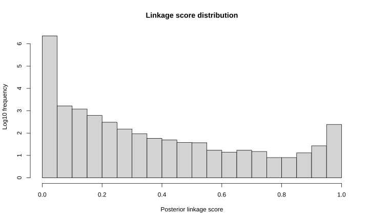
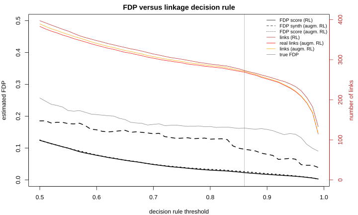
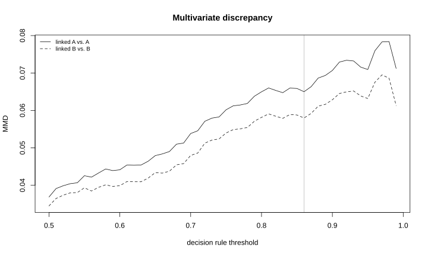
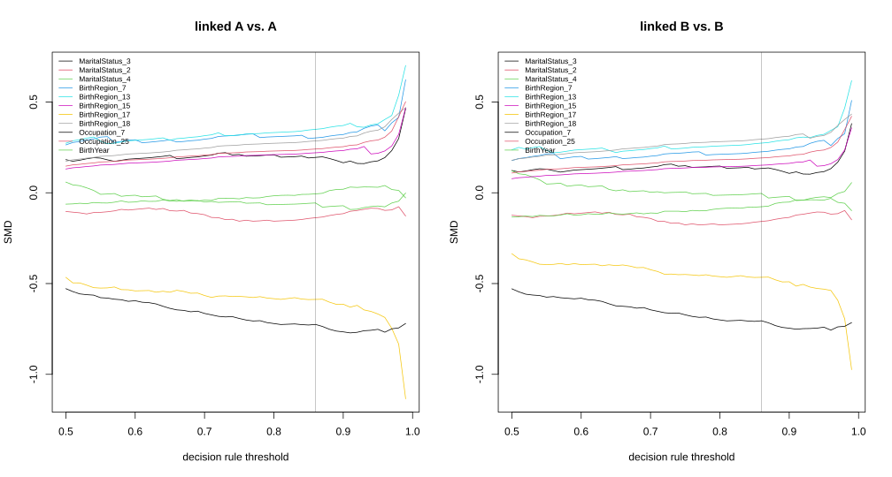
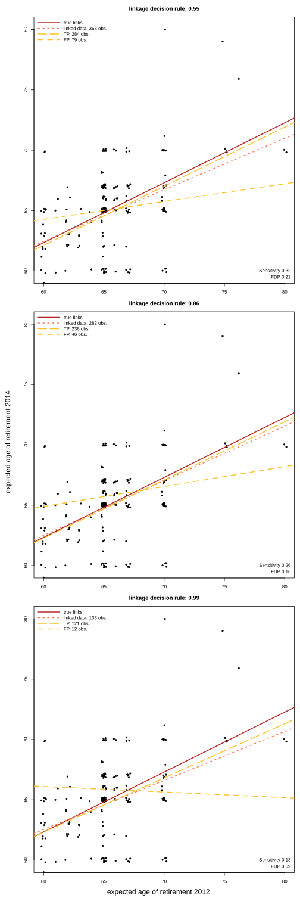

## Introduction {#sec-introduction}

Researchers and statistical agencies increasingly combine data sources that do not share a unique identifier [@Cleaton_Splink_2024; @Laidler_NHSE_2025; @Kramer_Destatis_2026]. Record linkage connects records referring to the same entity across sources based on Partially Identifying Variables (PIVs, e.g. birth year, sex, postal code or product code, brand and category). Each PIV has limited discriminative power on its own and may be missing, incorrectly recorded or change over time. Record linkage underpins the production of official statistics, enables the reuse of administrative and registry data for research [@opensafely2020; @perined_linkage_2021; @cooneyhealthcare_2023] and improves data quality through linkage and deduplication.

Linked data sets become the study sample for downstream analyses, where linkage errors may propagate [@reflexRL_2020; @Wang_Slawski_linked_2022; @CoxLinkedData_2024; @CRLrobachetal26]. Errors arise when links between entities that appear in both sources are missed or when records from distinct entities are falsely linked. These errors cannot be reduced simultaneously and may bias the conclusions drawn from linked data. A stricter decision rule reduces falsely linked pairs but misses more links. Practitioners therefore need not only record linkage methods, but also tools to quantify linkage errors and appraise their consequences for statistical analysis.

Two main probabilistic approaches to record linkage have developed through times. First, the traditional mixture model [@FS_RL_1969; @jaro_RL_matching_1989; @Larsen_mixture_1999; @fortini_bay_RL_2001; @sadinle_bay_bipartite_RL_2017] treats linkage as a classification problem between pairs of records that are similar and pairs that are not. Second, the hierarchical entity resolution framework [@tancredi_bay_RL_2011; @steorts2015; @smered2016; @dblink_2021; @marchantsteorts2023] models the data generation process, considering observed values as potentially distorted versions of latent true values. The latter framework uses all the information contained in the records and is therefore more flexible but more computationally demanding. It has been implemented in `R` for entity resolution (clustering records from a single file into entities) rather than for linkage between two data sources.

We address this gap with the *FlexRL* `R` package, which makes two contributions. First, it implements the hierarchical record linkage model proposed by @RLrobachetal25. The model is fitted with a Stochastic Expectation Maximisation (StEM) algorithm that accounts for registration errors and temporal changes in PIVs. Its architecture and efficient `Rcpp` backend support scalability to large data sets and a wide range of applications: health monitoring studies, survey waves, census and administrative records or data from different retailers. Second, it provides tools to assess the quality of the linked data, which quantify the linkage error and sample selection. *FlexRL* implements two estimators of the False Discovery Proportion (FDP): one derived from linkage scores [@belin_rubin_1995; @measurementError_2019; @fastLink_paper_2019] and one based on synthetic data [@FDProbachetal25]. *FlexRL* measures the divergence of the linked sample from the original sources using standardised mean differences, overlap of supports, maximum mean discrepancy and agreement rates. These tools only need the linked pairs and, when available, their linkage scores. They therefore apply to the output of any linkage method and *FlexRL* provides wrappers for several existing `R` packages.

The *FlexRL* package is aimed at practitioners, statistical agencies and researchers who need to link data sources without a unique identifier or who want to measure the error and the sample selection induced by record linkage. It builds on three lines of work: the biases that linkage errors cause in inference [@Lahiri_Larsen_linked_2005; @Tancredi_Liseo_linked_2015; @reflexRL_2020; @Wang_Slawski_linked_2022; @CRLrobachetal26]; the need for linked data quality control in practice [@eval_linkage_17; @datalinkagequal2020; @linkage_bias_datasynthesis24; @Laidler_NHSE_2025]; advances in record linkage methodology [@sadinle_bay_bipartite_RL_2017; @marchantsteorts2023; @RLrobachetal25]. By combining record linkage and diagnostics in a practical tool, it helps evaluating whether inference can be conducted on linked data.

Throughout the paper, we motivate and illustrate the main components of *FlexRL* on the 2012 and 2014 waves of the [Survey on Household Income and Wealth](https://www.bancaditalia.it/statistiche/tematiche/indagini-famiglie-imprese/bilanci-famiglie/distribuzione-microdati/index.html) (SHIW), conducted and made available by the Bank of Italy for research purposes. As a secondary analysis of public data, no additional ethics approval or participant consent was required. @sec-setup introduces the notation, the modelling paradigms, the existing software and demonstrates the potential of *FlexRL*. @sec-model presents the record linkage model implemented in *FlexRL* and its estimation on a subset of the SHIW. On the resulting linked data, @sec-inference describes the diagnostic tools *FlexRL* provides, and illustrates the impact of linkage errors on a socio-economic regression analysis. @sec-scalability demonstrates the scalability of *FlexRL* approach to record linkage on the SHIW. @sec-discussion concludes.

## The record linkage problem {#sec-setup}

### Setup and notation {#sec-notation}

We consider two overlapping samples $\mathcal A$ and $\mathcal B$ from the same population with $N_{\mathcal A}$ and $N_{\mathcal B} \geq N_{\mathcal A}$ records. Both sources record the same $K$ categorical PIVs, indexed by $k = 1, \dots, K$ with $N_k$ possible values each. Index $i$ refers to a record in $\mathcal A$ and index $j$ to a record in $\mathcal B.$ For PIV $k$, we denote by $G^{\mathcal A}_{i,k}$ the registered (observed) value and by $H^{\mathcal A}_{i,k}$ the latent true value in record $i \in \mathcal A.$ We define $G^{\mathcal B}_{j,k}$ and $H^{\mathcal B}_{j,k}$ analogously. Registered values differ from true values because of registration errors: missing values or mistakes (e.g. typographical errors). We write $\textbf{G}$ and $\textbf{H}$ for the collections of all registered and all true values. True values may also differ between the two data collections. This is the case for *dynamic* PIVs like postal code, whereas *stable* PIVs like birth year cannot change. For an entity recorded in both sources, the true values of stable PIVs are therefore identical in $\mathcal A$ and $\mathcal B$ and any disagreement between their registered values is due to registration errors. We elaborate on dynamic PIVs later.

The object of interest is the linkage matrix $\boldsymbol{\Delta} \in \{0,1\}^{N_{\mathcal A} \times N_{\mathcal B}}$, with $\Delta_{i,j} = 1$ if records $i \in \mathcal A$ and $j \in \mathcal B$ refer to the same entity. We assume that there are no duplicates within a data source. Thus, each record forms a link with at most one record in the other data source: $\sum_j \Delta_{i,j} \leq 1$ for all $i$ and $\sum_i \Delta_{i,j} \leq 1$ for all $j.$ This is the one-to-one assignment constraint, also referred to as bipartite matching [@sadinle_bay_bipartite_RL_2017]. We denote by $\gamma \in (0,1)$ the probability that a record from $\mathcal A$ forms a link with a record from $\mathcal B$, that is, the overlap between the sources as a fraction of the smaller data set.

Since record linkage is imperfect, the linked data contain two types of error: false positives (pairs declared linked while referring to distinct entities) and false negatives (true links that are missed). The non-links in the Cartesian product $\mathcal A \times \mathcal B$ are far more numerous than the links and are rarely of interest. The useful summaries are therefore the False Discovery Proportion (FDP) among the linked data (complement of precision or positive predictive value) and the sensitivity (also called recall, complement of miss rate). The two errors affect inference differently: falsely linked pairs contaminate the inference and missed links induce sample selection [@reflexRL_2020; @CRLrobachetal26].

### Modelling paradigms {#sec-paradigms}

Linkage methods can be grouped into four paradigms [@review_methods_2014; @Binette_Steorts_2022]. Deterministic (rule based) linkage declares a link when records agree on a set of variables, exactly or up to a tolerance. Supervised methods train a classifier on pairs whose linkage status is known [@DeepMatcher_method_2018]; such labelled pairs are seldom available. The two remaining paradigms are unsupervised and probabilistic, and differ in what they model:

#### Paradigm 1: classification of comparison vectors

The traditional 'Fellegi-Sunter' approach [@FS_RL_1969; @bookoflife; @newcombe1959; @Tepping1968] reduces the data to comparison vectors. For each pair $(i,j) \in \mathcal A \times \mathcal B$, a vector $\boldsymbol{c}_{i,j} = (c_{i,j,1}, \dots, c_{i,j,K})$ records whether elements $G^{\mathcal A}_{i,k}$ and $G^{\mathcal B}_{j,k}$ for $k = 1, \dots, K$ agree or how similar they are. The pairs of records are split into the set of matched $M$ and the set of unmatched $U.$ The comparison vectors follow a two components mixture: $$ \begin{aligned}
P(\boldsymbol{c}_{i,j}) &= \gamma \; m(\boldsymbol{c}_{i,j}) + (1-\gamma) \; u(\boldsymbol{c}_{i,j}), \\
m(\boldsymbol{c}) &= P(\boldsymbol{c} \mid M), \\
u(\boldsymbol{c}) &= P(\boldsymbol{c} \mid U),
\end{aligned} $$ {#eq-FS} where $\gamma$ in this paradigm is the proportion of links among all pairs. Under the assumption that the $K$ comparisons are independent given the linkage status, $m$ and $u$ factorise over $k \in \{1, \dots, K\}.$ The parameters are then estimated with an EM algorithm [@jaro_RL_matching_1989; @Larsen_mixture_1999]. Pairs are classified by thresholding the ratios $m(\boldsymbol{c}_{i,j}) / u(\boldsymbol{c}_{i,j})$ or the posterior linkage probabilities. Bayesian versions place a prior on the linkage matrix $\boldsymbol{\Delta}$ to enforce the one-to-one assignment constraint [@fortini_bay_RL_2001; @sadinle_bay_bipartite_RL_2017] or a prior on a partition of the records when there are more than two sources or duplicates [@multifilepartitioningrecordlinkage]. The computations are simple and fast, but memory intensive because they operate on $N_{\mathcal A} \times N_{\mathcal B}$ comparison vectors. Scaling to large data sets may therefore require blocking, which compares only pairs that agree on some variables [@blocking_methods_2014]. This paradigm treats pairs as independent although they share records, and the reduction to comparison vectors discards part of the information contained in the records.

#### Paradigm 2: hierarchical modelling

The second family models how the data were generated [@tancredi_bay_RL_2011; @steorts2015; @smered2016; @dblink_2021; @marchantsteorts2023; @RLrobachetal25]. Registered values $\textbf{G}$ are seen as distorted versions of latent true values $\textbf{H}$, which define the linkage structure $\boldsymbol{\Delta}.$ The joint model reads $$ P(\textbf{G}, \textbf{H}, \boldsymbol{\Delta}) = P(\textbf{G} \mid \textbf{H}) P(\textbf{H} \mid \boldsymbol{\Delta}) P(\boldsymbol{\Delta}), $$ {#eq-hier} with a model for registration errors $P(\textbf{G} \mid \textbf{H})$, a model for underlying true values $P(\textbf{H} \mid \boldsymbol{\Delta})$ and a model for the linkage structure $P(\boldsymbol{\Delta}).$ Since records are never reduced to pairwise comparisons, the model can separate missing values, mistakes and changes over time, and it does not need blocking to fit in memory. However, it is more computationally demanding.

### Existing software {#sec-software}

In `Python`, *recordlinkage* [@PYRL_de_bruin_j_2019], *Splink* [@splink_2022] and *NameMatch* [@PYRL_namematch] implement Paradigm 1. We list the main `R` packages for the task considered here in @tbl-packages. Paradigm 2 is only available in `R` through methods for entity resolution [@smered16software; @dblink_2021; @marchantsteorts2023]. These methods cluster records from a single file, possibly containing duplicates, into entities.

::: {#tbl-packages}
| Package | Paradigm | Estimation | Linkage structure | Record deduplication | PIV dynamics | Quality tools |
|-----------|-----------|-----------|-----------|-----------|-----------|-----------|
| *fedmatch* 2.1.0 [@fedmatchmanual; @fedmatch_article] | comparison vectors | push relabel maximum flow | many-to-many | no | no | no |
| *diyar* 0.5.1 [@diyarmanual] | comparison vectors | multistage weights comparisons, fixed score level parameters | clusters | yes | no | no |
| *reclin2* 0.6.0 [@reclin2manual] | comparison vectors, supervised | EM, machine learning | one-to-one post hoc | no | no | no |
| *fastLink* 0.6.1 [@fastLink_paper_2019; @fastLinkmanual] | comparison vectors | EM | one-to-one post hoc | no | no | no |
| *BRL* 0.1.0 [@brlmanual; @sadinle_bay_bipartite_RL_2017] | comparison vectors | Bayesian, bipartite prior, Gibbs sampler | one-to-one in model | no | no | no |
| *multilink* 0.1.1 [@multilinkmanual; @multifilepartitioningrecordlinkage] | comparison vectors | Bayesian, partition prior, Gibbs sampler | clusters, one-to-one in model | yes | no | no |
| *FlexRL* 2.0.0 [@flexrlmanual] | hierarchical | stochastic EM | one-to-one in model | no | yes | yes |

Record linkage packages on `CRAN` compared with *FlexRL*. The *FlexRL* package diagnostic tools apply to all these packages.
:::

To our knowledge, no `R` package implements Paradigm 2 for the linkage of two sources under the one-to-one assignment constraint or models the dynamics of PIVs over time. While the *postlink* package [@postlink26] develops statistical tools for post-linkage data analysis, no record linkage package provides tools to assess the quality of the linked data and their suitability for inference.

The implementation of *FlexRL* relies on `Rcpp` (potentially parallelised with `OpenMP`) for the backend samplers, *Matrix* for the sparse linkage matrix, and other standard `R` packages. The diagnostic tools apply to any record linkage output in the required format, with built-in wrappers for *BRL*, *diyar*, *fastLink*, *fedmatch*, *multilink* and *reclin2*. @fig-workflow shows the workflow, which follows the structure of @sec-model and @sec-inference: the data are prepared, linked with `StEM()` and the linked data quality is assessed with `RL_diagnostics()`. We elaborate on each component along the article.

::: {#fig-workflow}

::::::{.cell layout-align="default"}

:::::{.cell-output-display}

::::{}
`<figure class=''>`{=html}

:::{}
<svg id="mermaid-figure-1" width="672" xmlns="http://www.w3.org/2000/svg" xlink="http://www.w3.org/1999/xlink" class="flowchart" viewbox="0 0 616.33984375 734" role="graphics-document document" aria-roledescription="flowchart-v2" height="480"><style>#mermaid-figure-1{font-family:"trebuchet ms",verdana,arial,sans-serif;font-size:16px;fill:#333;}@keyframes edge-animation-frame{from{stroke-dashoffset:0;}}@keyframes dash{to{stroke-dashoffset:0;}}#mermaid-figure-1 .edge-animation-slow{stroke-dasharray:9,5!important;stroke-dashoffset:900;animation:dash 50s linear infinite;stroke-linecap:round;}#mermaid-figure-1 .edge-animation-fast{stroke-dasharray:9,5!important;stroke-dashoffset:900;animation:dash 20s linear infinite;stroke-linecap:round;}#mermaid-figure-1 .error-icon{fill:#552222;}#mermaid-figure-1 .error-text{fill:#552222;stroke:#552222;}#mermaid-figure-1 .edge-thickness-normal{stroke-width:1px;}#mermaid-figure-1 .edge-thickness-thick{stroke-width:3.5px;}#mermaid-figure-1 .edge-pattern-solid{stroke-dasharray:0;}#mermaid-figure-1 .edge-thickness-invisible{stroke-width:0;fill:none;}#mermaid-figure-1 .edge-pattern-dashed{stroke-dasharray:3;}#mermaid-figure-1 .edge-pattern-dotted{stroke-dasharray:2;}#mermaid-figure-1 .marker{fill:#333333;stroke:#333333;}#mermaid-figure-1 .marker.cross{stroke:#333333;}#mermaid-figure-1 svg{font-family:"trebuchet ms",verdana,arial,sans-serif;font-size:16px;}#mermaid-figure-1 p{margin:0;}#mermaid-figure-1 .label{font-family:"trebuchet ms",verdana,arial,sans-serif;color:#333;}#mermaid-figure-1 .cluster-label text{fill:#333;}#mermaid-figure-1 .cluster-label span{color:#333;}#mermaid-figure-1 .cluster-label span p{background-color:transparent;}#mermaid-figure-1 .label text,#mermaid-figure-1 span{fill:#333;color:#333;}#mermaid-figure-1 .node rect,#mermaid-figure-1 .node circle,#mermaid-figure-1 .node ellipse,#mermaid-figure-1 .node polygon,#mermaid-figure-1 .node path{fill:#ECECFF;stroke:#9370DB;stroke-width:1px;}#mermaid-figure-1 .rough-node .label text,#mermaid-figure-1 .node .label text,#mermaid-figure-1 .image-shape .label,#mermaid-figure-1 .icon-shape .label{text-anchor:middle;}#mermaid-figure-1 .node .katex path{fill:#000;stroke:#000;stroke-width:1px;}#mermaid-figure-1 .rough-node .label,#mermaid-figure-1 .node .label,#mermaid-figure-1 .image-shape .label,#mermaid-figure-1 .icon-shape .label{text-align:center;}#mermaid-figure-1 .node.clickable{cursor:pointer;}#mermaid-figure-1 .root .anchor path{fill:#333333!important;stroke-width:0;stroke:#333333;}#mermaid-figure-1 .arrowheadPath{fill:#333333;}#mermaid-figure-1 .edgePath .path{stroke:#333333;stroke-width:2.0px;}#mermaid-figure-1 .flowchart-link{stroke:#333333;fill:none;}#mermaid-figure-1 .edgeLabel{background-color:rgba(232,232,232, 0.8);text-align:center;}#mermaid-figure-1 .edgeLabel p{background-color:rgba(232,232,232, 0.8);}#mermaid-figure-1 .edgeLabel rect{opacity:0.5;background-color:rgba(232,232,232, 0.8);fill:rgba(232,232,232, 0.8);}#mermaid-figure-1 .labelBkg{background-color:rgba(232, 232, 232, 0.5);}#mermaid-figure-1 .cluster rect{fill:#ffffde;stroke:#aaaa33;stroke-width:1px;}#mermaid-figure-1 .cluster text{fill:#333;}#mermaid-figure-1 .cluster span{color:#333;}#mermaid-figure-1 div.mermaidTooltip{position:absolute;text-align:center;max-width:200px;padding:2px;font-family:"trebuchet ms",verdana,arial,sans-serif;font-size:12px;background:hsl(80, 100%, 96.2745098039%);border:1px solid #aaaa33;border-radius:2px;pointer-events:none;z-index:100;}#mermaid-figure-1 .flowchartTitleText{text-anchor:middle;font-size:18px;fill:#333;}#mermaid-figure-1 rect.text{fill:none;stroke-width:0;}#mermaid-figure-1 .icon-shape,#mermaid-figure-1 .image-shape{background-color:rgba(232,232,232, 0.8);text-align:center;}#mermaid-figure-1 .icon-shape p,#mermaid-figure-1 .image-shape p{background-color:rgba(232,232,232, 0.8);padding:2px;}#mermaid-figure-1 .icon-shape rect,#mermaid-figure-1 .image-shape rect{opacity:0.5;background-color:rgba(232,232,232, 0.8);fill:rgba(232,232,232, 0.8);}#mermaid-figure-1 .label-icon{display:inline-block;height:1em;overflow:visible;vertical-align:-0.125em;}#mermaid-figure-1 .node .label-icon path{fill:currentColor;stroke:revert;stroke-width:revert;}#mermaid-figure-1 :root{--mermaid-font-family:"trebuchet ms",verdana,arial,sans-serif;}</style><g><marker id="mermaid-1793439227705_flowchart-v2-pointEnd" class="marker flowchart-v2" viewbox="0 0 10 10" refx="5" refy="5" markerunits="userSpaceOnUse" markerwidth="8" markerheight="8" orient="auto"><path d="M 0 0 L 10 5 L 0 10 z" class="arrowMarkerPath" style="stroke-width: 1; stroke-dasharray: 1, 0;"></path></marker><marker id="mermaid-1793439227705_flowchart-v2-pointStart" class="marker flowchart-v2" viewbox="0 0 10 10" refx="4.5" refy="5" markerunits="userSpaceOnUse" markerwidth="8" markerheight="8" orient="auto"><path d="M 0 5 L 10 10 L 10 0 z" class="arrowMarkerPath" style="stroke-width: 1; stroke-dasharray: 1, 0;"></path></marker><marker id="mermaid-1793439227705_flowchart-v2-circleEnd" class="marker flowchart-v2" viewbox="0 0 10 10" refx="11" refy="5" markerunits="userSpaceOnUse" markerwidth="11" markerheight="11" orient="auto"><circle cx="5" cy="5" r="5" class="arrowMarkerPath" style="stroke-width: 1; stroke-dasharray: 1, 0;"></circle></marker><marker id="mermaid-1793439227705_flowchart-v2-circleStart" class="marker flowchart-v2" viewbox="0 0 10 10" refx="-1" refy="5" markerunits="userSpaceOnUse" markerwidth="11" markerheight="11" orient="auto"><circle cx="5" cy="5" r="5" class="arrowMarkerPath" style="stroke-width: 1; stroke-dasharray: 1, 0;"></circle></marker><marker id="mermaid-1793439227705_flowchart-v2-crossEnd" class="marker cross flowchart-v2" viewbox="0 0 11 11" refx="12" refy="5.2" markerunits="userSpaceOnUse" markerwidth="11" markerheight="11" orient="auto"><path d="M 1,1 l 9,9 M 10,1 l -9,9" class="arrowMarkerPath" style="stroke-width: 2; stroke-dasharray: 1, 0;"></path></marker><marker id="mermaid-1793439227705_flowchart-v2-crossStart" class="marker cross flowchart-v2" viewbox="0 0 11 11" refx="-1" refy="5.2" markerunits="userSpaceOnUse" markerwidth="11" markerheight="11" orient="auto"><path d="M 1,1 l 9,9 M 10,1 l -9,9" class="arrowMarkerPath" style="stroke-width: 2; stroke-dasharray: 1, 0;"></path></marker><g class="root"><g class="clusters"></g><g class="edgePaths"><path d="M113.969,62.5L113.885,66.583C113.802,70.667,113.635,78.833,120.264,86.831C126.893,94.828,140.317,102.657,147.029,106.571L153.742,110.485" id="L_raw_prep_0" class="edge-thickness-normal edge-pattern-solid edge-thickness-normal edge-pattern-solid flowchart-link" style=";" data-edge="true" data-et="edge" data-id="L_raw_prep_0" data-points="W3sieCI6MTEzLjk2ODc1LCJ5Ijo2Mi41fSx7IngiOjExMy40Njg3NSwieSI6ODd9LHsieCI6MTU3LjE5Njg5OTQxNDA2MjUsInkiOjExMi41fV0=" marker-end="url(#mermaid-1793439227705_flowchart-v2-pointEnd)"></path><path d="M335.297,62.5L335.214,66.583C335.13,70.667,334.964,78.833,328.331,86.825C321.699,94.817,308.601,102.633,302.052,106.542L295.504,110.45" id="L_sim_prep_0" class="edge-thickness-normal edge-pattern-solid edge-thickness-normal edge-pattern-solid flowchart-link" style=";" data-edge="true" data-et="edge" data-id="L_sim_prep_0" data-points="W3sieCI6MzM1LjI5Njg3NSwieSI6NjIuNX0seyJ4IjozMzQuNzk2ODc1LCJ5Ijo4N30seyJ4IjoyOTIuMDY4NzI1NTg1OTM3NSwieSI6MTEyLjV9XQ==" marker-end="url(#mermaid-1793439227705_flowchart-v2-pointEnd)"></path><path d="M180.165,190.5L175.331,194.583C170.497,198.667,160.828,206.833,156.065,214.5C151.301,222.167,151.441,229.334,151.511,232.917L151.582,236.501" id="L_prep_naive_0" class="edge-thickness-normal edge-pattern-solid edge-thickness-normal edge-pattern-solid flowchart-link" style=";" data-edge="true" data-et="edge" data-id="L_prep_naive_0" data-points="W3sieCI6MTgwLjE2NTEwMDA5NzY1NjI1LCJ5IjoxOTAuNX0seyJ4IjoxNTEuMTYwMTU2MjUsInkiOjIxNX0seyJ4IjoxNTEuNjYwMTU2MjUsInkiOjI0MC41fV0=" marker-end="url(#mermaid-1793439227705_flowchart-v2-pointEnd)"></path><path d="M269.101,190.5L273.768,194.583C278.436,198.667,287.77,206.833,292.508,214.5C297.246,222.167,297.387,229.334,297.457,232.917L297.527,236.501" id="L_prep_fit_0" class="edge-thickness-normal edge-pattern-solid edge-thickness-normal edge-pattern-solid flowchart-link" style=";" data-edge="true" data-et="edge" data-id="L_prep_fit_0" data-points="W3sieCI6MjY5LjEwMDUyNDkwMjM0Mzc1LCJ5IjoxOTAuNX0seyJ4IjoyOTcuMTA1NDY4NzUsInkiOjIxNX0seyJ4IjoyOTcuNjA1NDY4NzUsInkiOjI0MC41fV0=" marker-end="url(#mermaid-1793439227705_flowchart-v2-pointEnd)"></path><path d="M297.605,294.5L297.522,298.583C297.439,302.667,297.272,310.833,297.259,318.5C297.246,326.167,297.387,333.334,297.457,336.917L297.527,340.501" id="L_fit_delta_0" class="edge-thickness-normal edge-pattern-solid edge-thickness-normal edge-pattern-solid flowchart-link" style=";" data-edge="true" data-et="edge" data-id="L_fit_delta_0" data-points="W3sieCI6Mjk3LjYwNTQ2ODc1LCJ5IjoyOTQuNX0seyJ4IjoyOTcuMTA1NDY4NzUsInkiOjMxOX0seyJ4IjoyOTcuNjA1NDY4NzUsInkiOjM0NC41fV0=" marker-end="url(#mermaid-1793439227705_flowchart-v2-pointEnd)"></path><path d="M297.605,422.5L297.522,426.583C297.439,430.667,297.272,438.833,306.202,446.897C315.132,454.961,333.159,462.923,342.173,466.903L351.186,470.884" id="L_delta_diag_0" class="edge-thickness-normal edge-pattern-solid edge-thickness-normal edge-pattern-solid flowchart-link" style=";" data-edge="true" data-et="edge" data-id="L_delta_diag_0" data-points="W3sieCI6Mjk3LjYwNTQ2ODc1LCJ5Ijo0MjIuNX0seyJ4IjoyOTcuMTA1NDY4NzUsInkiOjQ0N30seyJ4IjozNTQuODQ1MTc3MjgzNjUzODcsInkiOjQ3Mi41fV0=" marker-end="url(#mermaid-1793439227705_flowchart-v2-pointEnd)"></path><path d="M535.723,410.5L535.639,416.583C535.556,422.667,535.389,434.833,526.457,444.893C517.526,454.953,499.829,462.907,490.98,466.884L482.131,470.86" id="L_wrap_diag_0" class="edge-thickness-normal edge-pattern-solid edge-thickness-normal edge-pattern-solid flowchart-link" style=";" data-edge="true" data-et="edge" data-id="L_wrap_diag_0" data-points="W3sieCI6NTM1LjcyMjY1NjI1LCJ5Ijo0MTAuNX0seyJ4Ijo1MzUuMjIyNjU2MjUsInkiOjQ0N30seyJ4Ijo0NzguNDgyOTQ3NzE2MzQ2MTMsInkiOjQ3Mi41fV0=" marker-end="url(#mermaid-1793439227705_flowchart-v2-pointEnd)"></path><path d="M416.664,526.5L416.581,530.583C416.497,534.667,416.331,542.833,416.318,550.5C416.305,558.167,416.445,565.334,416.515,568.917L416.586,572.501" id="L_diag_alles_0" class="edge-thickness-normal edge-pattern-solid edge-thickness-normal edge-pattern-solid flowchart-link" style=";" data-edge="true" data-et="edge" data-id="L_diag_alles_0" data-points="W3sieCI6NDE2LjY2NDA2MjUsInkiOjUyNi41fSx7IngiOjQxNi4xNjQwNjI1LCJ5Ijo1NTF9LHsieCI6NDE2LjY2NDA2MjUsInkiOjU3Ni41fV0=" marker-end="url(#mermaid-1793439227705_flowchart-v2-pointEnd)"></path></g><g class="edgeLabels"><g class="edgeLabel"><g class="label" data-id="L_raw_prep_0" transform="translate(0, 0)"><foreignobject width="0" height="0"><div xmlns="http://www.w3.org/1999/xhtml" class="labelBkg" style="display: table-cell; white-space: nowrap; line-height: 1.5; max-width: 200px; text-align: center;"><span class="edgeLabel"></span></div></foreignobject></g></g><g class="edgeLabel"><g class="label" data-id="L_sim_prep_0" transform="translate(0, 0)"><foreignobject width="0" height="0"><div xmlns="http://www.w3.org/1999/xhtml" class="labelBkg" style="display: table-cell; white-space: nowrap; line-height: 1.5; max-width: 200px; text-align: center;"><span class="edgeLabel"></span></div></foreignobject></g></g><g class="edgeLabel"><g class="label" data-id="L_prep_naive_0" transform="translate(0, 0)"><foreignobject width="0" height="0"><div xmlns="http://www.w3.org/1999/xhtml" class="labelBkg" style="display: table-cell; white-space: nowrap; line-height: 1.5; max-width: 200px; text-align: center;"><span class="edgeLabel"></span></div></foreignobject></g></g><g class="edgeLabel"><g class="label" data-id="L_prep_fit_0" transform="translate(0, 0)"><foreignobject width="0" height="0"><div xmlns="http://www.w3.org/1999/xhtml" class="labelBkg" style="display: table-cell; white-space: nowrap; line-height: 1.5; max-width: 200px; text-align: center;"><span class="edgeLabel"></span></div></foreignobject></g></g><g class="edgeLabel"><g class="label" data-id="L_fit_delta_0" transform="translate(0, 0)"><foreignobject width="0" height="0"><div xmlns="http://www.w3.org/1999/xhtml" class="labelBkg" style="display: table-cell; white-space: nowrap; line-height: 1.5; max-width: 200px; text-align: center;"><span class="edgeLabel"></span></div></foreignobject></g></g><g class="edgeLabel"><g class="label" data-id="L_delta_diag_0" transform="translate(0, 0)"><foreignobject width="0" height="0"><div xmlns="http://www.w3.org/1999/xhtml" class="labelBkg" style="display: table-cell; white-space: nowrap; line-height: 1.5; max-width: 200px; text-align: center;"><span class="edgeLabel"></span></div></foreignobject></g></g><g class="edgeLabel"><g class="label" data-id="L_wrap_diag_0" transform="translate(0, 0)"><foreignobject width="0" height="0"><div xmlns="http://www.w3.org/1999/xhtml" class="labelBkg" style="display: table-cell; white-space: nowrap; line-height: 1.5; max-width: 200px; text-align: center;"><span class="edgeLabel"></span></div></foreignobject></g></g><g class="edgeLabel"><g class="label" data-id="L_diag_alles_0" transform="translate(0, 0)"><foreignobject width="0" height="0"><div xmlns="http://www.w3.org/1999/xhtml" class="labelBkg" style="display: table-cell; white-space: nowrap; line-height: 1.5; max-width: 200px; text-align: center;"><span class="edgeLabel"></span></div></foreignobject></g></g></g><g class="nodes"><g class="node default" id="flowchart-raw-0" transform="translate(113.46875, 35)"><g class="basic label-container outer-path"><path d="M-100.46875 -27 C-30.629326078488916 -27, 39.21009784302217 -27, 100.46875 -27 C100.46875 -27, 100.46875 -27, 100.46875 -27 C100.58848427868132 -26.995047753601845, 100.70821855736264 -26.990095507203687, 100.88164672736166 -26.982922465033347 C101.03281066163004 -26.96407990027707, 101.1839745958984 -26.945237335520794, 101.29172295140367 -26.931806517013612 C101.39482078601154 -26.91018917435757, 101.4979186206194 -26.88857183170153, 101.696177435704 -26.847001329696653 C101.82405981852781 -26.808929094779792, 101.95194220135163 -26.77085685986293, 102.09224734602341 -26.729086208503173 C102.17135910457931 -26.698216704523112, 102.2504708631352 -26.667347200543052, 102.47722712326485 -26.578866633275286 C102.57620043543247 -26.53048152927591, 102.67517374760008 -26.482096425276538, 102.84848696518537 -26.397368756032446 C102.92691892085583 -26.350633454629858, 103.00535087652626 -26.303898153227273, 103.20349079061214 -26.185832391312644 C103.33675615907104 -26.090682747079974, 103.47002152752997 -25.995533102847308, 103.53981356344833 -25.94570254698197 C103.65259433431885 -25.85018210657894, 103.76537510518936 -25.75466166617591, 103.8551578581287 -25.678619553365657 C103.9169988388858 -25.61677857260856, 103.9788398196429 -25.554937591851466, 104.14736955336566 -25.386407858128706 C104.22231505373527 -25.297919873051406, 104.29726055410487 -25.209431887974105, 104.41445254698196 -25.07106356344834 C104.46927354144817 -24.99428198338317, 104.52409453591437 -24.917500403317998, 104.65458239131264 -24.734740790612136 C104.72044960734723 -24.62420133942385, 104.78631682338184 -24.51366188823556, 104.86611875603245 -24.37973696518537 C104.93642892007048 -24.23591522587522, 105.0067390841085 -24.092093486565073, 105.04761663327528 -24.008477123264846 C105.09208859602103 -23.894505250522077, 105.13656055876677 -23.780533377779303, 105.19783620850318 -23.623497346023417 C105.23661826928169 -23.493230700159156, 105.27540033006022 -23.3629640542949, 105.31575132969665 -23.227427435703994 C105.33786654041033 -23.121955159450817, 105.35998175112402 -23.016482883197643, 105.40055651701361 -22.82297295140367 C105.41204256253313 -22.73082648130395, 105.42352860805265 -22.638680011204226, 105.45167246503335 -22.412896727361662 C105.45640406386694 -22.298497214938262, 105.46113566270054 -22.184097702514862, 105.46875 -22 C105.46875 -22, 105.46875 -22, 105.46875 -22 C105.46875 -10.404391733066861, 105.46875 1.1912165338662781, 105.46875 22 C105.46875 22, 105.46875 22, 105.46875 22 C105.4651814096365 22.08628056011956, 105.461612819273 22.17256112023912, 105.45167246503335 22.412896727361662 C105.44052145506375 22.50235538439025, 105.42937044509415 22.591814041418836, 105.40055651701361 22.82297295140367 C105.37329017731386 22.953012088288073, 105.34602383761413 23.083051225172476, 105.31575132969665 23.227427435703994 C105.29030866788568 23.31288783026376, 105.26486600607471 23.39834822482353, 105.19783620850318 23.623497346023417 C105.16663582751497 23.70345706967773, 105.13543544652674 23.783416793332037, 105.04761663327528 24.008477123264846 C104.98922343636909 24.127922316685044, 104.9308302394629 24.247367510105246, 104.86611875603245 24.379736965185366 C104.7923580659777 24.503523375007813, 104.71859737592294 24.627309784830256, 104.65458239131264 24.734740790612133 C104.58541536753015 24.831615234903715, 104.51624834374763 24.9284896791953, 104.41445254698196 25.07106356344834 C104.31278786844256 25.191098822578226, 104.21112318990313 25.311134081708108, 104.14736955336566 25.386407858128706 C104.03126259848156 25.50251481301281, 103.91515564359746 25.618621767896908, 103.8551578581287 25.678619553365657 C103.74494938325452 25.77196137019199, 103.63474090838034 25.865303187018323, 103.53981356344833 25.94570254698197 C103.42605299916939 26.02692602870135, 103.31229243489044 26.108149510420734, 103.20349079061214 26.185832391312644 C103.0632969449189 26.269369791053013, 102.92310309922566 26.352907190793385, 102.84848696518537 26.397368756032446 C102.7331153046844 26.45377052404104, 102.61774364418342 26.510172292049635, 102.47722712326485 26.578866633275286 C102.3986958244699 26.60950964115379, 102.32016452567494 26.640152649032288, 102.09224734602341 26.729086208503173 C101.94287731749833 26.773555592713667, 101.79350728897325 26.818024976924157, 101.696177435704 26.847001329696653 C101.5883705966066 26.869606046762705, 101.4805637575092 26.892210763828754, 101.29172295140367 26.931806517013612 C101.1580027099621 26.948474727726587, 101.02428246852052 26.965142938439563, 100.88164672736166 26.982922465033347 C100.78919470406336 26.98674630900204, 100.69674268076507 26.99057015297073, 100.46875 27 C100.46875 27, 100.46875 27, 100.46875 27 C54.227874027383685 27, 7.986998054767369 27, -100.46875 27 C-100.46875 27, -100.46875 27, -100.46875 27 C-100.62693179968424 26.9934575523704, -100.78511359936847 26.986915104740806, -100.88164672736166 26.982922465033347 C-101.03368902972723 26.96397041180794, -101.1857313320928 26.945018358582526, -101.29172295140367 26.931806517013612 C-101.39236786154619 26.91070349853206, -101.49301277168873 26.889600480050515, -101.696177435704 26.847001329696653 C-101.81420883126981 26.81186186075403, -101.9322402268356 26.7767223918114, -102.09224734602341 26.729086208503173 C-102.19093410358937 26.69057851620723, -102.28962086115531 26.652070823911284, -102.47722712326485 26.578866633275286 C-102.55928887416252 26.538749087801712, -102.6413506250602 26.498631542328138, -102.84848696518537 26.397368756032446 C-102.94940700355228 26.337233465890563, -103.05032704191918 26.277098175748677, -103.20349079061214 26.185832391312644 C-103.32829248853582 26.096725691692228, -103.45309418645952 26.007618992071816, -103.53981356344833 25.94570254698197 C-103.64778393510318 25.85425630688852, -103.75575430675802 25.762810066795073, -103.8551578581287 25.67861955336566 C-103.92659269403669 25.607184717457674, -103.99802752994468 25.53574988154969, -104.14736955336566 25.386407858128706 C-104.20443230336794 25.31903399651233, -104.26149505337023 25.25166013489596, -104.41445254698196 25.07106356344834 C-104.50959960923512 24.93780181127674, -104.60474667148827 24.804540059105136, -104.65458239131264 24.734740790612133 C-104.70261291996013 24.65413516316025, -104.75064344860763 24.573529535708374, -104.86611875603245 24.37973696518537 C-104.92216273171714 24.26509718058085, -104.97820670740184 24.150457395976332, -105.04761663327528 24.00847712326485 C-105.09070768090895 23.8980442326516, -105.13379872854263 23.787611342038353, -105.19783620850318 23.623497346023417 C-105.23910443335225 23.48487982225225, -105.28037265820133 23.346262298481083, -105.31575132969665 23.227427435703994 C-105.33935131661298 23.114873937035803, -105.3629513035293 23.00232043836761, -105.40055651701361 22.82297295140367 C-105.42089478028343 22.659809818793146, -105.44123304355324 22.496646686182622, -105.45167246503335 22.412896727361662 C-105.4564702915339 22.296895977581485, -105.46126811803447 22.180895227801308, -105.46875 22 C-105.46875 22, -105.46875 22, -105.46875 22 C-105.46875 5.457166058254479, -105.46875 -11.085667883491041, -105.46875 -22 C-105.46875 -22, -105.46875 -22, -105.46875 -22 C-105.46316371937637 -22.13506381290559, -105.45757743875272 -22.270127625811174, -105.45167246503335 -22.41289672736166 C-105.43620836720915 -22.536957007756353, -105.42074426938493 -22.66101728815105, -105.40055651701361 -22.82297295140367 C-105.37052573269759 -22.966196329217514, -105.34049494838158 -23.109419707031357, -105.31575132969665 -23.227427435703994 C-105.29051132941512 -23.31220710218599, -105.2652713291336 -23.396986768667986, -105.19783620850318 -23.623497346023417 C-105.1426505202912 -23.764926143984873, -105.08746483207922 -23.906354941946326, -105.04761663327528 -24.008477123264846 C-105.01077385446726 -24.083840231880586, -104.97393107565924 -24.15920334049633, -104.86611875603245 -24.379736965185366 C-104.82298574817722 -24.452123492253914, -104.77985274032197 -24.524510019322463, -104.65458239131264 -24.734740790612133 C-104.582531671138 -24.83565410299747, -104.51048095096334 -24.936567415382807, -104.41445254698196 -25.07106356344834 C-104.35407700104993 -25.142348835827868, -104.29370145511791 -25.213634108207394, -104.14736955336566 -25.386407858128706 C-104.04153226648727 -25.492245145007104, -103.93569497960887 -25.5980824318855, -103.8551578581287 -25.678619553365657 C-103.74232001437063 -25.774188332038705, -103.62948217061255 -25.869757110711753, -103.53981356344833 -25.945702546981966 C-103.45574329493553 -26.005727564974578, -103.37167302642273 -26.065752582967193, -103.20349079061214 -26.185832391312644 C-103.10707096350146 -26.243286137590975, -103.01065113639078 -26.3007398838693, -102.84848696518537 -26.397368756032446 C-102.75372452231274 -26.44369529147123, -102.65896207944012 -26.490021826910017, -102.47722712326485 -26.578866633275286 C-102.35814957501753 -26.62533083678505, -102.23907202677022 -26.671795040294818, -102.09224734602341 -26.729086208503173 C-101.99708970537131 -26.757415865560255, -101.9019320647192 -26.78574552261734, -101.696177435704 -26.847001329696653 C-101.60226417961243 -26.866692868753685, -101.50835092352085 -26.886384407810716, -101.29172295140367 -26.931806517013612 C-101.14383691052669 -26.950240492784754, -100.9959508696497 -26.9686744685559, -100.88164672736167 -26.982922465033347 C-100.75104427020365 -26.988324222618346, -100.62044181304563 -26.993725980203344, -100.46875 -27 C-100.46875 -27, -100.46875 -27, -100.46875 -27" stroke="none" stroke-width="0" fill="#ECECFF" style=""></path><path d="M-100.46875 -27 C-33.753659512995796 -27, 32.96143097400841 -27, 100.46875 -27 M-100.46875 -27 C-24.39250965982326 -27, 51.68373068035348 -27, 100.46875 -27 M100.46875 -27 C100.46875 -27, 100.46875 -27, 100.46875 -27 M100.46875 -27 C100.46875 -27, 100.46875 -27, 100.46875 -27 M100.46875 -27 C100.57094802964978 -26.995773058226884, 100.67314605929955 -26.991546116453772, 100.88164672736166 -26.982922465033347 M100.46875 -27 C100.62567981897287 -26.99350933467566, 100.78260963794573 -26.987018669351322, 100.88164672736166 -26.982922465033347 M100.88164672736166 -26.982922465033347 C100.97856483420779 -26.970841635613667, 101.0754829410539 -26.95876080619399, 101.29172295140367 -26.931806517013612 M100.88164672736166 -26.982922465033347 C101.04089500439548 -26.96307218800227, 101.2001432814293 -26.943221910971186, 101.29172295140367 -26.931806517013612 M101.29172295140367 -26.931806517013612 C101.45123365544055 -26.898360639516895, 101.61074435947742 -26.864914762020174, 101.696177435704 -26.847001329696653 M101.29172295140367 -26.931806517013612 C101.40895110900536 -26.907226357193082, 101.52617926660704 -26.882646197372548, 101.696177435704 -26.847001329696653 M101.696177435704 -26.847001329696653 C101.83822462715591 -26.804712048539855, 101.98027181860782 -26.76242276738306, 102.09224734602341 -26.729086208503173 M101.696177435704 -26.847001329696653 C101.8259615313461 -26.808362930343666, 101.95574562698819 -26.769724530990676, 102.09224734602341 -26.729086208503173 M102.09224734602341 -26.729086208503173 C102.19758937810184 -26.687981620034, 102.30293141018025 -26.64687703156483, 102.47722712326485 -26.578866633275286 M102.09224734602341 -26.729086208503173 C102.22903989902379 -26.675709588688758, 102.36583245202416 -26.622332968874346, 102.47722712326485 -26.578866633275286 M102.47722712326485 -26.578866633275286 C102.62503282556321 -26.50660882841073, 102.77283852786157 -26.434351023546174, 102.84848696518537 -26.397368756032446 M102.47722712326485 -26.578866633275286 C102.62547716103305 -26.506391606035855, 102.77372719880123 -26.433916578796424, 102.84848696518537 -26.397368756032446 M102.84848696518537 -26.397368756032446 C102.9503010270546 -26.336700743513752, 103.05211508892384 -26.27603273099506, 103.20349079061214 -26.185832391312644 M102.84848696518537 -26.397368756032446 C102.96386872496151 -26.328616150370582, 103.07925048473766 -26.25986354470872, 103.20349079061214 -26.185832391312644 M103.20349079061214 -26.185832391312644 C103.3290178208094 -26.096207814402884, 103.45454485100667 -26.006583237493125, 103.53981356344833 -25.94570254698197 M103.20349079061214 -26.185832391312644 C103.33397619485734 -26.092667603378143, 103.46446159910256 -25.999502815443645, 103.53981356344833 -25.94570254698197 M103.53981356344833 -25.94570254698197 C103.63208477396671 -25.867552818112365, 103.72435598448507 -25.78940308924276, 103.8551578581287 -25.678619553365657 M103.53981356344833 -25.94570254698197 C103.61176195209705 -25.884765370218883, 103.68371034074576 -25.823828193455796, 103.8551578581287 -25.678619553365657 M103.8551578581287 -25.678619553365657 C103.96316392332457 -25.570613488169798, 104.07116998852042 -25.46260742297394, 104.14736955336566 -25.386407858128706 M103.8551578581287 -25.678619553365657 C103.92701097916893 -25.606766432325443, 103.99886410020913 -25.53491331128523, 104.14736955336566 -25.386407858128706 M104.14736955336566 -25.386407858128706 C104.21158724594189 -25.310586171778496, 104.2758049385181 -25.23476448542829, 104.41445254698196 -25.07106356344834 M104.14736955336566 -25.386407858128706 C104.23334693474021 -25.284894555761834, 104.31932431611476 -25.183381253394963, 104.41445254698196 -25.07106356344834 M104.41445254698196 -25.07106356344834 C104.48104508211077 -24.977794914867243, 104.54763761723957 -24.884526266286144, 104.65458239131264 -24.734740790612136 M104.41445254698196 -25.07106356344834 C104.47526289990245 -24.985893364931897, 104.53607325282294 -24.900723166415453, 104.65458239131264 -24.734740790612136 M104.65458239131264 -24.734740790612136 C104.73371785312311 -24.601934349947232, 104.81285331493358 -24.469127909282328, 104.86611875603245 -24.37973696518537 M104.65458239131264 -24.734740790612136 C104.7126635144398 -24.637268089298903, 104.77074463756693 -24.53979538798567, 104.86611875603245 -24.37973696518537 M104.86611875603245 -24.37973696518537 C104.91795675093955 -24.273700651774718, 104.96979474584667 -24.167664338364062, 105.04761663327528 -24.008477123264846 M104.86611875603245 -24.37973696518537 C104.90837509072904 -24.29330025100493, 104.95063142542563 -24.206863536824486, 105.04761663327528 -24.008477123264846 M105.04761663327528 -24.008477123264846 C105.08070066854219 -23.923690007418067, 105.1137847038091 -23.838902891571287, 105.19783620850318 -23.623497346023417 M105.04761663327528 -24.008477123264846 C105.1010845892359 -23.87145049578276, 105.1545525451965 -23.73442386830067, 105.19783620850318 -23.623497346023417 M105.19783620850318 -23.623497346023417 C105.24346571482951 -23.47023053600216, 105.28909522115586 -23.316963725980905, 105.31575132969665 -23.227427435703994 M105.19783620850318 -23.623497346023417 C105.24045278039043 -23.480350804386855, 105.28306935227766 -23.337204262750298, 105.31575132969665 -23.227427435703994 M105.31575132969665 -23.227427435703994 C105.34436375578754 -23.090968518445553, 105.37297618187843 -22.954509601187116, 105.40055651701361 -22.82297295140367 M105.31575132969665 -23.227427435703994 C105.33783942458182 -23.12208448076702, 105.35992751946696 -23.01674152583004, 105.40055651701361 -22.82297295140367 M105.40055651701361 -22.82297295140367 C105.41972384380024 -22.66920362307969, 105.43889117058687 -22.51543429475571, 105.45167246503335 -22.412896727361662 M105.40055651701361 -22.82297295140367 C105.41506355156162 -22.706590683638773, 105.4295705861096 -22.59020841587387, 105.45167246503335 -22.412896727361662 M105.45167246503335 -22.412896727361662 C105.45522185954907 -22.327080280051284, 105.4587712540648 -22.241263832740906, 105.46875 -22 M105.45167246503335 -22.412896727361662 C105.45684471430899 -22.287843269519044, 105.46201696358462 -22.162789811676426, 105.46875 -22 M105.46875 -22 C105.46875 -22, 105.46875 -22, 105.46875 -22 M105.46875 -22 C105.46875 -22, 105.46875 -22, 105.46875 -22 M105.46875 -22 C105.46875 -10.774269056170844, 105.46875 0.4514618876583114, 105.46875 22 M105.46875 -22 C105.46875 -5.360939172399725, 105.46875 11.27812165520055, 105.46875 22 M105.46875 22 C105.46875 22, 105.46875 22, 105.46875 22 M105.46875 22 C105.46875 22, 105.46875 22, 105.46875 22 M105.46875 22 C105.46223685112497 22.1574734211099, 105.45572370224993 22.314946842219797, 105.45167246503335 22.412896727361662 M105.46875 22 C105.46392818331756 22.11658077890077, 105.45910636663513 22.233161557801534, 105.45167246503335 22.412896727361662 M105.45167246503335 22.412896727361662 C105.44016173829394 22.505241201838743, 105.4286510115545 22.597585676315823, 105.40055651701361 22.82297295140367 M105.45167246503335 22.412896727361662 C105.4337824239729 22.556419067653444, 105.41589238291245 22.699941407945225, 105.40055651701361 22.82297295140367 M105.40055651701361 22.82297295140367 C105.3798158365894 22.921889792111276, 105.3590751561652 23.020806632818882, 105.31575132969665 23.227427435703994 M105.40055651701361 22.82297295140367 C105.37794692333824 22.930803048117347, 105.35533732966289 23.03863314483102, 105.31575132969665 23.227427435703994 M105.31575132969665 23.227427435703994 C105.27975977211192 23.348320946566368, 105.24376821452718 23.46921445742874, 105.19783620850318 23.623497346023417 M105.31575132969665 23.227427435703994 C105.2885032675616 23.318952063054375, 105.26125520542655 23.410476690404757, 105.19783620850318 23.623497346023417 M105.19783620850318 23.623497346023417 C105.166001229894 23.705083403997936, 105.1341662512848 23.78666946197245, 105.04761663327528 24.008477123264846 M105.19783620850318 23.623497346023417 C105.14748272108193 23.752542274697674, 105.09712923366068 23.881587203371932, 105.04761663327528 24.008477123264846 M105.04761663327528 24.008477123264846 C104.9978353359782 24.110306394471085, 104.9480540386811 24.212135665677323, 104.86611875603245 24.379736965185366 M105.04761663327528 24.008477123264846 C104.98821733798253 24.12998032382885, 104.92881804268978 24.251483524392857, 104.86611875603245 24.379736965185366 M104.86611875603245 24.379736965185366 C104.7951214630329 24.49888579637177, 104.72412417003335 24.618034627558174, 104.65458239131264 24.734740790612133 M104.86611875603245 24.379736965185366 C104.80552142152636 24.48143241404504, 104.74492408702028 24.58312786290472, 104.65458239131264 24.734740790612133 M104.65458239131264 24.734740790612133 C104.60108896074934 24.809663001742198, 104.54759553018603 24.884585212872267, 104.41445254698196 25.07106356344834 M104.65458239131264 24.734740790612133 C104.55962324180844 24.867739354603387, 104.46466409230422 25.00073791859464, 104.41445254698196 25.07106356344834 M104.41445254698196 25.07106356344834 C104.312312763812 25.191659777555508, 104.21017298064206 25.312255991662674, 104.14736955336566 25.386407858128706 M104.41445254698196 25.07106356344834 C104.3404667431488 25.15841843696623, 104.26648093931563 25.245773310484118, 104.14736955336566 25.386407858128706 M104.14736955336566 25.386407858128706 C104.07160782552536 25.462169585969008, 103.99584609768506 25.53793131380931, 103.8551578581287 25.678619553365657 M104.14736955336566 25.386407858128706 C104.06835909995723 25.46541831153713, 103.9893486465488 25.544428764945557, 103.8551578581287 25.678619553365657 M103.8551578581287 25.678619553365657 C103.7598685772158 25.759325457468222, 103.66457929630289 25.840031361570787, 103.53981356344833 25.94570254698197 M103.8551578581287 25.678619553365657 C103.77306962130228 25.748144743458305, 103.69098138447586 25.817669933550956, 103.53981356344833 25.94570254698197 M103.53981356344833 25.94570254698197 C103.45703460184916 26.0048055895593, 103.37425564025 26.063908632136627, 103.20349079061214 26.185832391312644 M103.53981356344833 25.94570254698197 C103.46756101974835 25.997289871636976, 103.39530847604836 26.048877196291986, 103.20349079061214 26.185832391312644 M103.20349079061214 26.185832391312644 C103.0949747671454 26.25049390612986, 102.98645874367867 26.31515542094708, 102.84848696518537 26.397368756032446 M103.20349079061214 26.185832391312644 C103.11535339876602 26.238350877401068, 103.0272160069199 26.290869363489488, 102.84848696518537 26.397368756032446 M102.84848696518537 26.397368756032446 C102.7281230671822 26.456211080241935, 102.60775916917902 26.51505340445142, 102.47722712326485 26.578866633275286 M102.84848696518537 26.397368756032446 C102.73625923587771 26.4522335497353, 102.62403150657006 26.507098343438155, 102.47722712326485 26.578866633275286 M102.47722712326485 26.578866633275286 C102.36542808063409 26.622490755080378, 102.25362903800333 26.666114876885473, 102.09224734602341 26.729086208503173 M102.47722712326485 26.578866633275286 C102.39433519262158 26.611211164981018, 102.31144326197831 26.64355569668675, 102.09224734602341 26.729086208503173 M102.09224734602341 26.729086208503173 C101.9512481893545 26.77106347618651, 101.81024903268559 26.81304074386985, 101.696177435704 26.847001329696653 M102.09224734602341 26.729086208503173 C101.95657502820545 26.76947760754988, 101.82090271038749 26.80986900659659, 101.696177435704 26.847001329696653 M101.696177435704 26.847001329696653 C101.60768091092022 26.865557099634948, 101.51918438613643 26.884112869573244, 101.29172295140367 26.931806517013612 M101.696177435704 26.847001329696653 C101.57845422388246 26.871685291471366, 101.46073101206092 26.896369253246075, 101.29172295140367 26.931806517013612 M101.29172295140367 26.931806517013612 C101.19589652843482 26.943751268179902, 101.10007010546596 26.95569601934619, 100.88164672736166 26.982922465033347 M101.29172295140367 26.931806517013612 C101.19024238080644 26.944456056946777, 101.08876181020922 26.95710559687994, 100.88164672736166 26.982922465033347 M100.88164672736166 26.982922465033347 C100.72820694228007 26.989268781488192, 100.57476715719847 26.995615097943034, 100.46875 27 M100.88164672736166 26.982922465033347 C100.78454235956033 26.986938731394037, 100.687437991759 26.990954997754727, 100.46875 27 M100.46875 27 C100.46875 27, 100.46875 27, 100.46875 27 M100.46875 27 C100.46875 27, 100.46875 27, 100.46875 27 M100.46875 27 C60.21050150816112 27, 19.952253016322246 27, -100.46875 27 M100.46875 27 C31.299579027294044 27, -37.86959194541191 27, -100.46875 27 M-100.46875 27 C-100.46875 27, -100.46875 27, -100.46875 27 M-100.46875 27 C-100.46875 27, -100.46875 27, -100.46875 27 M-100.46875 27 C-100.57143806183142 26.995752790345932, -100.67412612366282 26.991505580691864, -100.88164672736166 26.982922465033347 M-100.46875 27 C-100.57130712731228 26.995758205837703, -100.67386425462455 26.991516411675402, -100.88164672736166 26.982922465033347 M-100.88164672736166 26.982922465033347 C-100.9737760709982 26.971438554325236, -101.06590541463474 26.959954643617124, -101.29172295140367 26.931806517013612 M-100.88164672736166 26.982922465033347 C-101.032092141815 26.964169463678612, -101.18253755626834 26.945416462323877, -101.29172295140367 26.931806517013612 M-101.29172295140367 26.931806517013612 C-101.42912073270944 26.902997231833535, -101.5665185140152 26.874187946653453, -101.696177435704 26.847001329696653 M-101.29172295140367 26.931806517013612 C-101.38116466162776 26.9130525625294, -101.47060637185186 26.89429860804519, -101.696177435704 26.847001329696653 M-101.696177435704 26.847001329696653 C-101.792960256516 26.81818783554283, -101.88974307732799 26.789374341389006, -102.09224734602341 26.729086208503173 M-101.696177435704 26.847001329696653 C-101.81583169809868 26.811378712365773, -101.93548596049335 26.775756095034893, -102.09224734602341 26.729086208503173 M-102.09224734602341 26.729086208503173 C-102.17056466297164 26.698526696600364, -102.24888197991987 26.667967184697556, -102.47722712326485 26.578866633275286 M-102.09224734602341 26.729086208503173 C-102.2249840174936 26.677292198572857, -102.35772068896378 26.62549818864254, -102.47722712326485 26.578866633275286 M-102.47722712326485 26.578866633275286 C-102.56360379767789 26.53663965023246, -102.6499804720909 26.494412667189636, -102.84848696518537 26.397368756032446 M-102.47722712326485 26.578866633275286 C-102.56395736248137 26.53646680293238, -102.65068760169791 26.49406697258948, -102.84848696518537 26.397368756032446 M-102.84848696518537 26.397368756032446 C-102.94422019862627 26.34032413077914, -103.03995343206716 26.28327950552584, -103.20349079061214 26.185832391312644 M-102.84848696518537 26.397368756032446 C-102.91969485684595 26.35493806243884, -102.99090274850653 26.312507368845235, -103.20349079061214 26.185832391312644 M-103.20349079061214 26.185832391312644 C-103.32447943893419 26.099448156779996, -103.44546808725623 26.013063922247348, -103.53981356344833 25.94570254698197 M-103.20349079061214 26.185832391312644 C-103.31048137441195 26.109442582748567, -103.41747195821176 26.033052774184487, -103.53981356344833 25.94570254698197 M-103.53981356344833 25.94570254698197 C-103.61934643166764 25.87834164369868, -103.69887929988693 25.81098074041539, -103.8551578581287 25.67861955336566 M-103.53981356344833 25.94570254698197 C-103.63495508374753 25.865121789735444, -103.73009660404672 25.784541032488914, -103.8551578581287 25.67861955336566 M-103.8551578581287 25.67861955336566 C-103.94466324699326 25.589114164501108, -104.03416863585781 25.49960877563656, -104.14736955336566 25.386407858128706 M-103.8551578581287 25.67861955336566 C-103.97040271744338 25.563374694050985, -104.08564757675806 25.448129834736307, -104.14736955336566 25.386407858128706 M-104.14736955336566 25.386407858128706 C-104.20809211566633 25.314712864296947, -104.268814677967 25.24301787046519, -104.41445254698196 25.07106356344834 M-104.14736955336566 25.386407858128706 C-104.24862524587662 25.266855487890144, -104.34988093838757 25.147303117651585, -104.41445254698196 25.07106356344834 M-104.41445254698196 25.07106356344834 C-104.49793252949969 24.954142573161032, -104.58141251201742 24.837221582873727, -104.65458239131264 24.734740790612133 M-104.41445254698196 25.07106356344834 C-104.49986606508762 24.951434488074312, -104.58527958319327 24.831805412700287, -104.65458239131264 24.734740790612133 M-104.65458239131264 24.734740790612133 C-104.72028507139818 24.62447746637447, -104.78598775148372 24.5142141421368, -104.86611875603245 24.37973696518537 M-104.65458239131264 24.734740790612133 C-104.72974978806634 24.60859362234497, -104.80491718482004 24.482446454077802, -104.86611875603245 24.37973696518537 M-104.86611875603245 24.37973696518537 C-104.92413346852622 24.26106597400522, -104.98214818101998 24.142394982825074, -105.04761663327528 24.00847712326485 M-104.86611875603245 24.37973696518537 C-104.90806966908448 24.29392500096453, -104.95002058213652 24.20811303674369, -105.04761663327528 24.00847712326485 M-105.04761663327528 24.00847712326485 C-105.08379067472822 23.915771000248927, -105.11996471618117 23.823064877233005, -105.19783620850318 23.623497346023417 M-105.04761663327528 24.00847712326485 C-105.08209796371622 23.920109046787463, -105.11657929415715 23.831740970310076, -105.19783620850318 23.623497346023417 M-105.19783620850318 23.623497346023417 C-105.2397233593267 23.482800886550745, -105.28161051015024 23.342104427078073, -105.31575132969665 23.227427435703994 M-105.19783620850318 23.623497346023417 C-105.24070738207169 23.47949561241447, -105.2835785556402 23.335493878805526, -105.31575132969665 23.227427435703994 M-105.31575132969665 23.227427435703994 C-105.34184168309478 23.102996834667618, -105.3679320364929 22.978566233631238, -105.40055651701361 22.82297295140367 M-105.31575132969665 23.227427435703994 C-105.34796498067303 23.073793489417373, -105.3801786316494 22.92015954313075, -105.40055651701361 22.82297295140367 M-105.40055651701361 22.82297295140367 C-105.42020604177543 22.665335203680943, -105.43985556653723 22.50769745595822, -105.45167246503335 22.412896727361662 M-105.40055651701361 22.82297295140367 C-105.41476371708958 22.708996097074117, -105.42897091716556 22.59501924274456, -105.45167246503335 22.412896727361662 M-105.45167246503335 22.412896727361662 C-105.4553884166286 22.32305330114659, -105.45910436822385 22.233209874931518, -105.46875 22 M-105.45167246503335 22.412896727361662 C-105.45548244246064 22.320779966124203, -105.45929241988792 22.22866320488674, -105.46875 22 M-105.46875 22 C-105.46875 22, -105.46875 22, -105.46875 22 M-105.46875 22 C-105.46875 22, -105.46875 22, -105.46875 22 M-105.46875 22 C-105.46875 8.949566615590944, -105.46875 -4.100866768818111, -105.46875 -22 M-105.46875 22 C-105.46875 5.460342750430353, -105.46875 -11.079314499139294, -105.46875 -22 M-105.46875 -22 C-105.46875 -22, -105.46875 -22, -105.46875 -22 M-105.46875 -22 C-105.46875 -22, -105.46875 -22, -105.46875 -22 M-105.46875 -22 C-105.46513798415242 -22.087330491523183, -105.46152596830485 -22.174660983046362, -105.45167246503335 -22.41289672736166 M-105.46875 -22 C-105.46531499954503 -22.083050653921365, -105.46187999909004 -22.166101307842734, -105.45167246503335 -22.41289672736166 M-105.45167246503335 -22.41289672736166 C-105.4319621954391 -22.57102179875699, -105.41225192584484 -22.729146870152324, -105.40055651701361 -22.82297295140367 M-105.45167246503335 -22.41289672736166 C-105.44038547145792 -22.503446308960225, -105.42909847788248 -22.59399589055879, -105.40055651701361 -22.82297295140367 M-105.40055651701361 -22.82297295140367 C-105.37051371874671 -22.96625362637663, -105.34047092047979 -23.10953430134959, -105.31575132969665 -23.227427435703994 M-105.40055651701361 -22.82297295140367 C-105.3720655390557 -22.958852655956523, -105.3435745610978 -23.094732360509372, -105.31575132969665 -23.227427435703994 M-105.31575132969665 -23.227427435703994 C-105.28742835092173 -23.322562644401753, -105.2591053721468 -23.41769785309951, -105.19783620850318 -23.623497346023417 M-105.31575132969665 -23.227427435703994 C-105.29077495764928 -23.311321590556936, -105.2657985856019 -23.395215745409875, -105.19783620850318 -23.623497346023417 M-105.19783620850318 -23.623497346023417 C-105.1593250998647 -23.72219285892489, -105.12081399122624 -23.820888371826356, -105.04761663327528 -24.008477123264846 M-105.19783620850318 -23.623497346023417 C-105.15988782158644 -23.720750726747692, -105.1219394346697 -23.81800410747197, -105.04761663327528 -24.008477123264846 M-105.04761663327528 -24.008477123264846 C-104.97693830431314 -24.153051955964315, -104.90625997535099 -24.297626788663784, -104.86611875603245 -24.379736965185366 M-105.04761663327528 -24.008477123264846 C-105.00699655189604 -24.091566827787844, -104.96637647051679 -24.17465653231084, -104.86611875603245 -24.379736965185366 M-104.86611875603245 -24.379736965185366 C-104.78978538229246 -24.507840895312555, -104.71345200855248 -24.63594482543974, -104.65458239131264 -24.734740790612133 M-104.86611875603245 -24.379736965185366 C-104.81807149508548 -24.460370673058943, -104.77002423413849 -24.54100438093252, -104.65458239131264 -24.734740790612133 M-104.65458239131264 -24.734740790612133 C-104.56078714239914 -24.866109210399273, -104.46699189348563 -24.997477630186417, -104.41445254698196 -25.07106356344834 M-104.65458239131264 -24.734740790612133 C-104.6029084649354 -24.807114627570925, -104.55123453855815 -24.87948846452972, -104.41445254698196 -25.07106356344834 M-104.41445254698196 -25.07106356344834 C-104.3583060654894 -25.13735558887955, -104.30215958399684 -25.20364761431076, -104.14736955336566 -25.386407858128706 M-104.41445254698196 -25.07106356344834 C-104.33758612522847 -25.161819576117875, -104.26071970347498 -25.25257558878741, -104.14736955336566 -25.386407858128706 M-104.14736955336566 -25.386407858128706 C-104.03550445503033 -25.49827295646404, -103.92363935669499 -25.61013805479937, -103.8551578581287 -25.678619553365657 M-104.14736955336566 -25.386407858128706 C-104.06445225569658 -25.469325155797787, -103.9815349580275 -25.552242453466864, -103.8551578581287 -25.678619553365657 M-103.8551578581287 -25.678619553365657 C-103.78523445867329 -25.737841651768644, -103.71531105921787 -25.797063750171635, -103.53981356344833 -25.945702546981966 M-103.8551578581287 -25.678619553365657 C-103.78709062857936 -25.73626955605124, -103.71902339903002 -25.793919558736825, -103.53981356344833 -25.945702546981966 M-103.53981356344833 -25.945702546981966 C-103.4596536054678 -26.002935656917085, -103.37949364748728 -26.0601687668522, -103.20349079061214 -26.185832391312644 M-103.53981356344833 -25.945702546981966 C-103.4191766312714 -26.031835661013726, -103.29853969909446 -26.11796877504549, -103.20349079061214 -26.185832391312644 M-103.20349079061214 -26.185832391312644 C-103.12599030085738 -26.23201265950276, -103.04848981110263 -26.278192927692874, -102.84848696518537 -26.397368756032446 M-103.20349079061214 -26.185832391312644 C-103.10077870256114 -26.24703551128739, -102.99806661451014 -26.30823863126214, -102.84848696518537 -26.397368756032446 M-102.84848696518537 -26.397368756032446 C-102.73982227872212 -26.450491684228275, -102.63115759225887 -26.50361461242411, -102.47722712326485 -26.578866633275286 M-102.84848696518537 -26.397368756032446 C-102.71292155445283 -26.463642646976936, -102.5773561437203 -26.529916537921427, -102.47722712326485 -26.578866633275286 M-102.47722712326485 -26.578866633275286 C-102.38273158887931 -26.615738905211344, -102.28823605449377 -26.6526111771474, -102.09224734602341 -26.729086208503173 M-102.47722712326485 -26.578866633275286 C-102.35912674462031 -26.62494954402285, -102.24102636597578 -26.671032454770415, -102.09224734602341 -26.729086208503173 M-102.09224734602341 -26.729086208503173 C-102.00447395286017 -26.755217479833682, -101.91670055969692 -26.78134875116419, -101.696177435704 -26.847001329696653 M-102.09224734602341 -26.729086208503173 C-101.95360836169455 -26.7703608224371, -101.81496937736568 -26.811635436371027, -101.696177435704 -26.847001329696653 M-101.696177435704 -26.847001329696653 C-101.53618936083728 -26.880547301330576, -101.37620128597057 -26.914093272964497, -101.29172295140367 -26.931806517013612 M-101.696177435704 -26.847001329696653 C-101.57534667602837 -26.872336875736323, -101.45451591635275 -26.897672421775994, -101.29172295140367 -26.931806517013612 M-101.29172295140367 -26.931806517013612 C-101.13076979167899 -26.951869307450487, -100.9698166319543 -26.97193209788736, -100.88164672736167 -26.982922465033347 M-101.29172295140367 -26.931806517013612 C-101.16025423153425 -26.9481940758553, -101.02878551166482 -26.964581634696994, -100.88164672736167 -26.982922465033347 M-100.88164672736167 -26.982922465033347 C-100.78521656949756 -26.986910845864763, -100.68878641163344 -26.990899226696182, -100.46875 -27 M-100.88164672736167 -26.982922465033347 C-100.79363191049853 -26.986562784786347, -100.70561709363538 -26.990203104539347, -100.46875 -27 M-100.46875 -27 C-100.46875 -27, -100.46875 -27, -100.46875 -27 M-100.46875 -27 C-100.46875 -27, -100.46875 -27, -100.46875 -27" stroke="#9370DB" stroke-width="1.3" fill="none" stroke-dasharray="0 0" style=""></path></g><g class="label" style="" transform="translate(-90.46875, -12)"><rect></rect><foreignobject width="180.9375" height="24"><div xmlns="http://www.w3.org/1999/xhtml" style="display: table-cell; white-space: nowrap; line-height: 1.5; max-width: 200px; text-align: center;"><span class="nodeLabel"><p>raw sources data1, data2</p></span></div></foreignobject></g></g><g class="node default" id="flowchart-prep-1" transform="translate(224.1328125, 151)"><g class="basic label-container outer-path"><path d="M-110 -39 C-48.00861028676889 -39, 13.982779426462216 -39, 110 -39 C110 -39, 110 -39, 110 -39 C110.16218406780395 -38.99329201733651, 110.3243681356079 -38.98658403467301, 110.41289672736166 -38.98292246503335 C110.52424513062198 -38.969042901041476, 110.6355935338823 -38.95516333704961, 110.82297295140367 -38.93180651701361 C110.9115247400534 -38.91323915946117, 111.00007652870312 -38.894671801908736, 111.227427435704 -38.84700132969665 C111.33138523699566 -38.81605175130422, 111.4353430382873 -38.7851021729118, 111.62349734602341 -38.729086208503176 C111.71782654715486 -38.69227884000428, 111.81215574828629 -38.65547147150537, 112.00847712326485 -38.57886663327529 C112.14741395045745 -38.51094455725472, 112.28635077765004 -38.44302248123414, 112.37973696518537 -38.39736875603244 C112.45519289422552 -38.35240678159028, 112.53064882326566 -38.30744480714812, 112.73474079061214 -38.185832391312644 C112.85295434347145 -38.10142953685679, 112.97116789633077 -38.01702668240093, 113.07106356344833 -37.94570254698197 C113.19454826096693 -37.841116343155136, 113.31803295848553 -37.736530139328295, 113.3864078581287 -37.67861955336566 C113.47039212874223 -37.59463528275214, 113.55437639935575 -37.51065101213862, 113.67861955336566 -37.386407858128706 C113.74530946238151 -37.307667231343935, 113.81199937139736 -37.22892660455917, 113.94570254698196 -37.07106356344834 C114.01908997829977 -36.968278070620784, 114.09247740961759 -36.865492577793226, 114.18583239131264 -36.734740790612136 C114.22881856162975 -36.66260068872831, 114.27180473194686 -36.590460586844486, 114.39736875603245 -36.379736965185366 C114.45897633754538 -36.2537166429587, 114.52058391905832 -36.127696320732035, 114.57886663327528 -36.008477123264846 C114.61532274942554 -35.91504810475429, 114.6517788655758 -35.821619086243736, 114.72908620850318 -35.62349734602342 C114.76286340280585 -35.510041750312745, 114.79664059710852 -35.39658615460207, 114.84700132969665 -35.227427435703994 C114.86472534599348 -35.14289772593196, 114.88244936229032 -35.05836801615993, 114.93180651701361 -34.82297295140367 C114.94390226083024 -34.72593519423664, 114.95599800464687 -34.62889743706961, 114.98292246503335 -34.41289672736166 C114.98810991102548 -34.28747584678984, 114.9932973570176 -34.162054966218015, 115 -34 C115 -34, 115 -34, 115 -34 C115 -18.4017463123295, 115 -2.8034926246590004, 115 34 C115 34, 115 34, 115 34 C114.99648554651749 34.084971651015714, 114.99297109303497 34.16994330203143, 114.98292246503335 34.41289672736166 C114.96806536674184 34.53208737144897, 114.95320826845033 34.65127801553628, 114.93180651701361 34.82297295140367 C114.9062180947217 34.945009733227614, 114.88062967242976 35.06704651505156, 114.84700132969665 35.227427435703994 C114.80966269034899 35.35284571444717, 114.77232405100132 35.47826399319035, 114.72908620850318 35.62349734602342 C114.68240971411156 35.74311894917356, 114.63573321971995 35.8627405523237, 114.57886663327528 36.008477123264846 C114.51965116289722 36.12960430395576, 114.46043569251916 36.25073148464667, 114.39736875603245 36.379736965185366 C114.32509582811562 36.50102658798499, 114.25282290019878 36.62231621078461, 114.18583239131264 36.734740790612136 C114.12007757249283 36.82683614450063, 114.054322753673 36.91893149838913, 113.94570254698196 37.07106356344834 C113.8919717276801 37.13450342192052, 113.83824090837824 37.1979432803927, 113.67861955336566 37.386407858128706 C113.60392952851946 37.461097882974904, 113.52923950367327 37.5357879078211, 113.3864078581287 37.67861955336566 C113.27001954996634 37.77719542199665, 113.15363124180395 37.87577129062764, 113.07106356344833 37.94570254698197 C112.96275255774569 38.02303511866406, 112.85444155204304 38.100367690346154, 112.73474079061214 38.185832391312644 C112.64488346575486 38.23937573502423, 112.55502614089758 38.29291907873583, 112.37973696518537 38.39736875603244 C112.27721966798403 38.44748640874291, 112.1747023707827 38.49760406145339, 112.00847712326485 38.57886663327529 C111.92686791913903 38.61071064354074, 111.8452587150132 38.64255465380619, 111.62349734602341 38.729086208503176 C111.46646225915062 38.77583757945509, 111.30942717227782 38.822588950407, 111.227427435704 38.84700132969665 C111.10540830856108 38.872586050191245, 110.98338918141816 38.89817077068583, 110.82297295140367 38.93180651701361 C110.68773571261654 38.94866382124851, 110.55249847382942 38.96552112548341, 110.41289672736166 38.98292246503335 C110.30503125427826 38.98738381400079, 110.19716578119487 38.99184516296824, 110 39 C110 39, 110 39, 110 39 C40.16612177225741 39, -29.667756455485176 39, -110 39 C-110 39, -110 39, -110 39 C-110.14830306045397 38.9938661400473, -110.29660612090795 38.9877322800946, -110.41289672736166 38.98292246503335 C-110.49526515891417 38.97265525074766, -110.57763359046668 38.962388036461974, -110.82297295140367 38.93180651701361 C-110.92495605830392 38.91042290817861, -111.02693916520417 38.88903929934361, -111.227427435704 38.84700132969665 C-111.37847343804864 38.802032986461754, -111.52951944039327 38.75706464322686, -111.62349734602341 38.729086208503176 C-111.76645895170438 38.673302416863066, -111.90942055738535 38.617518625222964, -112.00847712326485 38.57886663327529 C-112.11312732976799 38.527706264744474, -112.21777753627114 38.476545896213665, -112.37973696518537 38.39736875603245 C-112.47403230881807 38.34118092713206, -112.56832765245075 38.28499309823166, -112.73474079061214 38.185832391312644 C-112.83089032364079 38.117182944223664, -112.92703985666944 38.048533497134684, -113.07106356344833 37.94570254698197 C-113.16710447144992 37.864360047208216, -113.2631453794515 37.78301754743447, -113.3864078581287 37.67861955336566 C-113.48296204869622 37.58206536279815, -113.57951623926373 37.48551117223064, -113.67861955336566 37.386407858128706 C-113.76580567454695 37.283467399368796, -113.85299179572826 37.18052694060888, -113.94570254698196 37.07106356344834 C-113.99644250721207 36.99999782746808, -114.04718246744216 36.92893209148782, -114.18583239131264 36.734740790612136 C-114.2649170213076 36.602019656740644, -114.34400165130253 36.469298522869146, -114.39736875603245 36.379736965185366 C-114.43955116412874 36.29345147028282, -114.48173357222505 36.20716597538027, -114.57886663327528 36.008477123264846 C-114.62385190383246 35.893189755343776, -114.66883717438962 35.77790238742271, -114.72908620850318 35.62349734602342 C-114.75519932267095 35.53578494169472, -114.78131243683872 35.44807253736602, -114.84700132969665 35.227427435703994 C-114.87064933207813 35.11464494078197, -114.89429733445962 35.001862445859956, -114.93180651701361 34.82297295140367 C-114.95219549766364 34.659402940067935, -114.97258447831365 34.495832928732206, -114.98292246503335 34.41289672736166 C-114.98832974141862 34.28216083791507, -114.99373701780391 34.15142494846848, -115 34 C-115 34, -115 34, -115 34 C-115 14.616541343840257, -115 -4.766917312319485, -115 -34 C-115 -34, -115 -34, -115 -34 C-114.9965625782114 -34.08310919637109, -114.99312515642279 -34.166218392742174, -114.98292246503335 -34.41289672736166 C-114.97179371759135 -34.502176783902314, -114.96066497014935 -34.591456840442966, -114.93180651701361 -34.82297295140367 C-114.90135861925233 -34.9681856344562, -114.87091072149106 -35.113398317508725, -114.84700132969665 -35.227427435703994 C-114.82057609992776 -35.31618821785643, -114.79415087015889 -35.404949000008855, -114.72908620850318 -35.62349734602342 C-114.68598572883874 -35.73395440885985, -114.64288524917433 -35.844411471696276, -114.57886663327528 -36.008477123264846 C-114.54164325348464 -36.084618763634204, -114.50441987369398 -36.160760404003554, -114.39736875603245 -36.379736965185366 C-114.35041841415999 -36.45852980532845, -114.30346807228753 -36.53732264547154, -114.18583239131264 -36.734740790612136 C-114.1162764691217 -36.832159921014856, -114.04672054693077 -36.929579051417576, -113.94570254698196 -37.07106356344834 C-113.87767563775857 -37.151382783395206, -113.80964872853518 -37.23170200334207, -113.67861955336566 -37.386407858128706 C-113.61054204820383 -37.45448536329054, -113.54246454304199 -37.522562868452376, -113.3864078581287 -37.67861955336566 C-113.27942339084905 -37.76923077504785, -113.17243892356939 -37.85984199673004, -113.07106356344833 -37.94570254698197 C-112.97995756847881 -38.01075097711095, -112.8888515735093 -38.07579940723994, -112.73474079061214 -38.185832391312644 C-112.66225757561114 -38.22902301267027, -112.58977436061015 -38.272213634027885, -112.37973696518537 -38.39736875603245 C-112.24947570923594 -38.46104960370912, -112.11921445328652 -38.5247304513858, -112.00847712326485 -38.57886663327528 C-111.89514567578439 -38.62308870130823, -111.78181422830393 -38.667310769341164, -111.62349734602341 -38.729086208503176 C-111.49837556971704 -38.76633657525083, -111.37325379341065 -38.80358694199849, -111.227427435704 -38.84700132969665 C-111.10827155203802 -38.87198569116737, -110.98911566837205 -38.89697005263808, -110.82297295140367 -38.93180651701361 C-110.72126659422958 -38.94448420121423, -110.61956023705548 -38.957161885414855, -110.41289672736167 -38.98292246503335 C-110.28460479264189 -38.98822865870341, -110.1563128579221 -38.99353485237347, -110 -39 C-110 -39, -110 -39, -110 -39" stroke="none" stroke-width="0" fill="#ECECFF" style=""></path><path d="M-110 -39 C-29.166029364231477 -39, 51.667941271537046 -39, 110 -39 M-110 -39 C-44.19621967631164 -39, 21.607560647376715 -39, 110 -39 M110 -39 C110 -39, 110 -39, 110 -39 M110 -39 C110 -39, 110 -39, 110 -39 M110 -39 C110.0965531795781 -38.996006530952855, 110.19310635915618 -38.99201306190571, 110.41289672736166 -38.98292246503335 M110 -39 C110.09597299875571 -38.99603052740917, 110.19194599751143 -38.99206105481834, 110.41289672736166 -38.98292246503335 M110.41289672736166 -38.98292246503335 C110.52876508735646 -38.96847948902209, 110.64463344735127 -38.95403651301083, 110.82297295140367 -38.93180651701361 M110.41289672736166 -38.98292246503335 C110.50971401168667 -38.97085420312782, 110.6065312960117 -38.95878594122229, 110.82297295140367 -38.93180651701361 M110.82297295140367 -38.93180651701361 C110.9068671763038 -38.91421574788226, 110.99076140120394 -38.89662497875091, 111.227427435704 -38.84700132969665 M110.82297295140367 -38.93180651701361 C110.96318527819327 -38.90240708370504, 111.10339760498286 -38.87300765039648, 111.227427435704 -38.84700132969665 M111.227427435704 -38.84700132969665 C111.35007222365448 -38.81048839433313, 111.47271701160496 -38.77397545896961, 111.62349734602341 -38.729086208503176 M111.227427435704 -38.84700132969665 C111.38184771183718 -38.80102842163027, 111.53626798797035 -38.755055513563896, 111.62349734602341 -38.729086208503176 M111.62349734602341 -38.729086208503176 C111.7699825095938 -38.67192752030815, 111.9164676731642 -38.614768832113135, 112.00847712326485 -38.57886663327529 M111.62349734602341 -38.729086208503176 C111.7146953176711 -38.69350064954025, 111.80589328931877 -38.657915090577326, 112.00847712326485 -38.57886663327529 M112.00847712326485 -38.57886663327529 C112.1192295538739 -38.52472306915847, 112.22998198448292 -38.47057950504164, 112.37973696518537 -38.39736875603244 M112.00847712326485 -38.57886663327529 C112.14497361522936 -38.5121375644525, 112.28147010719385 -38.445408495629714, 112.37973696518537 -38.39736875603244 M112.37973696518537 -38.39736875603244 C112.51336376139048 -38.31774446842258, 112.64699055759559 -38.23812018081272, 112.73474079061214 -38.185832391312644 M112.37973696518537 -38.39736875603244 C112.47928042425134 -38.33805372911087, 112.57882388331733 -38.278738702189294, 112.73474079061214 -38.185832391312644 M112.73474079061214 -38.185832391312644 C112.81340888128437 -38.129664454162224, 112.89207697195663 -38.07349651701181, 113.07106356344833 -37.94570254698197 M112.73474079061214 -38.185832391312644 C112.82941986435027 -38.118232831977465, 112.9240989380884 -38.050633272642294, 113.07106356344833 -37.94570254698197 M113.07106356344833 -37.94570254698197 C113.15101693285975 -37.87798549735608, 113.23097030227116 -37.81026844773019, 113.3864078581287 -37.67861955336566 M113.07106356344833 -37.94570254698197 C113.19185762917414 -37.84339519203891, 113.31265169489994 -37.74108783709585, 113.3864078581287 -37.67861955336566 M113.3864078581287 -37.67861955336566 C113.49905149316618 -37.56597591832819, 113.61169512820364 -37.453332283290734, 113.67861955336566 -37.386407858128706 M113.3864078581287 -37.67861955336566 C113.48702112884696 -37.57800628264741, 113.58763439956522 -37.47739301192916, 113.67861955336566 -37.386407858128706 M113.67861955336566 -37.386407858128706 C113.77436230559826 -37.27336460417701, 113.87010505783087 -37.16032135022532, 113.94570254698196 -37.07106356344834 M113.67861955336566 -37.386407858128706 C113.74093412967645 -37.31283317690711, 113.80324870598722 -37.23925849568552, 113.94570254698196 -37.07106356344834 M113.94570254698196 -37.07106356344834 C114.02059790029028 -36.96616609446688, 114.0954932535986 -36.861268625485415, 114.18583239131264 -36.734740790612136 M113.94570254698196 -37.07106356344834 C114.0091380346021 -36.98221663502057, 114.07257352222223 -36.8933697065928, 114.18583239131264 -36.734740790612136 M114.18583239131264 -36.734740790612136 C114.2431295557535 -36.63858374173047, 114.30042672019437 -36.54242669284881, 114.39736875603245 -36.379736965185366 M114.18583239131264 -36.734740790612136 C114.26013148734386 -36.61005081897645, 114.33443058337505 -36.48536084734076, 114.39736875603245 -36.379736965185366 M114.39736875603245 -36.379736965185366 C114.43537241789123 -36.30199923233456, 114.47337607975001 -36.224261499483745, 114.57886663327528 -36.008477123264846 M114.39736875603245 -36.379736965185366 C114.45188393582441 -36.26822438256296, 114.50639911561638 -36.15671179994057, 114.57886663327528 -36.008477123264846 M114.57886663327528 -36.008477123264846 C114.61153212612159 -35.92476263971384, 114.64419761896791 -35.841048156162834, 114.72908620850318 -35.62349734602342 M114.57886663327528 -36.008477123264846 C114.61698665546237 -35.91078387904045, 114.65510667764946 -35.81309063481605, 114.72908620850318 -35.62349734602342 M114.72908620850318 -35.62349734602342 C114.75700848628246 -35.529708068244446, 114.78493076406176 -35.43591879046548, 114.84700132969665 -35.227427435703994 M114.72908620850318 -35.62349734602342 C114.75683569767241 -35.530288454954764, 114.78458518684165 -35.437079563886115, 114.84700132969665 -35.227427435703994 M114.84700132969665 -35.227427435703994 C114.86404215246773 -35.1461560252634, 114.8810829752388 -35.06488461482281, 114.93180651701361 -34.82297295140367 M114.84700132969665 -35.227427435703994 C114.87278658884279 -35.10445189587624, 114.8985718479889 -34.98147635604848, 114.93180651701361 -34.82297295140367 M114.93180651701361 -34.82297295140367 C114.94963567188849 -34.67993906878594, 114.96746482676336 -34.53690518616821, 114.98292246503335 -34.41289672736166 M114.93180651701361 -34.82297295140367 C114.94301864004896 -34.733024016561366, 114.95423076308431 -34.643075081719054, 114.98292246503335 -34.41289672736166 M114.98292246503335 -34.41289672736166 C114.98708287496744 -34.31230728927095, 114.99124328490154 -34.211717851180225, 115 -34 M114.98292246503335 -34.41289672736166 C114.98681674619554 -34.318741689738495, 114.99071102735773 -34.22458665211533, 115 -34 M115 -34 C115 -34, 115 -34, 115 -34 M115 -34 C115 -34, 115 -34, 115 -34 M115 -34 C115 -11.13643000999937, 115 11.727139980001262, 115 34 M115 -34 C115 -11.621514893686964, 115 10.756970212626072, 115 34 M115 34 C115 34, 115 34, 115 34 M115 34 C115 34, 115 34, 115 34 M115 34 C114.99493741803423 34.12240194675333, 114.98987483606847 34.244803893506656, 114.98292246503335 34.41289672736166 M115 34 C114.99515246897327 34.11720249442493, 114.99030493794655 34.23440498884986, 114.98292246503335 34.41289672736166 M114.98292246503335 34.41289672736166 C114.97263740267879 34.49540834453382, 114.96235234032422 34.57791996170599, 114.93180651701361 34.82297295140367 M114.98292246503335 34.41289672736166 C114.96838186407194 34.52954828071349, 114.95384126311055 34.64619983406533, 114.93180651701361 34.82297295140367 M114.93180651701361 34.82297295140367 C114.90891671416377 34.93213942694919, 114.88602691131392 35.04130590249471, 114.84700132969665 35.227427435703994 M114.93180651701361 34.82297295140367 C114.8992243241679 34.978364554461265, 114.86664213132221 35.13375615751886, 114.84700132969665 35.227427435703994 M114.84700132969665 35.227427435703994 C114.82031018407825 35.31708141345003, 114.79361903845985 35.40673539119608, 114.72908620850318 35.62349734602342 M114.84700132969665 35.227427435703994 C114.8232420095733 35.30723358520592, 114.79948268944996 35.38703973470784, 114.72908620850318 35.62349734602342 M114.72908620850318 35.62349734602342 C114.67816435110856 35.75399888210324, 114.62724249371395 35.88450041818306, 114.57886663327528 36.008477123264846 M114.72908620850318 35.62349734602342 C114.68689302178845 35.73162921630664, 114.64469983507372 35.83976108658985, 114.57886663327528 36.008477123264846 M114.57886663327528 36.008477123264846 C114.54172362704274 36.08445435689328, 114.50458062081022 36.16043159052172, 114.39736875603245 36.379736965185366 M114.57886663327528 36.008477123264846 C114.52827785349133 36.11195812629837, 114.47768907370737 36.2154391293319, 114.39736875603245 36.379736965185366 M114.39736875603245 36.379736965185366 C114.34346050106603 36.470206690144984, 114.28955224609962 36.56067641510461, 114.18583239131264 36.734740790612136 M114.39736875603245 36.379736965185366 C114.34721680648651 36.463902796270716, 114.2970648569406 36.54806862735606, 114.18583239131264 36.734740790612136 M114.18583239131264 36.734740790612136 C114.1302199119288 36.81263091427754, 114.07460743254495 36.890521037942946, 113.94570254698196 37.07106356344834 M114.18583239131264 36.734740790612136 C114.09132677267708 36.86710414509941, 113.9968211540415 36.99946749958669, 113.94570254698196 37.07106356344834 M113.94570254698196 37.07106356344834 C113.857373493404 37.17535347993903, 113.76904443982605 37.27964339642971, 113.67861955336566 37.386407858128706 M113.94570254698196 37.07106356344834 C113.8617102133881 37.17023312432936, 113.77771787979422 37.26940268521038, 113.67861955336566 37.386407858128706 M113.67861955336566 37.386407858128706 C113.5734531435017 37.491574267992675, 113.46828673363773 37.59674067785664, 113.3864078581287 37.67861955336566 M113.67861955336566 37.386407858128706 C113.57882443976592 37.48620297172844, 113.4790293261662 37.58599808532817, 113.3864078581287 37.67861955336566 M113.3864078581287 37.67861955336566 C113.28651956602242 37.76322062125563, 113.18663127391613 37.84782168914559, 113.07106356344833 37.94570254698197 M113.3864078581287 37.67861955336566 C113.3060133844068 37.74671019928528, 113.22561891068489 37.814800845204914, 113.07106356344833 37.94570254698197 M113.07106356344833 37.94570254698197 C112.94928637770873 38.03264978640938, 112.82750919196911 38.11959702583679, 112.73474079061214 38.185832391312644 M113.07106356344833 37.94570254698197 C112.95733940868429 38.02690003280737, 112.84361525392025 38.108097518632775, 112.73474079061214 38.185832391312644 M112.73474079061214 38.185832391312644 C112.61483512092559 38.257280662170835, 112.49492945123905 38.32872893302902, 112.37973696518537 38.39736875603244 M112.73474079061214 38.185832391312644 C112.65944311378358 38.23070006790461, 112.58414543695504 38.27556774449657, 112.37973696518537 38.39736875603244 M112.37973696518537 38.39736875603244 C112.23565665029251 38.46780532997015, 112.09157633539967 38.538241903907846, 112.00847712326485 38.57886663327529 M112.37973696518537 38.39736875603244 C112.23166067531861 38.46975884309865, 112.08358438545186 38.54214893016486, 112.00847712326485 38.57886663327529 M112.00847712326485 38.57886663327529 C111.91478436763288 38.61542565996967, 111.8210916120009 38.65198468666404, 111.62349734602341 38.729086208503176 M112.00847712326485 38.57886663327529 C111.88554875813745 38.62683343019438, 111.76262039301002 38.67480022711348, 111.62349734602341 38.729086208503176 M111.62349734602341 38.729086208503176 C111.4755137944657 38.773142820636366, 111.327530242908 38.81719943276955, 111.227427435704 38.84700132969665 M111.62349734602341 38.729086208503176 C111.4856015956389 38.77013955210492, 111.34770584525437 38.811192895706675, 111.227427435704 38.84700132969665 M111.227427435704 38.84700132969665 C111.0672508339097 38.88058683127036, 110.90707423211539 38.91417233284406, 110.82297295140367 38.93180651701361 M111.227427435704 38.84700132969665 C111.14457856176061 38.8643729117819, 111.06172968781722 38.881744493867146, 110.82297295140367 38.93180651701361 M110.82297295140367 38.93180651701361 C110.66728940086601 38.95121245135034, 110.51160585032835 38.97061838568706, 110.41289672736166 38.98292246503335 M110.82297295140367 38.93180651701361 C110.71356320480133 38.94544442770508, 110.604153458199 38.95908233839654, 110.41289672736166 38.98292246503335 M110.41289672736166 38.98292246503335 C110.32393242663797 38.98660205572931, 110.23496812591428 38.99028164642527, 110 39 M110.41289672736166 38.98292246503335 C110.27931075890639 38.988447621558386, 110.14572479045111 38.993972778083425, 110 39 M110 39 C110 39, 110 39, 110 39 M110 39 C110 39, 110 39, 110 39 M110 39 C36.65015750381738 39, -36.699684992365235 39, -110 39 M110 39 C38.55013381637019 39, -32.89973236725962 39, -110 39 M-110 39 C-110 39, -110 39, -110 39 M-110 39 C-110 39, -110 39, -110 39 M-110 39 C-110.12743744194604 38.99472914841248, -110.25487488389209 38.98945829682497, -110.41289672736166 38.98292246503335 M-110 39 C-110.09837053366357 38.99593136463187, -110.19674106732712 38.991862729263744, -110.41289672736166 38.98292246503335 M-110.41289672736166 38.98292246503335 C-110.57123038409061 38.963186195304374, -110.72956404081957 38.9434499255754, -110.82297295140367 38.93180651701361 M-110.41289672736166 38.98292246503335 C-110.51569502890216 38.9701086701094, -110.61849333044266 38.957294875185454, -110.82297295140367 38.93180651701361 M-110.82297295140367 38.93180651701361 C-110.97176451576226 38.90060820675519, -111.12055608012085 38.86940989649676, -111.227427435704 38.84700132969665 M-110.82297295140367 38.93180651701361 C-110.95412895412187 38.904305995174916, -111.08528495684008 38.87680547333621, -111.227427435704 38.84700132969665 M-111.227427435704 38.84700132969665 C-111.3786321059533 38.80198574897989, -111.52983677620261 38.756970168263116, -111.62349734602341 38.729086208503176 M-111.227427435704 38.84700132969665 C-111.3197323365222 38.81952097008551, -111.41203723734037 38.79204061047438, -111.62349734602341 38.729086208503176 M-111.62349734602341 38.729086208503176 C-111.74521304837312 38.68159259406828, -111.86692875072283 38.634098979633386, -112.00847712326485 38.57886663327529 M-111.62349734602341 38.729086208503176 C-111.72569889089975 38.68920704194288, -111.82790043577607 38.64932787538259, -112.00847712326485 38.57886663327529 M-112.00847712326485 38.57886663327529 C-112.11426099810602 38.5271520480649, -112.2200448729472 38.47543746285451, -112.37973696518537 38.39736875603245 M-112.00847712326485 38.57886663327529 C-112.10963484235035 38.529413637805135, -112.21079256143585 38.47996064233498, -112.37973696518537 38.39736875603245 M-112.37973696518537 38.39736875603245 C-112.50112464111366 38.32503740113285, -112.62251231704195 38.252706046233264, -112.73474079061214 38.185832391312644 M-112.37973696518537 38.39736875603245 C-112.45781379961849 38.350845060956885, -112.53589063405163 38.30432136588132, -112.73474079061214 38.185832391312644 M-112.73474079061214 38.185832391312644 C-112.84189672262004 38.109324526397124, -112.94905265462793 38.032816661481604, -113.07106356344833 37.94570254698197 M-112.73474079061214 38.185832391312644 C-112.86335967405144 38.094000273618654, -112.99197855749073 38.00216815592466, -113.07106356344833 37.94570254698197 M-113.07106356344833 37.94570254698197 C-113.16775267800892 37.86381104425754, -113.26444179256951 37.7819195415331, -113.3864078581287 37.67861955336566 M-113.07106356344833 37.94570254698197 C-113.18763259742295 37.846973611395995, -113.30420163139756 37.74824467581003, -113.3864078581287 37.67861955336566 M-113.3864078581287 37.67861955336566 C-113.47405142307937 37.59097598841499, -113.56169498803006 37.503332423464315, -113.67861955336566 37.386407858128706 M-113.3864078581287 37.67861955336566 C-113.48621799010594 37.57880942138843, -113.58602812208316 37.4789992894112, -113.67861955336566 37.386407858128706 M-113.67861955336566 37.386407858128706 C-113.75477308953853 37.296493547873716, -113.83092662571138 37.206579237618726, -113.94570254698196 37.07106356344834 M-113.67861955336566 37.386407858128706 C-113.7726074926366 37.275436507925725, -113.86659543190754 37.164465157722745, -113.94570254698196 37.07106356344834 M-113.94570254698196 37.07106356344834 C-114.00833145000797 36.98334632703356, -114.070960353034 36.89562909061878, -114.18583239131264 36.734740790612136 M-113.94570254698196 37.07106356344834 C-114.01462539908964 36.97453110286543, -114.08354825119731 36.877998642282506, -114.18583239131264 36.734740790612136 M-114.18583239131264 36.734740790612136 C-114.25875566463516 36.612359747397996, -114.33167893795768 36.48997870418386, -114.39736875603245 36.379736965185366 M-114.18583239131264 36.734740790612136 C-114.23470042176946 36.65272965377418, -114.28356845222626 36.57071851693622, -114.39736875603245 36.379736965185366 M-114.39736875603245 36.379736965185366 C-114.43830942663557 36.295991484923356, -114.4792500972387 36.212246004661345, -114.57886663327528 36.008477123264846 M-114.39736875603245 36.379736965185366 C-114.46227975634882 36.24695939179197, -114.52719075666518 36.11418181839857, -114.57886663327528 36.008477123264846 M-114.57886663327528 36.008477123264846 C-114.62461178297862 35.89124235199119, -114.67035693268197 35.77400758071754, -114.72908620850318 35.62349734602342 M-114.57886663327528 36.008477123264846 C-114.61519504357176 35.91537538680836, -114.65152345386824 35.822273650351875, -114.72908620850318 35.62349734602342 M-114.72908620850318 35.62349734602342 C-114.77078264736008 35.4834414767546, -114.81247908621697 35.34338560748578, -114.84700132969665 35.227427435703994 M-114.72908620850318 35.62349734602342 C-114.76403120738797 35.50611916386724, -114.79897620627278 35.38874098171105, -114.84700132969665 35.227427435703994 M-114.84700132969665 35.227427435703994 C-114.86983536254328 35.118526939500136, -114.8926693953899 35.00962644329627, -114.93180651701361 34.82297295140367 M-114.84700132969665 35.227427435703994 C-114.88013415248102 35.06940975805201, -114.9132669752654 34.91139208040003, -114.93180651701361 34.82297295140367 M-114.93180651701361 34.82297295140367 C-114.95080178834567 34.67058393301952, -114.96979705967773 34.51819491463538, -114.98292246503335 34.41289672736166 M-114.93180651701361 34.82297295140367 C-114.94675658308292 34.70303647599072, -114.96170664915222 34.58310000057778, -114.98292246503335 34.41289672736166 M-114.98292246503335 34.41289672736166 C-114.98634503170211 34.33014669467422, -114.98976759837089 34.24739666198677, -115 34 M-114.98292246503335 34.41289672736166 C-114.98708716975594 34.31220345085883, -114.99125187447852 34.211510174356, -115 34 M-115 34 C-115 34, -115 34, -115 34 M-115 34 C-115 34, -115 34, -115 34 M-115 34 C-115 10.737948678582931, -115 -12.524102642834137, -115 -34 M-115 34 C-115 9.815880225271744, -115 -14.368239549456511, -115 -34 M-115 -34 C-115 -34, -115 -34, -115 -34 M-115 -34 C-115 -34, -115 -34, -115 -34 M-115 -34 C-114.99569951693793 -34.10397609408329, -114.99139903387587 -34.207952188166594, -114.98292246503335 -34.41289672736166 M-115 -34 C-114.99357713772545 -34.15529049237122, -114.98715427545089 -34.310580984742444, -114.98292246503335 -34.41289672736166 M-114.98292246503335 -34.41289672736166 C-114.96602939776186 -34.548420874082126, -114.94913633049036 -34.68394502080259, -114.93180651701361 -34.82297295140367 M-114.98292246503335 -34.41289672736166 C-114.96900543529895 -34.52454569846481, -114.95508840556454 -34.63619466956796, -114.93180651701361 -34.82297295140367 M-114.93180651701361 -34.82297295140367 C-114.90405626923996 -34.955319951718025, -114.87630602146632 -35.087666952032386, -114.84700132969665 -35.227427435703994 M-114.93180651701361 -34.82297295140367 C-114.91238585763364 -34.91559432307686, -114.89296519825366 -35.00821569475006, -114.84700132969665 -35.227427435703994 M-114.84700132969665 -35.227427435703994 C-114.81256081826193 -35.34311107438613, -114.7781203068272 -35.45879471306826, -114.72908620850318 -35.62349734602342 M-114.84700132969665 -35.227427435703994 C-114.814182612226 -35.33766356448744, -114.78136389475534 -35.44789969327089, -114.72908620850318 -35.62349734602342 M-114.72908620850318 -35.62349734602342 C-114.6799524757035 -35.74941631150821, -114.63081874290381 -35.875335276993, -114.57886663327528 -36.008477123264846 M-114.72908620850318 -35.62349734602342 C-114.69902719014195 -35.70053200795243, -114.66896817178073 -35.77756666988144, -114.57886663327528 -36.008477123264846 M-114.57886663327528 -36.008477123264846 C-114.53769446646824 -36.09269613658067, -114.4965222996612 -36.1769151498965, -114.39736875603245 -36.379736965185366 M-114.57886663327528 -36.008477123264846 C-114.532736786131 -36.10283723380042, -114.48660693898671 -36.19719734433599, -114.39736875603245 -36.379736965185366 M-114.39736875603245 -36.379736965185366 C-114.35258966320683 -36.45488597927235, -114.3078105703812 -36.53003499335932, -114.18583239131264 -36.734740790612136 M-114.39736875603245 -36.379736965185366 C-114.3533477400334 -36.45361376220576, -114.30932672403434 -36.52749055922616, -114.18583239131264 -36.734740790612136 M-114.18583239131264 -36.734740790612136 C-114.09890517077693 -36.8564899381494, -114.0119779502412 -36.97823908568667, -113.94570254698196 -37.07106356344834 M-114.18583239131264 -36.734740790612136 C-114.10305093685288 -36.850683431481805, -114.02026948239312 -36.96662607235148, -113.94570254698196 -37.07106356344834 M-113.94570254698196 -37.07106356344834 C-113.8839206023252 -37.14400936766438, -113.82213865766843 -37.21695517188042, -113.67861955336566 -37.386407858128706 M-113.94570254698196 -37.07106356344834 C-113.83925024599748 -37.19675155771757, -113.732797945013 -37.32243955198679, -113.67861955336566 -37.386407858128706 M-113.67861955336566 -37.386407858128706 C-113.61822708454443 -37.44680032694994, -113.5578346157232 -37.50719279577117, -113.3864078581287 -37.67861955336566 M-113.67861955336566 -37.386407858128706 C-113.5646510286058 -37.500376382888575, -113.45068250384593 -37.614344907648444, -113.3864078581287 -37.67861955336566 M-113.3864078581287 -37.67861955336566 C-113.26183341804253 -37.78412872206655, -113.13725897795634 -37.88963789076743, -113.07106356344833 -37.94570254698197 M-113.3864078581287 -37.67861955336566 C-113.30193381618338 -37.75016541731888, -113.21745977423805 -37.82171128127211, -113.07106356344833 -37.94570254698197 M-113.07106356344833 -37.94570254698197 C-112.98567412825133 -38.006669431883715, -112.90028469305433 -38.06763631678546, -112.73474079061214 -38.185832391312644 M-113.07106356344833 -37.94570254698197 C-112.98050628861994 -38.01035919846047, -112.88994901379155 -38.075015849938964, -112.73474079061214 -38.185832391312644 M-112.73474079061214 -38.185832391312644 C-112.63317050239883 -38.24635514626143, -112.53160021418553 -38.306877901210214, -112.37973696518537 -38.39736875603245 M-112.73474079061214 -38.185832391312644 C-112.61053155828411 -38.25984502889401, -112.48632232595607 -38.333857666475375, -112.37973696518537 -38.39736875603245 M-112.37973696518537 -38.39736875603245 C-112.24571587481084 -38.462887674757724, -112.1116947844363 -38.528406593483, -112.00847712326485 -38.57886663327528 M-112.37973696518537 -38.39736875603245 C-112.27718573331296 -38.44750299839272, -112.17463450144056 -38.497637240752994, -112.00847712326485 -38.57886663327528 M-112.00847712326485 -38.57886663327528 C-111.8874529831341 -38.626090399294974, -111.76642884300335 -38.673314165314665, -111.62349734602341 -38.729086208503176 M-112.00847712326485 -38.57886663327528 C-111.87080202903857 -38.63258762174466, -111.73312693481229 -38.68630861021405, -111.62349734602341 -38.729086208503176 M-111.62349734602341 -38.729086208503176 C-111.50787419594114 -38.76350871170148, -111.39225104585886 -38.79793121489979, -111.227427435704 -38.84700132969665 M-111.62349734602341 -38.729086208503176 C-111.52449987811886 -38.758559031663104, -111.4255024102143 -38.78803185482303, -111.227427435704 -38.84700132969665 M-111.227427435704 -38.84700132969665 C-111.07268354524429 -38.879447711492354, -110.91793965478456 -38.911894093288055, -110.82297295140367 -38.93180651701361 M-111.227427435704 -38.84700132969665 C-111.09709980547133 -38.87432816009038, -110.96677217523866 -38.901654990484104, -110.82297295140367 -38.93180651701361 M-110.82297295140367 -38.93180651701361 C-110.67055024575554 -38.95080598745874, -110.5181275401074 -38.969805457903874, -110.41289672736167 -38.98292246503335 M-110.82297295140367 -38.93180651701361 C-110.72163958145786 -38.94443770840471, -110.62030621151206 -38.957068899795814, -110.41289672736167 -38.98292246503335 M-110.41289672736167 -38.98292246503335 C-110.31288147401557 -38.98705912651074, -110.21286622066948 -38.991195787988126, -110 -39 M-110.41289672736167 -38.98292246503335 C-110.3110626047196 -38.98713435550129, -110.20922848207752 -38.991346245969225, -110 -39 M-110 -39 C-110 -39, -110 -39, -110 -39 M-110 -39 C-110 -39, -110 -39, -110 -39" stroke="#9370DB" stroke-width="1.3" fill="none" stroke-dasharray="0 0" style=""></path></g><g class="label" style="" transform="translate(-100, -24)"><rect></rect><foreignobject width="200" height="48"><div xmlns="http://www.w3.org/1999/xhtml" style="display: table; white-space: break-spaces; line-height: 1.5; max-width: 200px; text-align: center; width: 200px;"><span class="nodeLabel"><p>prepare_data, checks, encodes, raises warnings</p></span></div></foreignobject></g></g><g class="node default" id="flowchart-sim-2" transform="translate(334.796875, 35)"><g class="basic label-container outer-path"><path d="M-60.859375 -27 C-23.19388628663097 -27, 14.471602426738059 -27, 60.859375 -27 C60.859375 -27, 60.859375 -27, 60.859375 -27 C61.005406807211926 -26.993960079776265, 61.15143861442385 -26.987920159552534, 61.27227172736166 -26.982922465033347 C61.42312930632871 -26.964118087425557, 61.57398688529576 -26.945313709817768, 61.68234795140367 -26.931806517013612 C61.804708923856666 -26.906150119095038, 61.92706989630965 -26.88049372117646, 62.086802435703994 -26.847001329696653 C62.19540056253054 -26.8146702665371, 62.30399868935707 -26.782339203377543, 62.48287234602342 -26.729086208503173 C62.62617627831612 -26.673168840604664, 62.76948021060882 -26.61725147270615, 62.867852123264846 -26.578866633275286 C62.976320304968645 -26.525839770402666, 63.084788486672444 -26.472812907530045, 63.239111965185366 -26.397368756032446 C63.36045672514711 -26.32506297349828, 63.48180148510886 -26.252757190964115, 63.594115790612136 -26.185832391312644 C63.710905448264526 -26.102446178493924, 63.827695105916916 -26.019059965675204, 63.93043856344834 -25.94570254698197 C64.04345714629648 -25.849980690108204, 64.1564757291446 -25.754258833234434, 64.2457828581287 -25.678619553365657 C64.356877644575 -25.56752476691937, 64.4679724310213 -25.45642998047308, 64.53799455336566 -25.386407858128706 C64.60492866973424 -25.307378896267412, 64.67186278610282 -25.22834993440612, 64.80507754698196 -25.07106356344834 C64.88103374358137 -24.96468029099168, 64.95698994018079 -24.85829701853502, 65.04520739131264 -24.734740790612136 C65.09813740089015 -24.64591277324132, 65.15106741046766 -24.55708475587051, 65.25674375603245 -24.37973696518537 C65.30272775765145 -24.285675186440134, 65.34871175927046 -24.1916134076949, 65.43824163327528 -24.008477123264846 C65.47482122152726 -23.91473167287685, 65.51140080977925 -23.820986222488855, 65.58846120850318 -23.623497346023417 C65.62913752415301 -23.486868010205484, 65.66981383980286 -23.350238674387548, 65.70637632969665 -23.227427435703994 C65.73923828293472 -23.070701594154574, 65.7721002361728 -22.913975752605154, 65.79118151701361 -22.82297295140367 C65.80723629133801 -22.694173985760845, 65.8232910656624 -22.565375020118015, 65.84229746503335 -22.412896727361662 C65.84678392965412 -22.30442401376692, 65.8512703942749 -22.195951300172172, 65.859375 -22 C65.859375 -22, 65.859375 -22, 65.859375 -22 C65.859375 -11.946922009947492, 65.859375 -1.8938440198949849, 65.859375 22 C65.859375 22, 65.859375 22, 65.859375 22 C65.85473868828501 22.11209568230348, 65.85010237657002 22.22419136460696, 65.84229746503335 22.412896727361662 C65.82575271980535 22.545626470498124, 65.80920797457735 22.678356213634586, 65.79118151701361 22.82297295140367 C65.77397941669936 22.905013529717362, 65.7567773163851 22.98705410803105, 65.70637632969665 23.227427435703994 C65.67344421672324 23.338044453267045, 65.64051210374983 23.448661470830096, 65.58846120850318 23.623497346023417 C65.55548359959803 23.70801171448038, 65.52250599069288 23.792526082937346, 65.43824163327528 24.008477123264846 C65.37270575325817 24.142532908516365, 65.30716987324108 24.276588693767888, 65.25674375603245 24.379736965185366 C65.20711394025265 24.46302654274992, 65.15748412447286 24.54631612031447, 65.04520739131264 24.734740790612133 C64.99201235250862 24.809245078080302, 64.93881731370459 24.88374936554847, 64.80507754698196 25.07106356344834 C64.72334869829217 25.16756063275312, 64.64161984960239 25.264057702057894, 64.53799455336566 25.386407858128706 C64.44797834713539 25.476424064358977, 64.35796214090512 25.56644027058925, 64.2457828581287 25.678619553365657 C64.17624306550344 25.737516753356662, 64.10670327287818 25.79641395334767, 63.93043856344834 25.94570254698197 C63.81158793472489 26.030560264862, 63.69273730600145 26.11541798274203, 63.594115790612136 26.185832391312644 C63.46129054828944 26.264979056479397, 63.328465305966745 26.344125721646154, 63.239111965185366 26.397368756032446 C63.163097393795695 26.434530015584194, 63.087082822406025 26.471691275135946, 62.867852123264846 26.578866633275286 C62.72316592680819 26.63532336232427, 62.57847973035153 26.691780091373253, 62.48287234602342 26.729086208503173 C62.325996357367615 26.775790213863683, 62.169120368711816 26.822494219224197, 62.086802435703994 26.847001329696653 C61.94871214690887 26.87595581842777, 61.81062185811375 26.904910307158886, 61.68234795140367 26.931806517013612 C61.56772197878929 26.946094629599404, 61.4530960061749 26.960382742185196, 61.27227172736166 26.982922465033347 C61.122046549814776 26.98913582433707, 60.9718213722679 26.99534918364079, 60.859375 27 C60.859375 27, 60.859375 27, 60.859375 27 C24.182996520625856 27, -12.493381958748287 27, -60.859375 27 C-60.859375 27, -60.859375 27, -60.859375 27 C-60.97490393693077 26.995221687823243, -61.090432873861545 26.990443375646485, -61.27227172736166 26.982922465033347 C-61.42291414373237 26.96414490741522, -61.57355656010307 26.945367349797095, -61.68234795140367 26.931806517013612 C-61.84113045787125 26.898513326490743, -61.999912964338826 26.865220135967874, -62.086802435703994 26.847001329696653 C-62.17932440179287 26.819456346954514, -62.27184636788174 26.79191136421238, -62.48287234602342 26.729086208503173 C-62.61088699886937 26.679134735957632, -62.73890165171532 26.62918326341209, -62.867852123264846 26.578866633275286 C-63.00872496911186 26.509998095406694, -63.149597814958874 26.4411295575381, -63.239111965185366 26.397368756032446 C-63.35932333087156 26.325738329896357, -63.47953469655776 26.25410790376027, -63.594115790612136 26.185832391312644 C-63.68326884094673 26.12217833685206, -63.77242189128132 26.058524282391478, -63.93043856344834 25.94570254698197 C-64.00834009002673 25.879723319588848, -64.08624161660514 25.81374409219573, -64.2457828581287 25.67861955336566 C-64.35288601263127 25.571516398863096, -64.45998916713384 25.464413244360532, -64.53799455336566 25.386407858128706 C-64.59575992850387 25.318204408581956, -64.65352530364207 25.250000959035205, -64.80507754698196 25.07106356344834 C-64.85639784671892 24.999185011415676, -64.90771814645588 24.92730645938301, -65.04520739131264 24.734740790612133 C-65.129752010135 24.592856613199253, -65.21429662895734 24.450972435786372, -65.25674375603245 24.37973696518537 C-65.3010246097362 24.289159031184703, -65.34530546343997 24.198581097184036, -65.43824163327528 24.00847712326485 C-65.46992130579059 23.927289080697662, -65.50160097830592 23.846101038130474, -65.58846120850318 23.623497346023417 C-65.61832103484298 23.523199957352166, -65.64818086118278 23.422902568680914, -65.70637632969665 23.227427435703994 C-65.72998975344971 23.11480985382292, -65.75360317720276 23.002192271941844, -65.79118151701361 22.82297295140367 C-65.80292380252735 22.728770803314088, -65.81466608804108 22.634568655224502, -65.84229746503335 22.412896727361662 C-65.84658045284712 22.309343629382973, -65.85086344066089 22.205790531404283, -65.859375 22 C-65.859375 22, -65.859375 22, -65.859375 22 C-65.859375 8.744027873114897, -65.859375 -4.511944253770206, -65.859375 -22 C-65.859375 -22, -65.859375 -22, -65.859375 -22 C-65.85490477223584 -22.108080142595995, -65.85043454447168 -22.21616028519199, -65.84229746503335 -22.41289672736166 C-65.83083066169142 -22.504888827644645, -65.81936385834949 -22.59688092792763, -65.79118151701361 -22.82297295140367 C-65.76799362358268 -22.933561086119603, -65.74480573015175 -23.044149220835536, -65.70637632969665 -23.227427435703994 C-65.67363223492953 -23.337412911244712, -65.6408881401624 -23.447398386785434, -65.58846120850318 -23.623497346023417 C-65.53787904060361 -23.753128332536477, -65.48729687270404 -23.882759319049534, -65.43824163327528 -24.008477123264846 C-65.38276104625629 -24.12196447793384, -65.3272804592373 -24.235451832602838, -65.25674375603245 -24.379736965185366 C-65.17699366988799 -24.513574878571543, -65.09724358374353 -24.64741279195772, -65.04520739131264 -24.734740790612133 C-64.9736360812359 -24.83498264737769, -64.90206477115915 -24.93522450414325, -64.80507754698196 -25.07106356344834 C-64.70247494180099 -25.192206230471328, -64.59987233662001 -25.31334889749432, -64.53799455336566 -25.386407858128706 C-64.45892825451374 -25.465474156980633, -64.37986195566181 -25.54454045583256, -64.2457828581287 -25.678619553365657 C-64.18204918048593 -25.732599224810997, -64.11831550284316 -25.786578896256334, -63.93043856344834 -25.945702546981966 C-63.851209271305464 -26.002271174280853, -63.77197997916258 -26.05883980157974, -63.594115790612136 -26.185832391312644 C-63.47526223265045 -26.256653739660102, -63.356408674688765 -26.32747508800756, -63.239111965185366 -26.397368756032446 C-63.1491083973838 -26.441368819211277, -63.05910482958223 -26.485368882390112, -62.867852123264846 -26.578866633275286 C-62.73707468300278 -26.629896148815885, -62.606297242740716 -26.680925664356486, -62.48287234602342 -26.729086208503173 C-62.3289637631635 -26.774906778881792, -62.17505518030357 -26.820727349260412, -62.086802435703994 -26.847001329696653 C-61.991311879571356 -26.867023593793533, -61.895821323438724 -26.887045857890413, -61.68234795140367 -26.931806517013612 C-61.5687613872699 -26.945965067467412, -61.45517482313614 -26.96012361792121, -61.27227172736166 -26.982922465033347 C-61.16868263534342 -26.987206941571607, -61.06509354332518 -26.991491418109867, -60.859375 -27 C-60.859375 -27, -60.859375 -27, -60.859375 -27" stroke="none" stroke-width="0" fill="#ECECFF" style=""></path><path d="M-60.859375 -27 C-17.512950927427667 -27, 25.833473145144666 -27, 60.859375 -27 M-60.859375 -27 C-22.600505344153973 -27, 15.658364311692054 -27, 60.859375 -27 M60.859375 -27 C60.859375 -27, 60.859375 -27, 60.859375 -27 M60.859375 -27 C60.859375 -27, 60.859375 -27, 60.859375 -27 M60.859375 -27 C60.96694464209545 -26.995550886692726, 61.07451428419089 -26.99110177338545, 61.27227172736166 -26.982922465033347 M60.859375 -27 C60.9535317555566 -26.996105647783555, 61.0476885111132 -26.992211295567106, 61.27227172736166 -26.982922465033347 M61.27227172736166 -26.982922465033347 C61.39227302076786 -26.96796431940961, 61.51227431417406 -26.953006173785877, 61.68234795140367 -26.931806517013612 M61.27227172736166 -26.982922465033347 C61.36221933367205 -26.97171050759933, 61.45216693998243 -26.960498550165315, 61.68234795140367 -26.931806517013612 M61.68234795140367 -26.931806517013612 C61.76866431777048 -26.913707878223835, 61.854980684137296 -26.89560923943406, 62.086802435703994 -26.847001329696653 M61.68234795140367 -26.931806517013612 C61.78963518712306 -26.90931074931891, 61.89692242284245 -26.8868149816242, 62.086802435703994 -26.847001329696653 M62.086802435703994 -26.847001329696653 C62.20755186194292 -26.811052667962862, 62.32830128818185 -26.77510400622907, 62.48287234602342 -26.729086208503173 M62.086802435703994 -26.847001329696653 C62.20501318132711 -26.811808465928536, 62.32322392695023 -26.776615602160422, 62.48287234602342 -26.729086208503173 M62.48287234602342 -26.729086208503173 C62.577431513001 -26.692189107052656, 62.67199067997858 -26.655292005602135, 62.867852123264846 -26.578866633275286 M62.48287234602342 -26.729086208503173 C62.61297335358091 -26.67832063782295, 62.743074361138405 -26.627555067142723, 62.867852123264846 -26.578866633275286 M62.867852123264846 -26.578866633275286 C62.960243602642485 -26.533699191260492, 63.05263508202012 -26.4885317492457, 63.239111965185366 -26.397368756032446 M62.867852123264846 -26.578866633275286 C63.011354520047135 -26.508712586286222, 63.154856916829424 -26.438558539297155, 63.239111965185366 -26.397368756032446 M63.239111965185366 -26.397368756032446 C63.32878379174094 -26.343935945316826, 63.418455618296505 -26.290503134601206, 63.594115790612136 -26.185832391312644 M63.239111965185366 -26.397368756032446 C63.379689468835856 -26.313602745770837, 63.52026697248635 -26.229836735509227, 63.594115790612136 -26.185832391312644 M63.594115790612136 -26.185832391312644 C63.71027477850801 -26.102896468045177, 63.82643376640389 -26.01996054477771, 63.93043856344834 -25.94570254698197 M63.594115790612136 -26.185832391312644 C63.7075048394227 -26.104874166539254, 63.82089388823326 -26.023915941765864, 63.93043856344834 -25.94570254698197 M63.93043856344834 -25.94570254698197 C64.05294829040884 -25.841942101095697, 64.17545801736934 -25.738181655209427, 64.2457828581287 -25.678619553365657 M63.93043856344834 -25.94570254698197 C64.03555903375887 -25.856670050201433, 64.1406795040694 -25.767637553420894, 64.2457828581287 -25.678619553365657 M64.2457828581287 -25.678619553365657 C64.35717882297205 -25.567223588522324, 64.46857478781537 -25.455827623678996, 64.53799455336566 -25.386407858128706 M64.2457828581287 -25.678619553365657 C64.333996245674 -25.59040616582037, 64.42220963321928 -25.502192778275084, 64.53799455336566 -25.386407858128706 M64.53799455336566 -25.386407858128706 C64.59979178899688 -25.31344399989324, 64.6615890246281 -25.240480141657777, 64.80507754698196 -25.07106356344834 M64.53799455336566 -25.386407858128706 C64.6317729086608 -25.275683963258345, 64.72555126395595 -25.164960068387987, 64.80507754698196 -25.07106356344834 M64.80507754698196 -25.07106356344834 C64.86968684850267 -24.98057260636209, 64.93429615002339 -24.890081649275842, 65.04520739131264 -24.734740790612136 M64.80507754698196 -25.07106356344834 C64.86767777538854 -24.983386488336894, 64.93027800379512 -24.895709413225443, 65.04520739131264 -24.734740790612136 M65.04520739131264 -24.734740790612136 C65.10611237792361 -24.632529034902447, 65.16701736453456 -24.530317279192758, 65.25674375603245 -24.37973696518537 M65.04520739131264 -24.734740790612136 C65.12702491902657 -24.597433262595015, 65.2088424467405 -24.460125734577893, 65.25674375603245 -24.37973696518537 M65.25674375603245 -24.37973696518537 C65.29987329657976 -24.291514079888074, 65.34300283712706 -24.203291194590776, 65.43824163327528 -24.008477123264846 M65.25674375603245 -24.37973696518537 C65.31203517471094 -24.266636560541663, 65.36732659338944 -24.153536155897953, 65.43824163327528 -24.008477123264846 M65.43824163327528 -24.008477123264846 C65.48259017650608 -23.894821547631157, 65.52693871973688 -23.781165971997467, 65.58846120850318 -23.623497346023417 M65.43824163327528 -24.008477123264846 C65.48154766546453 -23.89749327445462, 65.52485369765378 -23.786509425644397, 65.58846120850318 -23.623497346023417 M65.58846120850318 -23.623497346023417 C65.62527867424478 -23.499829658564245, 65.66209613998639 -23.376161971105073, 65.70637632969665 -23.227427435703994 M65.58846120850318 -23.623497346023417 C65.62271306849789 -23.50844737635821, 65.6569649284926 -23.393397406692998, 65.70637632969665 -23.227427435703994 M65.70637632969665 -23.227427435703994 C65.73402026689695 -23.095587453762956, 65.76166420409723 -22.963747471821918, 65.79118151701361 -22.82297295140367 M65.70637632969665 -23.227427435703994 C65.72904852420668 -23.119298781919685, 65.7517207187167 -23.011170128135376, 65.79118151701361 -22.82297295140367 M65.79118151701361 -22.82297295140367 C65.80356912503558 -22.72359372203674, 65.81595673305755 -22.624214492669804, 65.84229746503335 -22.412896727361662 M65.79118151701361 -22.82297295140367 C65.81099294129872 -22.664036369407903, 65.83080436558383 -22.50509978741213, 65.84229746503335 -22.412896727361662 M65.84229746503335 -22.412896727361662 C65.84898244437126 -22.251268828692986, 65.85566742370915 -22.08964093002431, 65.859375 -22 M65.84229746503335 -22.412896727361662 C65.84741585559406 -22.289145453187455, 65.85253424615478 -22.165394179013248, 65.859375 -22 M65.859375 -22 C65.859375 -22, 65.859375 -22, 65.859375 -22 M65.859375 -22 C65.859375 -22, 65.859375 -22, 65.859375 -22 M65.859375 -22 C65.859375 -8.317547711241646, 65.859375 5.3649045775167075, 65.859375 22 M65.859375 -22 C65.859375 -6.988644213154581, 65.859375 8.022711573690838, 65.859375 22 M65.859375 22 C65.859375 22, 65.859375 22, 65.859375 22 M65.859375 22 C65.859375 22, 65.859375 22, 65.859375 22 M65.859375 22 C65.85490955901439 22.10796440896117, 65.85044411802876 22.21592881792234, 65.84229746503335 22.412896727361662 M65.859375 22 C65.85411212223373 22.127244652723036, 65.84884924446746 22.25448930544607, 65.84229746503335 22.412896727361662 M65.84229746503335 22.412896727361662 C65.82985102198677 22.512747959022757, 65.8174045789402 22.61259919068385, 65.79118151701361 22.82297295140367 M65.84229746503335 22.412896727361662 C65.82311482638111 22.566788894687484, 65.80393218772888 22.72068106201331, 65.79118151701361 22.82297295140367 M65.79118151701361 22.82297295140367 C65.772162521306 22.913678701183816, 65.75314352559839 23.004384450963965, 65.70637632969665 23.227427435703994 M65.79118151701361 22.82297295140367 C65.76966927172673 22.92556955367436, 65.74815702643984 23.02816615594505, 65.70637632969665 23.227427435703994 M65.70637632969665 23.227427435703994 C65.67887173807013 23.31981373042707, 65.65136714644362 23.412200025150153, 65.58846120850318 23.623497346023417 M65.70637632969665 23.227427435703994 C65.67471297561517 23.333782767272456, 65.64304962153368 23.440138098840915, 65.58846120850318 23.623497346023417 M65.58846120850318 23.623497346023417 C65.55035783577921 23.721147921330697, 65.51225446305524 23.81879849663798, 65.43824163327528 24.008477123264846 M65.58846120850318 23.623497346023417 C65.54922672843074 23.72404670102963, 65.50999224835829 23.824596056035844, 65.43824163327528 24.008477123264846 M65.43824163327528 24.008477123264846 C65.39527875497832 24.096359095480096, 65.35231587668136 24.184241067695346, 65.25674375603245 24.379736965185366 M65.43824163327528 24.008477123264846 C65.39313858276945 24.100736887705633, 65.34803553226362 24.192996652146416, 65.25674375603245 24.379736965185366 M65.25674375603245 24.379736965185366 C65.18551266354586 24.499278162537237, 65.11428157105927 24.61881935988911, 65.04520739131264 24.734740790612133 M65.25674375603245 24.379736965185366 C65.20565457234673 24.46547567810305, 65.154565388661 24.55121439102074, 65.04520739131264 24.734740790612133 M65.04520739131264 24.734740790612133 C64.99099984893734 24.810663177565402, 64.93679230656201 24.886585564518672, 64.80507754698196 25.07106356344834 M65.04520739131264 24.734740790612133 C64.96487608155907 24.847251790305627, 64.88454477180548 24.959762789999125, 64.80507754698196 25.07106356344834 M64.80507754698196 25.07106356344834 C64.72234711671575 25.168743197885796, 64.63961668644954 25.26642283232325, 64.53799455336566 25.386407858128706 M64.80507754698196 25.07106356344834 C64.72019436402064 25.171284948189953, 64.63531118105932 25.271506332931565, 64.53799455336566 25.386407858128706 M64.53799455336566 25.386407858128706 C64.42349428957796 25.500908121916403, 64.30899402579026 25.6154083857041, 64.2457828581287 25.678619553365657 M64.53799455336566 25.386407858128706 C64.44665423561115 25.477748175883224, 64.35531391785662 25.56908849363774, 64.2457828581287 25.678619553365657 M64.2457828581287 25.678619553365657 C64.14672402992178 25.762518101168606, 64.04766520171486 25.84641664897156, 63.93043856344834 25.94570254698197 M64.2457828581287 25.678619553365657 C64.13538085738818 25.772125278239788, 64.02497885664766 25.865631003113915, 63.93043856344834 25.94570254698197 M63.93043856344834 25.94570254698197 C63.85638794220234 25.998573674329187, 63.78233732095634 26.051444801676404, 63.594115790612136 26.185832391312644 M63.93043856344834 25.94570254698197 C63.83141693613348 26.01640262997655, 63.732395308818624 26.08710271297113, 63.594115790612136 26.185832391312644 M63.594115790612136 26.185832391312644 C63.46417527728575 26.263260131100644, 63.334234763959365 26.340687870888647, 63.239111965185366 26.397368756032446 M63.594115790612136 26.185832391312644 C63.51304977863301 26.234137249593484, 63.431983766653886 26.282442107874324, 63.239111965185366 26.397368756032446 M63.239111965185366 26.397368756032446 C63.14638303711504 26.442701166660825, 63.05365410904471 26.488033577289208, 62.867852123264846 26.578866633275286 M63.239111965185366 26.397368756032446 C63.116357661802795 26.45737967822405, 62.99360335842023 26.517390600415656, 62.867852123264846 26.578866633275286 M62.867852123264846 26.578866633275286 C62.741566492389914 26.628143439354172, 62.61528086151498 26.677420245433055, 62.48287234602342 26.729086208503173 M62.867852123264846 26.578866633275286 C62.776786878296726 26.61440040212714, 62.685721633328605 26.64993417097899, 62.48287234602342 26.729086208503173 M62.48287234602342 26.729086208503173 C62.379451488689305 26.75987593175342, 62.27603063135519 26.790665655003668, 62.086802435703994 26.847001329696653 M62.48287234602342 26.729086208503173 C62.36572396243548 26.763962793390046, 62.248575578847536 26.798839378276924, 62.086802435703994 26.847001329696653 M62.086802435703994 26.847001329696653 C62.00359012578222 26.864449116292963, 61.92037781586045 26.881896902889274, 61.68234795140367 26.931806517013612 M62.086802435703994 26.847001329696653 C61.96850307875145 26.871806096401592, 61.85020372179891 26.89661086310653, 61.68234795140367 26.931806517013612 M61.68234795140367 26.931806517013612 C61.522634891079136 26.95171472922146, 61.36292183075461 26.97162294142931, 61.27227172736166 26.982922465033347 M61.68234795140367 26.931806517013612 C61.554812295705474 26.94770381991763, 61.42727664000727 26.96360112282165, 61.27227172736166 26.982922465033347 M61.27227172736166 26.982922465033347 C61.17372629974313 26.98699833406896, 61.075180872124605 26.99107420310457, 60.859375 27 M61.27227172736166 26.982922465033347 C61.17733965468694 26.986848884603003, 61.08240758201221 26.990775304172658, 60.859375 27 M60.859375 27 C60.859375 27, 60.859375 27, 60.859375 27 M60.859375 27 C60.859375 27, 60.859375 27, 60.859375 27 M60.859375 27 C17.47572612176794 27, -25.907922756464117 27, -60.859375 27 M60.859375 27 C16.27770676323437 27, -28.30396147353126 27, -60.859375 27 M-60.859375 27 C-60.859375 27, -60.859375 27, -60.859375 27 M-60.859375 27 C-60.859375 27, -60.859375 27, -60.859375 27 M-60.859375 27 C-60.98020848543352 26.99500229007428, -61.101041970867044 26.990004580148558, -61.27227172736166 26.982922465033347 M-60.859375 27 C-60.97303517703274 26.99529898030436, -61.08669535406548 26.99059796060872, -61.27227172736166 26.982922465033347 M-61.27227172736166 26.982922465033347 C-61.42500508822641 26.963884271455846, -61.57773844909117 26.944846077878346, -61.68234795140367 26.931806517013612 M-61.27227172736166 26.982922465033347 C-61.37587871697713 26.97000786724598, -61.479485706592584 26.95709326945861, -61.68234795140367 26.931806517013612 M-61.68234795140367 26.931806517013612 C-61.774058280759796 26.912576883119453, -61.86576861011592 26.893347249225293, -62.086802435703994 26.847001329696653 M-61.68234795140367 26.931806517013612 C-61.78716254721912 26.909829207386156, -61.891977143034566 26.887851897758704, -62.086802435703994 26.847001329696653 M-62.086802435703994 26.847001329696653 C-62.21547484802611 26.808693892807586, -62.34414726034822 26.77038645591852, -62.48287234602342 26.729086208503173 M-62.086802435703994 26.847001329696653 C-62.18483706915281 26.817815154773765, -62.282871702601625 26.788628979850873, -62.48287234602342 26.729086208503173 M-62.48287234602342 26.729086208503173 C-62.57163814898397 26.694449684706928, -62.66040395194452 26.659813160910684, -62.867852123264846 26.578866633275286 M-62.48287234602342 26.729086208503173 C-62.56340188912507 26.69766348327665, -62.64393143222672 26.666240758050126, -62.867852123264846 26.578866633275286 M-62.867852123264846 26.578866633275286 C-63.00612505787229 26.511269114562875, -63.144397992479725 26.443671595850468, -63.239111965185366 26.397368756032446 M-62.867852123264846 26.578866633275286 C-62.99935131274153 26.51458059677398, -63.130850502218216 26.45029456027267, -63.239111965185366 26.397368756032446 M-63.239111965185366 26.397368756032446 C-63.3150632975385 26.35211158528987, -63.391014629891636 26.30685441454729, -63.594115790612136 26.185832391312644 M-63.239111965185366 26.397368756032446 C-63.32594143178612 26.345629624226746, -63.412770898386874 26.293890492421045, -63.594115790612136 26.185832391312644 M-63.594115790612136 26.185832391312644 C-63.71996114870073 26.095980532657002, -63.84580650678933 26.006128674001356, -63.93043856344834 25.94570254698197 M-63.594115790612136 26.185832391312644 C-63.70711337793104 26.105153664672137, -63.82011096524993 26.024474938031634, -63.93043856344834 25.94570254698197 M-63.93043856344834 25.94570254698197 C-64.05061684869231 25.843916731503146, -64.1707951339363 25.742130916024323, -64.2457828581287 25.67861955336566 M-63.93043856344834 25.94570254698197 C-64.02021889051642 25.86966248877987, -64.1099992175845 25.793622430577773, -64.2457828581287 25.67861955336566 M-64.2457828581287 25.67861955336566 C-64.33706469940567 25.587337712088694, -64.42834654068264 25.496055870811723, -64.53799455336566 25.386407858128706 M-64.2457828581287 25.67861955336566 C-64.33790979093891 25.586492620555454, -64.43003672374913 25.494365687745248, -64.53799455336566 25.386407858128706 M-64.53799455336566 25.386407858128706 C-64.63765155811895 25.26874305495883, -64.73730856287224 25.15107825178895, -64.80507754698196 25.07106356344834 M-64.53799455336566 25.386407858128706 C-64.61162650822992 25.29947077329896, -64.68525846309416 25.212533688469215, -64.80507754698196 25.07106356344834 M-64.80507754698196 25.07106356344834 C-64.8603073460123 24.993709416966272, -64.91553714504265 24.916355270484203, -65.04520739131264 24.734740790612133 M-64.80507754698196 25.07106356344834 C-64.86715417540967 24.984119835735857, -64.92923080383737 24.89717610802337, -65.04520739131264 24.734740790612133 M-65.04520739131264 24.734740790612133 C-65.11951048427859 24.610044111254464, -65.19381357724454 24.4853474318968, -65.25674375603245 24.37973696518537 M-65.04520739131264 24.734740790612133 C-65.10162655914817 24.640057210152865, -65.1580457269837 24.5453736296936, -65.25674375603245 24.37973696518537 M-65.25674375603245 24.37973696518537 C-65.29728874047132 24.2968008739092, -65.33783372491018 24.213864782633028, -65.43824163327528 24.00847712326485 M-65.25674375603245 24.37973696518537 C-65.30362302003074 24.28384389797296, -65.35050228402903 24.187950830760553, -65.43824163327528 24.00847712326485 M-65.43824163327528 24.00847712326485 C-65.48665219776842 23.884411479313815, -65.53506276226156 23.760345835362777, -65.58846120850318 23.623497346023417 M-65.43824163327528 24.00847712326485 C-65.47960870643546 23.90246240057525, -65.52097577959563 23.796447677885652, -65.58846120850318 23.623497346023417 M-65.58846120850318 23.623497346023417 C-65.61474342960732 23.535216921508297, -65.64102565071146 23.44693649699318, -65.70637632969665 23.227427435703994 M-65.58846120850318 23.623497346023417 C-65.629793674089 23.48466404142121, -65.67112613967484 23.345830736819, -65.70637632969665 23.227427435703994 M-65.70637632969665 23.227427435703994 C-65.73649044419511 23.083806638026665, -65.76660455869359 22.94018584034934, -65.79118151701361 22.82297295140367 M-65.70637632969665 23.227427435703994 C-65.72885311619919 23.12023072544105, -65.75132990270171 23.01303401517811, -65.79118151701361 22.82297295140367 M-65.79118151701361 22.82297295140367 C-65.80514300554503 22.71096731087909, -65.81910449407646 22.598961670354516, -65.84229746503335 22.412896727361662 M-65.79118151701361 22.82297295140367 C-65.81089960910623 22.66478512423998, -65.83061770119886 22.50659729707629, -65.84229746503335 22.412896727361662 M-65.84229746503335 22.412896727361662 C-65.8468341317943 22.303210237924926, -65.85137079855524 22.19352374848819, -65.859375 22 M-65.84229746503335 22.412896727361662 C-65.84757920643024 22.28519599409975, -65.85286094782714 22.15749526083784, -65.859375 22 M-65.859375 22 C-65.859375 22, -65.859375 22, -65.859375 22 M-65.859375 22 C-65.859375 22, -65.859375 22, -65.859375 22 M-65.859375 22 C-65.859375 8.11908663122624, -65.859375 -5.761826737547519, -65.859375 -22 M-65.859375 22 C-65.859375 9.641673781972962, -65.859375 -2.7166524360540762, -65.859375 -22 M-65.859375 -22 C-65.859375 -22, -65.859375 -22, -65.859375 -22 M-65.859375 -22 C-65.859375 -22, -65.859375 -22, -65.859375 -22 M-65.859375 -22 C-65.85565552506898 -22.08992861262014, -65.85193605013795 -22.179857225240283, -65.84229746503335 -22.41289672736166 M-65.859375 -22 C-65.85487013235955 -22.108917657587675, -65.8503652647191 -22.21783531517535, -65.84229746503335 -22.41289672736166 M-65.84229746503335 -22.41289672736166 C-65.82287108371501 -22.56874431322166, -65.80344470239669 -22.724591899081666, -65.79118151701361 -22.82297295140367 M-65.84229746503335 -22.41289672736166 C-65.82653932830331 -22.539315926428376, -65.81078119157328 -22.665735125495093, -65.79118151701361 -22.82297295140367 M-65.79118151701361 -22.82297295140367 C-65.76602258868887 -22.942961382572385, -65.74086366036414 -23.062949813741103, -65.70637632969665 -23.227427435703994 M-65.79118151701361 -22.82297295140367 C-65.76021557366138 -22.970656307170454, -65.72924963030916 -23.11833966293724, -65.70637632969665 -23.227427435703994 M-65.70637632969665 -23.227427435703994 C-65.66105110578391 -23.379672179114568, -65.61572588187117 -23.531916922525145, -65.58846120850318 -23.623497346023417 M-65.70637632969665 -23.227427435703994 C-65.66704396002206 -23.359542536566284, -65.62771159034747 -23.491657637428577, -65.58846120850318 -23.623497346023417 M-65.58846120850318 -23.623497346023417 C-65.55672879004713 -23.70482056485165, -65.52499637159107 -23.786143783679883, -65.43824163327528 -24.008477123264846 M-65.58846120850318 -23.623497346023417 C-65.55360940521356 -23.7128148630417, -65.51875760192395 -23.802132380059984, -65.43824163327528 -24.008477123264846 M-65.43824163327528 -24.008477123264846 C-65.38872399606753 -24.109767069138044, -65.33920635885978 -24.211057015011246, -65.25674375603245 -24.379736965185366 M-65.43824163327528 -24.008477123264846 C-65.38294135166038 -24.12159565733475, -65.32764107004547 -24.234714191404656, -65.25674375603245 -24.379736965185366 M-65.25674375603245 -24.379736965185366 C-65.20067131391885 -24.473838664804333, -65.14459887180523 -24.567940364423304, -65.04520739131264 -24.734740790612133 M-65.25674375603245 -24.379736965185366 C-65.20916104575481 -24.45959105644344, -65.16157833547716 -24.53944514770151, -65.04520739131264 -24.734740790612133 M-65.04520739131264 -24.734740790612133 C-64.96639496956752 -24.84512445528796, -64.8875825478224 -24.955508119963785, -64.80507754698196 -25.07106356344834 M-65.04520739131264 -24.734740790612133 C-64.96765724374232 -24.843356530306654, -64.890107096172 -24.951972270001175, -64.80507754698196 -25.07106356344834 M-64.80507754698196 -25.07106356344834 C-64.70257608147446 -25.192086815084515, -64.60007461596696 -25.313110066720686, -64.53799455336566 -25.386407858128706 M-64.80507754698196 -25.07106356344834 C-64.73853655649621 -25.149628362456866, -64.67199556601048 -25.228193161465388, -64.53799455336566 -25.386407858128706 M-64.53799455336566 -25.386407858128706 C-64.45063085776418 -25.473771553730188, -64.3632671621627 -25.56113524933167, -64.2457828581287 -25.678619553365657 M-64.53799455336566 -25.386407858128706 C-64.430614869314 -25.493787542180375, -64.32323518526232 -25.60116722623204, -64.2457828581287 -25.678619553365657 M-64.2457828581287 -25.678619553365657 C-64.17500312742298 -25.73856692734115, -64.10422339671725 -25.798514301316647, -63.93043856344834 -25.945702546981966 M-64.2457828581287 -25.678619553365657 C-64.18216266687381 -25.73250310674348, -64.11854247561891 -25.786386660121302, -63.93043856344834 -25.945702546981966 M-63.93043856344834 -25.945702546981966 C-63.82438682576515 -26.021422032302887, -63.718335088081965 -26.097141517623804, -63.594115790612136 -26.185832391312644 M-63.93043856344834 -25.945702546981966 C-63.822460957634036 -26.022797075719144, -63.71448335181974 -26.09989160445632, -63.594115790612136 -26.185832391312644 M-63.594115790612136 -26.185832391312644 C-63.479625941088194 -26.254053533821452, -63.36513609156425 -26.32227467633026, -63.239111965185366 -26.397368756032446 M-63.594115790612136 -26.185832391312644 C-63.459540528144785 -26.26602184214274, -63.32496526567743 -26.346211292972843, -63.239111965185366 -26.397368756032446 M-63.239111965185366 -26.397368756032446 C-63.16336102023254 -26.434401136472395, -63.08761007527973 -26.471433516912345, -62.867852123264846 -26.578866633275286 M-63.239111965185366 -26.397368756032446 C-63.09653486332409 -26.46707045389827, -62.95395776146282 -26.536772151764094, -62.867852123264846 -26.578866633275286 M-62.867852123264846 -26.578866633275286 C-62.76693219808359 -26.61824571027873, -62.66601227290232 -26.657624787282177, -62.48287234602342 -26.729086208503173 M-62.867852123264846 -26.578866633275286 C-62.73147309367766 -26.63208189575317, -62.59509406409046 -26.68529715823105, -62.48287234602342 -26.729086208503173 M-62.48287234602342 -26.729086208503173 C-62.35419873690832 -26.767394001692946, -62.22552512779323 -26.80570179488272, -62.086802435703994 -26.847001329696653 M-62.48287234602342 -26.729086208503173 C-62.327674409176744 -26.775290636194978, -62.17247647233007 -26.821495063886783, -62.086802435703994 -26.847001329696653 M-62.086802435703994 -26.847001329696653 C-61.97144470514852 -26.871189302207675, -61.85608697459304 -26.8953772747187, -61.68234795140367 -26.931806517013612 M-62.086802435703994 -26.847001329696653 C-61.97771374301132 -26.869874823197332, -61.86862505031864 -26.892748316698015, -61.68234795140367 -26.931806517013612 M-61.68234795140367 -26.931806517013612 C-61.5389368660022 -26.949682690166448, -61.39552578060073 -26.96755886331928, -61.27227172736166 -26.982922465033347 M-61.68234795140367 -26.931806517013612 C-61.534834401107766 -26.950194061882247, -61.387320850811854 -26.968581606750877, -61.27227172736166 -26.982922465033347 M-61.27227172736166 -26.982922465033347 C-61.169114578742246 -26.98718907626048, -61.06595743012282 -26.991455687487615, -60.859375 -27 M-61.27227172736166 -26.982922465033347 C-61.152171476665 -26.987889848146025, -61.03207122596835 -26.9928572312587, -60.859375 -27 M-60.859375 -27 C-60.859375 -27, -60.859375 -27, -60.859375 -27 M-60.859375 -27 C-60.859375 -27, -60.859375 -27, -60.859375 -27" stroke="#9370DB" stroke-width="1.3" fill="none" stroke-dasharray="0 0" style=""></path></g><g class="label" style="" transform="translate(-50.859375, -12)"><rect></rect><foreignobject width="101.71875" height="24"><div xmlns="http://www.w3.org/1999/xhtml" style="display: table-cell; white-space: nowrap; line-height: 1.5; max-width: 200px; text-align: center;"><span class="nodeLabel"><p>simulate_data</p></span></div></foreignobject></g></g><g class="node default" id="flowchart-naive-5" transform="translate(151.16015625, 267)"><g class="basic label-container outer-path"><path d="M-58.9609375 -27 C-25.087935078266227 -27, 8.785067343467546 -27, 58.9609375 -27 C58.9609375 -27, 58.9609375 -27, 58.9609375 -27 C59.06564320767425 -26.995669339896587, 59.1703489153485 -26.991338679793174, 59.37383422736166 -26.982922465033347 C59.473001312147204 -26.970561300805873, 59.572168396932746 -26.958200136578395, 59.78391045140367 -26.931806517013612 C59.93222937172735 -26.900707309787716, 60.080548292051034 -26.86960810256182, 60.188364935703994 -26.847001329696653 C60.32452328936297 -26.806465231510717, 60.46068164302195 -26.765929133324782, 60.58443484602342 -26.729086208503173 C60.730243194680334 -26.6721916143069, 60.876051543337255 -26.61529702011063, 60.969414623264846 -26.578866633275286 C61.07044821026754 -26.52947432228264, 61.17148179727024 -26.48008201128999, 61.340674465185366 -26.397368756032446 C61.47812101850867 -26.31546838721719, 61.61556757183198 -26.233568018401936, 61.695678290612136 -26.185832391312644 C61.784391200612994 -26.122492591010147, 61.87310411061385 -26.05915279070765, 62.03200106344834 -25.94570254698197 C62.107620033991815 -25.881656545936014, 62.18323900453529 -25.81761054489006, 62.347345358128706 -25.678619553365657 C62.461541372905785 -25.564423538588578, 62.575737387682864 -25.4502275238115, 62.63955705336566 -25.386407858128706 C62.7366978812907 -25.271713899326162, 62.83383870921575 -25.157019940523618, 62.90664004698197 -25.07106356344834 C62.98529544627216 -24.96089982240419, 63.06395084556235 -24.85073608136004, 63.146769891312644 -24.734740790612136 C63.20611378720005 -24.63514888317029, 63.26545768308747 -24.535556975728447, 63.35830625603245 -24.37973696518537 C63.39777308031704 -24.29900628575491, 63.43723990460162 -24.218275606324454, 63.53980413327529 -24.008477123264846 C63.58503374678192 -23.892563558031544, 63.63026336028854 -23.776649992798244, 63.690023708503176 -23.623497346023417 C63.73106030763459 -23.485657839323288, 63.77209690676601 -23.347818332623156, 63.80793882969665 -23.227427435703994 C63.83694576874851 -23.089086999858942, 63.86595270780037 -22.95074656401389, 63.89274401701361 -22.82297295140367 C63.91142480152818 -22.67310689447528, 63.930105586042735 -22.523240837546886, 63.94385996503335 -22.412896727361662 C63.95057765600193 -22.250477934381802, 63.95729534697051 -22.088059141401942, 63.9609375 -22 C63.9609375 -22, 63.9609375 -22, 63.9609375 -22 C63.9609375 -5.562233343633537, 63.9609375 10.875533312732927, 63.9609375 22 C63.9609375 22, 63.9609375 22, 63.9609375 22 C63.95697131635811 22.095893479301868, 63.95300513271622 22.191786958603736, 63.94385996503335 22.412896727361662 C63.93017589270156 22.522676804396884, 63.916491820369785 22.632456881432105, 63.89274401701361 22.82297295140367 C63.87271323760754 22.918504118908043, 63.85268245820147 23.014035286412412, 63.80793882969665 23.227427435703994 C63.77616894858708 23.334140585252324, 63.744399067477495 23.440853734800655, 63.690023708503176 23.623497346023417 C63.644504536034056 23.740152987279174, 63.598985363564935 23.85680862853493, 63.53980413327529 24.008477123264846 C63.47085534466062 24.14951412463674, 63.401906556045944 24.290551126008637, 63.35830625603245 24.379736965185366 C63.30352470467921 24.471672270582953, 63.24874315332598 24.56360757598054, 63.146769891312644 24.734740790612133 C63.07812196747993 24.830888190187643, 63.00947404364722 24.927035589763157, 62.90664004698197 25.07106356344834 C62.81711529128682 25.176765242761082, 62.72759053559167 25.282466922073827, 62.63955705336566 25.386407858128706 C62.530840137990666 25.495124773503694, 62.42212322261568 25.603841688878685, 62.347345358128706 25.678619553365657 C62.24807194234158 25.762699847578105, 62.14879852655446 25.846780141790553, 62.03200106344834 25.94570254698197 C61.9311271127537 26.017725163449636, 61.83025316205905 26.089747779917307, 61.695678290612136 26.185832391312644 C61.593079758109944 26.246967846867268, 61.49048122560776 26.30810330242189, 61.340674465185366 26.397368756032446 C61.19443417447548 26.468861277803498, 61.0481938837656 26.54035379957455, 60.969414623264846 26.578866633275286 C60.84692944695999 26.62666049737919, 60.72444427065514 26.674454361483093, 60.58443484602342 26.729086208503173 C60.503286429630464 26.75324513879383, 60.42213801323751 26.77740406908449, 60.188364935703994 26.847001329696653 C60.06518266029975 26.872829936734743, 59.94200038489549 26.898658543772836, 59.78391045140367 26.931806517013612 C59.69010988000107 26.943498746045513, 59.59630930859847 26.955190975077418, 59.37383422736166 26.982922465033347 C59.23593297180032 26.988626103153326, 59.09803171623897 26.994329741273305, 58.9609375 27 C58.9609375 27, 58.9609375 27, 58.9609375 27 C18.001736998355817 27, -22.957463503288366 27, -58.9609375 27 C-58.9609375 27, -58.9609375 27, -58.9609375 27 C-59.05027836376987 26.99630483454124, -59.13961922753974 26.992609669082483, -59.37383422736166 26.982922465033347 C-59.52341532208694 26.96427720102036, -59.67299641681222 26.945631937007374, -59.78391045140367 26.931806517013612 C-59.879248040863345 26.911816326655202, -59.97458563032303 26.891826136296796, -60.188364935703994 26.847001329696653 C-60.3156267172924 26.809113855772686, -60.44288849888081 26.771226381848717, -60.58443484602342 26.729086208503173 C-60.6774787271783 26.692780373415438, -60.77052260833318 26.656474538327704, -60.969414623264846 26.578866633275286 C-61.088545462865575 26.52062711458714, -61.2076763024663 26.46238759589899, -61.340674465185366 26.397368756032446 C-61.46719627435774 26.321978121754288, -61.59371808353011 26.246587487476134, -61.695678290612136 26.185832391312644 C-61.82931844122594 26.090415157764653, -61.962958591839744 25.99499792421666, -62.03200106344834 25.94570254698197 C-62.11149239984116 25.878376819361385, -62.19098373623398 25.8110510917408, -62.347345358128706 25.67861955336566 C-62.43599865372622 25.589966257768143, -62.52465194932374 25.501312962170626, -62.63955705336566 25.386407858128706 C-62.71020671138884 25.302991964525475, -62.78085636941203 25.219576070922244, -62.90664004698197 25.07106356344834 C-62.960269694642996 24.995950568402428, -63.01389934230403 24.92083757335651, -63.146769891312644 24.734740790612133 C-63.20291324648724 24.640520083521523, -63.25905660166185 24.546299376430913, -63.35830625603244 24.37973696518537 C-63.424647839751415 24.244033086669436, -63.49098942347039 24.1083292081535, -63.53980413327528 24.00847712326485 C-63.57816192969358 23.910174515910356, -63.61651972611187 23.811871908555858, -63.690023708503176 23.623497346023417 C-63.72673017317994 23.500202504568655, -63.76343663785671 23.376907663113894, -63.80793882969665 23.227427435703994 C-63.84010667519727 23.074011945748435, -63.872274520697886 22.92059645579288, -63.89274401701361 22.82297295140367 C-63.90535553418411 22.721797417327274, -63.9179670513546 22.62062188325088, -63.94385996503335 22.412896727361662 C-63.949721749522645 22.271171845119696, -63.95558353401195 22.129446962877733, -63.9609375 22 C-63.9609375 22, -63.9609375 22, -63.9609375 22 C-63.9609375 6.452478899524728, -63.9609375 -9.095042200950544, -63.9609375 -22 C-63.9609375 -22, -63.9609375 -22, -63.9609375 -22 C-63.95604828297489 -22.11821036894211, -63.951159065949774 -22.23642073788422, -63.94385996503335 -22.41289672736166 C-63.92436878462817 -22.569264162033694, -63.904877604223 -22.72563159670573, -63.89274401701361 -22.82297295140367 C-63.86860214010327 -22.938110841958878, -63.84446026319293 -23.05324873251408, -63.80793882969665 -23.227427435703994 C-63.77821450153902 -23.327269694004197, -63.748490173381384 -23.427111952304397, -63.690023708503176 -23.623497346023417 C-63.645685522055224 -23.737126379497436, -63.601347335607265 -23.850755412971456, -63.53980413327529 -24.008477123264846 C-63.49979240324765 -24.090322425208242, -63.459780673220024 -24.17216772715164, -63.35830625603245 -24.379736965185366 C-63.312452255844505 -24.456689906583414, -63.26659825565657 -24.533642847981458, -63.146769891312644 -24.734740790612133 C-63.0963380068301 -24.80537503966102, -63.04590612234756 -24.87600928870991, -62.90664004698197 -25.07106356344834 C-62.81101766235937 -25.183964699631453, -62.71539527773677 -25.296865835814568, -62.63955705336566 -25.386407858128706 C-62.53076238285371 -25.495202528640654, -62.42196771234176 -25.603997199152605, -62.347345358128706 -25.678619553365657 C-62.2615941331097 -25.751247136203506, -62.175842908090694 -25.823874719041356, -62.03200106344834 -25.945702546981966 C-61.93727346854841 -26.013336749760786, -61.84254587364848 -26.08097095253961, -61.695678290612136 -26.185832391312644 C-61.624013694789035 -26.228535221518232, -61.55234909896593 -26.271238051723817, -61.340674465185366 -26.397368756032446 C-61.2152639316766 -26.458678230006218, -61.08985339816784 -26.51998770397999, -60.969414623264846 -26.578866633275286 C-60.872382101950805 -26.616728840582724, -60.77534958063677 -26.654591047890158, -60.58443484602342 -26.729086208503173 C-60.47829594133977 -26.760685129509373, -60.37215703665612 -26.79228405051557, -60.188364935703994 -26.847001329696653 C-60.07134750934228 -26.87153730382269, -59.95433008298057 -26.896073277948734, -59.78391045140367 -26.931806517013612 C-59.69614649226982 -26.942746283110935, -59.60838253313596 -26.953686049208255, -59.37383422736166 -26.982922465033347 C-59.271999399625905 -26.987134384664177, -59.170164571890155 -26.99134630429501, -58.9609375 -27 C-58.9609375 -27, -58.9609375 -27, -58.9609375 -27" stroke="none" stroke-width="0" fill="#ECECFF" style=""></path><path d="M-58.9609375 -27 C-18.648881940804145 -27, 21.66317361839171 -27, 58.9609375 -27 M-58.9609375 -27 C-22.508783056970188 -27, 13.943371386059624 -27, 58.9609375 -27 M58.9609375 -27 C58.9609375 -27, 58.9609375 -27, 58.9609375 -27 M58.9609375 -27 C58.9609375 -27, 58.9609375 -27, 58.9609375 -27 M58.9609375 -27 C59.105332587940396 -26.99402777498608, 59.24972767588079 -26.98805554997216, 59.37383422736166 -26.982922465033347 M58.9609375 -27 C59.108297893196266 -26.99390512905348, 59.255658286392524 -26.987810258106965, 59.37383422736166 -26.982922465033347 M59.37383422736166 -26.982922465033347 C59.47605881598731 -26.970180183349658, 59.578283404612954 -26.957437901665966, 59.78391045140367 -26.931806517013612 M59.37383422736166 -26.982922465033347 C59.49096575024101 -26.968322035932733, 59.60809727312035 -26.95372160683212, 59.78391045140367 -26.931806517013612 M59.78391045140367 -26.931806517013612 C59.9387921773563 -26.89933123415426, 60.09367390330893 -26.866855951294905, 60.188364935703994 -26.847001329696653 M59.78391045140367 -26.931806517013612 C59.90531386064051 -26.906350898987622, 60.02671726987735 -26.88089528096163, 60.188364935703994 -26.847001329696653 M60.188364935703994 -26.847001329696653 C60.27597055117932 -26.820920007947997, 60.36357616665464 -26.79483868619934, 60.58443484602342 -26.729086208503173 M60.188364935703994 -26.847001329696653 C60.28708466564608 -26.817611192710682, 60.38580439558817 -26.788221055724712, 60.58443484602342 -26.729086208503173 M60.58443484602342 -26.729086208503173 C60.70006585778184 -26.68396684770457, 60.81569686954026 -26.638847486905973, 60.969414623264846 -26.578866633275286 M60.58443484602342 -26.729086208503173 C60.683549880965224 -26.690411401856597, 60.78266491590702 -26.651736595210018, 60.969414623264846 -26.578866633275286 M60.969414623264846 -26.578866633275286 C61.087456639488636 -26.521159407901127, 61.205498655712425 -26.463452182526964, 61.340674465185366 -26.397368756032446 M60.969414623264846 -26.578866633275286 C61.10191123429167 -26.51409298709034, 61.234407845318486 -26.449319340905394, 61.340674465185366 -26.397368756032446 M61.340674465185366 -26.397368756032446 C61.42419859857016 -26.347599175320603, 61.50772273195495 -26.29782959460876, 61.695678290612136 -26.185832391312644 M61.340674465185366 -26.397368756032446 C61.476061645751926 -26.31669550702651, 61.611448826318494 -26.236022258020572, 61.695678290612136 -26.185832391312644 M61.695678290612136 -26.185832391312644 C61.808158602824925 -26.105522991999155, 61.92063891503771 -26.025213592685667, 62.03200106344834 -25.94570254698197 M61.695678290612136 -26.185832391312644 C61.80955364249977 -26.10452695281593, 61.92342899438741 -26.023221514319214, 62.03200106344834 -25.94570254698197 M62.03200106344834 -25.94570254698197 C62.110374923333254 -25.879323273684683, 62.188748783218166 -25.812944000387393, 62.347345358128706 -25.678619553365657 M62.03200106344834 -25.94570254698197 C62.11452323125279 -25.875809836098266, 62.197045399057245 -25.80591712521456, 62.347345358128706 -25.678619553365657 M62.347345358128706 -25.678619553365657 C62.45703368364706 -25.568931227847298, 62.566722009165424 -25.459242902328942, 62.63955705336566 -25.386407858128706 M62.347345358128706 -25.678619553365657 C62.40746976629366 -25.618495145200708, 62.467594174458604 -25.55837073703576, 62.63955705336566 -25.386407858128706 M62.63955705336566 -25.386407858128706 C62.713294903645696 -25.2993457428178, 62.78703275392574 -25.21228362750689, 62.90664004698197 -25.07106356344834 M62.63955705336566 -25.386407858128706 C62.71646723089771 -25.295600183109045, 62.79337740842977 -25.204792508089383, 62.90664004698197 -25.07106356344834 M62.90664004698197 -25.07106356344834 C62.96286133910544 -24.992320744486776, 63.019082631228905 -24.913577925525214, 63.146769891312644 -24.734740790612136 M62.90664004698197 -25.07106356344834 C62.97520714664031 -24.97502936517237, 63.04377424629865 -24.8789951668964, 63.146769891312644 -24.734740790612136 M63.146769891312644 -24.734740790612136 C63.19319988895191 -24.65682120076607, 63.239629886591175 -24.578901610920003, 63.35830625603245 -24.37973696518537 M63.146769891312644 -24.734740790612136 C63.22347208881683 -24.606017894344667, 63.30017428632101 -24.4772949980772, 63.35830625603245 -24.37973696518537 M63.35830625603245 -24.37973696518537 C63.427131897371154 -24.23895186559273, 63.49595753870986 -24.098166766000087, 63.53980413327529 -24.008477123264846 M63.35830625603245 -24.37973696518537 C63.42428727769914 -24.24477062813584, 63.49026829936584 -24.109804291086306, 63.53980413327529 -24.008477123264846 M63.53980413327529 -24.008477123264846 C63.58763885259536 -23.88588724401434, 63.63547357191544 -23.763297364763833, 63.690023708503176 -23.623497346023417 M63.53980413327529 -24.008477123264846 C63.58782581966167 -23.885408088488663, 63.63584750604804 -23.76233905371248, 63.690023708503176 -23.623497346023417 M63.690023708503176 -23.623497346023417 C63.72797940986019 -23.496006392527164, 63.7659351112172 -23.36851543903091, 63.80793882969665 -23.227427435703994 M63.690023708503176 -23.623497346023417 C63.72574903750931 -23.503498081193133, 63.76147436651544 -23.38349881636285, 63.80793882969665 -23.227427435703994 M63.80793882969665 -23.227427435703994 C63.826797774971354 -23.137485001439686, 63.84565672024606 -23.047542567175377, 63.89274401701361 -22.82297295140367 M63.80793882969665 -23.227427435703994 C63.82832074935221 -23.130221603559225, 63.848702669007764 -23.03301577141445, 63.89274401701361 -22.82297295140367 M63.89274401701361 -22.82297295140367 C63.9127667375265 -22.662341251492634, 63.932789458039395 -22.501709551581595, 63.94385996503335 -22.412896727361662 M63.89274401701361 -22.82297295140367 C63.908943235832176 -22.69301518395736, 63.92514245465074 -22.563057416511047, 63.94385996503335 -22.412896727361662 M63.94385996503335 -22.412896727361662 C63.94782339861942 -22.31706973827922, 63.95178683220549 -22.221242749196772, 63.9609375 -22 M63.94385996503335 -22.412896727361662 C63.95026847904823 -22.257953143924933, 63.95667699306313 -22.103009560488204, 63.9609375 -22 M63.9609375 -22 C63.9609375 -22, 63.9609375 -22, 63.9609375 -22 M63.9609375 -22 C63.9609375 -22, 63.9609375 -22, 63.9609375 -22 M63.9609375 -22 C63.9609375 -13.05891249730868, 63.9609375 -4.1178249946173615, 63.9609375 22 M63.9609375 -22 C63.9609375 -5.8728656824942576, 63.9609375 10.254268635011485, 63.9609375 22 M63.9609375 22 C63.9609375 22, 63.9609375 22, 63.9609375 22 M63.9609375 22 C63.9609375 22, 63.9609375 22, 63.9609375 22 M63.9609375 22 C63.955682269808726 22.12705975140718, 63.950427039617445 22.254119502814365, 63.94385996503335 22.412896727361662 M63.9609375 22 C63.95477401313709 22.149019373100465, 63.94861052627418 22.29803874620093, 63.94385996503335 22.412896727361662 M63.94385996503335 22.412896727361662 C63.92936857028178 22.529153525309155, 63.914877175530215 22.64541032325665, 63.89274401701361 22.82297295140367 M63.94385996503335 22.412896727361662 C63.930913887331705 22.516756263684726, 63.91796780963006 22.620615800007794, 63.89274401701361 22.82297295140367 M63.89274401701361 22.82297295140367 C63.86398618953522 22.960125319676838, 63.83522836205683 23.097277687950005, 63.80793882969665 23.227427435703994 M63.89274401701361 22.82297295140367 C63.86239780609582 22.967700667661788, 63.83205159517802 23.112428383919905, 63.80793882969665 23.227427435703994 M63.80793882969665 23.227427435703994 C63.77675837564299 23.332160734671547, 63.74557792158934 23.436894033639103, 63.690023708503176 23.623497346023417 M63.80793882969665 23.227427435703994 C63.772901513235745 23.34511570713217, 63.737864196774844 23.46280397856034, 63.690023708503176 23.623497346023417 M63.690023708503176 23.623497346023417 C63.63068442099226 23.775570906695926, 63.57134513348135 23.927644467368435, 63.53980413327529 24.008477123264846 M63.690023708503176 23.623497346023417 C63.63828401982388 23.756094804058296, 63.58654433114458 23.88869226209318, 63.53980413327529 24.008477123264846 M63.53980413327529 24.008477123264846 C63.49288833440455 24.104444923753345, 63.445972535533805 24.20041272424184, 63.35830625603245 24.379736965185366 M63.53980413327529 24.008477123264846 C63.486678293498755 24.11714776546162, 63.43355245372222 24.225818407658394, 63.35830625603245 24.379736965185366 M63.35830625603245 24.379736965185366 C63.31480589627914 24.452739988284115, 63.27130553652583 24.52574301138287, 63.146769891312644 24.734740790612133 M63.35830625603245 24.379736965185366 C63.303694617136834 24.471387120686753, 63.24908297824122 24.563037276188144, 63.146769891312644 24.734740790612133 M63.146769891312644 24.734740790612133 C63.083514206253945 24.82333588988392, 63.020258521195245 24.911930989155714, 62.90664004698197 25.07106356344834 M63.146769891312644 24.734740790612133 C63.07415473676521 24.836444642523574, 63.00153958221777 24.938148494435012, 62.90664004698197 25.07106356344834 M62.90664004698197 25.07106356344834 C62.84538659242489 25.14338538058278, 62.78413313786781 25.215707197717222, 62.63955705336566 25.386407858128706 M62.90664004698197 25.07106356344834 C62.82339539222869 25.169350341590395, 62.74015073747542 25.267637119732452, 62.63955705336566 25.386407858128706 M62.63955705336566 25.386407858128706 C62.543886092964165 25.482078818530194, 62.44821513256268 25.577749778931683, 62.347345358128706 25.678619553365657 M62.63955705336566 25.386407858128706 C62.54662812852496 25.479336782969405, 62.45369920368426 25.5722657078101, 62.347345358128706 25.678619553365657 M62.347345358128706 25.678619553365657 C62.25384940139786 25.757806589363906, 62.160353444667 25.836993625362158, 62.03200106344834 25.94570254698197 M62.347345358128706 25.678619553365657 C62.25256064608433 25.758898109435716, 62.15777593403996 25.83917666550578, 62.03200106344834 25.94570254698197 M62.03200106344834 25.94570254698197 C61.95801924850922 25.99852454757033, 61.884037433570086 26.05134654815869, 61.695678290612136 26.185832391312644 M62.03200106344834 25.94570254698197 C61.92149589194742 26.024601722932726, 61.810990720446505 26.103500898883482, 61.695678290612136 26.185832391312644 M61.695678290612136 26.185832391312644 C61.60329771270036 26.24087926749399, 61.51091713478858 26.295926143675338, 61.340674465185366 26.397368756032446 M61.695678290612136 26.185832391312644 C61.60922257540222 26.237348815629396, 61.522766860192306 26.288865239946148, 61.340674465185366 26.397368756032446 M61.340674465185366 26.397368756032446 C61.218537074861814 26.457078087806742, 61.09639968453826 26.51678741958104, 60.969414623264846 26.578866633275286 M61.340674465185366 26.397368756032446 C61.19782966333498 26.467201324448425, 61.054984861484584 26.537033892864404, 60.969414623264846 26.578866633275286 M60.969414623264846 26.578866633275286 C60.871965140524786 26.616891539436033, 60.77451565778472 26.654916445596776, 60.58443484602342 26.729086208503173 M60.969414623264846 26.578866633275286 C60.88803111125504 26.61062257820379, 60.806647599245224 26.642378523132297, 60.58443484602342 26.729086208503173 M60.58443484602342 26.729086208503173 C60.49627345254399 26.75533299253261, 60.40811205906456 26.78157977656205, 60.188364935703994 26.847001329696653 M60.58443484602342 26.729086208503173 C60.488874971706906 26.757535615710548, 60.393315097390385 26.785985022917924, 60.188364935703994 26.847001329696653 M60.188364935703994 26.847001329696653 C60.04836926850444 26.876355334266435, 59.90837360130488 26.905709338836218, 59.78391045140367 26.931806517013612 M60.188364935703994 26.847001329696653 C60.090534546967696 26.867514205098256, 59.992704158231405 26.88802708049986, 59.78391045140367 26.931806517013612 M59.78391045140367 26.931806517013612 C59.64871668214725 26.94865840277716, 59.513522912890835 26.96551028854071, 59.37383422736166 26.982922465033347 M59.78391045140367 26.931806517013612 C59.642939910327065 26.949378476633605, 59.50196936925046 26.9669504362536, 59.37383422736166 26.982922465033347 M59.37383422736166 26.982922465033347 C59.230099338069195 26.988867384029206, 59.08636444877673 26.994812303025064, 58.9609375 27 M59.37383422736166 26.982922465033347 C59.26477388187036 26.987433234289146, 59.155713536379054 26.991944003544944, 58.9609375 27 M58.9609375 27 C58.9609375 27, 58.9609375 27, 58.9609375 27 M58.9609375 27 C58.9609375 27, 58.9609375 27, 58.9609375 27 M58.9609375 27 C26.187298372470046 27, -6.586340755059908 27, -58.9609375 27 M58.9609375 27 C19.599686380946416 27, -19.761564738107168 27, -58.9609375 27 M-58.9609375 27 C-58.9609375 27, -58.9609375 27, -58.9609375 27 M-58.9609375 27 C-58.9609375 27, -58.9609375 27, -58.9609375 27 M-58.9609375 27 C-59.066906937488405 26.995617071644844, -59.17287637497681 26.991234143289688, -59.37383422736166 26.982922465033347 M-58.9609375 27 C-59.07630662119637 26.99522829785091, -59.191675742392746 26.990456595701826, -59.37383422736166 26.982922465033347 M-59.37383422736166 26.982922465033347 C-59.50589567569996 26.96646102266506, -59.63795712403826 26.949999580296776, -59.78391045140367 26.931806517013612 M-59.37383422736166 26.982922465033347 C-59.53187384881673 26.963222846763042, -59.6899134702718 26.943523228492737, -59.78391045140367 26.931806517013612 M-59.78391045140367 26.931806517013612 C-59.872879104760976 26.913151752123674, -59.961847758118274 26.894496987233737, -60.188364935703994 26.847001329696653 M-59.78391045140367 26.931806517013612 C-59.89808151345881 26.907867362721596, -60.01225257551396 26.883928208429584, -60.188364935703994 26.847001329696653 M-60.188364935703994 26.847001329696653 C-60.31438864291293 26.80948244648533, -60.44041235012187 26.77196356327401, -60.58443484602342 26.729086208503173 M-60.188364935703994 26.847001329696653 C-60.32336200443308 26.806810961013717, -60.458359073162164 26.766620592330785, -60.58443484602342 26.729086208503173 M-60.58443484602342 26.729086208503173 C-60.67007462071272 26.695669464723483, -60.75571439540201 26.662252720943798, -60.969414623264846 26.578866633275286 M-60.58443484602342 26.729086208503173 C-60.73392020785811 26.670756839312663, -60.88340556969281 26.612427470122157, -60.969414623264846 26.578866633275286 M-60.969414623264846 26.578866633275286 C-61.05646106540183 26.53631222074395, -61.14350750753881 26.493757808212617, -61.340674465185366 26.397368756032446 M-60.969414623264846 26.578866633275286 C-61.08987690010969 26.519976214580723, -61.21033917695452 26.461085795886156, -61.340674465185366 26.397368756032446 M-61.340674465185366 26.397368756032446 C-61.44619300984579 26.334493350897986, -61.55171155450623 26.271617945763527, -61.695678290612136 26.185832391312644 M-61.340674465185366 26.397368756032446 C-61.44678006193492 26.334143543780595, -61.55288565868448 26.270918331528744, -61.695678290612136 26.185832391312644 M-61.695678290612136 26.185832391312644 C-61.790001572994434 26.118486862122893, -61.884324855376725 26.051141332933142, -62.03200106344834 25.94570254698197 M-61.695678290612136 26.185832391312644 C-61.79004440103992 26.118456283486157, -61.884410511467706 26.051080175659667, -62.03200106344834 25.94570254698197 M-62.03200106344834 25.94570254698197 C-62.1044763670946 25.884319095980537, -62.176951670740856 25.822935644979104, -62.347345358128706 25.67861955336566 M-62.03200106344834 25.94570254698197 C-62.10073527014431 25.887487643468937, -62.16946947684029 25.829272739955904, -62.347345358128706 25.67861955336566 M-62.347345358128706 25.67861955336566 C-62.45439820938993 25.571566702104437, -62.561451060651144 25.464513850843215, -62.63955705336566 25.386407858128706 M-62.347345358128706 25.67861955336566 C-62.45221694868605 25.573747962808312, -62.557088539243395 25.468876372250964, -62.63955705336566 25.386407858128706 M-62.63955705336566 25.386407858128706 C-62.7044048032482 25.309842264522633, -62.76925255313075 25.233276670916563, -62.90664004698197 25.07106356344834 M-62.63955705336566 25.386407858128706 C-62.73376850246945 25.275172610364738, -62.827979951573255 25.163937362600773, -62.90664004698197 25.07106356344834 M-62.90664004698197 25.07106356344834 C-62.995588504948415 24.94648349675082, -63.08453696291487 24.821903430053297, -63.146769891312644 24.734740790612133 M-62.90664004698197 25.07106356344834 C-62.97986564712066 24.968504729289744, -63.053091247259346 24.865945895131148, -63.146769891312644 24.734740790612133 M-63.146769891312644 24.734740790612133 C-63.200062967081834 24.64530346955444, -63.253356042851024 24.55586614849675, -63.35830625603244 24.37973696518537 M-63.146769891312644 24.734740790612133 C-63.21407964575338 24.621780447615553, -63.28138940019412 24.508820104618973, -63.35830625603244 24.37973696518537 M-63.35830625603244 24.37973696518537 C-63.39893499495073 24.29662955138322, -63.43956373386901 24.21352213758107, -63.53980413327528 24.00847712326485 M-63.35830625603244 24.37973696518537 C-63.40514976238027 24.28391704141608, -63.451993268728096 24.188097117646784, -63.53980413327528 24.00847712326485 M-63.53980413327528 24.00847712326485 C-63.59776650640016 23.859932291739746, -63.655728879525036 23.71138746021464, -63.690023708503176 23.623497346023417 M-63.53980413327528 24.00847712326485 C-63.59073798350407 23.877944852185134, -63.64167183373286 23.747412581105415, -63.690023708503176 23.623497346023417 M-63.690023708503176 23.623497346023417 C-63.7237106959436 23.510344749821872, -63.75739768338403 23.39719215362033, -63.80793882969665 23.227427435703994 M-63.690023708503176 23.623497346023417 C-63.72950684783862 23.490875818797416, -63.76898998717406 23.358254291571416, -63.80793882969665 23.227427435703994 M-63.80793882969665 23.227427435703994 C-63.83722019362376 23.087778207615113, -63.866501557550855 22.94812897952623, -63.89274401701361 22.82297295140367 M-63.80793882969665 23.227427435703994 C-63.82611630830312 23.140735065009956, -63.84429378690959 23.054042694315918, -63.89274401701361 22.82297295140367 M-63.89274401701361 22.82297295140367 C-63.911909119787126 22.66922146516097, -63.93107422256064 22.515469978918265, -63.94385996503335 22.412896727361662 M-63.89274401701361 22.82297295140367 C-63.91084870723139 22.67772859441573, -63.92895339744916 22.532484237427788, -63.94385996503335 22.412896727361662 M-63.94385996503335 22.412896727361662 C-63.94957591055969 22.274697906149395, -63.95529185608602 22.136499084937128, -63.9609375 22 M-63.94385996503335 22.412896727361662 C-63.94894800505218 22.28987926163477, -63.95403604507101 22.166861795907877, -63.9609375 22 M-63.9609375 22 C-63.9609375 22, -63.9609375 22, -63.9609375 22 M-63.9609375 22 C-63.9609375 22, -63.9609375 22, -63.9609375 22 M-63.9609375 22 C-63.9609375 12.757487383818154, -63.9609375 3.514974767636307, -63.9609375 -22 M-63.9609375 22 C-63.9609375 5.620474311402944, -63.9609375 -10.759051377194112, -63.9609375 -22 M-63.9609375 -22 C-63.9609375 -22, -63.9609375 -22, -63.9609375 -22 M-63.9609375 -22 C-63.9609375 -22, -63.9609375 -22, -63.9609375 -22 M-63.9609375 -22 C-63.95701390866584 -22.09486369224491, -63.953090317331686 -22.18972738448982, -63.94385996503335 -22.41289672736166 M-63.9609375 -22 C-63.95419985560206 -22.162901222422683, -63.94746221120413 -22.325802444845365, -63.94385996503335 -22.41289672736166 M-63.94385996503335 -22.41289672736166 C-63.93212416205551 -22.507046869493323, -63.92038835907767 -22.601197011624983, -63.89274401701361 -22.82297295140367 M-63.94385996503335 -22.41289672736166 C-63.93222556275933 -22.506233385260956, -63.92059116048531 -22.599570043160252, -63.89274401701361 -22.82297295140367 M-63.89274401701361 -22.82297295140367 C-63.86170651136129 -22.97099760342948, -63.83066900570898 -23.11902225545529, -63.80793882969665 -23.227427435703994 M-63.89274401701361 -22.82297295140367 C-63.875003092200124 -22.90758330158934, -63.857262167386644 -22.992193651775008, -63.80793882969665 -23.227427435703994 M-63.80793882969665 -23.227427435703994 C-63.763140420256356 -23.37790264049438, -63.71834201081606 -23.528377845284766, -63.690023708503176 -23.623497346023417 M-63.80793882969665 -23.227427435703994 C-63.772344234891364 -23.346987572094424, -63.73674964008608 -23.466547708484857, -63.690023708503176 -23.623497346023417 M-63.690023708503176 -23.623497346023417 C-63.65865633166316 -23.703885043367112, -63.62728895482314 -23.784272740710808, -63.53980413327529 -24.008477123264846 M-63.690023708503176 -23.623497346023417 C-63.637337707880775 -23.758519993721517, -63.584651707258374 -23.89354264141962, -63.53980413327529 -24.008477123264846 M-63.53980413327529 -24.008477123264846 C-63.475863282619194 -24.139270223809394, -63.411922431963106 -24.270063324353938, -63.35830625603245 -24.379736965185366 M-63.53980413327529 -24.008477123264846 C-63.50162269412346 -24.08657850538096, -63.46344125497163 -24.164679887497073, -63.35830625603245 -24.379736965185366 M-63.35830625603245 -24.379736965185366 C-63.30426734336818 -24.4704259620542, -63.250228430703906 -24.56111495892304, -63.146769891312644 -24.734740790612133 M-63.35830625603245 -24.379736965185366 C-63.288095534011816 -24.497565759947513, -63.21788481199118 -24.615394554709656, -63.146769891312644 -24.734740790612133 M-63.146769891312644 -24.734740790612133 C-63.079145218316334 -24.829455038221194, -63.011520545320025 -24.924169285830256, -62.90664004698197 -25.07106356344834 M-63.146769891312644 -24.734740790612133 C-63.07939126038214 -24.829110434866973, -63.012012629451625 -24.923480079121813, -62.90664004698197 -25.07106356344834 M-62.90664004698197 -25.07106356344834 C-62.810807919622206 -25.184212342413268, -62.71497579226244 -25.297361121378195, -62.63955705336566 -25.386407858128706 M-62.90664004698197 -25.07106356344834 C-62.85084894530302 -25.1369359927265, -62.795057843624065 -25.20280842200466, -62.63955705336566 -25.386407858128706 M-62.63955705336566 -25.386407858128706 C-62.56907901969936 -25.456885891795007, -62.498600986033054 -25.527363925461305, -62.347345358128706 -25.678619553365657 M-62.63955705336566 -25.386407858128706 C-62.55579795626213 -25.470166955232227, -62.472038859158616 -25.55392605233575, -62.347345358128706 -25.678619553365657 M-62.347345358128706 -25.678619553365657 C-62.24491507312586 -25.765373579416014, -62.142484788123014 -25.85212760546637, -62.03200106344834 -25.945702546981966 M-62.347345358128706 -25.678619553365657 C-62.2659308347134 -25.74757413730587, -62.1845163112981 -25.816528721246083, -62.03200106344834 -25.945702546981966 M-62.03200106344834 -25.945702546981966 C-61.904445909157154 -26.036775176662136, -61.77689075486596 -26.127847806342302, -61.695678290612136 -26.185832391312644 M-62.03200106344834 -25.945702546981966 C-61.93919076061421 -26.011967829537472, -61.846380457780086 -26.078233112092978, -61.695678290612136 -26.185832391312644 M-61.695678290612136 -26.185832391312644 C-61.612473690904785 -26.235411571280352, -61.529269091197435 -26.284990751248063, -61.340674465185366 -26.397368756032446 M-61.695678290612136 -26.185832391312644 C-61.616587622483536 -26.232960200144202, -61.53749695435493 -26.280088008975763, -61.340674465185366 -26.397368756032446 M-61.340674465185366 -26.397368756032446 C-61.20954621069176 -26.46147345347032, -61.078417956198166 -26.525578150908192, -60.969414623264846 -26.578866633275286 M-61.340674465185366 -26.397368756032446 C-61.198592244448896 -26.466828521258385, -61.05651002371243 -26.53628828648432, -60.969414623264846 -26.578866633275286 M-60.969414623264846 -26.578866633275286 C-60.822603469947396 -26.636152523064332, -60.675792316629945 -26.69343841285338, -60.58443484602342 -26.729086208503173 M-60.969414623264846 -26.578866633275286 C-60.81934724771911 -26.63742310492057, -60.66927987217338 -26.695979576565847, -60.58443484602342 -26.729086208503173 M-60.58443484602342 -26.729086208503173 C-60.42666330611251 -26.77605683102401, -60.268891766201605 -26.823027453544853, -60.188364935703994 -26.847001329696653 M-60.58443484602342 -26.729086208503173 C-60.46363060894692 -26.76505118813031, -60.34282637187042 -26.801016167757453, -60.188364935703994 -26.847001329696653 M-60.188364935703994 -26.847001329696653 C-60.05826853317278 -26.874279676739853, -59.92817213064156 -26.90155802378305, -59.78391045140367 -26.931806517013612 M-60.188364935703994 -26.847001329696653 C-60.03745560103597 -26.878643689693078, -59.88654626636795 -26.910286049689503, -59.78391045140367 -26.931806517013612 M-59.78391045140367 -26.931806517013612 C-59.632073414435354 -26.95073298393394, -59.48023637746703 -26.969659450854262, -59.37383422736166 -26.982922465033347 M-59.78391045140367 -26.931806517013612 C-59.675720452161706 -26.945292386355163, -59.56753045291974 -26.958778255696718, -59.37383422736166 -26.982922465033347 M-59.37383422736166 -26.982922465033347 C-59.24658351755152 -26.988185593322594, -59.11933280774139 -26.993448721611838, -58.9609375 -27 M-59.37383422736166 -26.982922465033347 C-59.24329488467365 -26.988321612184556, -59.11275554198564 -26.993720759335766, -58.9609375 -27 M-58.9609375 -27 C-58.9609375 -27, -58.9609375 -27, -58.9609375 -27 M-58.9609375 -27 C-58.9609375 -27, -58.9609375 -27, -58.9609375 -27" stroke="#9370DB" stroke-width="1.3" fill="none" stroke-dasharray="0 0" style=""></path></g><g class="label" style="" transform="translate(-48.9609375, -12)"><rect></rect><foreignobject width="97.921875" height="24"><div xmlns="http://www.w3.org/1999/xhtml" style="display: table-cell; white-space: nowrap; line-height: 1.5; max-width: 200px; text-align: center;"><span class="nodeLabel"><p>naive_linkage</p></span></div></foreignobject></g></g><g class="node default" id="flowchart-fit-7" transform="translate(297.10546875, 267)"><g class="basic label-container outer-path"><path d="M-26.984375 -27 C-6.010684310381514 -27, 14.963006379236973 -27, 26.984375 -27 C26.984375 -27, 26.984375 -27, 26.984375 -27 C27.119327696582104 -26.994418315181495, 27.254280393164205 -26.98883663036299, 27.397271727361662 -26.982922465033347 C27.51421176421458 -26.968345904641033, 27.631151801067496 -26.953769344248723, 27.80734795140367 -26.931806517013612 C27.95584082587982 -26.900670835437555, 28.104333700355976 -26.869535153861495, 28.211802435703998 -26.847001329696653 C28.341570111625146 -26.80836781870639, 28.47133778754629 -26.769734307716124, 28.607872346023417 -26.729086208503173 C28.70066318575672 -26.69287911048453, 28.79345402549003 -26.656672012465886, 28.992852123264846 -26.578866633275286 C29.119060524902512 -26.517167105341017, 29.245268926540177 -26.455467577406747, 29.36411196518537 -26.397368756032446 C29.50453164493791 -26.313696788401497, 29.644951324690446 -26.230024820770552, 29.719115790612136 -26.185832391312644 C29.827196917467226 -26.108663949973003, 29.935278044322317 -26.03149550863336, 30.05543856344834 -25.94570254698197 C30.130802717742334 -25.88187236429037, 30.206166872036327 -25.81804218159877, 30.370782858128706 -25.678619553365657 C30.479576072258727 -25.569826339235636, 30.588369286388748 -25.461033125105615, 30.662994553365657 -25.386407858128706 C30.756203355145807 -25.276356433822787, 30.84941215692596 -25.16630500951687, 30.93007754698197 -25.07106356344834 C31.020794817874794 -24.944006120106174, 31.11151208876762 -24.816948676764007, 31.170207391312644 -24.734740790612136 C31.22655141174015 -24.64018332377572, 31.282895432167656 -24.545625856939306, 31.381743756032446 -24.37973696518537 C31.439838035970844 -24.260903216195793, 31.497932315909246 -24.142069467206216, 31.563241633275286 -24.008477123264846 C31.608964619419904 -23.89129915232421, 31.654687605564526 -23.77412118138357, 31.713461208503173 -23.623497346023417 C31.74837647442311 -23.50621903513572, 31.78329174034305 -23.38894072424803, 31.831376329696653 -23.227427435703994 C31.854328053988073 -23.11796564326205, 31.87727977827949 -23.00850385082011, 31.916181517013612 -22.82297295140367 C31.930488226008464 -22.708197789632017, 31.944794935003316 -22.593422627860363, 31.967297465033347 -22.412896727361662 C31.97336928924785 -22.266093552771242, 31.979441113462354 -22.119290378180818, 31.984375 -22 C31.984375 -22, 31.984375 -22, 31.984375 -22 C31.984375 -4.781414231000113, 31.984375 12.437171537999774, 31.984375 22 C31.984375 22, 31.984375 22, 31.984375 22 C31.980166946150867 22.101741361751632, 31.975958892301737 22.20348272350326, 31.967297465033347 22.412896727361662 C31.9472164871035 22.573995795726077, 31.92713550917365 22.735094864090495, 31.916181517013612 22.82297295140367 C31.89908337493 22.904517730180874, 31.88198523284639 22.986062508958078, 31.831376329696653 23.227427435703994 C31.797683227337036 23.34060057155703, 31.76399012497742 23.453773707410065, 31.713461208503173 23.623497346023417 C31.658378995851034 23.76466095885228, 31.603296783198896 23.90582457168114, 31.563241633275286 24.008477123264846 C31.520130021423405 24.096663334829476, 31.477018409571524 24.1848495463941, 31.381743756032446 24.379736965185366 C31.319021222206686 24.48499895868752, 31.256298688380923 24.590260952189674, 31.170207391312644 24.734740790612133 C31.095177620197134 24.839826523446263, 31.020147849081624 24.94491225628039, 30.93007754698197 25.07106356344834 C30.837961334721225 25.179824969746345, 30.745845122460484 25.288586376044346, 30.662994553365657 25.386407858128706 C30.583573439615893 25.46582897187847, 30.504152325866134 25.54525008562823, 30.370782858128706 25.678619553365657 C30.251509811175726 25.779638671121475, 30.132236764222743 25.880657788877294, 30.05543856344834 25.94570254698197 C29.96561831097541 26.00983297461308, 29.87579805850248 26.073963402244193, 29.719115790612136 26.185832391312644 C29.581405146635554 26.26789012400048, 29.44369450265897 26.349947856688317, 29.36411196518537 26.397368756032446 C29.241875035352503 26.45712674970766, 29.119638105519634 26.516884743382874, 28.992852123264846 26.578866633275286 C28.899116666154555 26.615442322138207, 28.805381209044263 26.652018011001132, 28.607872346023417 26.729086208503173 C28.45910712192048 26.77337553463584, 28.31034189781754 26.81766486076851, 28.211802435703998 26.847001329696653 C28.051904586984453 26.88052838289696, 27.892006738264907 26.914055436097268, 27.80734795140367 26.931806517013612 C27.717798145320238 26.94296888870105, 27.628248339236805 26.95413126038849, 27.397271727361662 26.982922465033347 C27.304314997874844 26.986767183804407, 27.211358268388025 26.99061190257547, 26.984375 27 C26.984375 27, 26.984375 27, 26.984375 27 C12.756254727967494 27, -1.471865544065011 27, -26.984375 27 C-26.984375 27, -26.984375 27, -26.984375 27 C-27.084139516882825 26.995873709059445, -27.183904033765646 26.991747418118887, -27.397271727361662 26.982922465033347 C-27.482380211979155 26.9723137034893, -27.567488696596644 26.961704941945246, -27.80734795140367 26.931806517013612 C-27.90320428694568 26.911707557039858, -27.999060622487686 26.891608597066107, -28.211802435703994 26.847001329696653 C-28.328873112900247 26.812147879004915, -28.445943790096504 26.777294428313176, -28.607872346023417 26.729086208503173 C-28.74200073316017 26.676749149434613, -28.87612912029693 26.624412090366057, -28.992852123264846 26.578866633275286 C-29.140274631750255 26.506796160450907, -29.287697140235668 26.43472568762653, -29.36411196518537 26.397368756032446 C-29.46082431794929 26.339740702299263, -29.55753667071321 26.282112648566084, -29.719115790612133 26.185832391312644 C-29.793346410762897 26.132832747217613, -29.867577030913665 26.07983310312258, -30.05543856344834 25.94570254698197 C-30.12814674782046 25.884121856066997, -30.200854932192573 25.822541165152025, -30.370782858128706 25.67861955336566 C-30.447472008378284 25.601930403116082, -30.52416115862786 25.525241252866504, -30.662994553365657 25.386407858128706 C-30.76109508800267 25.270580775752517, -30.85919562263968 25.15475369337633, -30.930077546981966 25.07106356344834 C-30.981127997661165 24.999562958536764, -31.032178448340364 24.92806235362519, -31.170207391312644 24.734740790612133 C-31.24994354020078 24.60092626695999, -31.329679689088916 24.467111743307846, -31.381743756032446 24.37973696518537 C-31.45117606836463 24.23771090024063, -31.52060838069682 24.09568483529589, -31.563241633275286 24.00847712326485 C-31.603968850782916 23.904102210075507, -31.644696068290546 23.799727296886164, -31.713461208503173 23.623497346023417 C-31.749111365609643 23.503750579153166, -31.784761522716114 23.384003812282916, -31.831376329696653 23.227427435703994 C-31.84934094030405 23.14175027904948, -31.867305550911446 23.05607312239496, -31.916181517013612 22.82297295140367 C-31.931862751851966 22.697170695553005, -31.94754398669032 22.571368439702336, -31.967297465033347 22.412896727361662 C-31.971681358387567 22.306903958346993, -31.97606525174179 22.200911189332327, -31.984375 22 C-31.984375 22, -31.984375 22, -31.984375 22 C-31.984375 4.950455119849373, -31.984375 -12.099089760301254, -31.984375 -22 C-31.984375 -22, -31.984375 -22, -31.984375 -22 C-31.979491458755813 -22.118073141211386, -31.97460791751163 -22.236146282422773, -31.967297465033347 -22.41289672736166 C-31.950809729704087 -22.545169110223778, -31.93432199437483 -22.677441493085897, -31.916181517013612 -22.82297295140367 C-31.89613391886511 -22.91858433116877, -31.87608632071661 -23.01419571093387, -31.831376329696653 -23.227427435703994 C-31.80561557391462 -23.31395628907819, -31.77985481813258 -23.40048514245239, -31.713461208503173 -23.623497346023417 C-31.678752980215776 -23.71244691184569, -31.64404475192838 -23.80139647766796, -31.56324163327529 -24.008477123264846 C-31.499306692182493 -24.139258135604457, -31.435371751089694 -24.27003914794407, -31.381743756032446 -24.379736965185366 C-31.315465556906865 -24.49096613499333, -31.249187357781285 -24.602195304801292, -31.170207391312644 -24.734740790612133 C-31.10158423467571 -24.83085350157165, -31.03296107803877 -24.926966212531166, -30.93007754698197 -25.07106356344834 C-30.865155679575846 -25.147716667449142, -30.800233812169726 -25.22436977144994, -30.66299455336566 -25.386407858128706 C-30.577412402262862 -25.4719900092315, -30.491830251160067 -25.5575721603343, -30.370782858128706 -25.678619553365657 C-30.300896180663194 -25.737810549829714, -30.231009503197683 -25.79700154629377, -30.05543856344834 -25.945702546981966 C-29.983943903920757 -25.996748752738583, -29.912449244393176 -26.047794958495203, -29.719115790612136 -26.185832391312644 C-29.63598663876371 -26.235366614114657, -29.552857486915286 -26.28490083691667, -29.364111965185366 -26.397368756032446 C-29.23928895008281 -26.45839100975903, -29.114465934980252 -26.519413263485614, -28.99285212326485 -26.578866633275286 C-28.88974063458811 -26.619100861008295, -28.786629145911377 -26.6593350887413, -28.60787234602342 -26.729086208503173 C-28.454609744312478 -26.774714461961253, -28.30134714260154 -26.820342715419333, -28.211802435703994 -26.847001329696653 C-28.07093460573139 -26.876538207569144, -27.930066775758785 -26.906075085441636, -27.807347951403674 -26.931806517013612 C-27.690183775392434 -26.946411016322873, -27.57301959938119 -26.961015515632134, -27.397271727361662 -26.982922465033347 C-27.26818826672782 -26.98826139645738, -27.13910480609398 -26.99360032788141, -26.984375 -27 C-26.984375 -27, -26.984375 -27, -26.984375 -27" stroke="none" stroke-width="0" fill="#ECECFF" style=""></path><path d="M-26.984375 -27 C-8.221086291212313 -27, 10.542202417575375 -27, 26.984375 -27 M-26.984375 -27 C-11.766139079167528 -27, 3.452096841664943 -27, 26.984375 -27 M26.984375 -27 C26.984375 -27, 26.984375 -27, 26.984375 -27 M26.984375 -27 C26.984375 -27, 26.984375 -27, 26.984375 -27 M26.984375 -27 C27.111358372701016 -26.99474792885538, 27.238341745402035 -26.989495857710757, 27.397271727361662 -26.982922465033347 M26.984375 -27 C27.0934457192691 -26.995488801681578, 27.202516438538193 -26.990977603363156, 27.397271727361662 -26.982922465033347 M27.397271727361662 -26.982922465033347 C27.5392399465497 -26.965226144966454, 27.681208165737733 -26.94752982489956, 27.80734795140367 -26.931806517013612 M27.397271727361662 -26.982922465033347 C27.540850890745524 -26.965025340981857, 27.684430054129386 -26.947128216930366, 27.80734795140367 -26.931806517013612 M27.80734795140367 -26.931806517013612 C27.94342451240093 -26.903274262599908, 28.079501073398188 -26.874742008186207, 28.211802435703998 -26.847001329696653 M27.80734795140367 -26.931806517013612 C27.92385135273982 -26.90737832260141, 28.040354754075974 -26.882950128189208, 28.211802435703998 -26.847001329696653 M28.211802435703998 -26.847001329696653 C28.309575821152073 -26.817892931673413, 28.407349206600152 -26.788784533650173, 28.607872346023417 -26.729086208503173 M28.211802435703998 -26.847001329696653 C28.35147358626716 -26.8054194265609, 28.491144736830325 -26.76383752342515, 28.607872346023417 -26.729086208503173 M28.607872346023417 -26.729086208503173 C28.70858315017983 -26.689788730776836, 28.809293954336244 -26.6504912530505, 28.992852123264846 -26.578866633275286 M28.607872346023417 -26.729086208503173 C28.70701967520756 -26.69039880060413, 28.80616700439171 -26.651711392705085, 28.992852123264846 -26.578866633275286 M28.992852123264846 -26.578866633275286 C29.14117714074521 -26.506354950688145, 29.28950215822557 -26.433843268101004, 29.36411196518537 -26.397368756032446 M28.992852123264846 -26.578866633275286 C29.114919966486443 -26.519191301007396, 29.23698780970804 -26.459515968739506, 29.36411196518537 -26.397368756032446 M29.36411196518537 -26.397368756032446 C29.492558591858323 -26.32083117947463, 29.621005218531273 -26.24429360291682, 29.719115790612136 -26.185832391312644 M29.36411196518537 -26.397368756032446 C29.459141839780543 -26.34074324168066, 29.55417171437572 -26.284117727328876, 29.719115790612136 -26.185832391312644 M29.719115790612136 -26.185832391312644 C29.847709967037872 -26.094017914087274, 29.97630414346361 -26.0022034368619, 30.05543856344834 -25.94570254698197 M29.719115790612136 -26.185832391312644 C29.852053029699633 -26.090917026948137, 29.98499026878713 -25.996001662583627, 30.05543856344834 -25.94570254698197 M30.05543856344834 -25.94570254698197 C30.13049400548412 -25.882133830235624, 30.205549447519903 -25.81856511348928, 30.370782858128706 -25.678619553365657 M30.05543856344834 -25.94570254698197 C30.131890002703276 -25.880951480902972, 30.20834144195821 -25.81620041482397, 30.370782858128706 -25.678619553365657 M30.370782858128706 -25.678619553365657 C30.448468938098404 -25.60093347339596, 30.526155018068106 -25.523247393426256, 30.662994553365657 -25.386407858128706 M30.370782858128706 -25.678619553365657 C30.467765771040604 -25.58163664045376, 30.5647486839525 -25.48465372754186, 30.662994553365657 -25.386407858128706 M30.662994553365657 -25.386407858128706 C30.7242147615884 -25.31412529486704, 30.785434969811146 -25.241842731605374, 30.93007754698197 -25.07106356344834 M30.662994553365657 -25.386407858128706 C30.767226799431263 -25.26334107774909, 30.87145904549687 -25.140274297369473, 30.93007754698197 -25.07106356344834 M30.93007754698197 -25.07106356344834 C31.00929924800147 -24.960106667482556, 31.088520949020968 -24.84914977151677, 31.170207391312644 -24.734740790612136 M30.93007754698197 -25.07106356344834 C31.015077912017592 -24.952013144952655, 31.100078277053218 -24.83296272645697, 31.170207391312644 -24.734740790612136 M31.170207391312644 -24.734740790612136 C31.21795008754621 -24.654618208277157, 31.26569278377978 -24.574495625942177, 31.381743756032446 -24.37973696518537 M31.170207391312644 -24.734740790612136 C31.215659829704798 -24.658461756860362, 31.261112268096955 -24.582182723108588, 31.381743756032446 -24.37973696518537 M31.381743756032446 -24.37973696518537 C31.453282802322185 -24.2334015070514, 31.524821848611925 -24.087066048917432, 31.563241633275286 -24.008477123264846 M31.381743756032446 -24.37973696518537 C31.427615267088935 -24.285905289563612, 31.473486778145425 -24.19207361394185, 31.563241633275286 -24.008477123264846 M31.563241633275286 -24.008477123264846 C31.602362854069963 -23.908218026911396, 31.64148407486464 -23.80795893055794, 31.713461208503173 -23.623497346023417 M31.563241633275286 -24.008477123264846 C31.618805298932514 -23.866079652129766, 31.674368964589743 -23.723682180994686, 31.713461208503173 -23.623497346023417 M31.713461208503173 -23.623497346023417 C31.746581354362334 -23.512248737130587, 31.779701500221496 -23.401000128237758, 31.831376329696653 -23.227427435703994 M31.713461208503173 -23.623497346023417 C31.750737192324276 -23.498289523484118, 31.78801317614538 -23.37308170094482, 31.831376329696653 -23.227427435703994 M31.831376329696653 -23.227427435703994 C31.863494178456683 -23.074250391138044, 31.89561202721671 -22.921073346572097, 31.916181517013612 -22.82297295140367 M31.831376329696653 -23.227427435703994 C31.86453301395538 -23.06929595746257, 31.897689698214105 -22.91116447922114, 31.916181517013612 -22.82297295140367 M31.916181517013612 -22.82297295140367 C31.93460628209538 -22.675160803017498, 31.953031047177152 -22.527348654631325, 31.967297465033347 -22.412896727361662 M31.916181517013612 -22.82297295140367 C31.933635911941693 -22.68294556968943, 31.95109030686977 -22.542918187975186, 31.967297465033347 -22.412896727361662 M31.967297465033347 -22.412896727361662 C31.970720878039337 -22.330126232126805, 31.974144291045327 -22.24735573689195, 31.984375 -22 M31.967297465033347 -22.412896727361662 C31.97350258927046 -22.262870655368268, 31.979707713507576 -22.11284458337487, 31.984375 -22 M31.984375 -22 C31.984375 -22, 31.984375 -22, 31.984375 -22 M31.984375 -22 C31.984375 -22, 31.984375 -22, 31.984375 -22 M31.984375 -22 C31.984375 -8.550322809220562, 31.984375 4.899354381558876, 31.984375 22 M31.984375 -22 C31.984375 -8.314201434241147, 31.984375 5.3715971315177065, 31.984375 22 M31.984375 22 C31.984375 22, 31.984375 22, 31.984375 22 M31.984375 22 C31.984375 22, 31.984375 22, 31.984375 22 M31.984375 22 C31.977667790350388 22.162165378051416, 31.970960580700776 22.324330756102835, 31.967297465033347 22.412896727361662 M31.984375 22 C31.97819532808295 22.14941069163087, 31.972015656165905 22.298821383261735, 31.967297465033347 22.412896727361662 M31.967297465033347 22.412896727361662 C31.953558288048065 22.52311887989602, 31.939819111062782 22.633341032430383, 31.916181517013612 22.82297295140367 M31.967297465033347 22.412896727361662 C31.954763900004338 22.51344689262315, 31.942230334975324 22.613997057884635, 31.916181517013612 22.82297295140367 M31.916181517013612 22.82297295140367 C31.884743039714117 22.972909924903067, 31.853304562414625 23.122846898402468, 31.831376329696653 23.227427435703994 M31.916181517013612 22.82297295140367 C31.885050124713988 22.971445369382497, 31.85391873241436 23.119917787361324, 31.831376329696653 23.227427435703994 M31.831376329696653 23.227427435703994 C31.79248724763286 23.358053559728724, 31.75359816556907 23.488679683753453, 31.713461208503173 23.623497346023417 M31.831376329696653 23.227427435703994 C31.80328751847353 23.32177608946034, 31.775198707250407 23.416124743216685, 31.713461208503173 23.623497346023417 M31.713461208503173 23.623497346023417 C31.67340897696806 23.7261424184184, 31.633356745432945 23.82878749081339, 31.563241633275286 24.008477123264846 M31.713461208503173 23.623497346023417 C31.664456661460278 23.749085236787796, 31.61545211441738 23.874673127552175, 31.563241633275286 24.008477123264846 M31.563241633275286 24.008477123264846 C31.5116672449152 24.11397422086503, 31.46009285655511 24.21947131846521, 31.381743756032446 24.379736965185366 M31.563241633275286 24.008477123264846 C31.508958462312606 24.119515124241488, 31.454675291349925 24.230553125218133, 31.381743756032446 24.379736965185366 M31.381743756032446 24.379736965185366 C31.29714143465161 24.521717979986125, 31.21253911327078 24.66369899478688, 31.170207391312644 24.734740790612133 M31.381743756032446 24.379736965185366 C31.32111251040492 24.481489324249836, 31.260481264777393 24.583241683314306, 31.170207391312644 24.734740790612133 M31.170207391312644 24.734740790612133 C31.117131257522555 24.80907854124644, 31.064055123732466 24.883416291880746, 30.93007754698197 25.07106356344834 M31.170207391312644 24.734740790612133 C31.096056024232837 24.83859624204671, 31.02190465715303 24.94245169348128, 30.93007754698197 25.07106356344834 M30.93007754698197 25.07106356344834 C30.8482730003979 25.167650009088007, 30.76646845381383 25.26423645472767, 30.662994553365657 25.386407858128706 M30.93007754698197 25.07106356344834 C30.87463637393 25.13652283277734, 30.819195200878024 25.201982102106342, 30.662994553365657 25.386407858128706 M30.662994553365657 25.386407858128706 C30.58948505819534 25.459917353299023, 30.515975563025023 25.53342684846934, 30.370782858128706 25.678619553365657 M30.662994553365657 25.386407858128706 C30.56661620012135 25.482786211373014, 30.47023784687704 25.579164564617322, 30.370782858128706 25.678619553365657 M30.370782858128706 25.678619553365657 C30.286029239086268 25.75040220704143, 30.20127562004383 25.8221848607172, 30.05543856344834 25.94570254698197 M30.370782858128706 25.678619553365657 C30.30045789011723 25.73818176298646, 30.230132922105756 25.797743972607265, 30.05543856344834 25.94570254698197 M30.05543856344834 25.94570254698197 C29.95873532860851 26.014747329565488, 29.862032093768676 26.083792112149006, 29.719115790612136 26.185832391312644 M30.05543856344834 25.94570254698197 C29.922939910062983 26.040304767174018, 29.79044125667762 26.134906987366065, 29.719115790612136 26.185832391312644 M29.719115790612136 26.185832391312644 C29.644924247031426 26.23004095555318, 29.570732703450716 26.27424951979371, 29.36411196518537 26.397368756032446 M29.719115790612136 26.185832391312644 C29.64616712801938 26.22930035923522, 29.57321846542662 26.272768327157802, 29.36411196518537 26.397368756032446 M29.36411196518537 26.397368756032446 C29.278599361302476 26.439173320732916, 29.19308675741958 26.48097788543339, 28.992852123264846 26.578866633275286 M29.36411196518537 26.397368756032446 C29.24709967683031 26.454572578126182, 29.13008738847525 26.51177640021992, 28.992852123264846 26.578866633275286 M28.992852123264846 26.578866633275286 C28.91040798114849 26.611036437355615, 28.82796383903214 26.643206241435948, 28.607872346023417 26.729086208503173 M28.992852123264846 26.578866633275286 C28.846950231244087 26.635797728205393, 28.70104833922333 26.6927288231355, 28.607872346023417 26.729086208503173 M28.607872346023417 26.729086208503173 C28.45132357210643 26.77569279781521, 28.29477479818944 26.822299387127245, 28.211802435703998 26.847001329696653 M28.607872346023417 26.729086208503173 C28.46382897364251 26.7719697784712, 28.319785601261604 26.81485334843922, 28.211802435703998 26.847001329696653 M28.211802435703998 26.847001329696653 C28.081543607006772 26.87431373392544, 27.951284778309546 26.901626138154228, 27.80734795140367 26.931806517013612 M28.211802435703998 26.847001329696653 C28.125565990266217 26.86508321082983, 28.039329544828437 26.88316509196301, 27.80734795140367 26.931806517013612 M27.80734795140367 26.931806517013612 C27.7072833276749 26.94427955935369, 27.607218703946135 26.95675260169376, 27.397271727361662 26.982922465033347 M27.80734795140367 26.931806517013612 C27.650741955784977 26.951327434009777, 27.494135960166282 26.970848351005937, 27.397271727361662 26.982922465033347 M27.397271727361662 26.982922465033347 C27.232296796793005 26.989745878634636, 27.067321866224344 26.996569292235925, 26.984375 27 M27.397271727361662 26.982922465033347 C27.288637221071415 26.987415621449507, 27.180002714781168 26.991908777865667, 26.984375 27 M26.984375 27 C26.984375 27, 26.984375 27, 26.984375 27 M26.984375 27 C26.984375 27, 26.984375 27, 26.984375 27 M26.984375 27 C11.262053569153606 27, -4.460267861692788 27, -26.984375 27 M26.984375 27 C14.944293042923194 27, 2.904211085846388 27, -26.984375 27 M-26.984375 27 C-26.984375 27, -26.984375 27, -26.984375 27 M-26.984375 27 C-26.984375 27, -26.984375 27, -26.984375 27 M-26.984375 27 C-27.086377212799427 26.995781157271725, -27.188379425598857 26.99156231454345, -27.397271727361662 26.982922465033347 M-26.984375 27 C-27.11250804042276 26.994700378246673, -27.24064108084552 26.989400756493346, -27.397271727361662 26.982922465033347 M-27.397271727361662 26.982922465033347 C-27.543280837486623 26.964722448436454, -27.689289947611588 26.946522431839565, -27.80734795140367 26.931806517013612 M-27.397271727361662 26.982922465033347 C-27.49142540678364 26.971186221132733, -27.585579086205616 26.959449977232115, -27.80734795140367 26.931806517013612 M-27.80734795140367 26.931806517013612 C-27.895639324572223 26.91329376284553, -27.98393069774077 26.894781008677448, -28.211802435703994 26.847001329696653 M-27.80734795140367 26.931806517013612 C-27.920679385876575 26.90804341411218, -28.034010820349483 26.88428031121075, -28.211802435703994 26.847001329696653 M-28.211802435703994 26.847001329696653 C-28.32287543400679 26.81393346537534, -28.433948432309585 26.780865601054025, -28.607872346023417 26.729086208503173 M-28.211802435703994 26.847001329696653 C-28.305786964647908 26.819020923127024, -28.39977149359182 26.791040516557395, -28.607872346023417 26.729086208503173 M-28.607872346023417 26.729086208503173 C-28.73600365477111 26.67908921668352, -28.8641349635188 26.629092224863868, -28.992852123264846 26.578866633275286 M-28.607872346023417 26.729086208503173 C-28.720815477265166 26.685015661936767, -28.833758608506916 26.64094511537036, -28.992852123264846 26.578866633275286 M-28.992852123264846 26.578866633275286 C-29.1323228201212 26.510683564279564, -29.271793516977553 26.44250049528384, -29.36411196518537 26.397368756032446 M-28.992852123264846 26.578866633275286 C-29.08553561394555 26.53355643563316, -29.178219104626255 26.488246237991028, -29.36411196518537 26.397368756032446 M-29.36411196518537 26.397368756032446 C-29.488142812293642 26.323462412970194, -29.612173659401915 26.249556069907946, -29.719115790612133 26.185832391312644 M-29.36411196518537 26.397368756032446 C-29.48509088755629 26.325280965385968, -29.60606980992721 26.253193174739486, -29.719115790612133 26.185832391312644 M-29.719115790612133 26.185832391312644 C-29.80384599872163 26.125336185504576, -29.888576206831132 26.064839979696504, -30.05543856344834 25.94570254698197 M-29.719115790612133 26.185832391312644 C-29.83070701857445 26.10615778595278, -29.942298246536765 26.026483180592916, -30.05543856344834 25.94570254698197 M-30.05543856344834 25.94570254698197 C-30.175676028750118 25.84386660855097, -30.295913494051895 25.742030670119977, -30.370782858128706 25.67861955336566 M-30.05543856344834 25.94570254698197 C-30.148155725587696 25.867175116356062, -30.240872887727054 25.788647685730155, -30.370782858128706 25.67861955336566 M-30.370782858128706 25.67861955336566 C-30.483690934453033 25.56571147704133, -30.596599010777364 25.452803400717002, -30.662994553365657 25.386407858128706 M-30.370782858128706 25.67861955336566 C-30.451788935474568 25.5976134760198, -30.53279501282043 25.516607398673933, -30.662994553365657 25.386407858128706 M-30.662994553365657 25.386407858128706 C-30.730389741470418 25.306834509897186, -30.797784929575183 25.22726116166567, -30.930077546981966 25.07106356344834 M-30.662994553365657 25.386407858128706 C-30.765922554709707 25.26488099658196, -30.86885055605376 25.143354135035214, -30.930077546981966 25.07106356344834 M-30.930077546981966 25.07106356344834 C-30.980210598496072 25.00084785601322, -31.030343650010174 24.9306321485781, -31.170207391312644 24.734740790612133 M-30.930077546981966 25.07106356344834 C-31.02141472149548 24.943137891064584, -31.11275189600899 24.815212218680823, -31.170207391312644 24.734740790612133 M-31.170207391312644 24.734740790612133 C-31.225549628630024 24.64186453275751, -31.280891865947403 24.54898827490289, -31.381743756032446 24.37973696518537 M-31.170207391312644 24.734740790612133 C-31.24962662226831 24.601458123875098, -31.329045853223974 24.468175457138067, -31.381743756032446 24.37973696518537 M-31.381743756032446 24.37973696518537 C-31.438433766659543 24.26377569498424, -31.49512377728664 24.147814424783107, -31.563241633275286 24.00847712326485 M-31.381743756032446 24.37973696518537 C-31.42359423205471 24.294130448192693, -31.465444708076973 24.208523931200013, -31.563241633275286 24.00847712326485 M-31.563241633275286 24.00847712326485 C-31.600995564261467 23.911722090380497, -31.638749495247644 23.814967057496144, -31.713461208503173 23.623497346023417 M-31.563241633275286 24.00847712326485 C-31.594884939523254 23.927382279453422, -31.62652824577122 23.84628743564199, -31.713461208503173 23.623497346023417 M-31.713461208503173 23.623497346023417 C-31.75246259516748 23.49249399749513, -31.791463981831782 23.361490648966846, -31.831376329696653 23.227427435703994 M-31.713461208503173 23.623497346023417 C-31.745942781311648 23.514393666197844, -31.778424354120126 23.405289986372267, -31.831376329696653 23.227427435703994 M-31.831376329696653 23.227427435703994 C-31.855367467291497 23.113008453909462, -31.87935860488634 22.998589472114926, -31.916181517013612 22.82297295140367 M-31.831376329696653 23.227427435703994 C-31.851994278381728 23.129095929500423, -31.872612227066803 23.030764423296848, -31.916181517013612 22.82297295140367 M-31.916181517013612 22.82297295140367 C-31.936525607822798 22.659763067525986, -31.956869698631984 22.496553183648302, -31.967297465033347 22.412896727361662 M-31.916181517013612 22.82297295140367 C-31.927750704348185 22.730159478481998, -31.939319891682754 22.63734600556032, -31.967297465033347 22.412896727361662 M-31.967297465033347 22.412896727361662 C-31.97272790288131 22.281600845377323, -31.978158340729273 22.150304963392983, -31.984375 22 M-31.967297465033347 22.412896727361662 C-31.97232082180589 22.291443158342297, -31.977344178578434 22.169989589322935, -31.984375 22 M-31.984375 22 C-31.984375 22, -31.984375 22, -31.984375 22 M-31.984375 22 C-31.984375 22, -31.984375 22, -31.984375 22 M-31.984375 22 C-31.984375 9.136688446402198, -31.984375 -3.7266231071956035, -31.984375 -22 M-31.984375 22 C-31.984375 4.644334272764777, -31.984375 -12.711331454470447, -31.984375 -22 M-31.984375 -22 C-31.984375 -22, -31.984375 -22, -31.984375 -22 M-31.984375 -22 C-31.984375 -22, -31.984375 -22, -31.984375 -22 M-31.984375 -22 C-31.978423164241995 -22.143902121182737, -31.972471328483994 -22.287804242365475, -31.967297465033347 -22.41289672736166 M-31.984375 -22 C-31.97973859133668 -22.11209802629793, -31.97510218267336 -22.224196052595854, -31.967297465033347 -22.41289672736166 M-31.967297465033347 -22.41289672736166 C-31.951401020131026 -22.540425499765885, -31.93550457522871 -22.667954272170107, -31.916181517013612 -22.82297295140367 M-31.967297465033347 -22.41289672736166 C-31.949350753554953 -22.55687370445284, -31.931404042076558 -22.700850681544026, -31.916181517013612 -22.82297295140367 M-31.916181517013612 -22.82297295140367 C-31.892172754932115 -22.937475988229334, -31.86816399285062 -23.051979025054997, -31.831376329696653 -23.227427435703994 M-31.916181517013612 -22.82297295140367 C-31.89226845877589 -22.937019555668954, -31.868355400538174 -23.051066159934237, -31.831376329696653 -23.227427435703994 M-31.831376329696653 -23.227427435703994 C-31.79299840927209 -23.356336598048497, -31.75462048884753 -23.485245760393, -31.713461208503173 -23.623497346023417 M-31.831376329696653 -23.227427435703994 C-31.78683608137754 -23.377035492574066, -31.742295833058428 -23.526643549444138, -31.713461208503173 -23.623497346023417 M-31.713461208503173 -23.623497346023417 C-31.68090039406334 -23.706943561810082, -31.648339579623503 -23.790389777596744, -31.56324163327529 -24.008477123264846 M-31.713461208503173 -23.623497346023417 C-31.655082731037005 -23.77310856158254, -31.59670425357084 -23.92271977714166, -31.56324163327529 -24.008477123264846 M-31.56324163327529 -24.008477123264846 C-31.506707422912566 -24.124119698931352, -31.450173212549842 -24.239762274597858, -31.381743756032446 -24.379736965185366 M-31.56324163327529 -24.008477123264846 C-31.501633415343456 -24.13449874730717, -31.440025197411625 -24.26052037134949, -31.381743756032446 -24.379736965185366 M-31.381743756032446 -24.379736965185366 C-31.319667676907695 -24.483914067717933, -31.257591597782945 -24.5880911702505, -31.170207391312644 -24.734740790612133 M-31.381743756032446 -24.379736965185366 C-31.322166214348744 -24.47972098086632, -31.262588672665046 -24.579704996547267, -31.170207391312644 -24.734740790612133 M-31.170207391312644 -24.734740790612133 C-31.116090841677316 -24.81053573430359, -31.06197429204199 -24.886330677995044, -30.93007754698197 -25.07106356344834 M-31.170207391312644 -24.734740790612133 C-31.115706001120817 -24.811074737039476, -31.06120461092899 -24.887408683466816, -30.93007754698197 -25.07106356344834 M-30.93007754698197 -25.07106356344834 C-30.82546655413058 -25.19457752931292, -30.72085556127919 -25.318091495177498, -30.66299455336566 -25.386407858128706 M-30.93007754698197 -25.07106356344834 C-30.86063743578988 -25.153051347806688, -30.791197324597793 -25.23503913216503, -30.66299455336566 -25.386407858128706 M-30.66299455336566 -25.386407858128706 C-30.602512230191333 -25.446890181303033, -30.542029907017007 -25.507372504477356, -30.370782858128706 -25.678619553365657 M-30.66299455336566 -25.386407858128706 C-30.571793098302443 -25.477609313191923, -30.480591643239222 -25.56881076825514, -30.370782858128706 -25.678619553365657 M-30.370782858128706 -25.678619553365657 C-30.248508046713244 -25.782181035934457, -30.126233235297786 -25.885742518503257, -30.05543856344834 -25.945702546981966 M-30.370782858128706 -25.678619553365657 C-30.26330983463127 -25.769644561056968, -30.15583681113383 -25.86066956874828, -30.05543856344834 -25.945702546981966 M-30.05543856344834 -25.945702546981966 C-29.960392705511087 -26.013563985201802, -29.865346847573836 -26.08142542342164, -29.719115790612136 -26.185832391312644 M-30.05543856344834 -25.945702546981966 C-29.964633049525776 -26.01053643776703, -29.873827535603212 -26.075370328552097, -29.719115790612136 -26.185832391312644 M-29.719115790612136 -26.185832391312644 C-29.639125048755425 -26.233496527673054, -29.559134306898713 -26.281160664033465, -29.364111965185366 -26.397368756032446 M-29.719115790612136 -26.185832391312644 C-29.5939800219307 -26.26039712472493, -29.468844253249266 -26.334961858137216, -29.364111965185366 -26.397368756032446 M-29.364111965185366 -26.397368756032446 C-29.27791285822791 -26.439508931635807, -29.191713751270452 -26.48164910723917, -28.99285212326485 -26.578866633275286 M-29.364111965185366 -26.397368756032446 C-29.272500483869408 -26.442154880230277, -29.18088900255345 -26.486941004428104, -28.99285212326485 -26.578866633275286 M-28.99285212326485 -26.578866633275286 C-28.896169277019837 -26.61659239694739, -28.799486430774827 -26.65431816061949, -28.60787234602342 -26.729086208503173 M-28.99285212326485 -26.578866633275286 C-28.876506493832498 -26.62426483875554, -28.76016086440014 -26.669663044235797, -28.60787234602342 -26.729086208503173 M-28.60787234602342 -26.729086208503173 C-28.500672038579072 -26.761001122802227, -28.393471731134728 -26.792916037101282, -28.211802435703994 -26.847001329696653 M-28.60787234602342 -26.729086208503173 C-28.463497364375378 -26.772068502827437, -28.319122382727336 -26.815050797151706, -28.211802435703994 -26.847001329696653 M-28.211802435703994 -26.847001329696653 C-28.084455092834837 -26.873703259544257, -27.95710774996568 -26.90040518939186, -27.807347951403674 -26.931806517013612 M-28.211802435703994 -26.847001329696653 C-28.114707868038778 -26.867359919644176, -28.017613300373558 -26.887718509591704, -27.807347951403674 -26.931806517013612 M-27.807347951403674 -26.931806517013612 C-27.651965096322524 -26.95117496970077, -27.496582241241374 -26.970543422387927, -27.397271727361662 -26.982922465033347 M-27.807347951403674 -26.931806517013612 C-27.701827188553903 -26.94495966638586, -27.59630642570413 -26.958112815758106, -27.397271727361662 -26.982922465033347 M-27.397271727361662 -26.982922465033347 C-27.281883188517302 -26.987694970302297, -27.166494649672945 -26.992467475571246, -26.984375 -27 M-27.397271727361662 -26.982922465033347 C-27.242687880390378 -26.989316100237968, -27.088104033419096 -26.99570973544259, -26.984375 -27 M-26.984375 -27 C-26.984375 -27, -26.984375 -27, -26.984375 -27 M-26.984375 -27 C-26.984375 -27, -26.984375 -27, -26.984375 -27" stroke="#9370DB" stroke-width="1.3" fill="none" stroke-dasharray="0 0" style=""></path></g><g class="label" style="" transform="translate(-16.984375, -12)"><rect></rect><foreignobject width="33.96875" height="24"><div xmlns="http://www.w3.org/1999/xhtml" style="display: table-cell; white-space: nowrap; line-height: 1.5; max-width: 200px; text-align: center;"><span class="nodeLabel"><p>StEM</p></span></div></foreignobject></g></g><g class="node default" id="flowchart-delta-9" transform="translate(297.10546875, 383)"><g class="basic label-container outer-path"><path d="M-110 -39 C-24.231828062867123 -39, 61.536343874265754 -39, 110 -39 C110 -39, 110 -39, 110 -39 C110.10655883952982 -38.995592693796084, 110.21311767905966 -38.991185387592175, 110.41289672736166 -38.98292246503335 C110.56181352544765 -38.964360005510095, 110.71073032353364 -38.945797545986835, 110.82297295140367 -38.93180651701361 C110.96862850197093 -38.90126575969953, 111.11428405253818 -38.870725002385434, 111.227427435704 -38.84700132969665 C111.36530172531717 -38.80595437524336, 111.50317601493033 -38.76490742079007, 111.62349734602341 -38.729086208503176 C111.73265233834617 -38.686493798329785, 111.84180733066894 -38.643901388156394, 112.00847712326485 -38.57886663327529 C112.12632851284678 -38.52125259958775, 112.24417990242873 -38.463638565900204, 112.37973696518537 -38.39736875603244 C112.45564435390115 -38.35213777001418, 112.53155174261691 -38.30690678399592, 112.73474079061214 -38.185832391312644 C112.84702064016946 -38.105666119584136, 112.95930048972679 -38.02549984785563, 113.07106356344833 -37.94570254698197 C113.13663923305624 -37.890162787922655, 113.20221490266417 -37.83462302886335, 113.3864078581287 -37.67861955336566 C113.45252059816877 -37.61250681332559, 113.51863333820884 -37.54639407328552, 113.67861955336566 -37.386407858128706 C113.73651808550406 -37.31804719040892, 113.79441661764244 -37.24968652268914, 113.94570254698196 -37.07106356344834 C114.03221295275378 -36.94989820131078, 114.1187233585256 -36.82873283917322, 114.18583239131264 -36.734740790612136 C114.23378489299071 -36.654266109310655, 114.2817373946688 -36.57379142800917, 114.39736875603245 -36.379736965185366 C114.44337930131994 -36.28562089049841, 114.48938984660744 -36.19150481581144, 114.57886663327528 -36.008477123264846 C114.63243743292638 -35.87118692999253, 114.68600823257746 -35.73389673672022, 114.72908620850318 -35.62349734602342 C114.77412634874922 -35.47221018176943, 114.81916648899528 -35.32092301751543, 114.84700132969665 -35.227427435703994 C114.87868356218671 -35.076327940394194, 114.91036579467675 -34.925228445084386, 114.93180651701361 -34.82297295140367 C114.94982258058123 -34.67843959916976, 114.96783864414884 -34.53390624693584, 114.98292246503335 -34.41289672736166 C114.98773661794576 -34.29650124133667, 114.99255077085817 -34.18010575531167, 115 -34 C115 -34, 115 -34, 115 -34 C115 -17.34289714617735, 115 -0.6857942923547, 115 34 C115 34, 115 34, 115 34 C114.99526414181314 34.114502494090836, 114.99052828362628 34.229004988181664, 114.98292246503335 34.41289672736166 C114.96304303735393 34.57237886463408, 114.9431636096745 34.73186100190651, 114.93180651701361 34.82297295140367 C114.89953129902044 34.976900524257466, 114.86725608102725 35.13082809711126, 114.84700132969665 35.227427435703994 C114.80754076853528 35.35997312418015, 114.76808020737391 35.492518812656314, 114.72908620850318 35.62349734602342 C114.68013563638397 35.748946910913375, 114.63118506426476 35.87439647580334, 114.57886663327528 36.008477123264846 C114.52276115237919 36.123242718790195, 114.46665567148308 36.23800831431555, 114.39736875603245 36.379736965185366 C114.34165151187848 36.47324256571459, 114.28593426772453 36.56674816624382, 114.18583239131264 36.734740790612136 C114.09988788806452 36.85511355695033, 114.01394338481637 36.975486323288514, 113.94570254698196 37.07106356344834 C113.87195780932042 37.15813381067522, 113.79821307165889 37.2452040579021, 113.67861955336566 37.386407858128706 C113.59201779704806 37.47300961444631, 113.50541604073045 37.55961137076391, 113.3864078581287 37.67861955336566 C113.28788818538011 37.762061459788804, 113.18936851263152 37.84550336621195, 113.07106356344833 37.94570254698197 C112.95845637783397 38.02610253216306, 112.84584919221959 38.106502517344154, 112.73474079061214 38.185832391312644 C112.64122224661948 38.24155734809674, 112.5477037026268 38.297282304880845, 112.37973696518537 38.39736875603244 C112.23231179515368 38.469440530007525, 112.08488662512197 38.5415123039826, 112.00847712326485 38.57886663327529 C111.85761690557105 38.63773247288675, 111.70675668787723 38.69659831249821, 111.62349734602341 38.729086208503176 C111.5286231302397 38.75733148632105, 111.43374891445598 38.78557676413893, 111.227427435704 38.84700132969665 C111.08544622756415 38.876771658421326, 110.94346501942431 38.90654198714599, 110.82297295140367 38.93180651701361 C110.7398263542276 38.94217072954312, 110.65667975705153 38.95253494207263, 110.41289672736166 38.98292246503335 C110.27395759995784 38.98866902985026, 110.13501847255402 38.994415594667174, 110 39 C110 39, 110 39, 110 39 C24.114057626075876 39, -61.77188474784825 39, -110 39 C-110 39, -110 39, -110 39 C-110.09241169171487 38.99617782415794, -110.18482338342976 38.99235564831587, -110.41289672736166 38.98292246503335 C-110.49703718444754 38.97243436799528, -110.58117764153342 38.961946270957206, -110.82297295140367 38.93180651701361 C-110.90894256803873 38.91378058399691, -110.9949121846738 38.8957546509802, -111.227427435704 38.84700132969665 C-111.36723118596704 38.805379949919846, -111.50703493623008 38.76375857014305, -111.62349734602341 38.729086208503176 C-111.77653422299869 38.6693710338045, -111.92957109997398 38.60965585910583, -112.00847712326485 38.57886663327529 C-112.0900900753895 38.53896849215257, -112.17170302751414 38.49907035102985, -112.37973696518537 38.39736875603245 C-112.49351188759599 38.32957361761644, -112.6072868100066 38.26177847920044, -112.73474079061214 38.185832391312644 C-112.83888380025593 38.11147571161771, -112.94302680989973 38.03711903192278, -113.07106356344833 37.94570254698197 C-113.18486052905219 37.84932143354297, -113.29865749465606 37.75294032010396, -113.3864078581287 37.67861955336566 C-113.48678267234578 37.57824473914858, -113.58715748656286 37.47786992493151, -113.67861955336566 37.386407858128706 C-113.7692975709636 37.279344525060345, -113.85997558856155 37.17228119199198, -113.94570254698196 37.07106356344834 C-114.03072416194233 36.95198338258125, -114.11574577690271 36.832903201714146, -114.18583239131264 36.734740790612136 C-114.27022796763569 36.593106738786275, -114.35462354395874 36.451472686960415, -114.39736875603245 36.379736965185366 C-114.44399076393039 36.28437012373713, -114.49061277182834 36.18900328228891, -114.57886663327528 36.008477123264846 C-114.62282696210572 35.89581645587229, -114.66678729093614 35.783155788479746, -114.72908620850318 35.62349734602342 C-114.7605925943067 35.517669261606514, -114.79209898011024 35.411841177189615, -114.84700132969665 35.227427435703994 C-114.87382315997044 35.099508261481446, -114.90064499024422 34.9715890872589, -114.93180651701361 34.82297295140367 C-114.94499137528203 34.71719780484568, -114.95817623355043 34.611422658287694, -114.98292246503335 34.41289672736166 C-114.9890087888003 34.2657429859144, -114.99509511256726 34.11858924446713, -115 34 C-115 34, -115 34, -115 34 C-115 16.77459386105506, -115 -0.4508122778898809, -115 -34 C-115 -34, -115 -34, -115 -34 C-114.99459854696939 -34.13059509371211, -114.98919709393876 -34.26119018742422, -114.98292246503335 -34.41289672736166 C-114.96951765696814 -34.52043641484371, -114.95611284890292 -34.627976102325746, -114.93180651701361 -34.82297295140367 C-114.90549262977902 -34.948469634190644, -114.87917874254441 -35.073966316977625, -114.84700132969665 -35.227427435703994 C-114.81583109816711 -35.332126397818314, -114.78466086663757 -35.436825359932634, -114.72908620850318 -35.62349734602342 C-114.67007393547225 -35.77473284040884, -114.61106166244132 -35.925968334794256, -114.57886663327528 -36.008477123264846 C-114.52062007328327 -36.12762236608285, -114.46237351329125 -36.24676760890086, -114.39736875603245 -36.379736965185366 C-114.34976184867325 -36.45963166438585, -114.30215494131406 -36.53952636358633, -114.18583239131264 -36.734740790612136 C-114.12323184632757 -36.82241830911934, -114.06063130134251 -36.91009582762655, -113.94570254698196 -37.07106356344834 C-113.8900732109219 -37.13674499642119, -113.83444387486183 -37.202426429394045, -113.67861955336566 -37.386407858128706 C-113.562300509918 -37.50272690157637, -113.44598146647033 -37.619045945024034, -113.3864078581287 -37.67861955336566 C-113.26205749046338 -37.7839389424068, -113.13770712279805 -37.889258331447934, -113.07106356344833 -37.94570254698197 C-113.0012308604691 -37.995562138570676, -112.93139815748987 -38.04542173015938, -112.73474079061214 -38.185832391312644 C-112.63031901511658 -38.248054263878, -112.52589723962103 -38.31027613644335, -112.37973696518537 -38.39736875603245 C-112.28330993752238 -38.44450905738886, -112.18688290985939 -38.491649358745285, -112.00847712326485 -38.57886663327528 C-111.8946690029741 -38.623274699615976, -111.78086088268334 -38.66768276595666, -111.62349734602341 -38.729086208503176 C-111.49605162522518 -38.76702844350253, -111.36860590442694 -38.804970678501896, -111.227427435704 -38.84700132969665 C-111.13532101699143 -38.866314014795265, -111.04321459827884 -38.88562669989388, -110.82297295140367 -38.93180651701361 C-110.67340304782977 -38.95045038605104, -110.52383314425586 -38.96909425508846, -110.41289672736167 -38.98292246503335 C-110.27699290771285 -38.98854348859288, -110.14108908806404 -38.994164512152416, -110 -39 C-110 -39, -110 -39, -110 -39" stroke="none" stroke-width="0" fill="#ECECFF" style=""></path><path d="M-110 -39 C-65.33375966236548 -39, -20.66751932473096 -39, 110 -39 M-110 -39 C-44.545769203174785 -39, 20.90846159365043 -39, 110 -39 M110 -39 C110 -39, 110 -39, 110 -39 M110 -39 C110 -39, 110 -39, 110 -39 M110 -39 C110.1524593716699 -38.99369423374382, 110.30491874333983 -38.98738846748763, 110.41289672736166 -38.98292246503335 M110 -39 C110.14172643233795 -38.99413815139825, 110.28345286467588 -38.98827630279651, 110.41289672736166 -38.98292246503335 M110.41289672736166 -38.98292246503335 C110.52658863005229 -38.96875078414213, 110.64028053274292 -38.954579103250914, 110.82297295140367 -38.93180651701361 M110.41289672736166 -38.98292246503335 C110.52870895366952 -38.96848648607887, 110.6445211799774 -38.954050507124386, 110.82297295140367 -38.93180651701361 M110.82297295140367 -38.93180651701361 C110.92520405773857 -38.91037090816544, 111.02743516407345 -38.88893529931727, 111.227427435704 -38.84700132969665 M110.82297295140367 -38.93180651701361 C110.91210656872083 -38.91311716281867, 111.00124018603798 -38.89442780862374, 111.227427435704 -38.84700132969665 M111.227427435704 -38.84700132969665 C111.35519265588286 -38.808963975610475, 111.48295787606172 -38.77092662152429, 111.62349734602341 -38.729086208503176 M111.227427435704 -38.84700132969665 C111.33620951239232 -38.814615502290486, 111.44499158908062 -38.78222967488432, 111.62349734602341 -38.729086208503176 M111.62349734602341 -38.729086208503176 C111.76520414962606 -38.673792042153394, 111.9069109532287 -38.61849787580361, 112.00847712326485 -38.57886663327529 M111.62349734602341 -38.729086208503176 C111.7581271239023 -38.676553506159934, 111.8927569017812 -38.6240208038167, 112.00847712326485 -38.57886663327529 M112.00847712326485 -38.57886663327529 C112.15152684639702 -38.50893388494905, 112.2945765695292 -38.43900113662282, 112.37973696518537 -38.39736875603244 M112.00847712326485 -38.57886663327529 C112.09730621958737 -38.53544073421619, 112.1861353159099 -38.49201483515709, 112.37973696518537 -38.39736875603244 M112.37973696518537 -38.39736875603244 C112.45269796979042 -38.35389343386682, 112.52565897439545 -38.31041811170121, 112.73474079061214 -38.185832391312644 M112.37973696518537 -38.39736875603244 C112.4931468772806 -38.329791116554965, 112.60655678937583 -38.26221347707748, 112.73474079061214 -38.185832391312644 M112.73474079061214 -38.185832391312644 C112.82038244531579 -38.12468542514445, 112.90602410001942 -38.06353845897626, 113.07106356344833 -37.94570254698197 M112.73474079061214 -38.185832391312644 C112.85568574765408 -38.099479351754404, 112.97663070469602 -38.01312631219616, 113.07106356344833 -37.94570254698197 M113.07106356344833 -37.94570254698197 C113.15009856553164 -37.87876331480631, 113.22913356761495 -37.811824082630636, 113.3864078581287 -37.67861955336566 M113.07106356344833 -37.94570254698197 C113.16523041615893 -37.86594729107393, 113.25939726886953 -37.78619203516589, 113.3864078581287 -37.67861955336566 M113.3864078581287 -37.67861955336566 C113.48214965951644 -37.58287775197792, 113.57789146090418 -37.487135950590186, 113.67861955336566 -37.386407858128706 M113.3864078581287 -37.67861955336566 C113.50113656077535 -37.56389085071902, 113.61586526342198 -37.44916214807239, 113.67861955336566 -37.386407858128706 M113.67861955336566 -37.386407858128706 C113.76517359742076 -37.28421369142149, 113.85172764147585 -37.18201952471427, 113.94570254698196 -37.07106356344834 M113.67861955336566 -37.386407858128706 C113.78232507055603 -37.26396298535691, 113.88603058774639 -37.14151811258511, 113.94570254698196 -37.07106356344834 M113.94570254698196 -37.07106356344834 C114.02876759356826 -36.95472372709213, 114.11183264015457 -36.83838389073592, 114.18583239131264 -36.734740790612136 M113.94570254698196 -37.07106356344834 C114.01811435454687 -36.96964451670638, 114.09052616211179 -36.86822546996442, 114.18583239131264 -36.734740790612136 M114.18583239131264 -36.734740790612136 C114.2489676832576 -36.62878609960862, 114.31210297520255 -36.5228314086051, 114.39736875603245 -36.379736965185366 M114.18583239131264 -36.734740790612136 C114.23092447021648 -36.65906651811289, 114.27601654912031 -36.583392245613645, 114.39736875603245 -36.379736965185366 M114.39736875603245 -36.379736965185366 C114.44436765432759 -36.28359918210735, 114.49136655262272 -36.18746139902934, 114.57886663327528 -36.008477123264846 M114.39736875603245 -36.379736965185366 C114.46624740201514 -36.238843442860485, 114.53512604799782 -36.097949920535605, 114.57886663327528 -36.008477123264846 M114.57886663327528 -36.008477123264846 C114.61882410032437 -35.90607491143357, 114.65878156737347 -35.80367269960229, 114.72908620850318 -35.62349734602342 M114.57886663327528 -36.008477123264846 C114.62226635245129 -35.89725317528488, 114.6656660716273 -35.786029227304915, 114.72908620850318 -35.62349734602342 M114.72908620850318 -35.62349734602342 C114.769382328389 -35.48814506526535, 114.80967844827484 -35.35279278450727, 114.84700132969665 -35.227427435703994 M114.72908620850318 -35.62349734602342 C114.76861062064789 -35.490737185874835, 114.8081350327926 -35.35797702572625, 114.84700132969665 -35.227427435703994 M114.84700132969665 -35.227427435703994 C114.87892832087694 -35.07516063267438, 114.91085531205721 -34.92289382964477, 114.93180651701361 -34.82297295140367 M114.84700132969665 -35.227427435703994 C114.8657624978381 -35.13795132197098, 114.88452366597956 -35.048475208237974, 114.93180651701361 -34.82297295140367 M114.93180651701361 -34.82297295140367 C114.94327016503674 -34.73100616457512, 114.95473381305987 -34.63903937774656, 114.98292246503335 -34.41289672736166 M114.93180651701361 -34.82297295140367 C114.94466258453322 -34.71983551917929, 114.95751865205283 -34.61669808695492, 114.98292246503335 -34.41289672736166 M114.98292246503335 -34.41289672736166 C114.9866046121996 -34.323870616885216, 114.99028675936584 -34.23484450640877, 115 -34 M114.98292246503335 -34.41289672736166 C114.98933280962234 -34.257908884723726, 114.99574315421134 -34.10292104208578, 115 -34 M115 -34 C115 -34, 115 -34, 115 -34 M115 -34 C115 -34, 115 -34, 115 -34 M115 -34 C115 -14.485069382402859, 115 5.029861235194282, 115 34 M115 -34 C115 -13.733279739973511, 115 6.533440520052977, 115 34 M115 34 C115 34, 115 34, 115 34 M115 34 C115 34, 115 34, 115 34 M115 34 C114.99447270878696 34.13363758045291, 114.9889454175739 34.26727516090583, 114.98292246503335 34.41289672736166 M115 34 C114.99533781552098 34.11272122806362, 114.99067563104198 34.22544245612724, 114.98292246503335 34.41289672736166 M114.98292246503335 34.41289672736166 C114.9630019485101 34.572708498702944, 114.94308143198684 34.732520270044226, 114.93180651701361 34.82297295140367 M114.98292246503335 34.41289672736166 C114.96793465318468 34.53313601720486, 114.95294684133601 34.653375307048066, 114.93180651701361 34.82297295140367 M114.93180651701361 34.82297295140367 C114.90101829484227 34.96980871599309, 114.87023007267092 35.116644480582515, 114.84700132969665 35.227427435703994 M114.93180651701361 34.82297295140367 C114.90258634905737 34.96233032252461, 114.87336618110113 35.101687693645545, 114.84700132969665 35.227427435703994 M114.84700132969665 35.227427435703994 C114.81423867991309 35.33747523644629, 114.78147603012953 35.447523037188574, 114.72908620850318 35.62349734602342 M114.84700132969665 35.227427435703994 C114.81705667562606 35.32800975570031, 114.78711202155546 35.42859207569662, 114.72908620850318 35.62349734602342 M114.72908620850318 35.62349734602342 C114.69771389855659 35.703897685835756, 114.66634158861 35.78429802564809, 114.57886663327528 36.008477123264846 M114.72908620850318 35.62349734602342 C114.6957563341879 35.708914493355344, 114.66242645987262 35.79433164068726, 114.57886663327528 36.008477123264846 M114.57886663327528 36.008477123264846 C114.51413980310636 36.14087797060025, 114.44941297293745 36.27327881793566, 114.39736875603245 36.379736965185366 M114.57886663327528 36.008477123264846 C114.53958847252395 36.08882188526976, 114.5003103117726 36.16916664727468, 114.39736875603245 36.379736965185366 M114.39736875603245 36.379736965185366 C114.35088792667247 36.45774186166573, 114.30440709731249 36.535746758146104, 114.18583239131264 36.734740790612136 M114.39736875603245 36.379736965185366 C114.3219003341067 36.5063893188743, 114.24643191218094 36.63304167256323, 114.18583239131264 36.734740790612136 M114.18583239131264 36.734740790612136 C114.13126622829422 36.811165457027684, 114.07670006527579 36.887590123443225, 113.94570254698196 37.07106356344834 M114.18583239131264 36.734740790612136 C114.13759213129025 36.802305478617896, 114.08935187126784 36.86987016662365, 113.94570254698196 37.07106356344834 M113.94570254698196 37.07106356344834 C113.88328329083708 37.144761839916505, 113.82086403469222 37.21846011638466, 113.67861955336566 37.386407858128706 M113.94570254698196 37.07106356344834 C113.8843724743873 37.14347584332882, 113.82304240179263 37.215888123209304, 113.67861955336566 37.386407858128706 M113.67861955336566 37.386407858128706 C113.5759157480561 37.48911166343827, 113.47321194274653 37.59181546874783, 113.3864078581287 37.67861955336566 M113.67861955336566 37.386407858128706 C113.60310920704782 37.46191820444654, 113.52759886072998 37.53742855076438, 113.3864078581287 37.67861955336566 M113.3864078581287 37.67861955336566 C113.28355257141337 37.765733537504936, 113.18069728469803 37.852847521644215, 113.07106356344833 37.94570254698197 M113.3864078581287 37.67861955336566 C113.26179558105697 37.78416076835862, 113.13718330398524 37.88970198335158, 113.07106356344833 37.94570254698197 M113.07106356344833 37.94570254698197 C112.94763353988205 38.033829889935156, 112.82420351631578 38.12195723288835, 112.73474079061214 38.185832391312644 M113.07106356344833 37.94570254698197 C112.96365209939307 38.02239285827255, 112.85624063533781 38.09908316956314, 112.73474079061214 38.185832391312644 M112.73474079061214 38.185832391312644 C112.6260115719546 38.25062094288948, 112.51728235329708 38.31540949446632, 112.37973696518537 38.39736875603244 M112.73474079061214 38.185832391312644 C112.60307663751558 38.264287197472754, 112.47141248441905 38.342742003632864, 112.37973696518537 38.39736875603244 M112.37973696518537 38.39736875603244 C112.2519106183288 38.45985924918722, 112.12408427147221 38.522349742341994, 112.00847712326485 38.57886663327529 M112.37973696518537 38.39736875603244 C112.29362531843014 38.43946617494829, 112.20751367167492 38.48156359386414, 112.00847712326485 38.57886663327529 M112.00847712326485 38.57886663327529 C111.90368783131869 38.61975554187557, 111.79889853937254 38.66064445047586, 111.62349734602341 38.729086208503176 M112.00847712326485 38.57886663327529 C111.88926013144943 38.62538524783417, 111.77004313963403 38.67190386239305, 111.62349734602341 38.729086208503176 M111.62349734602341 38.729086208503176 C111.48931756179232 38.76903326104894, 111.35513777756121 38.8089803135947, 111.227427435704 38.84700132969665 M111.62349734602341 38.729086208503176 C111.48740828859601 38.76960167630712, 111.35131923116862 38.81011714411107, 111.227427435704 38.84700132969665 M111.227427435704 38.84700132969665 C111.0722691425881 38.87953460259196, 110.9171108494722 38.91206787548727, 110.82297295140367 38.93180651701361 M111.227427435704 38.84700132969665 C111.13048314974723 38.86732840888356, 111.03353886379047 38.887655488070465, 110.82297295140367 38.93180651701361 M110.82297295140367 38.93180651701361 C110.72296672779959 38.944272279785736, 110.62296050419549 38.956738042557866, 110.41289672736166 38.98292246503335 M110.82297295140367 38.93180651701361 C110.73457144539456 38.942825753246055, 110.64616993938547 38.9538449894785, 110.41289672736166 38.98292246503335 M110.41289672736166 38.98292246503335 C110.28428133099858 38.98824203717594, 110.15566593463552 38.99356160931853, 110 39 M110.41289672736166 38.98292246503335 C110.25241447038384 38.98956006028042, 110.09193221340604 38.99619765552748, 110 39 M110 39 C110 39, 110 39, 110 39 M110 39 C110 39, 110 39, 110 39 M110 39 C23.689428860792376 39, -62.62114227841525 39, -110 39 M110 39 C38.33500057713297 39, -33.32999884573405 39, -110 39 M-110 39 C-110 39, -110 39, -110 39 M-110 39 C-110 39, -110 39, -110 39 M-110 39 C-110.14604360846076 38.993959591673004, -110.29208721692152 38.98791918334601, -110.41289672736166 38.98292246503335 M-110 39 C-110.14343852411902 38.994067338758384, -110.28687704823803 38.988134677516776, -110.41289672736166 38.98292246503335 M-110.41289672736166 38.98292246503335 C-110.55252241825833 38.96551814081346, -110.69214810915501 38.948113816593576, -110.82297295140367 38.93180651701361 M-110.41289672736166 38.98292246503335 C-110.52382714191175 38.969095003279875, -110.63475755646185 38.955267541526396, -110.82297295140367 38.93180651701361 M-110.82297295140367 38.93180651701361 C-110.96191980091524 38.902672426387035, -111.10086665042682 38.873538335760465, -111.227427435704 38.84700132969665 M-110.82297295140367 38.93180651701361 C-110.98388766815468 38.89806624900859, -111.14480238490567 38.864325981003574, -111.227427435704 38.84700132969665 M-111.227427435704 38.84700132969665 C-111.37220655557391 38.803898718210775, -111.51698567544382 38.76079610672489, -111.62349734602341 38.729086208503176 M-111.227427435704 38.84700132969665 C-111.30706755380321 38.82329143926353, -111.38670767190243 38.7995815488304, -111.62349734602341 38.729086208503176 M-111.62349734602341 38.729086208503176 C-111.70283076152377 38.698130213715, -111.78216417702413 38.66717421892681, -112.00847712326485 38.57886663327529 M-111.62349734602341 38.729086208503176 C-111.76739555808582 38.67293695191895, -111.91129377014825 38.61678769533472, -112.00847712326485 38.57886663327529 M-112.00847712326485 38.57886663327529 C-112.12701992784773 38.52091458739038, -112.24556273243059 38.46296254150546, -112.37973696518537 38.39736875603245 M-112.00847712326485 38.57886663327529 C-112.13302564497491 38.517978571191406, -112.25757416668496 38.45709050910753, -112.37973696518537 38.39736875603245 M-112.37973696518537 38.39736875603245 C-112.45916916855057 38.35003743637312, -112.53860137191577 38.30270611671379, -112.73474079061214 38.185832391312644 M-112.37973696518537 38.39736875603245 C-112.46507453752666 38.346518600247826, -112.55041210986795 38.295668444463196, -112.73474079061214 38.185832391312644 M-112.73474079061214 38.185832391312644 C-112.83873921826748 38.11157894117332, -112.94273764592282 38.037325491034, -113.07106356344833 37.94570254698197 M-112.73474079061214 38.185832391312644 C-112.85943255452008 38.09680418307081, -112.98412431842803 38.007775974828974, -113.07106356344833 37.94570254698197 M-113.07106356344833 37.94570254698197 C-113.1774345887641 37.855610884140354, -113.28380561407985 37.76551922129874, -113.3864078581287 37.67861955336566 M-113.07106356344833 37.94570254698197 C-113.1947642195305 37.84093343558196, -113.31846487561266 37.73616432418195, -113.3864078581287 37.67861955336566 M-113.3864078581287 37.67861955336566 C-113.49437008510847 37.57065732638589, -113.60233231208824 37.46269509940613, -113.67861955336566 37.386407858128706 M-113.3864078581287 37.67861955336566 C-113.49600888237049 37.56901852912388, -113.60560990661226 37.459417504882104, -113.67861955336566 37.386407858128706 M-113.67861955336566 37.386407858128706 C-113.77439478506133 37.27332625574742, -113.87017001675702 37.16024465336614, -113.94570254698196 37.07106356344834 M-113.67861955336566 37.386407858128706 C-113.77568490331242 37.271803016006714, -113.87275025325918 37.15719817388473, -113.94570254698196 37.07106356344834 M-113.94570254698196 37.07106356344834 C-114.0022648497787 36.99184312932188, -114.05882715257542 36.91262269519541, -114.18583239131264 36.734740790612136 M-113.94570254698196 37.07106356344834 C-114.02525234946289 36.95964713279379, -114.10480215194382 36.84823070213924, -114.18583239131264 36.734740790612136 M-114.18583239131264 36.734740790612136 C-114.25119226687863 36.62505276658809, -114.31655214244464 36.51536474256404, -114.39736875603245 36.379736965185366 M-114.18583239131264 36.734740790612136 C-114.24723296389942 36.631697334322375, -114.3086335364862 36.528653878032614, -114.39736875603245 36.379736965185366 M-114.39736875603245 36.379736965185366 C-114.43501019790273 36.302740165163705, -114.47265163977302 36.22574336514205, -114.57886663327528 36.008477123264846 M-114.39736875603245 36.379736965185366 C-114.46228253450099 36.24695370899087, -114.52719631296952 36.11417045279638, -114.57886663327528 36.008477123264846 M-114.57886663327528 36.008477123264846 C-114.61196433310246 35.92365498815135, -114.64506203292964 35.83883285303785, -114.72908620850318 35.62349734602342 M-114.57886663327528 36.008477123264846 C-114.60976511134513 35.92929111048067, -114.64066358941498 35.850105097696485, -114.72908620850318 35.62349734602342 M-114.72908620850318 35.62349734602342 C-114.76184748784686 35.51345414850754, -114.79460876719054 35.40341095099166, -114.84700132969665 35.227427435703994 M-114.72908620850318 35.62349734602342 C-114.75430382705235 35.53879285845517, -114.77952144560153 35.45408837088692, -114.84700132969665 35.227427435703994 M-114.84700132969665 35.227427435703994 C-114.87349687087473 35.101064405534764, -114.89999241205282 34.974701375365534, -114.93180651701361 34.82297295140367 M-114.84700132969665 35.227427435703994 C-114.87535776457086 35.09218939654043, -114.90371419944508 34.956951357376866, -114.93180651701361 34.82297295140367 M-114.93180651701361 34.82297295140367 C-114.94212592128079 34.740185827224444, -114.95244532554797 34.657398703045224, -114.98292246503335 34.41289672736166 M-114.93180651701361 34.82297295140367 C-114.9440307108768 34.724904707429445, -114.95625490473999 34.62683646345523, -114.98292246503335 34.41289672736166 M-114.98292246503335 34.41289672736166 C-114.98923110214848 34.26036794472202, -114.9955397392636 34.10783916208237, -115 34 M-114.98292246503335 34.41289672736166 C-114.989749061203 34.24784484938456, -114.99657565737263 34.08279297140746, -115 34 M-115 34 C-115 34, -115 34, -115 34 M-115 34 C-115 34, -115 34, -115 34 M-115 34 C-115 9.769341857322537, -115 -14.461316285354926, -115 -34 M-115 34 C-115 16.566365313196076, -115 -0.8672693736078472, -115 -34 M-115 -34 C-115 -34, -115 -34, -115 -34 M-115 -34 C-115 -34, -115 -34, -115 -34 M-115 -34 C-114.99437663646417 -34.13596039505967, -114.98875327292834 -34.27192079011933, -114.98292246503335 -34.41289672736166 M-115 -34 C-114.99609689448353 -34.094368390838945, -114.99219378896706 -34.18873678167789, -114.98292246503335 -34.41289672736166 M-114.98292246503335 -34.41289672736166 C-114.96468402138322 -34.5592141174169, -114.9464455777331 -34.705531507472145, -114.93180651701361 -34.82297295140367 M-114.98292246503335 -34.41289672736166 C-114.9714233650247 -34.50514792672531, -114.95992426501604 -34.59739912608896, -114.93180651701361 -34.82297295140367 M-114.93180651701361 -34.82297295140367 C-114.89984339239487 -34.97541208270329, -114.86788026777613 -35.12785121400292, -114.84700132969665 -35.227427435703994 M-114.93180651701361 -34.82297295140367 C-114.9010117414884 -34.96983997037085, -114.87021696596318 -35.116706989338034, -114.84700132969665 -35.227427435703994 M-114.84700132969665 -35.227427435703994 C-114.80523045057853 -35.36773334540261, -114.76345957146043 -35.50803925510124, -114.72908620850318 -35.62349734602342 M-114.84700132969665 -35.227427435703994 C-114.82212419721206 -35.31098825074151, -114.79724706472749 -35.39454906577902, -114.72908620850318 -35.62349734602342 M-114.72908620850318 -35.62349734602342 C-114.68930256994754 -35.72545407360545, -114.64951893139192 -35.82741080118748, -114.57886663327528 -36.008477123264846 M-114.72908620850318 -35.62349734602342 C-114.67490706767786 -35.76234658410986, -114.62072792685255 -35.90119582219629, -114.57886663327528 -36.008477123264846 M-114.57886663327528 -36.008477123264846 C-114.51286595742059 -36.14348366359853, -114.44686528156589 -36.278490203932215, -114.39736875603245 -36.379736965185366 M-114.57886663327528 -36.008477123264846 C-114.50734496430813 -36.15477703551733, -114.43582329534097 -36.301076947769815, -114.39736875603245 -36.379736965185366 M-114.39736875603245 -36.379736965185366 C-114.33941462462418 -36.476996546895926, -114.28146049321592 -36.574256128606486, -114.18583239131264 -36.734740790612136 M-114.39736875603245 -36.379736965185366 C-114.35215434332645 -36.45561654029444, -114.30693993062043 -36.53149611540352, -114.18583239131264 -36.734740790612136 M-114.18583239131264 -36.734740790612136 C-114.09573629892326 -36.860928219328315, -114.00564020653387 -36.987115648044494, -113.94570254698196 -37.07106356344834 M-114.18583239131264 -36.734740790612136 C-114.11232849751842 -36.8376893992869, -114.0388246037242 -36.94063800796166, -113.94570254698196 -37.07106356344834 M-113.94570254698196 -37.07106356344834 C-113.88412412356325 -37.143769070592676, -113.82254570014454 -37.21647457773702, -113.67861955336566 -37.386407858128706 M-113.94570254698196 -37.07106356344834 C-113.85621037574774 -37.17672677036078, -113.7667182045135 -37.282389977273226, -113.67861955336566 -37.386407858128706 M-113.67861955336566 -37.386407858128706 C-113.59341272623962 -37.47161468525474, -113.50820589911359 -37.55682151238078, -113.3864078581287 -37.67861955336566 M-113.67861955336566 -37.386407858128706 C-113.56490561434651 -37.500121797147855, -113.45119167532737 -37.613835736167, -113.3864078581287 -37.67861955336566 M-113.3864078581287 -37.67861955336566 C-113.26699119800574 -37.77976030527186, -113.14757453788278 -37.88090105717806, -113.07106356344833 -37.94570254698197 M-113.3864078581287 -37.67861955336566 C-113.28319702352258 -37.76603467120752, -113.17998618891643 -37.85344978904939, -113.07106356344833 -37.94570254698197 M-113.07106356344833 -37.94570254698197 C-112.97978104986186 -38.01087700898104, -112.88849853627538 -38.076051470980104, -112.73474079061214 -38.185832391312644 M-113.07106356344833 -37.94570254698197 C-112.94398312394597 -38.03643623681759, -112.81690268444362 -38.12716992665321, -112.73474079061214 -38.185832391312644 M-112.73474079061214 -38.185832391312644 C-112.632473471632 -38.246770486446394, -112.53020615265184 -38.30770858158014, -112.37973696518537 -38.39736875603245 M-112.73474079061214 -38.185832391312644 C-112.62254122899239 -38.252688818450196, -112.51034166737264 -38.31954524558775, -112.37973696518537 -38.39736875603245 M-112.37973696518537 -38.39736875603245 C-112.29609883251365 -38.438256947596464, -112.21246069984194 -38.47914513916047, -112.00847712326485 -38.57886663327528 M-112.37973696518537 -38.39736875603245 C-112.23391475027597 -38.468656892998716, -112.08809253536658 -38.539945029964976, -112.00847712326485 -38.57886663327528 M-112.00847712326485 -38.57886663327528 C-111.89902844615567 -38.621573639607945, -111.78957976904647 -38.66428064594061, -111.62349734602341 -38.729086208503176 M-112.00847712326485 -38.57886663327528 C-111.86262331530075 -38.635778965748266, -111.71676950733664 -38.69269129822125, -111.62349734602341 -38.729086208503176 M-111.62349734602341 -38.729086208503176 C-111.54289968926825 -38.753081170545435, -111.4623020325131 -38.777076132587695, -111.227427435704 -38.84700132969665 M-111.62349734602341 -38.729086208503176 C-111.51765493559036 -38.76059685934651, -111.41181252515729 -38.79210751018984, -111.227427435704 -38.84700132969665 M-111.227427435704 -38.84700132969665 C-111.0888267207693 -38.87606284353457, -110.95022600583462 -38.905124357372486, -110.82297295140367 -38.93180651701361 M-111.227427435704 -38.84700132969665 C-111.08208605320026 -38.87747621289509, -110.9367446706965 -38.90795109609353, -110.82297295140367 -38.93180651701361 M-110.82297295140367 -38.93180651701361 C-110.73697941802959 -38.94252559977012, -110.65098588465551 -38.95324468252663, -110.41289672736167 -38.98292246503335 M-110.82297295140367 -38.93180651701361 C-110.72191724905113 -38.94440309717531, -110.62086154669858 -38.956999677337, -110.41289672736167 -38.98292246503335 M-110.41289672736167 -38.98292246503335 C-110.25368572254699 -38.98950748090202, -110.09447471773231 -38.996092496770686, -110 -39 M-110.41289672736167 -38.98292246503335 C-110.31123666117145 -38.987127156473186, -110.20957659498123 -38.99133184791303, -110 -39 M-110 -39 C-110 -39, -110 -39, -110 -39 M-110 -39 C-110 -39, -110 -39, -110 -39" stroke="#9370DB" stroke-width="1.3" fill="none" stroke-dasharray="0 0" style=""></path></g><g class="label" style="" transform="translate(-100, -24)"><rect></rect><foreignobject width="200" height="48"><div xmlns="http://www.w3.org/1999/xhtml" style="display: table; white-space: break-spaces; line-height: 1.5; max-width: 200px; text-align: center; width: 200px;"><span class="nodeLabel"><p>linkage output Δ, chains γ, η, α, φ</p></span></div></foreignobject></g></g><g class="node default" id="flowchart-diag-11" transform="translate(416.1640625, 499)"><g class="basic label-container outer-path"><path d="M-104.78125 -27 C-41.738975182290176 -27, 21.30329963541965 -27, 104.78125 -27 C104.78125 -27, 104.78125 -27, 104.78125 -27 C104.86839983176662 -26.99639545629523, 104.95554966353325 -26.992790912590458, 105.19414672736166 -26.982922465033347 C105.32569560974787 -26.96652491394436, 105.45724449213407 -26.950127362855373, 105.60422295140367 -26.931806517013612 C105.76168302074022 -26.89879061239797, 105.91914309007677 -26.865774707782332, 106.008677435704 -26.847001329696653 C106.10416493851713 -26.818573468419356, 106.19965244133024 -26.790145607142055, 106.40474734602341 -26.729086208503173 C106.51500008176454 -26.686065457518744, 106.62525281750568 -26.64304470653431, 106.78972712326485 -26.578866633275286 C106.88406073928749 -26.53274973850913, 106.97839435531012 -26.48663284374297, 107.16098696518537 -26.397368756032446 C107.27113487078212 -26.331734850528957, 107.38128277637888 -26.26610094502547, 107.51599079061214 -26.185832391312644 C107.58463854873452 -26.136818834090324, 107.6532863068569 -26.087805276868004, 107.85231356344833 -25.94570254698197 C107.95093787279244 -25.862172017883093, 108.04956218213653 -25.778641488784217, 108.1676578581287 -25.678619553365657 C108.23574985854422 -25.61052755295014, 108.30384185895974 -25.542435552534617, 108.45986955336566 -25.386407858128706 C108.52242220449764 -25.31255208249688, 108.58497485562962 -25.23869630686505, 108.72695254698196 -25.07106356344834 C108.81161581458723 -24.95248527927987, 108.89627908219248 -24.8339069951114, 108.96708239131264 -24.734740790612136 C109.01443520113584 -24.655272522098556, 109.06178801095903 -24.57580425358498, 109.17861875603245 -24.37973696518537 C109.2263853718793 -24.28202879075503, 109.27415198772614 -24.184320616324694, 109.36011663327528 -24.008477123264846 C109.39155848647563 -23.92789855936753, 109.42300033967598 -23.847319995470215, 109.51033620850318 -23.623497346023417 C109.5554239900941 -23.472050157312868, 109.600511771685 -23.32060296860232, 109.62825132969665 -23.227427435703994 C109.64890762490575 -23.128913046541417, 109.66956392011484 -23.030398657378843, 109.71305651701361 -22.82297295140367 C109.72736722032785 -22.708165745319494, 109.7416779236421 -22.593358539235318, 109.76417246503335 -22.412896727361662 C109.77093228612885 -22.249459321826475, 109.77769210722437 -22.086021916291287, 109.78125 -22 C109.78125 -22, 109.78125 -22, 109.78125 -22 C109.78125 -5.306790825339849, 109.78125 11.386418349320302, 109.78125 22 C109.78125 22, 109.78125 22, 109.78125 22 C109.77594147789792 22.128348231015543, 109.77063295579585 22.256696462031083, 109.76417246503335 22.412896727361662 C109.74812473010005 22.54163921969174, 109.73207699516675 22.670381712021815, 109.71305651701361 22.82297295140367 C109.68318304722511 22.965446061832765, 109.65330957743662 23.107919172261855, 109.62825132969665 23.227427435703994 C109.59860103472417 23.327021020918817, 109.56895073975167 23.426614606133644, 109.51033620850318 23.623497346023417 C109.47681926113478 23.70939392050197, 109.44330231376638 23.795290494980527, 109.36011663327528 24.008477123264846 C109.2964650392481 24.1386785399178, 109.23281344522091 24.268879956570753, 109.17861875603245 24.379736965185366 C109.11515883863896 24.486236447984908, 109.05169892124547 24.59273593078445, 108.96708239131264 24.734740790612133 C108.90081490067533 24.82755418605726, 108.83454741003801 24.920367581502383, 108.72695254698196 25.07106356344834 C108.67103684469807 25.137083108382765, 108.61512114241418 25.20310265331719, 108.45986955336566 25.386407858128706 C108.34551007417353 25.50076733732083, 108.2311505949814 25.61512681651296, 108.1676578581287 25.678619553365657 C108.06641165739428 25.764370711197245, 107.96516545665986 25.850121869028833, 107.85231356344833 25.94570254698197 C107.73212855524812 26.031512993496253, 107.61194354704793 26.117323440010537, 107.51599079061214 26.185832391312644 C107.38027933792647 26.266698864561096, 107.24456788524078 26.347565337809545, 107.16098696518537 26.397368756032446 C107.05224651347389 26.45052872360116, 106.94350606176242 26.503688691169874, 106.78972712326485 26.578866633275286 C106.7098340349737 26.610041013064112, 106.62994094668254 26.64121539285294, 106.40474734602341 26.729086208503173 C106.27152435309864 26.768748411935427, 106.13830136017386 26.80841061536768, 106.008677435704 26.847001329696653 C105.86215819758692 26.87772318324601, 105.71563895946986 26.908445036795374, 105.60422295140367 26.931806517013612 C105.50690998738872 26.943936565328055, 105.40959702337378 26.956066613642502, 105.19414672736166 26.982922465033347 C105.05607437456295 26.98863317978741, 104.91800202176425 26.99434389454147, 104.78125 27 C104.78125 27, 104.78125 27, 104.78125 27 C31.478633774573737 27, -41.823982450852526 27, -104.78125 27 C-104.78125 27, -104.78125 27, -104.78125 27 C-104.87761756777313 26.996014207913895, -104.97398513554626 26.99202841582779, -105.19414672736166 26.982922465033347 C-105.3127395791371 26.968139881475796, -105.43133243091253 26.95335729791825, -105.60422295140367 26.931806517013612 C-105.75380236746835 26.900443011624198, -105.90338178353302 26.869079506234783, -106.008677435704 26.847001329696653 C-106.13176778398724 26.810355745274798, -106.2548581322705 26.77371016085294, -106.40474734602341 26.729086208503173 C-106.52878558938798 26.680686335752057, -106.65282383275255 26.632286463000945, -106.78972712326485 26.578866633275286 C-106.87209940740017 26.538597277352313, -106.95447169153549 26.49832792142934, -107.16098696518537 26.397368756032446 C-107.27323697824131 26.33048226636417, -107.38548699129726 26.263595776695897, -107.51599079061214 26.185832391312644 C-107.60138282578724 26.124863650062213, -107.68677486096234 26.06389490881178, -107.85231356344833 25.94570254698197 C-107.95345328305304 25.860041574066898, -108.05459300265774 25.77438060115183, -108.1676578581287 25.67861955336566 C-108.25601591591997 25.590261495574396, -108.34437397371124 25.501903437783128, -108.45986955336566 25.386407858128706 C-108.54076095571557 25.29089955984902, -108.62165235806548 25.195391261569338, -108.72695254698196 25.07106356344834 C-108.80896322571354 24.956200461154406, -108.8909739044451 24.841337358860468, -108.96708239131264 24.734740790612133 C-109.01753334828533 24.65007316031855, -109.06798430525802 24.565405530024965, -109.17861875603245 24.37973696518537 C-109.2399850050638 24.25421029644009, -109.30135125409514 24.12868362769481, -109.36011663327528 24.00847712326485 C-109.4052375214811 23.892842197097224, -109.45035840968691 23.7772072709296, -109.51033620850318 23.623497346023417 C-109.54352763427819 23.51200931211372, -109.57671906005321 23.400521278204018, -109.62825132969665 23.227427435703994 C-109.65052927745002 23.12117903091971, -109.6728072252034 23.01493062613542, -109.71305651701361 22.82297295140367 C-109.72646876828054 22.71537355104983, -109.73988101954745 22.60777415069599, -109.76417246503335 22.412896727361662 C-109.76931697941954 22.28851383732097, -109.77446149380573 22.16413094728028, -109.78125 22 C-109.78125 22, -109.78125 22, -109.78125 22 C-109.78125 6.552451524188452, -109.78125 -8.895096951623096, -109.78125 -22 C-109.78125 -22, -109.78125 -22, -109.78125 -22 C-109.77492377081683 -22.15295411963006, -109.76859754163364 -22.305908239260116, -109.76417246503335 -22.41289672736166 C-109.74748691362781 -22.546756084011022, -109.73080136222227 -22.68061544066039, -109.71305651701361 -22.82297295140367 C-109.69201998133849 -22.923300790503287, -109.67098344566335 -23.023628629602904, -109.62825132969665 -23.227427435703994 C-109.59649746743138 -23.33408677890281, -109.56474360516609 -23.44074612210163, -109.51033620850318 -23.623497346023417 C-109.47776871722952 -23.706960673068643, -109.44520122595588 -23.790424000113866, -109.36011663327528 -24.008477123264846 C-109.31735976713625 -24.09593769087554, -109.27460290099721 -24.183398258486235, -109.17861875603245 -24.379736965185366 C-109.12691000004374 -24.466515454587725, -109.07520124405502 -24.553293943990088, -108.96708239131264 -24.734740790612133 C-108.87817798088163 -24.8592591648978, -108.78927357045062 -24.98377753918347, -108.72695254698196 -25.07106356344834 C-108.62913773281046 -25.186553296308375, -108.53132291863895 -25.302043029168406, -108.45986955336566 -25.386407858128706 C-108.37552091223614 -25.47075649925822, -108.29117227110663 -25.555105140387735, -108.1676578581287 -25.678619553365657 C-108.09181140287347 -25.742858224134334, -108.01596494761824 -25.80709689490301, -107.85231356344833 -25.945702546981966 C-107.77426019077592 -26.001431583916492, -107.69620681810352 -26.057160620851015, -107.51599079061214 -26.185832391312644 C-107.43904858883617 -26.231679992074863, -107.3621063870602 -26.277527592837078, -107.16098696518537 -26.397368756032446 C-107.03377186120264 -26.459560430754532, -106.90655675721989 -26.52175210547662, -106.78972712326485 -26.578866633275286 C-106.63634609033842 -26.638716098042817, -106.48296505741199 -26.698565562810348, -106.40474734602341 -26.729086208503173 C-106.319530944013 -26.754456230584946, -106.2343145420026 -26.779826252666723, -106.008677435704 -26.847001329696653 C-105.89744445728147 -26.87032443263434, -105.78621147885895 -26.89364753557203, -105.60422295140367 -26.931806517013612 C-105.51434532467987 -26.943009751501258, -105.42446769795606 -26.954212985988907, -105.19414672736167 -26.982922465033347 C-105.07565031624748 -26.98782351285021, -104.95715390513328 -26.99272456066707, -104.78125 -27 C-104.78125 -27, -104.78125 -27, -104.78125 -27" stroke="none" stroke-width="0" fill="#ECECFF" style=""></path><path d="M-104.78125 -27 C-57.879990887556346 -27, -10.978731775112692 -27, 104.78125 -27 M-104.78125 -27 C-30.95667236816564 -27, 42.86790526366872 -27, 104.78125 -27 M104.78125 -27 C104.78125 -27, 104.78125 -27, 104.78125 -27 M104.78125 -27 C104.78125 -27, 104.78125 -27, 104.78125 -27 M104.78125 -27 C104.91306411771191 -26.994548127763792, 105.04487823542381 -26.98909625552759, 105.19414672736166 -26.982922465033347 M104.78125 -27 C104.8895322379871 -26.99552141350863, 104.99781447597421 -26.991042827017264, 105.19414672736166 -26.982922465033347 M105.19414672736166 -26.982922465033347 C105.31166647115694 -26.968273644246025, 105.42918621495224 -26.953624823458707, 105.60422295140367 -26.931806517013612 M105.19414672736166 -26.982922465033347 C105.342683443029 -26.96440738273417, 105.49122015869636 -26.945892300434988, 105.60422295140367 -26.931806517013612 M105.60422295140367 -26.931806517013612 C105.7599673319593 -26.89915035450516, 105.91571171251492 -26.866494191996708, 106.008677435704 -26.847001329696653 M105.60422295140367 -26.931806517013612 C105.70081094234702 -26.911554145034874, 105.79739893329037 -26.89130177305613, 106.008677435704 -26.847001329696653 M106.008677435704 -26.847001329696653 C106.1091029641251 -26.81710335450045, 106.20952849254618 -26.787205379304243, 106.40474734602341 -26.729086208503173 M106.008677435704 -26.847001329696653 C106.16638650102499 -26.800049306667088, 106.32409556634597 -26.753097283637523, 106.40474734602341 -26.729086208503173 M106.40474734602341 -26.729086208503173 C106.48567025538597 -26.69750999128534, 106.56659316474853 -26.665933774067508, 106.78972712326485 -26.578866633275286 M106.40474734602341 -26.729086208503173 C106.50041950171783 -26.691754817507697, 106.59609165741225 -26.654423426512224, 106.78972712326485 -26.578866633275286 M106.78972712326485 -26.578866633275286 C106.88149165021527 -26.534005689625854, 106.97325617716568 -26.489144745976418, 107.16098696518537 -26.397368756032446 M106.78972712326485 -26.578866633275286 C106.90217299374622 -26.523895196850816, 107.0146188642276 -26.468923760426346, 107.16098696518537 -26.397368756032446 M107.16098696518537 -26.397368756032446 C107.28604184272535 -26.32285222327822, 107.41109672026535 -26.248335690523994, 107.51599079061214 -26.185832391312644 M107.16098696518537 -26.397368756032446 C107.23375310061049 -26.35400955069421, 107.30651923603561 -26.310650345355974, 107.51599079061214 -26.185832391312644 M107.51599079061214 -26.185832391312644 C107.63025027542714 -26.104252687177375, 107.74450976024214 -26.022672983042106, 107.85231356344833 -25.94570254698197 M107.51599079061214 -26.185832391312644 C107.60282683566801 -26.12383264682399, 107.6896628807239 -26.061832902335336, 107.85231356344833 -25.94570254698197 M107.85231356344833 -25.94570254698197 C107.95341790556444 -25.86007153727131, 108.05452224768054 -25.774440527560653, 108.1676578581287 -25.678619553365657 M107.85231356344833 -25.94570254698197 C107.9419573447525 -25.869778137142653, 108.03160112605666 -25.79385372730334, 108.1676578581287 -25.678619553365657 M108.1676578581287 -25.678619553365657 C108.2385497369865 -25.607727674507863, 108.30944161584429 -25.536835795650074, 108.45986955336566 -25.386407858128706 M108.1676578581287 -25.678619553365657 C108.24623124684163 -25.600046164652735, 108.32480463555456 -25.521472775939817, 108.45986955336566 -25.386407858128706 M108.45986955336566 -25.386407858128706 C108.51705949733643 -25.318883818877524, 108.57424944130719 -25.25135977962634, 108.72695254698196 -25.07106356344834 M108.45986955336566 -25.386407858128706 C108.52074497375214 -25.314532385096072, 108.58162039413861 -25.24265691206344, 108.72695254698196 -25.07106356344834 M108.72695254698196 -25.07106356344834 C108.80496257535789 -24.961803720609762, 108.88297260373382 -24.85254387777118, 108.96708239131264 -24.734740790612136 M108.72695254698196 -25.07106356344834 C108.82247714453243 -24.937273040192967, 108.91800174208288 -24.803482516937592, 108.96708239131264 -24.734740790612136 M108.96708239131264 -24.734740790612136 C109.04150579010607 -24.609842212025317, 109.11592918889949 -24.4849436334385, 109.17861875603245 -24.37973696518537 M108.96708239131264 -24.734740790612136 C109.02985595817171 -24.629393152629564, 109.09262952503077 -24.524045514646993, 109.17861875603245 -24.37973696518537 M109.17861875603245 -24.37973696518537 C109.23699206784877 -24.260332447366615, 109.29536537966511 -24.140927929547857, 109.36011663327528 -24.008477123264846 M109.17861875603245 -24.37973696518537 C109.21582864604265 -24.30362291860298, 109.25303853605284 -24.22750887202059, 109.36011663327528 -24.008477123264846 M109.36011663327528 -24.008477123264846 C109.40922513726996 -23.882622813666046, 109.45833364126464 -23.756768504067242, 109.51033620850318 -23.623497346023417 M109.36011663327528 -24.008477123264846 C109.39485951829707 -23.919438739844317, 109.42960240331885 -23.830400356423787, 109.51033620850318 -23.623497346023417 M109.51033620850318 -23.623497346023417 C109.54138685893162 -23.51920004974727, 109.57243750936007 -23.414902753471125, 109.62825132969665 -23.227427435703994 M109.51033620850318 -23.623497346023417 C109.53620618927083 -23.536601612389735, 109.5620761700385 -23.449705878756053, 109.62825132969665 -23.227427435703994 M109.62825132969665 -23.227427435703994 C109.65670854210506 -23.09170876644084, 109.68516575451348 -22.955990097177683, 109.71305651701361 -22.82297295140367 M109.62825132969665 -23.227427435703994 C109.65721677873336 -23.08928487481459, 109.68618222777008 -22.95114231392519, 109.71305651701361 -22.82297295140367 M109.71305651701361 -22.82297295140367 C109.72529642706867 -22.724778624731854, 109.73753633712371 -22.62658429806004, 109.76417246503335 -22.412896727361662 M109.71305651701361 -22.82297295140367 C109.72758301933148 -22.706434504014528, 109.74210952164933 -22.58989605662539, 109.76417246503335 -22.412896727361662 M109.76417246503335 -22.412896727361662 C109.76834270053263 -22.312069729007284, 109.7725129360319 -22.211242730652902, 109.78125 -22 M109.76417246503335 -22.412896727361662 C109.7695110768947 -22.283820993041058, 109.77484968875605 -22.154745258720453, 109.78125 -22 M109.78125 -22 C109.78125 -22, 109.78125 -22, 109.78125 -22 M109.78125 -22 C109.78125 -22, 109.78125 -22, 109.78125 -22 M109.78125 -22 C109.78125 -10.12069935785052, 109.78125 1.7586012842989582, 109.78125 22 M109.78125 -22 C109.78125 -10.264675175958335, 109.78125 1.4706496480833309, 109.78125 22 M109.78125 22 C109.78125 22, 109.78125 22, 109.78125 22 M109.78125 22 C109.78125 22, 109.78125 22, 109.78125 22 M109.78125 22 C109.77517125003244 22.146970623860994, 109.76909250006487 22.293941247721985, 109.76417246503335 22.412896727361662 M109.78125 22 C109.7768875567615 22.105474153032027, 109.77252511352297 22.210948306064058, 109.76417246503335 22.412896727361662 M109.76417246503335 22.412896727361662 C109.74742795988834 22.547229038691714, 109.73068345474333 22.68156135002177, 109.71305651701361 22.82297295140367 M109.76417246503335 22.412896727361662 C109.7478429672139 22.543899654348767, 109.73151346939443 22.67490258133587, 109.71305651701361 22.82297295140367 M109.71305651701361 22.82297295140367 C109.68323277617148 22.965208893612363, 109.65340903532935 23.107444835821052, 109.62825132969665 23.227427435703994 M109.71305651701361 22.82297295140367 C109.68205509056315 22.970825533825703, 109.65105366411268 23.11867811624774, 109.62825132969665 23.227427435703994 M109.62825132969665 23.227427435703994 C109.58434366702328 23.37491067484551, 109.54043600434991 23.522393913987024, 109.51033620850318 23.623497346023417 M109.62825132969665 23.227427435703994 C109.58379014403256 23.376769925797184, 109.53932895836846 23.526112415890378, 109.51033620850318 23.623497346023417 M109.51033620850318 23.623497346023417 C109.47501446756554 23.714019210016993, 109.4396927266279 23.804541074010565, 109.36011663327528 24.008477123264846 M109.51033620850318 23.623497346023417 C109.45342512356929 23.769347956818816, 109.39651403863542 23.915198567614212, 109.36011663327528 24.008477123264846 M109.36011663327528 24.008477123264846 C109.31416754462708 24.102467486386814, 109.2682184559789 24.196457849508782, 109.17861875603245 24.379736965185366 M109.36011663327528 24.008477123264846 C109.29499330325659 24.141689024006414, 109.2298699732379 24.274900924747982, 109.17861875603245 24.379736965185366 M109.17861875603245 24.379736965185366 C109.10343728181779 24.505907758480305, 109.02825580760314 24.632078551775248, 108.96708239131264 24.734740790612133 M109.17861875603245 24.379736965185366 C109.12132152840081 24.475894120114845, 109.06402430076916 24.572051275044323, 108.96708239131264 24.734740790612133 M108.96708239131264 24.734740790612133 C108.8997117543313 24.829099238644524, 108.83234111734998 24.92345768667692, 108.72695254698196 25.07106356344834 M108.96708239131264 24.734740790612133 C108.8835949253512 24.851672262114487, 108.80010745938978 24.968603733616842, 108.72695254698196 25.07106356344834 M108.72695254698196 25.07106356344834 C108.65212593838626 25.159411173273448, 108.57729932979056 25.24775878309855, 108.45986955336566 25.386407858128706 M108.72695254698196 25.07106356344834 C108.62986206595295 25.18569807778307, 108.53277158492395 25.300332592117798, 108.45986955336566 25.386407858128706 M108.45986955336566 25.386407858128706 C108.39908863249116 25.447188779003206, 108.33830771161666 25.5079696998777, 108.1676578581287 25.678619553365657 M108.45986955336566 25.386407858128706 C108.35642620484475 25.489851206649615, 108.25298285632384 25.593294555170527, 108.1676578581287 25.678619553365657 M108.1676578581287 25.678619553365657 C108.04352408786973 25.783755493761383, 107.91939031761075 25.888891434157106, 107.85231356344833 25.94570254698197 M108.1676578581287 25.678619553365657 C108.07473333524594 25.757322609582527, 107.98180881236316 25.836025665799397, 107.85231356344833 25.94570254698197 M107.85231356344833 25.94570254698197 C107.76418457061936 26.008625438437043, 107.67605557779038 26.071548329892117, 107.51599079061214 26.185832391312644 M107.85231356344833 25.94570254698197 C107.73635530696069 26.028495150778667, 107.62039705047306 26.11128775457536, 107.51599079061214 26.185832391312644 M107.51599079061214 26.185832391312644 C107.39004181819595 26.260881688973274, 107.26409284577976 26.3359309866339, 107.16098696518537 26.397368756032446 M107.51599079061214 26.185832391312644 C107.4118151220162 26.24790761599663, 107.30763945342025 26.309982840680615, 107.16098696518537 26.397368756032446 M107.16098696518537 26.397368756032446 C107.07908979566211 26.437405842574787, 106.99719262613885 26.477442929117128, 106.78972712326485 26.578866633275286 M107.16098696518537 26.397368756032446 C107.04572673312313 26.45371604999669, 106.93046650106089 26.510063343960933, 106.78972712326485 26.578866633275286 M106.78972712326485 26.578866633275286 C106.66322628563918 26.62822741328889, 106.53672544801351 26.67758819330249, 106.40474734602341 26.729086208503173 M106.78972712326485 26.578866633275286 C106.70795911919961 26.61077260746938, 106.62619111513436 26.64267858166347, 106.40474734602341 26.729086208503173 M106.40474734602341 26.729086208503173 C106.2793422658024 26.766420918480545, 106.15393718558138 26.803755628457917, 106.008677435704 26.847001329696653 M106.40474734602341 26.729086208503173 C106.25091226870823 26.774884895332978, 106.09707719139305 26.820683582162786, 106.008677435704 26.847001329696653 M106.008677435704 26.847001329696653 C105.92579468575143 26.864380014834072, 105.84291193579887 26.88175869997149, 105.60422295140367 26.931806517013612 M106.008677435704 26.847001329696653 C105.91893257382881 26.86581884839774, 105.82918771195362 26.884636367098828, 105.60422295140367 26.931806517013612 M105.60422295140367 26.931806517013612 C105.49568926556691 26.945335226844527, 105.38715557973015 26.958863936675446, 105.19414672736166 26.982922465033347 M105.60422295140367 26.931806517013612 C105.45547355142799 26.950348110384176, 105.3067241514523 26.968889703754744, 105.19414672736166 26.982922465033347 M105.19414672736166 26.982922465033347 C105.10169580454385 26.98674626348583, 105.00924488172605 26.99057006193831, 104.78125 27 M105.19414672736166 26.982922465033347 C105.05355017504164 26.988737581451872, 104.91295362272162 26.994552697870397, 104.78125 27 M104.78125 27 C104.78125 27, 104.78125 27, 104.78125 27 M104.78125 27 C104.78125 27, 104.78125 27, 104.78125 27 M104.78125 27 C47.721631119428 27, -9.337987761144007 27, -104.78125 27 M104.78125 27 C51.040990401197625 27, -2.6992691976047496 27, -104.78125 27 M-104.78125 27 C-104.78125 27, -104.78125 27, -104.78125 27 M-104.78125 27 C-104.78125 27, -104.78125 27, -104.78125 27 M-104.78125 27 C-104.8885737774044 26.995561055731567, -104.99589755480882 26.99112211146313, -105.19414672736166 26.982922465033347 M-104.78125 27 C-104.93633932212515 26.99358545818837, -105.09142864425031 26.987170916376737, -105.19414672736166 26.982922465033347 M-105.19414672736166 26.982922465033347 C-105.32093760966455 26.967117998036237, -105.44772849196747 26.951313531039126, -105.60422295140367 26.931806517013612 M-105.19414672736166 26.982922465033347 C-105.31710945506104 26.96759517700993, -105.44007218276043 26.952267888986515, -105.60422295140367 26.931806517013612 M-105.60422295140367 26.931806517013612 C-105.69809275920856 26.91212408810428, -105.79196256701347 26.89244165919495, -106.008677435704 26.847001329696653 M-105.60422295140367 26.931806517013612 C-105.70122064756545 26.911468238884385, -105.79821834372723 26.89112996075516, -106.008677435704 26.847001329696653 M-106.008677435704 26.847001329696653 C-106.12337493779152 26.812854403846284, -106.23807243987905 26.778707477995912, -106.40474734602341 26.729086208503173 M-106.008677435704 26.847001329696653 C-106.15734425803706 26.80274129904016, -106.30601108037011 26.758481268383665, -106.40474734602341 26.729086208503173 M-106.40474734602341 26.729086208503173 C-106.53612234247527 26.67782352581378, -106.66749733892712 26.62656084312438, -106.78972712326485 26.578866633275286 M-106.40474734602341 26.729086208503173 C-106.50585975096854 26.689632025662807, -106.60697215591367 26.65017784282244, -106.78972712326485 26.578866633275286 M-106.78972712326485 26.578866633275286 C-106.90314844510469 26.523418327739417, -107.01656976694453 26.46797002220355, -107.16098696518537 26.397368756032446 M-106.78972712326485 26.578866633275286 C-106.9061140225708 26.52196854525792, -107.02250092187676 26.465070457240554, -107.16098696518537 26.397368756032446 M-107.16098696518537 26.397368756032446 C-107.23458536035719 26.353513631527406, -107.308183755529 26.309658507022363, -107.51599079061214 26.185832391312644 M-107.16098696518537 26.397368756032446 C-107.28340880284703 26.32442117449545, -107.40583064050868 26.251473592958455, -107.51599079061214 26.185832391312644 M-107.51599079061214 26.185832391312644 C-107.62123342268657 26.110690596292738, -107.72647605476101 26.035548801272828, -107.85231356344833 25.94570254698197 M-107.51599079061214 26.185832391312644 C-107.59061406281694 26.132552399039525, -107.66523733502176 26.07927240676641, -107.85231356344833 25.94570254698197 M-107.85231356344833 25.94570254698197 C-107.96807864687277 25.847654522778523, -108.0838437302972 25.749606498575076, -108.1676578581287 25.67861955336566 M-107.85231356344833 25.94570254698197 C-107.95384173982451 25.85971256796415, -108.05536991620069 25.77372258894633, -108.1676578581287 25.67861955336566 M-108.1676578581287 25.67861955336566 C-108.2800822238377 25.566195187656668, -108.3925065895467 25.453770821947675, -108.45986955336566 25.386407858128706 M-108.1676578581287 25.67861955336566 C-108.25181583224168 25.594461579252698, -108.33597380635463 25.510303605139732, -108.45986955336566 25.386407858128706 M-108.45986955336566 25.386407858128706 C-108.5294907876026 25.304206222195415, -108.59911202183952 25.222004586262123, -108.72695254698196 25.07106356344834 M-108.45986955336566 25.386407858128706 C-108.53100470130542 25.30241874766415, -108.60213984924516 25.21842963719959, -108.72695254698196 25.07106356344834 M-108.72695254698196 25.07106356344834 C-108.79815684974022 24.971335732414765, -108.8693611524985 24.87160790138119, -108.96708239131264 24.734740790612133 M-108.72695254698196 25.07106356344834 C-108.79613005308005 24.974174437760304, -108.86530755917815 24.877285312072267, -108.96708239131264 24.734740790612133 M-108.96708239131264 24.734740790612133 C-109.03826144440927 24.615286926625064, -109.1094404975059 24.495833062637992, -109.17861875603245 24.37973696518537 M-108.96708239131264 24.734740790612133 C-109.01487721857248 24.654530721126775, -109.06267204583233 24.57432065164142, -109.17861875603245 24.37973696518537 M-109.17861875603245 24.37973696518537 C-109.23367804126323 24.26711139709848, -109.28873732649403 24.15448582901159, -109.36011663327528 24.00847712326485 M-109.17861875603245 24.37973696518537 C-109.23185256612246 24.27084546618233, -109.28508637621246 24.161953967179286, -109.36011663327528 24.00847712326485 M-109.36011663327528 24.00847712326485 C-109.4018470192263 23.90153130968996, -109.44357740517732 23.794585496115072, -109.51033620850318 23.623497346023417 M-109.36011663327528 24.00847712326485 C-109.41944885216385 23.85642167791886, -109.47878107105242 23.704366232572873, -109.51033620850318 23.623497346023417 M-109.51033620850318 23.623497346023417 C-109.54499165753303 23.507091744685702, -109.5796471065629 23.39068614334799, -109.62825132969665 23.227427435703994 M-109.51033620850318 23.623497346023417 C-109.53591467085015 23.53758080550399, -109.56149313319712 23.45166426498456, -109.62825132969665 23.227427435703994 M-109.62825132969665 23.227427435703994 C-109.65729296692493 23.0889215166675, -109.68633460415319 22.950415597631004, -109.71305651701361 22.82297295140367 M-109.62825132969665 23.227427435703994 C-109.66155784614675 23.068581374975196, -109.69486436259686 22.909735314246397, -109.71305651701361 22.82297295140367 M-109.71305651701361 22.82297295140367 C-109.73054162363913 22.68269918597931, -109.74802673026466 22.54242542055495, -109.76417246503335 22.412896727361662 M-109.71305651701361 22.82297295140367 C-109.7289634404175 22.695360115521748, -109.74487036382139 22.567747279639825, -109.76417246503335 22.412896727361662 M-109.76417246503335 22.412896727361662 C-109.77055594458764 22.25855842137696, -109.77693942414193 22.10422011539226, -109.78125 22 M-109.76417246503335 22.412896727361662 C-109.76992724314384 22.27375902082766, -109.77568202125433 22.134621314293664, -109.78125 22 M-109.78125 22 C-109.78125 22, -109.78125 22, -109.78125 22 M-109.78125 22 C-109.78125 22, -109.78125 22, -109.78125 22 M-109.78125 22 C-109.78125 5.811570231499292, -109.78125 -10.376859537001415, -109.78125 -22 M-109.78125 22 C-109.78125 6.350393999752397, -109.78125 -9.299212000495206, -109.78125 -22 M-109.78125 -22 C-109.78125 -22, -109.78125 -22, -109.78125 -22 M-109.78125 -22 C-109.78125 -22, -109.78125 -22, -109.78125 -22 M-109.78125 -22 C-109.77500739200104 -22.150932345798328, -109.7687647840021 -22.301864691596656, -109.76417246503335 -22.41289672736166 M-109.78125 -22 C-109.77502350221769 -22.150542836671644, -109.76879700443538 -22.301085673343287, -109.76417246503335 -22.41289672736166 M-109.76417246503335 -22.41289672736166 C-109.75110538078512 -22.517727035227335, -109.73803829653689 -22.62255734309301, -109.71305651701361 -22.82297295140367 M-109.76417246503335 -22.41289672736166 C-109.74748594009907 -22.546763894117337, -109.7307994151648 -22.68063106087302, -109.71305651701361 -22.82297295140367 M-109.71305651701361 -22.82297295140367 C-109.69387619985231 -22.914448078475747, -109.67469588269101 -23.005923205547827, -109.62825132969665 -23.227427435703994 M-109.71305651701361 -22.82297295140367 C-109.68293963642296 -22.966606941179574, -109.6528227558323 -23.110240930955474, -109.62825132969665 -23.227427435703994 M-109.62825132969665 -23.227427435703994 C-109.59101942501536 -23.35248719902258, -109.55378752033408 -23.47754696234117, -109.51033620850318 -23.623497346023417 M-109.62825132969665 -23.227427435703994 C-109.59323864639177 -23.345032965819648, -109.55822596308687 -23.4626384959353, -109.51033620850318 -23.623497346023417 M-109.51033620850318 -23.623497346023417 C-109.47192872129628 -23.721927299955073, -109.43352123408938 -23.820357253886733, -109.36011663327528 -24.008477123264846 M-109.51033620850318 -23.623497346023417 C-109.47214469590676 -23.721373804464818, -109.43395318331036 -23.819250262906216, -109.36011663327528 -24.008477123264846 M-109.36011663327528 -24.008477123264846 C-109.30994365855331 -24.111107583449467, -109.25977068383132 -24.21373804363409, -109.17861875603245 -24.379736965185366 M-109.36011663327528 -24.008477123264846 C-109.2897408916331 -24.152433003708335, -109.21936514999092 -24.29638888415182, -109.17861875603245 -24.379736965185366 M-109.17861875603245 -24.379736965185366 C-109.11271757358715 -24.490333419365804, -109.04681639114185 -24.600929873546242, -108.96708239131264 -24.734740790612133 M-109.17861875603245 -24.379736965185366 C-109.12032821700467 -24.477561111726136, -109.06203767797687 -24.575385258266902, -108.96708239131264 -24.734740790612133 M-108.96708239131264 -24.734740790612133 C-108.89280371555802 -24.83877454893997, -108.81852503980338 -24.94280830726781, -108.72695254698196 -25.07106356344834 M-108.96708239131264 -24.734740790612133 C-108.90484511244586 -24.821909523264253, -108.84260783357908 -24.909078255916377, -108.72695254698196 -25.07106356344834 M-108.72695254698196 -25.07106356344834 C-108.67120644768822 -25.136882858510695, -108.61546034839446 -25.20270215357305, -108.45986955336566 -25.386407858128706 M-108.72695254698196 -25.07106356344834 C-108.62974775196982 -25.185833048047915, -108.53254295695768 -25.300602532647485, -108.45986955336566 -25.386407858128706 M-108.45986955336566 -25.386407858128706 C-108.34540097152687 -25.50087643996749, -108.23093238968809 -25.615345021806274, -108.1676578581287 -25.678619553365657 M-108.45986955336566 -25.386407858128706 C-108.37716917927524 -25.46910823221912, -108.29446880518483 -25.551808606309535, -108.1676578581287 -25.678619553365657 M-108.1676578581287 -25.678619553365657 C-108.10412397460313 -25.732430007825535, -108.04059009107755 -25.786240462285416, -107.85231356344833 -25.945702546981966 M-108.1676578581287 -25.678619553365657 C-108.07853149422361 -25.754105733022207, -107.9894051303185 -25.829591912678758, -107.85231356344833 -25.945702546981966 M-107.85231356344833 -25.945702546981966 C-107.75522959254936 -26.015019169886738, -107.65814562165039 -26.084335792791514, -107.51599079061214 -26.185832391312644 M-107.85231356344833 -25.945702546981966 C-107.71850395661849 -26.041240769942707, -107.58469434978865 -26.136778992903448, -107.51599079061214 -26.185832391312644 M-107.51599079061214 -26.185832391312644 C-107.41970070034918 -26.24320883120954, -107.32341061008623 -26.300585271106435, -107.16098696518537 -26.397368756032446 M-107.51599079061214 -26.185832391312644 C-107.40978599877356 -26.249116711007925, -107.303581206935 -26.312401030703207, -107.16098696518537 -26.397368756032446 M-107.16098696518537 -26.397368756032446 C-107.02168381203425 -26.465469917901647, -106.88238065888312 -26.533571079770848, -106.78972712326485 -26.578866633275286 M-107.16098696518537 -26.397368756032446 C-107.08466703300606 -26.43467929737785, -107.00834710082674 -26.471989838723257, -106.78972712326485 -26.578866633275286 M-106.78972712326485 -26.578866633275286 C-106.6763061057099 -26.62312365165975, -106.56288508815493 -26.667380670044214, -106.40474734602341 -26.729086208503173 M-106.78972712326485 -26.578866633275286 C-106.68037829921643 -26.62153467682273, -106.57102947516802 -26.664202720370174, -106.40474734602341 -26.729086208503173 M-106.40474734602341 -26.729086208503173 C-106.2830308226843 -26.765322787518244, -106.16131429934516 -26.801559366533315, -106.008677435704 -26.847001329696653 M-106.40474734602341 -26.729086208503173 C-106.30184252236072 -26.75972230187314, -106.19893769869802 -26.790358395243107, -106.008677435704 -26.847001329696653 M-106.008677435704 -26.847001329696653 C-105.91895455099713 -26.865814240270133, -105.82923166629024 -26.884627150843613, -105.60422295140367 -26.931806517013612 M-106.008677435704 -26.847001329696653 C-105.9082466537964 -26.86805945020877, -105.8078158718888 -26.889117570720888, -105.60422295140367 -26.931806517013612 M-105.60422295140367 -26.931806517013612 C-105.47674047686866 -26.947697190892555, -105.34925800233363 -26.963587864771497, -105.19414672736167 -26.982922465033347 M-105.60422295140367 -26.931806517013612 C-105.4438924896297 -26.951791688231875, -105.28356202785575 -26.971776859450138, -105.19414672736167 -26.982922465033347 M-105.19414672736167 -26.982922465033347 C-105.08952368099152 -26.987249706239933, -104.98490063462135 -26.99157694744652, -104.78125 -27 M-105.19414672736167 -26.982922465033347 C-105.04547880360552 -26.989071415843853, -104.89681087984938 -26.995220366654355, -104.78125 -27 M-104.78125 -27 C-104.78125 -27, -104.78125 -27, -104.78125 -27 M-104.78125 -27 C-104.78125 -27, -104.78125 -27, -104.78125 -27" stroke="#9370DB" stroke-width="1.3" fill="none" stroke-dasharray="0 0" style=""></path></g><g class="label" style="" transform="translate(-94.78125, -12)"><rect></rect><foreignobject width="189.5625" height="24"><div xmlns="http://www.w3.org/1999/xhtml" style="display: table-cell; white-space: nowrap; line-height: 1.5; max-width: 200px; text-align: center;"><span class="nodeLabel"><p>RL_diagnostics, print, plot</p></span></div></foreignobject></g></g><g class="node default" id="flowchart-wrap-12" transform="translate(535.22265625, 383)"><g class="basic label-container outer-path"><path d="M-68.1171875 -27 C-21.993335164069507 -27, 24.130517171860987 -27, 68.1171875 -27 C68.1171875 -27, 68.1171875 -27, 68.1171875 -27 C68.22122618342975 -26.99569692822341, 68.3252648668595 -26.99139385644682, 68.53008422736166 -26.982922465033347 C68.65954105366446 -26.966785688463204, 68.78899787996725 -26.95064891189306, 68.94016045140367 -26.931806517013612 C69.06767296384714 -26.90506995474819, 69.19518547629063 -26.878333392482766, 69.344614935704 -26.847001329696653 C69.43118609218554 -26.821227979733898, 69.51775724866707 -26.79545462977114, 69.74068484602341 -26.729086208503173 C69.87313150800338 -26.67740536062709, 70.00557816998335 -26.62572451275101, 70.12566462326485 -26.578866633275286 C70.24177008538396 -26.52210613151483, 70.35787554750307 -26.46534562975437, 70.49692446518537 -26.397368756032446 C70.60835148801179 -26.33097266209764, 70.71977851083821 -26.26457656816283, 70.85192829061214 -26.185832391312644 C70.94337365555833 -26.1205416556776, 71.03481902050454 -26.055250920042557, 71.18825106344833 -25.94570254698197 C71.26629353197103 -25.879603947851212, 71.34433600049374 -25.81350534872045, 71.5035953581287 -25.678619553365657 C71.56698725220748 -25.61522765928688, 71.63037914628626 -25.5518357652081, 71.79580705336566 -25.386407858128706 C71.87511286170499 -25.292771667159737, 71.9544186700443 -25.19913547619077, 72.06289004698196 -25.07106356344834 C72.15722929194254 -24.938933229791346, 72.25156853690312 -24.80680289613435, 72.30301989131264 -24.734740790612136 C72.37874238983726 -24.60766204137337, 72.45446488836185 -24.4805832921346, 72.51455625603245 -24.37973696518537 C72.58186145367551 -24.24206198288261, 72.6491666513186 -24.104387000579848, 72.69605413327528 -24.008477123264846 C72.75494832135462 -23.857544254674327, 72.81384250943394 -23.706611386083804, 72.84627370850318 -23.623497346023417 C72.87846615968323 -23.515364808628803, 72.91065861086327 -23.407232271234193, 72.96418882969665 -23.227427435703994 C72.9968756044234 -23.071537058784763, 73.02956237915015 -22.91564668186553, 73.04899401701361 -22.82297295140367 C73.0691946268102 -22.660914139826282, 73.08939523660679 -22.498855328248897, 73.10010996503335 -22.412896727361662 C73.10422905080561 -22.313306415386844, 73.10834813657787 -22.213716103412022, 73.1171875 -22 C73.1171875 -22, 73.1171875 -22, 73.1171875 -22 C73.1171875 -8.417072309117392, 73.1171875 5.1658553817652155, 73.1171875 22 C73.1171875 22, 73.1171875 22, 73.1171875 22 C73.11190849428921 22.12763459047037, 73.1066294885784 22.255269180940743, 73.10010996503335 22.412896727361662 C73.08169463784824 22.560633160493108, 73.06327931066313 22.708369593624553, 73.04899401701361 22.82297295140367 C73.01917264594047 22.96519759166578, 72.98935127486733 23.10742223192789, 72.96418882969665 23.227427435703994 C72.92257488623706 23.367206207817848, 72.88096094277746 23.506984979931698, 72.84627370850318 23.623497346023417 C72.79330870354515 23.7592350205535, 72.74034369858713 23.89497269508358, 72.69605413327528 24.008477123264846 C72.64311038122364 24.116775299067072, 72.59016662917197 24.2250734748693, 72.51455625603245 24.379736965185366 C72.46234735810533 24.46735480105956, 72.4101384601782 24.554972636933755, 72.30301989131264 24.734740790612133 C72.23306355629911 24.832720734066424, 72.16310722128559 24.930700677520715, 72.06289004698196 25.07106356344834 C71.99243455775165 25.154250202391026, 71.92197906852135 25.237436841333714, 71.79580705336566 25.386407858128706 C71.72476789077169 25.45744702072268, 71.65372872817771 25.52848618331665, 71.5035953581287 25.678619553365657 C71.40881208209626 25.758896893195654, 71.31402880606382 25.839174233025652, 71.18825106344833 25.94570254698197 C71.10565606098619 26.00467424526, 71.02306105852405 26.063645943538024, 70.85192829061214 26.185832391312644 C70.76712544681182 26.236363918047193, 70.6823226030115 26.28689544478174, 70.49692446518537 26.397368756032446 C70.38436835897812 26.45239408341948, 70.27181225277087 26.507419410806516, 70.12566462326485 26.578866633275286 C69.99113449238035 26.63136045324066, 69.85660436149585 26.683854273206034, 69.74068484602341 26.729086208503173 C69.61878203623078 26.765378247398353, 69.49687922643817 26.801670286293536, 69.344614935704 26.847001329696653 C69.1913893458814 26.8791293573266, 69.03816375605881 26.911257384956546, 68.94016045140367 26.931806517013612 C68.81275014262093 26.947688195440914, 68.68533983383819 26.963569873868213, 68.53008422736166 26.982922465033347 C68.40441818741876 26.988120050892064, 68.27875214747586 26.99331763675078, 68.1171875 27 C68.1171875 27, 68.1171875 27, 68.1171875 27 C38.119260003288915 27, 8.121332506577822 27, -68.1171875 27 C-68.1171875 27, -68.1171875 27, -68.1171875 27 C-68.27538115443731 26.99345706205419, -68.43357480887461 26.986914124108377, -68.53008422736166 26.982922465033347 C-68.65758732301833 26.967029220734272, -68.78509041867501 26.951135976435197, -68.94016045140367 26.931806517013612 C-69.05448345143182 26.907835504678822, -69.16880645145999 26.88386449234403, -69.344614935704 26.847001329696653 C-69.4371121285011 26.819463722283025, -69.52960932129818 26.7919261148694, -69.74068484602341 26.729086208503173 C-69.86496703408542 26.680591148235738, -69.98924922214744 26.632096087968304, -70.12566462326485 26.578866633275286 C-70.26841865813985 26.509078438129713, -70.41117269301486 26.43929024298414, -70.49692446518537 26.397368756032446 C-70.56877543499805 26.354554871034182, -70.64062640481072 26.311740986035918, -70.85192829061214 26.185832391312644 C-70.92567782761064 26.13317623398626, -70.99942736460913 26.080520076659873, -71.18825106344833 25.94570254698197 C-71.26645239578949 25.879469397060458, -71.34465372813064 25.813236247138942, -71.5035953581287 25.67861955336566 C-71.61532728283514 25.566887628659224, -71.72705920754157 25.45515570395279, -71.79580705336566 25.386407858128706 C-71.86784675801489 25.301350739575398, -71.93988646266413 25.21629362102209, -72.06289004698196 25.07106356344834 C-72.1336599746042 24.971944112645918, -72.20442990222644 24.872824661843495, -72.30301989131264 24.734740790612133 C-72.37507944518167 24.613809255668095, -72.44713899905068 24.492877720724056, -72.51455625603245 24.37973696518537 C-72.56415589227822 24.278279287598952, -72.613755528524 24.17682161001254, -72.69605413327528 24.00847712326485 C-72.73087931834988 23.919227822885244, -72.76570450342449 23.829978522505638, -72.84627370850318 23.623497346023417 C-72.8705290137022 23.542025212019638, -72.89478431890122 23.46055307801586, -72.96418882969665 23.227427435703994 C-72.98478689437447 23.12919076067949, -73.00538495905228 23.030954085654987, -73.04899401701361 22.82297295140367 C-73.06373546588091 22.704710101498705, -73.07847691474821 22.58644725159374, -73.10010996503335 22.412896727361662 C-73.10636761673871 22.261600658277096, -73.11262526844405 22.11030458919253, -73.1171875 22 C-73.1171875 22, -73.1171875 22, -73.1171875 22 C-73.1171875 10.163420154458972, -73.1171875 -1.6731596910820556, -73.1171875 -22 C-73.1171875 -22, -73.1171875 -22, -73.1171875 -22 C-73.11182501423917 -22.129652951991833, -73.10646252847835 -22.25930590398367, -73.10010996503335 -22.41289672736166 C-73.08807559343025 -22.509442127709413, -73.07604122182714 -22.605987528057167, -73.04899401701361 -22.82297295140367 C-73.02961458367757 -22.915397707057668, -73.01023515034153 -23.007822462711665, -72.96418882969665 -23.227427435703994 C-72.92982165883139 -23.34286472775584, -72.8954544879661 -23.458302019807682, -72.84627370850318 -23.623497346023417 C-72.80990083837962 -23.716713023251586, -72.77352796825608 -23.80992870047976, -72.69605413327528 -24.008477123264846 C-72.64757897152795 -24.107634651500337, -72.5991038097806 -24.20679217973583, -72.51455625603245 -24.379736965185366 C-72.4510186386306 -24.486366845423863, -72.38748102122874 -24.592996725662363, -72.30301989131264 -24.734740790612133 C-72.21159442325809 -24.862790125794362, -72.12016895520354 -24.990839460976595, -72.06289004698196 -25.07106356344834 C-71.96041630330579 -25.192054083980107, -71.85794255962962 -25.313044604511873, -71.79580705336566 -25.386407858128706 C-71.69096129251892 -25.49125361897545, -71.58611553167218 -25.596099379822192, -71.5035953581287 -25.678619553365657 C-71.39426818814658 -25.771214943023875, -71.28494101816446 -25.86381033268209, -71.18825106344833 -25.945702546981966 C-71.10071667425998 -26.008200899597583, -71.01318228507164 -26.0706992522132, -70.85192829061214 -26.185832391312644 C-70.75021742285816 -26.246438913485495, -70.64850655510418 -26.307045435658342, -70.49692446518537 -26.397368756032446 C-70.4131806291595 -26.43830862281751, -70.32943679313362 -26.47924848960257, -70.12566462326485 -26.578866633275286 C-69.99036755542758 -26.63165971296827, -69.85507048759031 -26.68445279266125, -69.74068484602341 -26.729086208503173 C-69.63859422828466 -26.75947990226717, -69.5365036105459 -26.789873596031168, -69.344614935704 -26.847001329696653 C-69.24534691132108 -26.867815645594128, -69.14607888693817 -26.888629961491606, -68.94016045140367 -26.931806517013612 C-68.81799476040018 -26.947034454516494, -68.6958290693967 -26.962262392019376, -68.53008422736167 -26.982922465033347 C-68.37345811390125 -26.989400569004776, -68.21683200044082 -26.995878672976204, -68.1171875 -27 C-68.1171875 -27, -68.1171875 -27, -68.1171875 -27" stroke="none" stroke-width="0" fill="#ECECFF" style=""></path><path d="M-68.1171875 -27 C-17.78740533579743 -27, 32.54237682840514 -27, 68.1171875 -27 M-68.1171875 -27 C-26.40094140665085 -27, 15.315304686698298 -27, 68.1171875 -27 M68.1171875 -27 C68.1171875 -27, 68.1171875 -27, 68.1171875 -27 M68.1171875 -27 C68.1171875 -27, 68.1171875 -27, 68.1171875 -27 M68.1171875 -27 C68.24854801943718 -26.99456688872721, 68.37990853887436 -26.989133777454423, 68.53008422736166 -26.982922465033347 M68.1171875 -27 C68.20776372905264 -26.996253739455195, 68.29833995810529 -26.99250747891039, 68.53008422736166 -26.982922465033347 M68.53008422736166 -26.982922465033347 C68.67214982698898 -26.965214006507356, 68.8142154266163 -26.947505547981365, 68.94016045140367 -26.931806517013612 M68.53008422736166 -26.982922465033347 C68.64904378672516 -26.968094171422614, 68.76800334608866 -26.953265877811884, 68.94016045140367 -26.931806517013612 M68.94016045140367 -26.931806517013612 C69.03197369618569 -26.912555304023883, 69.1237869409677 -26.893304091034153, 69.344614935704 -26.847001329696653 M68.94016045140367 -26.931806517013612 C69.06996907349357 -26.90458851118353, 69.19977769558346 -26.877370505353444, 69.344614935704 -26.847001329696653 M69.344614935704 -26.847001329696653 C69.4561791069169 -26.81378723686438, 69.56774327812981 -26.780573144032104, 69.74068484602341 -26.729086208503173 M69.344614935704 -26.847001329696653 C69.4570952148463 -26.813514499716952, 69.56957549398862 -26.78002766973725, 69.74068484602341 -26.729086208503173 M69.74068484602341 -26.729086208503173 C69.8550112617016 -26.684475902674734, 69.9693376773798 -26.639865596846295, 70.12566462326485 -26.578866633275286 M69.74068484602341 -26.729086208503173 C69.88745890346608 -26.67181479356939, 70.03423296090874 -26.614543378635602, 70.12566462326485 -26.578866633275286 M70.12566462326485 -26.578866633275286 C70.20232202152707 -26.541391114814747, 70.27897941978927 -26.503915596354204, 70.49692446518537 -26.397368756032446 M70.12566462326485 -26.578866633275286 C70.20339062614701 -26.54086870584875, 70.28111662902917 -26.502870778422217, 70.49692446518537 -26.397368756032446 M70.49692446518537 -26.397368756032446 C70.58538818179588 -26.344655822590408, 70.67385189840638 -26.291942889148373, 70.85192829061214 -26.185832391312644 M70.49692446518537 -26.397368756032446 C70.62764613431146 -26.319475548420396, 70.75836780343755 -26.24158234080835, 70.85192829061214 -26.185832391312644 M70.85192829061214 -26.185832391312644 C70.9660070510495 -26.104381721902865, 71.08008581148687 -26.022931052493085, 71.18825106344833 -25.94570254698197 M70.85192829061214 -26.185832391312644 C70.96537696873682 -26.10483159202728, 71.0788256468615 -26.023830792741922, 71.18825106344833 -25.94570254698197 M71.18825106344833 -25.94570254698197 C71.28906457475259 -25.860317858404038, 71.38987808605684 -25.774933169826106, 71.5035953581287 -25.678619553365657 M71.18825106344833 -25.94570254698197 C71.30228119449477 -25.84912395248667, 71.4163113255412 -25.752545357991373, 71.5035953581287 -25.678619553365657 M71.5035953581287 -25.678619553365657 C71.6155235273877 -25.566691384106672, 71.72745169664668 -25.454763214847688, 71.79580705336566 -25.386407858128706 M71.5035953581287 -25.678619553365657 C71.61439605884185 -25.56781885265251, 71.725196759555 -25.45701815193937, 71.79580705336566 -25.386407858128706 M71.79580705336566 -25.386407858128706 C71.8866055799489 -25.27920224037027, 71.97740410653213 -25.17199662261184, 72.06289004698196 -25.07106356344834 M71.79580705336566 -25.386407858128706 C71.85673187372362 -25.314474058659954, 71.91765669408159 -25.242540259191202, 72.06289004698196 -25.07106356344834 M72.06289004698196 -25.07106356344834 C72.12661559609997 -24.981810378615705, 72.19034114521797 -24.892557193783073, 72.30301989131264 -24.734740790612136 M72.06289004698196 -25.07106356344834 C72.11903605756797 -24.992426182840326, 72.17518206815397 -24.91378880223231, 72.30301989131264 -24.734740790612136 M72.30301989131264 -24.734740790612136 C72.36654088094645 -24.628138815368956, 72.43006187058025 -24.52153684012578, 72.51455625603245 -24.37973696518537 M72.30301989131264 -24.734740790612136 C72.37952853019702 -24.606342727621286, 72.4560371690814 -24.477944664630435, 72.51455625603245 -24.37973696518537 M72.51455625603245 -24.37973696518537 C72.57593396963422 -24.25418684528645, 72.63731168323599 -24.128636725387537, 72.69605413327528 -24.008477123264846 M72.51455625603245 -24.37973696518537 C72.56838800120308 -24.269622370425598, 72.6222197463737 -24.159507775665826, 72.69605413327528 -24.008477123264846 M72.69605413327528 -24.008477123264846 C72.75542452161281 -23.856323858004693, 72.81479490995034 -23.704170592744543, 72.84627370850318 -23.623497346023417 M72.69605413327528 -24.008477123264846 C72.72638319866445 -23.930750390116046, 72.75671226405363 -23.85302365696725, 72.84627370850318 -23.623497346023417 M72.84627370850318 -23.623497346023417 C72.87754472105343 -23.51845986642781, 72.90881573360366 -23.41342238683221, 72.96418882969665 -23.227427435703994 M72.84627370850318 -23.623497346023417 C72.88956258035279 -23.478092588620235, 72.9328514522024 -23.332687831217058, 72.96418882969665 -23.227427435703994 M72.96418882969665 -23.227427435703994 C72.98220377779748 -23.141510208535045, 73.0002187258983 -23.055592981366097, 73.04899401701361 -22.82297295140367 M72.96418882969665 -23.227427435703994 C72.98197990311903 -23.14257791583561, 72.99977097654138 -23.057728395967224, 73.04899401701361 -22.82297295140367 M73.04899401701361 -22.82297295140367 C73.06334025395 -22.707880677857002, 73.07768649088639 -22.59278840431033, 73.10010996503335 -22.412896727361662 M73.04899401701361 -22.82297295140367 C73.0655716750166 -22.68997916647576, 73.08214933301959 -22.55698538154785, 73.10010996503335 -22.412896727361662 M73.10010996503335 -22.412896727361662 C73.10562463721955 -22.279564246848643, 73.11113930940574 -22.146231766335625, 73.1171875 -22 M73.10010996503335 -22.412896727361662 C73.10404496580095 -22.317757180449284, 73.10797996656855 -22.222617633536906, 73.1171875 -22 M73.1171875 -22 C73.1171875 -22, 73.1171875 -22, 73.1171875 -22 M73.1171875 -22 C73.1171875 -22, 73.1171875 -22, 73.1171875 -22 M73.1171875 -22 C73.1171875 -4.792962745598032, 73.1171875 12.414074508803935, 73.1171875 22 M73.1171875 -22 C73.1171875 -5.997774442296805, 73.1171875 10.00445111540639, 73.1171875 22 M73.1171875 22 C73.1171875 22, 73.1171875 22, 73.1171875 22 M73.1171875 22 C73.1171875 22, 73.1171875 22, 73.1171875 22 M73.1171875 22 C73.11093932236655 22.151067007145215, 73.10469114473308 22.302134014290434, 73.10010996503335 22.412896727361662 M73.1171875 22 C73.1121353360013 22.122150063532498, 73.10708317200262 22.244300127065, 73.10010996503335 22.412896727361662 M73.10010996503335 22.412896727361662 C73.0851807560846 22.532665877124394, 73.07025154713584 22.652435026887126, 73.04899401701361 22.82297295140367 M73.10010996503335 22.412896727361662 C73.08301343477743 22.550053150027708, 73.0659169045215 22.68720957269375, 73.04899401701361 22.82297295140367 M73.04899401701361 22.82297295140367 C73.02187349229307 22.952316664764066, 72.99475296757254 23.081660378124457, 72.96418882969665 23.227427435703994 M73.04899401701361 22.82297295140367 C73.02032080649252 22.959721762902678, 72.99164759597141 23.096470574401685, 72.96418882969665 23.227427435703994 M72.96418882969665 23.227427435703994 C72.92477307811993 23.359822611438524, 72.88535732654319 23.49221778717305, 72.84627370850318 23.623497346023417 M72.96418882969665 23.227427435703994 C72.92156672810275 23.370592551297797, 72.87894462650885 23.513757666891603, 72.84627370850318 23.623497346023417 M72.84627370850318 23.623497346023417 C72.81477819554249 23.70421342810071, 72.7832826825818 23.784929510178003, 72.69605413327528 24.008477123264846 M72.84627370850318 23.623497346023417 C72.80698612242156 23.724182800066973, 72.76769853633996 23.82486825411053, 72.69605413327528 24.008477123264846 M72.69605413327528 24.008477123264846 C72.65814883887423 24.086013642264778, 72.62024354447317 24.163550161264713, 72.51455625603245 24.379736965185366 M72.69605413327528 24.008477123264846 C72.63946345731402 24.124235201159284, 72.58287278135278 24.23999327905372, 72.51455625603245 24.379736965185366 M72.51455625603245 24.379736965185366 C72.46862094190453 24.45682636898215, 72.42268562777663 24.533915772778933, 72.30301989131264 24.734740790612133 M72.51455625603245 24.379736965185366 C72.45663809315543 24.47693618391197, 72.39871993027842 24.574135402638575, 72.30301989131264 24.734740790612133 M72.30301989131264 24.734740790612133 C72.21229754711197 24.861805339564054, 72.12157520291129 24.988869888515975, 72.06289004698196 25.07106356344834 M72.30301989131264 24.734740790612133 C72.22893742473742 24.838499740885776, 72.15485495816219 24.942258691159424, 72.06289004698196 25.07106356344834 M72.06289004698196 25.07106356344834 C72.00245158364015 25.14242312227323, 71.94201312029833 25.21378268109812, 71.79580705336566 25.386407858128706 M72.06289004698196 25.07106356344834 C71.98406663754713 25.164130187107045, 71.9052432281123 25.25719681076575, 71.79580705336566 25.386407858128706 M71.79580705336566 25.386407858128706 C71.7201721688203 25.462042742674072, 71.64453728427493 25.537677627219434, 71.5035953581287 25.678619553365657 M71.79580705336566 25.386407858128706 C71.72197315698324 25.460241754511124, 71.64813926060083 25.534075650893545, 71.5035953581287 25.678619553365657 M71.5035953581287 25.678619553365657 C71.42901421554292 25.74178655896925, 71.35443307295715 25.804953564572838, 71.18825106344833 25.94570254698197 M71.5035953581287 25.678619553365657 C71.41926424632847 25.750044361661082, 71.33493313452821 25.821469169956508, 71.18825106344833 25.94570254698197 M71.18825106344833 25.94570254698197 C71.08717958108465 26.01786619835054, 70.98610809872096 26.09002984971911, 70.85192829061214 26.185832391312644 M71.18825106344833 25.94570254698197 C71.09260964160347 26.013989209658707, 70.99696821975861 26.08227587233544, 70.85192829061214 26.185832391312644 M70.85192829061214 26.185832391312644 C70.76815032822368 26.235753221281115, 70.68437236583522 26.28567405124959, 70.49692446518537 26.397368756032446 M70.85192829061214 26.185832391312644 C70.75950411110917 26.24090524840303, 70.6670799316062 26.295978105493422, 70.49692446518537 26.397368756032446 M70.49692446518537 26.397368756032446 C70.39543151685575 26.446985635093895, 70.29393856852613 26.496602514155345, 70.12566462326485 26.578866633275286 M70.49692446518537 26.397368756032446 C70.39755966425848 26.445945247224156, 70.2981948633316 26.494521738415862, 70.12566462326485 26.578866633275286 M70.12566462326485 26.578866633275286 C69.99030996657832 26.631682184206976, 69.8549553098918 26.684497735138667, 69.74068484602341 26.729086208503173 M70.12566462326485 26.578866633275286 C69.99255768322324 26.63080512245051, 69.85945074318163 26.682743611625735, 69.74068484602341 26.729086208503173 M69.74068484602341 26.729086208503173 C69.58480446819831 26.77549380767704, 69.4289240903732 26.821901406850905, 69.344614935704 26.847001329696653 M69.74068484602341 26.729086208503173 C69.59583268914933 26.7722105640473, 69.45098053227525 26.81533491959142, 69.344614935704 26.847001329696653 M69.344614935704 26.847001329696653 C69.23415555144433 26.87016222699579, 69.12369616718468 26.893323124294934, 68.94016045140367 26.931806517013612 M69.344614935704 26.847001329696653 C69.20321753130403 26.87664924764968, 69.06182012690407 26.906297165602712, 68.94016045140367 26.931806517013612 M68.94016045140367 26.931806517013612 C68.82491223367745 26.946172192371705, 68.70966401595123 26.9605378677298, 68.53008422736166 26.982922465033347 M68.94016045140367 26.931806517013612 C68.7884629519215 26.95071559060443, 68.63676545243932 26.969624664195244, 68.53008422736166 26.982922465033347 M68.53008422736166 26.982922465033347 C68.44383385769117 26.986489806710637, 68.3575834880207 26.99005714838793, 68.1171875 27 M68.53008422736166 26.982922465033347 C68.41856959781641 26.987534744228487, 68.30705496827117 26.99214702342363, 68.1171875 27 M68.1171875 27 C68.1171875 27, 68.1171875 27, 68.1171875 27 M68.1171875 27 C68.1171875 27, 68.1171875 27, 68.1171875 27 M68.1171875 27 C30.516166565258217 27, -7.0848543694835655 27, -68.1171875 27 M68.1171875 27 C25.16096429462759 27, -17.79525891074482 27, -68.1171875 27 M-68.1171875 27 C-68.1171875 27, -68.1171875 27, -68.1171875 27 M-68.1171875 27 C-68.1171875 27, -68.1171875 27, -68.1171875 27 M-68.1171875 27 C-68.20269178605878 26.996463516569147, -68.28819607211754 26.992927033138297, -68.53008422736166 26.982922465033347 M-68.1171875 27 C-68.25093840234919 26.99446802175865, -68.3846893046984 26.9889360435173, -68.53008422736166 26.982922465033347 M-68.53008422736166 26.982922465033347 C-68.63088261078815 26.970357959642335, -68.73168099421464 26.957793454251323, -68.94016045140367 26.931806517013612 M-68.53008422736166 26.982922465033347 C-68.66546616886363 26.966047123623852, -68.8008481103656 26.949171782214357, -68.94016045140367 26.931806517013612 M-68.94016045140367 26.931806517013612 C-69.07661237120547 26.903195558135092, -69.21306429100727 26.87458459925657, -69.344614935704 26.847001329696653 M-68.94016045140367 26.931806517013612 C-69.03635933932755 26.91163573135851, -69.13255822725141 26.891464945703408, -69.344614935704 26.847001329696653 M-69.344614935704 26.847001329696653 C-69.43157735395033 26.821111496059647, -69.51853977219665 26.79522166242264, -69.74068484602341 26.729086208503173 M-69.344614935704 26.847001329696653 C-69.4300168262864 26.821576085274387, -69.51541871686881 26.79615084085212, -69.74068484602341 26.729086208503173 M-69.74068484602341 26.729086208503173 C-69.85538539894266 26.684329913870254, -69.97008595186192 26.639573619237332, -70.12566462326485 26.578866633275286 M-69.74068484602341 26.729086208503173 C-69.8217803719644 26.69744263608743, -69.90287589790536 26.66579906367169, -70.12566462326485 26.578866633275286 M-70.12566462326485 26.578866633275286 C-70.24762968153301 26.519241549509264, -70.36959473980119 26.459616465743238, -70.49692446518537 26.397368756032446 M-70.12566462326485 26.578866633275286 C-70.23787815493014 26.524008780376846, -70.35009168659545 26.46915092747841, -70.49692446518537 26.397368756032446 M-70.49692446518537 26.397368756032446 C-70.60444098166244 26.333302818107544, -70.7119574981395 26.269236880182643, -70.85192829061214 26.185832391312644 M-70.49692446518537 26.397368756032446 C-70.59227458130866 26.340552419149077, -70.68762469743196 26.28373608226571, -70.85192829061214 26.185832391312644 M-70.85192829061214 26.185832391312644 C-70.97320541315642 26.099242190144157, -71.09448253570069 26.01265198897567, -71.18825106344833 25.94570254698197 M-70.85192829061214 26.185832391312644 C-70.94000392193466 26.12294759924088, -71.02807955325717 26.06006280716912, -71.18825106344833 25.94570254698197 M-71.18825106344833 25.94570254698197 C-71.30511982351078 25.846719756348822, -71.42198858357322 25.747736965715674, -71.5035953581287 25.67861955336566 M-71.18825106344833 25.94570254698197 C-71.26793707564234 25.878211937368462, -71.34762308783634 25.810721327754955, -71.5035953581287 25.67861955336566 M-71.5035953581287 25.67861955336566 C-71.57345807204635 25.608756839448017, -71.643320785964 25.538894125530373, -71.79580705336566 25.386407858128706 M-71.5035953581287 25.67861955336566 C-71.57702524766101 25.605189663833354, -71.65045513719332 25.53175977430105, -71.79580705336566 25.386407858128706 M-71.79580705336566 25.386407858128706 C-71.89263449867207 25.27208390948481, -71.98946194397845 25.157759960840913, -72.06289004698196 25.07106356344834 M-71.79580705336566 25.386407858128706 C-71.87747694722715 25.28998039665817, -71.95914684108864 25.193552935187633, -72.06289004698196 25.07106356344834 M-72.06289004698196 25.07106356344834 C-72.11984875914905 24.99128792345402, -72.17680747131615 24.9115122834597, -72.30301989131264 24.734740790612133 M-72.06289004698196 25.07106356344834 C-72.12102455155267 24.989641123729626, -72.17915905612337 24.90821868401091, -72.30301989131264 24.734740790612133 M-72.30301989131264 24.734740790612133 C-72.37892501443376 24.607355557755465, -72.45483013755488 24.479970324898797, -72.51455625603245 24.37973696518537 M-72.30301989131264 24.734740790612133 C-72.38207300069448 24.602072555154816, -72.46112611007632 24.4694043196975, -72.51455625603245 24.37973696518537 M-72.51455625603245 24.37973696518537 C-72.55125102920934 24.304676606927096, -72.58794580238624 24.22961624866882, -72.69605413327528 24.00847712326485 M-72.51455625603245 24.37973696518537 C-72.55836465763277 24.29012544740899, -72.60217305923307 24.200513929632606, -72.69605413327528 24.00847712326485 M-72.69605413327528 24.00847712326485 C-72.72840879429747 23.925559233408297, -72.76076345531966 23.842641343551744, -72.84627370850318 23.623497346023417 M-72.69605413327528 24.00847712326485 C-72.75431760159518 23.85916065088715, -72.81258106991507 23.709844178509456, -72.84627370850318 23.623497346023417 M-72.84627370850318 23.623497346023417 C-72.87697080063383 23.520387631135325, -72.90766789276448 23.417277916247233, -72.96418882969665 23.227427435703994 M-72.84627370850318 23.623497346023417 C-72.8724345653274 23.53562457693854, -72.89859542215163 23.447751807853667, -72.96418882969665 23.227427435703994 M-72.96418882969665 23.227427435703994 C-72.99429169935087 23.083860267148047, -73.02439456900507 22.940293098592097, -73.04899401701361 22.82297295140367 M-72.96418882969665 23.227427435703994 C-72.98745708161317 23.116456053796767, -73.01072533352968 23.005484671889544, -73.04899401701361 22.82297295140367 M-73.04899401701361 22.82297295140367 C-73.06797215546494 22.67072138106284, -73.08695029391626 22.51846981072201, -73.10010996503335 22.412896727361662 M-73.04899401701361 22.82297295140367 C-73.05955868910667 22.738218173139735, -73.07012336119973 22.6534633948758, -73.10010996503335 22.412896727361662 M-73.10010996503335 22.412896727361662 C-73.1052095875196 22.289599223391722, -73.11030921000582 22.166301719421785, -73.1171875 22 M-73.10010996503335 22.412896727361662 C-73.10555793501265 22.281176957523037, -73.11100590499196 22.149457187684412, -73.1171875 22 M-73.1171875 22 C-73.1171875 22, -73.1171875 22, -73.1171875 22 M-73.1171875 22 C-73.1171875 22, -73.1171875 22, -73.1171875 22 M-73.1171875 22 C-73.1171875 7.413415255181185, -73.1171875 -7.17316948963763, -73.1171875 -22 M-73.1171875 22 C-73.1171875 9.083929595429582, -73.1171875 -3.832140809140835, -73.1171875 -22 M-73.1171875 -22 C-73.1171875 -22, -73.1171875 -22, -73.1171875 -22 M-73.1171875 -22 C-73.1171875 -22, -73.1171875 -22, -73.1171875 -22 M-73.1171875 -22 C-73.11226218479604 -22.119083142438917, -73.10733686959209 -22.23816628487783, -73.10010996503335 -22.41289672736166 M-73.1171875 -22 C-73.11256880289888 -22.111669800205565, -73.10795010579776 -22.22333960041113, -73.10010996503335 -22.41289672736166 M-73.10010996503335 -22.41289672736166 C-73.0857983911601 -22.52771091748054, -73.07148681728683 -22.642525107599422, -73.04899401701361 -22.82297295140367 M-73.10010996503335 -22.41289672736166 C-73.08934651702737 -22.499246179674685, -73.07858306902139 -22.58559563198771, -73.04899401701361 -22.82297295140367 M-73.04899401701361 -22.82297295140367 C-73.0214286542509 -22.9544381946685, -72.9938632914882 -23.085903437933332, -72.96418882969665 -23.227427435703994 M-73.04899401701361 -22.82297295140367 C-73.02343568254403 -22.944866237822954, -72.99787734807447 -23.066759524242237, -72.96418882969665 -23.227427435703994 M-72.96418882969665 -23.227427435703994 C-72.93018316176138 -23.341650460818606, -72.89617749382612 -23.455873485933218, -72.84627370850318 -23.623497346023417 M-72.96418882969665 -23.227427435703994 C-72.93420749309378 -23.328132970154243, -72.90422615649092 -23.42883850460449, -72.84627370850318 -23.623497346023417 M-72.84627370850318 -23.623497346023417 C-72.80289461520412 -23.73466843441101, -72.75951552190506 -23.845839522798602, -72.69605413327528 -24.008477123264846 M-72.84627370850318 -23.623497346023417 C-72.79766247411823 -23.748077262832243, -72.74905123973328 -23.87265717964107, -72.69605413327528 -24.008477123264846 M-72.69605413327528 -24.008477123264846 C-72.65520111293888 -24.09204331204058, -72.61434809260247 -24.175609500816314, -72.51455625603245 -24.379736965185366 M-72.69605413327528 -24.008477123264846 C-72.62397791060008 -24.155911393258126, -72.55190168792485 -24.303345663251406, -72.51455625603245 -24.379736965185366 M-72.51455625603245 -24.379736965185366 C-72.43772831980192 -24.508670878262706, -72.3609003835714 -24.63760479134005, -72.30301989131264 -24.734740790612133 M-72.51455625603245 -24.379736965185366 C-72.43482473065649 -24.51354372958293, -72.35509320528051 -24.647350493980493, -72.30301989131264 -24.734740790612133 M-72.30301989131264 -24.734740790612133 C-72.23630180639941 -24.828185282607215, -72.16958372148619 -24.921629774602295, -72.06289004698196 -25.07106356344834 M-72.30301989131264 -24.734740790612133 C-72.21514817666011 -24.857812784466905, -72.12727646200757 -24.980884778321677, -72.06289004698196 -25.07106356344834 M-72.06289004698196 -25.07106356344834 C-71.97871371550823 -25.17045037021559, -71.89453738403452 -25.269837176982836, -71.79580705336566 -25.386407858128706 M-72.06289004698196 -25.07106356344834 C-71.965160755224 -25.186452320185506, -71.86743146346605 -25.30184107692267, -71.79580705336566 -25.386407858128706 M-71.79580705336566 -25.386407858128706 C-71.70102206501966 -25.48119284647471, -71.60623707667365 -25.57597783482071, -71.5035953581287 -25.678619553365657 M-71.79580705336566 -25.386407858128706 C-71.68608338379299 -25.496131527701383, -71.5763597142203 -25.60585519727406, -71.5035953581287 -25.678619553365657 M-71.5035953581287 -25.678619553365657 C-71.40013767337265 -25.766243742619714, -71.29667998861659 -25.853867931873772, -71.18825106344833 -25.945702546981966 M-71.5035953581287 -25.678619553365657 C-71.42973025870742 -25.74118010134449, -71.35586515928614 -25.803740649323323, -71.18825106344833 -25.945702546981966 M-71.18825106344833 -25.945702546981966 C-71.07682790082147 -26.02525715599874, -70.9654047381946 -26.104811765015516, -70.85192829061214 -26.185832391312644 M-71.18825106344833 -25.945702546981966 C-71.05497802905138 -26.040857664589193, -70.92170499465443 -26.13601278219642, -70.85192829061214 -26.185832391312644 M-70.85192829061214 -26.185832391312644 C-70.74500315051472 -26.2495459454023, -70.6380780104173 -26.313259499491956, -70.49692446518537 -26.397368756032446 M-70.85192829061214 -26.185832391312644 C-70.74664798419911 -26.248565837264742, -70.64136767778609 -26.31129928321684, -70.49692446518537 -26.397368756032446 M-70.49692446518537 -26.397368756032446 C-70.42060981914318 -26.434676713142878, -70.34429517310099 -26.471984670253306, -70.12566462326485 -26.578866633275286 M-70.49692446518537 -26.397368756032446 C-70.41708909478349 -26.436397890403352, -70.3372537243816 -26.475427024774262, -70.12566462326485 -26.578866633275286 M-70.12566462326485 -26.578866633275286 C-69.9976655275422 -26.62881203541248, -69.86966643181954 -26.678757437549677, -69.74068484602341 -26.729086208503173 M-70.12566462326485 -26.578866633275286 C-70.00807696746533 -26.624749478947905, -69.89048931166579 -26.670632324620527, -69.74068484602341 -26.729086208503173 M-69.74068484602341 -26.729086208503173 C-69.6614244237733 -26.752683058584342, -69.58216400152318 -26.776279908665508, -69.344614935704 -26.847001329696653 M-69.74068484602341 -26.729086208503173 C-69.58776664660077 -26.774611928957594, -69.43484844717813 -26.82013764941202, -69.344614935704 -26.847001329696653 M-69.344614935704 -26.847001329696653 C-69.23287027192582 -26.870431721770988, -69.12112560814764 -26.89386211384532, -68.94016045140367 -26.931806517013612 M-69.344614935704 -26.847001329696653 C-69.25115614937349 -26.866597576465644, -69.15769736304297 -26.88619382323464, -68.94016045140367 -26.931806517013612 M-68.94016045140367 -26.931806517013612 C-68.84748999963047 -26.943357876780617, -68.75481954785728 -26.95490923654762, -68.53008422736167 -26.982922465033347 M-68.94016045140367 -26.931806517013612 C-68.82755315254566 -26.945843002178087, -68.71494585368764 -26.959879487342562, -68.53008422736167 -26.982922465033347 M-68.53008422736167 -26.982922465033347 C-68.36750618312166 -26.989646742682773, -68.20492813888166 -26.996371020332198, -68.1171875 -27 M-68.53008422736167 -26.982922465033347 C-68.37740709293035 -26.989237238023968, -68.22472995849904 -26.99555201101459, -68.1171875 -27 M-68.1171875 -27 C-68.1171875 -27, -68.1171875 -27, -68.1171875 -27 M-68.1171875 -27 C-68.1171875 -27, -68.1171875 -27, -68.1171875 -27" stroke="#9370DB" stroke-width="1.3" fill="none" stroke-dasharray="0 0" style=""></path></g><g class="label" style="" transform="translate(-58.1171875, -12)"><rect></rect><foreignobject width="116.234375" height="24"><div xmlns="http://www.w3.org/1999/xhtml" style="display: table-cell; white-space: nowrap; line-height: 1.5; max-width: 200px; text-align: center;"><span class="nodeLabel"><p>link_with_&lt;pkg&gt;</p></span></div></foreignobject></g></g><g class="node default" id="flowchart-alles-15" transform="translate(416.1640625, 651)"><g class="basic label-container outer-path"><path d="M-110 -75 C-60.78205774792011 -75, -11.564115495840227 -75, 110 -75 C110 -75, 110 -75, 110 -75 C110.13699296611216 -74.99433392900953, 110.2739859322243 -74.98866785801906, 110.41289672736166 -74.98292246503335 C110.55954937769529 -74.9646422312331, 110.70620202802893 -74.94636199743286, 110.82297295140367 -74.93180651701361 C110.93082681117207 -74.90919194074964, 111.03868067094047 -74.88657736448566, 111.227427435704 -74.84700132969665 C111.32145827243988 -74.81900713670004, 111.41548910917577 -74.79101294370341, 111.62349734602341 -74.72908620850318 C111.70838243803874 -74.69596394281668, 111.79326753005405 -74.66284167713017, 112.00847712326485 -74.57886663327528 C112.15498422585013 -74.50724367512642, 112.3014913284354 -74.43562071697757, 112.37973696518537 -74.39736875603245 C112.48714993284669 -74.333364519809, 112.59456290050801 -74.26936028358556, 112.73474079061214 -74.18583239131264 C112.84352558597425 -74.10816154031568, 112.95231038133636 -74.0304906893187, 113.07106356344833 -73.94570254698196 C113.15326643468708 -73.87608026649468, 113.23546930592582 -73.80645798600742, 113.3864078581287 -73.67861955336566 C113.48579041421857 -73.5792369972758, 113.58517297030843 -73.47985444118594, 113.67861955336566 -73.3864078581287 C113.74812117610838 -73.30434744721975, 113.8176227988511 -73.22228703631082, 113.94570254698196 -73.07106356344833 C114.02048575624096 -72.96632316198063, 114.09526896549995 -72.86158276051292, 114.18583239131264 -72.73474079061214 C114.23300020797195 -72.6555829806854, 114.28016802463127 -72.57642517075865, 114.39736875603245 -72.37973696518537 C114.46747305969043 -72.23633632001315, 114.53757736334842 -72.09293567484093, 114.57886663327528 -72.00847712326485 C114.62861165575679 -71.88099155658858, 114.67835667823827 -71.75350598991231, 114.72908620850318 -71.62349734602341 C114.76470891529726 -71.50384278312714, 114.80033162209133 -71.38418822023087, 114.84700132969665 -71.227427435704 C114.86758877061206 -71.12924142772569, 114.88817621152747 -71.03105541974737, 114.93180651701361 -70.82297295140367 C114.94383590869039 -70.72646750237176, 114.95586530036718 -70.62996205333985, 114.98292246503335 -70.41289672736166 C114.98636602880832 -70.32963903145185, 114.98980959258327 -70.24638133554204, 115 -70 C115 -70, 115 -70, 115 -70 C115 -27.522233640735962, 115 14.955532718528076, 115 70 C115 70, 115 70, 115 70 C114.99606576417769 70.09512105224073, 114.99213152835536 70.19024210448147, 114.98292246503335 70.41289672736166 C114.96268276867036 70.57526910979473, 114.94244307230738 70.73764149222781, 114.93180651701361 70.82297295140367 C114.91076908445076 70.92330506795699, 114.88973165188791 71.0236371845103, 114.84700132969665 71.227427435704 C114.82313539249402 71.30759170566243, 114.79926945529138 71.38775597562088, 114.72908620850318 71.62349734602341 C114.67057206815174 71.77345623576062, 114.61205792780031 71.92341512549783, 114.57886663327528 72.00847712326485 C114.51752200317735 72.13395956977502, 114.45617737307941 72.25944201628518, 114.39736875603245 72.37973696518537 C114.33580604465881 72.48305252546851, 114.27424333328518 72.58636808575163, 114.18583239131264 72.73474079061214 C114.10133771859574 72.85308294294744, 114.01684304587886 72.97142509528273, 113.94570254698196 73.07106356344833 C113.85070214563771 73.1832303253624, 113.75570174429345 73.29539708727647, 113.67861955336566 73.3864078581287 C113.59364538760444 73.47138202388993, 113.50867122184322 73.55635618965115, 113.3864078581287 73.67861955336566 C113.30927321332726 73.74394926502568, 113.23213856852581 73.8092789766857, 113.07106356344833 73.94570254698196 C112.96773720049984 74.01947615214358, 112.86441083755135 74.09324975730519, 112.73474079061214 74.18583239131264 C112.62306604845155 74.25237609393126, 112.51139130629096 74.31891979654989, 112.37973696518537 74.39736875603245 C112.29214227916758 74.44019118866545, 112.20454759314978 74.48301362129847, 112.00847712326485 74.57886663327528 C111.92561004682037 74.61120146684256, 111.8427429703759 74.64353630040982, 111.62349734602341 74.72908620850318 C111.52432160914819 74.75861210463516, 111.42514587227298 74.78813800076713, 111.227427435704 74.84700132969665 C111.09920102691375 74.8738875802849, 110.97097461812349 74.90077383087315, 110.82297295140367 74.93180651701361 C110.67378193619186 74.95040315766596, 110.52459092098005 74.96899979831831, 110.41289672736166 74.98292246503335 C110.29459398366133 74.98781550270672, 110.17629123996102 74.9927085403801, 110 75 C110 75, 110 75, 110 75 C65.5525874662012 75, 21.10517493240242 75, -110 75 C-110 75, -110 75, -110 75 C-110.12542896183777 74.99481221976424, -110.25085792367554 74.98962443952848, -110.41289672736166 74.98292246503335 C-110.5675931257744 74.96363957908068, -110.72228952418713 74.944356693128, -110.82297295140367 74.93180651701361 C-110.91758702685209 74.9119680315902, -111.01220110230051 74.8921295461668, -111.227427435704 74.84700132969665 C-111.38159014535043 74.80110510249571, -111.53575285499687 74.75520887529478, -111.62349734602341 74.72908620850318 C-111.77313523988654 74.67069732113048, -111.92277313374967 74.61230843375779, -112.00847712326485 74.57886663327528 C-112.12652769941583 74.52115522320771, -112.2445782755668 74.46344381314015, -112.37973696518537 74.39736875603245 C-112.50742911396935 74.32128075071434, -112.63512126275333 74.24519274539621, -112.73474079061214 74.18583239131264 C-112.8246073754664 74.12166888299708, -112.91447396032066 74.05750537468154, -113.07106356344833 73.94570254698196 C-113.19611603598601 73.83978850544734, -113.3211685085237 73.73387446391271, -113.3864078581287 73.67861955336566 C-113.48150097231199 73.58352643918238, -113.57659408649529 73.48843332499908, -113.67861955336566 73.3864078581287 C-113.74588329430243 73.30698970927516, -113.81314703523921 73.22757156042161, -113.94570254698196 73.07106356344833 C-114.0128432680499 72.97702713268842, -114.07998398911785 72.88299070192849, -114.18583239131264 72.73474079061214 C-114.23260719026732 72.65624254949661, -114.27938198922199 72.5777443083811, -114.39736875603245 72.37973696518537 C-114.44580938285155 72.2806500792747, -114.49425000967065 72.18156319336401, -114.57886663327528 72.00847712326485 C-114.63833736344083 71.85606670393844, -114.69780809360638 71.70365628461202, -114.72908620850318 71.62349734602341 C-114.77102957579653 71.4826120587572, -114.81297294308989 71.34172677149098, -114.84700132969665 71.227427435704 C-114.86770585124621 71.12868304457716, -114.88841037279576 71.02993865345032, -114.93180651701361 70.82297295140367 C-114.95122766564153 70.66716734465221, -114.97064881426942 70.51136173790077, -114.98292246503335 70.41289672736167 C-114.98771515874253 70.29702007703547, -114.9925078524517 70.18114342670927, -115 70 C-115 70, -115 70, -115 70 C-115 32.752216654885004, -115 -4.4955666902299924, -115 -70 C-115 -70, -115 -70, -115 -70 C-114.99469571223455 -70.12824585419492, -114.98939142446909 -70.25649170838985, -114.98292246503335 -70.41289672736166 C-114.96444832948289 -70.56110494891414, -114.94597419393243 -70.7093131704666, -114.93180651701361 -70.82297295140367 C-114.90807665295286 -70.9361458625764, -114.8843467888921 -71.0493187737491, -114.84700132969665 -71.22742743570399 C-114.80690528852254 -71.36210766391608, -114.76680924734843 -71.49678789212818, -114.72908620850318 -71.62349734602341 C-114.69081407495956 -71.72158041824503, -114.65254194141593 -71.81966349046662, -114.57886663327528 -72.00847712326484 C-114.51574569345702 -72.13759306938388, -114.45262475363874 -72.26670901550291, -114.39736875603245 -72.37973696518537 C-114.3440975997035 -72.46913750067597, -114.29082644337454 -72.55853803616657, -114.18583239131264 -72.73474079061214 C-114.10794543628106 -72.84382825850687, -114.03005848124947 -72.95291572640161, -113.94570254698196 -73.07106356344833 C-113.86552448320793 -73.165729624463, -113.7853464194339 -73.26039568547765, -113.67861955336566 -73.3864078581287 C-113.56468857201484 -73.50033883947953, -113.45075759066401 -73.61426982083036, -113.3864078581287 -73.67861955336566 C-113.2922411949847 -73.75837464871898, -113.19807453184067 -73.83812974407232, -113.07106356344833 -73.94570254698196 C-112.95183714185781 -74.03082857581195, -112.8326107202673 -74.11595460464194, -112.73474079061214 -74.18583239131264 C-112.64650267275792 -74.23841089707426, -112.5582645549037 -74.29098940283589, -112.37973696518537 -74.39736875603245 C-112.28406912113476 -74.44413791513612, -112.18840127708415 -74.49090707423979, -112.00847712326485 -74.57886663327528 C-111.88040926543223 -74.62883886647104, -111.75234140759962 -74.6788110996668, -111.62349734602341 -74.72908620850318 C-111.51998420995156 -74.75990340432395, -111.41647107387969 -74.79072060014472, -111.227427435704 -74.84700132969665 C-111.09922611664413 -74.87388231952166, -110.97102479758425 -74.90076330934666, -110.82297295140367 -74.93180651701361 C-110.70013934843075 -74.94711770965667, -110.57730574545783 -74.9624289022997, -110.41289672736167 -74.98292246503335 C-110.29566385320383 -74.98777125257513, -110.17843097904601 -74.9926200401169, -110 -75 C-110 -75, -110 -75, -110 -75" stroke="none" stroke-width="0" fill="#ECECFF" style=""></path><path d="M-110 -75 C-32.32329296137594 -75, 45.35341407724812 -75, 110 -75 M-110 -75 C-41.428513306194944 -75, 27.142973387610112 -75, 110 -75 M110 -75 C110 -75, 110 -75, 110 -75 M110 -75 C110 -75, 110 -75, 110 -75 M110 -75 C110.09119679775115 -74.99622807254397, 110.1823935955023 -74.99245614508793, 110.41289672736166 -74.98292246503335 M110 -75 C110.14373421882843 -74.99405510873474, 110.28746843765684 -74.98811021746948, 110.41289672736166 -74.98292246503335 M110.41289672736166 -74.98292246503335 C110.51338720657265 -74.97039633986277, 110.61387768578362 -74.9578702146922, 110.82297295140367 -74.93180651701361 M110.41289672736166 -74.98292246503335 C110.57347501063272 -74.96290640289769, 110.7340532939038 -74.94289034076202, 110.82297295140367 -74.93180651701361 M110.82297295140367 -74.93180651701361 C110.9731998851444 -74.900307241445, 111.12342681888512 -74.8688079658764, 111.227427435704 -74.84700132969665 M110.82297295140367 -74.93180651701361 C110.97481725969394 -74.89996811366436, 111.12666156798419 -74.8681297103151, 111.227427435704 -74.84700132969665 M111.227427435704 -74.84700132969665 C111.33992629683821 -74.81350896761828, 111.45242515797244 -74.78001660553988, 111.62349734602341 -74.72908620850318 M111.227427435704 -74.84700132969665 C111.31385192304556 -74.82127164502874, 111.40027641038714 -74.79554196036084, 111.62349734602341 -74.72908620850318 M111.62349734602341 -74.72908620850318 C111.75879668741118 -74.67629224166804, 111.89409602879894 -74.6234982748329, 112.00847712326485 -74.57886663327528 M111.62349734602341 -74.72908620850318 C111.76617622021826 -74.67341273903129, 111.9088550944131 -74.61773926955941, 112.00847712326485 -74.57886663327528 M112.00847712326485 -74.57886663327528 C112.10792170071417 -74.53025114171822, 112.20736627816348 -74.48163565016117, 112.37973696518537 -74.39736875603245 M112.00847712326485 -74.57886663327528 C112.1279384506665 -74.52046554894618, 112.24739977806814 -74.46206446461707, 112.37973696518537 -74.39736875603245 M112.37973696518537 -74.39736875603245 C112.51511811726776 -74.31669909922337, 112.65049926935016 -74.23602944241428, 112.73474079061214 -74.18583239131264 M112.37973696518537 -74.39736875603245 C112.48268728937555 -74.33602367813157, 112.58563761356572 -74.27467860023069, 112.73474079061214 -74.18583239131264 M112.73474079061214 -74.18583239131264 C112.81968688733167 -74.12518204399973, 112.90463298405119 -74.06453169668681, 113.07106356344833 -73.94570254698196 M112.73474079061214 -74.18583239131264 C112.85442769395998 -74.10037758482727, 112.97411459730782 -74.01492277834191, 113.07106356344833 -73.94570254698196 M113.07106356344833 -73.94570254698196 C113.15156361746598 -73.87752247911328, 113.23206367148363 -73.80934241124461, 113.3864078581287 -73.67861955336566 M113.07106356344833 -73.94570254698196 C113.1454766399921 -73.88267788605492, 113.21988971653586 -73.8196532251279, 113.3864078581287 -73.67861955336566 M113.3864078581287 -73.67861955336566 C113.48524840347629 -73.57977900801808, 113.58408894882388 -73.4809384626705, 113.67861955336566 -73.3864078581287 M113.3864078581287 -73.67861955336566 C113.48161472492515 -73.58341268656922, 113.5768215917216 -73.48820581977277, 113.67861955336566 -73.3864078581287 M113.67861955336566 -73.3864078581287 C113.76481002085396 -73.28464296546275, 113.85100048834224 -73.18287807279678, 113.94570254698196 -73.07106356344833 M113.67861955336566 -73.3864078581287 C113.77151478459255 -73.2767266658754, 113.86441001581946 -73.16704547362211, 113.94570254698196 -73.07106356344833 M113.94570254698196 -73.07106356344833 C113.99580233636668 -73.00089444252401, 114.0459021257514 -72.9307253215997, 114.18583239131264 -72.73474079061214 M113.94570254698196 -73.07106356344833 C114.02573826234647 -72.95896656945598, 114.10577397771098 -72.84686957546364, 114.18583239131264 -72.73474079061214 M114.18583239131264 -72.73474079061214 C114.26042005187593 -72.60956654520675, 114.33500771243922 -72.48439229980136, 114.39736875603245 -72.37973696518537 M114.18583239131264 -72.73474079061214 C114.26491709344889 -72.60201953567193, 114.34400179558511 -72.46929828073173, 114.39736875603245 -72.37973696518537 M114.39736875603245 -72.37973696518537 C114.43623135773605 -72.3002422427992, 114.47509395943965 -72.22074752041304, 114.57886663327528 -72.00847712326485 M114.39736875603245 -72.37973696518537 C114.46920348390793 -72.23279668070055, 114.5410382117834 -72.08585639621573, 114.57886663327528 -72.00847712326485 M114.57886663327528 -72.00847712326485 C114.61746558893327 -71.90955647774699, 114.65606454459126 -71.81063583222911, 114.72908620850318 -71.62349734602341 M114.57886663327528 -72.00847712326485 C114.63222953439929 -71.87171972825486, 114.68559243552329 -71.73496233324485, 114.72908620850318 -71.62349734602341 M114.72908620850318 -71.62349734602341 C114.76051104144518 -71.51794319283958, 114.7919358743872 -71.41238903965575, 114.84700132969665 -71.227427435704 M114.72908620850318 -71.62349734602341 C114.77350738183203 -71.47428925499517, 114.81792855516089 -71.32508116396691, 114.84700132969665 -71.227427435704 M114.84700132969665 -71.227427435704 C114.8756322841437 -71.09088015266305, 114.90426323859076 -70.95433286962209, 114.93180651701361 -70.82297295140367 M114.84700132969665 -71.227427435704 C114.87087580130563 -71.1135648595097, 114.89475027291459 -70.99970228331539, 114.93180651701361 -70.82297295140367 M114.93180651701361 -70.82297295140367 C114.94297927165124 -70.73333984840069, 114.95415202628888 -70.6437067453977, 114.98292246503335 -70.41289672736166 M114.93180651701361 -70.82297295140367 C114.94274405495531 -70.73522686758422, 114.95368159289703 -70.64748078376476, 114.98292246503335 -70.41289672736166 M114.98292246503335 -70.41289672736166 C114.98826508211614 -70.28372415571471, 114.99360769919895 -70.15455158406776, 115 -70 M114.98292246503335 -70.41289672736166 C114.98661840532026 -70.32353712997437, 114.99031434560716 -70.23417753258708, 115 -70 M115 -70 C115 -70, 115 -70, 115 -70 M115 -70 C115 -70, 115 -70, 115 -70 M115 -70 C115 -14.320605170411717, 115 41.358789659176566, 115 70 M115 -70 C115 -40.1622483495984, 115 -10.3244966991968, 115 70 M115 70 C115 70, 115 70, 115 70 M115 70 C115 70, 115 70, 115 70 M115 70 C114.99439881794825 70.13542409621994, 114.9887976358965 70.27084819243987, 114.98292246503335 70.41289672736166 M115 70 C114.99541111832855 70.11094892957875, 114.9908222366571 70.22189785915751, 114.98292246503335 70.41289672736166 M114.98292246503335 70.41289672736166 C114.964155850603 70.56345135232284, 114.94538923617267 70.71400597728403, 114.93180651701361 70.82297295140367 M114.98292246503335 70.41289672736166 C114.96799474049796 70.5326539684609, 114.95306701596255 70.65241120956017, 114.93180651701361 70.82297295140367 M114.93180651701361 70.82297295140367 C114.90003151986133 70.9745148616743, 114.86825652270905 71.1260567719449, 114.84700132969665 71.227427435704 M114.93180651701361 70.82297295140367 C114.91285705128409 70.91334709751285, 114.89390758555457 71.00372124362204, 114.84700132969665 71.227427435704 M114.84700132969665 71.227427435704 C114.8213831366082 71.3134774294316, 114.79576494351976 71.39952742315921, 114.72908620850318 71.62349734602341 M114.84700132969665 71.227427435704 C114.81063859687366 71.34956770221433, 114.77427586405068 71.47170796872467, 114.72908620850318 71.62349734602341 M114.72908620850318 71.62349734602341 C114.68078691141707 71.74727783604887, 114.63248761433097 71.87105832607433, 114.57886663327528 72.00847712326485 M114.72908620850318 71.62349734602341 C114.698577523486 71.70168440482735, 114.66806883846881 71.77987146363127, 114.57886663327528 72.00847712326485 M114.57886663327528 72.00847712326485 C114.5114121247064 72.14645752594805, 114.4439576161375 72.28443792863126, 114.39736875603245 72.37973696518537 M114.57886663327528 72.00847712326485 C114.53563630080471 72.09690618173657, 114.49240596833413 72.18533524020827, 114.39736875603245 72.37973696518537 M114.39736875603245 72.37973696518537 C114.34109592761138 72.4741749564193, 114.28482309919029 72.56861294765324, 114.18583239131264 72.73474079061214 M114.39736875603245 72.37973696518537 C114.33881064752121 72.47801015125803, 114.28025253900998 72.5762833373307, 114.18583239131264 72.73474079061214 M114.18583239131264 72.73474079061214 C114.11236920789531 72.8376323808564, 114.03890602447798 72.94052397110066, 113.94570254698196 73.07106356344833 M114.18583239131264 72.73474079061214 C114.12811929478113 72.81557301164881, 114.07040619824963 72.89640523268548, 113.94570254698196 73.07106356344833 M113.94570254698196 73.07106356344833 C113.84373748588074 73.19145348359878, 113.7417724247795 73.31184340374922, 113.67861955336566 73.3864078581287 M113.94570254698196 73.07106356344833 C113.87773810337177 73.15130903038506, 113.80977365976158 73.2315544973218, 113.67861955336566 73.3864078581287 M113.67861955336566 73.3864078581287 C113.59772552971059 73.46730188178378, 113.51683150605551 73.54819590543886, 113.3864078581287 73.67861955336566 M113.67861955336566 73.3864078581287 C113.59029479321124 73.47473261828313, 113.50197003305684 73.56305737843753, 113.3864078581287 73.67861955336566 M113.3864078581287 73.67861955336566 C113.27832821821502 73.77015833895358, 113.17024857830135 73.86169712454148, 113.07106356344833 73.94570254698196 M113.3864078581287 73.67861955336566 C113.3071908893591 73.74571290346302, 113.2279739205895 73.81280625356038, 113.07106356344833 73.94570254698196 M113.07106356344833 73.94570254698196 C112.9923587418242 74.00189670952795, 112.91365392020008 74.05809087207395, 112.73474079061214 74.18583239131264 M113.07106356344833 73.94570254698196 C112.93824452211176 74.04053351977439, 112.80542548077518 74.13536449256681, 112.73474079061214 74.18583239131264 M112.73474079061214 74.18583239131264 C112.65583581405079 74.23284955198697, 112.57693083748943 74.27986671266129, 112.37973696518537 74.39736875603245 M112.73474079061214 74.18583239131264 C112.62370500131686 74.25199536066398, 112.51266921202158 74.31815833001531, 112.37973696518537 74.39736875603245 M112.37973696518537 74.39736875603245 C112.24110538395746 74.46514160639387, 112.10247380272955 74.5329144567553, 112.00847712326485 74.57886663327528 M112.37973696518537 74.39736875603245 C112.27236657639082 74.44985894065393, 112.16499618759627 74.5023491252754, 112.00847712326485 74.57886663327528 M112.00847712326485 74.57886663327528 C111.87706576216756 74.63014350549336, 111.74565440107027 74.68142037771145, 111.62349734602341 74.72908620850318 M112.00847712326485 74.57886663327528 C111.92075401238282 74.61309629735996, 111.83303090150076 74.64732596144465, 111.62349734602341 74.72908620850318 M111.62349734602341 74.72908620850318 C111.53230092155542 74.75623656040666, 111.44110449708742 74.78338691231015, 111.227427435704 74.84700132969665 M111.62349734602341 74.72908620850318 C111.53328106406387 74.75594475933907, 111.44306478210432 74.78280331017498, 111.227427435704 74.84700132969665 M111.227427435704 74.84700132969665 C111.1426332167323 74.86478080774035, 111.05783899776063 74.88256028578404, 110.82297295140367 74.93180651701361 M111.227427435704 74.84700132969665 C111.08954280964407 74.87591269548697, 110.95165818358416 74.90482406127728, 110.82297295140367 74.93180651701361 M110.82297295140367 74.93180651701361 C110.69183127015411 74.94815331053385, 110.56068958890457 74.96450010405408, 110.41289672736166 74.98292246503335 M110.82297295140367 74.93180651701361 C110.72306913285826 74.94425951500848, 110.62316531431284 74.95671251300337, 110.41289672736166 74.98292246503335 M110.41289672736166 74.98292246503335 C110.30742408965277 74.98728484559764, 110.20195145194387 74.99164722616192, 110 75 M110.41289672736166 74.98292246503335 C110.27495135962037 74.98862792764659, 110.13700599187908 74.99433339025983, 110 75 M110 75 C110 75, 110 75, 110 75 M110 75 C110 75, 110 75, 110 75 M110 75 C41.16679543678947 75, -27.66640912642106 75, -110 75 M110 75 C64.8828439066786 75, 19.765687813357204 75, -110 75 M-110 75 C-110 75, -110 75, -110 75 M-110 75 C-110 75, -110 75, -110 75 M-110 75 C-110.16196899976416 74.99330091261643, -110.32393799952831 74.98660182523287, -110.41289672736166 74.98292246503335 M-110 75 C-110.10795040253058 74.99553513832464, -110.21590080506114 74.99107027664928, -110.41289672736166 74.98292246503335 M-110.41289672736166 74.98292246503335 C-110.50754986325377 74.97112396394866, -110.60220299914589 74.95932546286396, -110.82297295140367 74.93180651701361 M-110.41289672736166 74.98292246503335 C-110.55286033270421 74.96547601982171, -110.69282393804676 74.94802957461008, -110.82297295140367 74.93180651701361 M-110.82297295140367 74.93180651701361 C-110.94830037334097 74.90552812004707, -111.07362779527826 74.87924972308052, -111.227427435704 74.84700132969665 M-110.82297295140367 74.93180651701361 C-110.95742094924816 74.90361573638395, -111.09186894709265 74.8754249557543, -111.227427435704 74.84700132969665 M-111.227427435704 74.84700132969665 C-111.35860971939587 74.80794667172607, -111.48979200308773 74.76889201375549, -111.62349734602341 74.72908620850318 M-111.227427435704 74.84700132969665 C-111.3505907862886 74.81033401154804, -111.47375413687321 74.7736666933994, -111.62349734602341 74.72908620850318 M-111.62349734602341 74.72908620850318 C-111.71204483436945 74.69453487133386, -111.80059232271549 74.65998353416454, -112.00847712326485 74.57886663327528 M-111.62349734602341 74.72908620850318 C-111.72925801931387 74.68781826572616, -111.83501869260434 74.64655032294914, -112.00847712326485 74.57886663327528 M-112.00847712326485 74.57886663327528 C-112.0988619848165 74.53468016694042, -112.18924684636812 74.49049370060554, -112.37973696518537 74.39736875603245 M-112.00847712326485 74.57886663327528 C-112.09799515790297 74.53510393279649, -112.1875131925411 74.49134123231771, -112.37973696518537 74.39736875603245 M-112.37973696518537 74.39736875603245 C-112.47374164235045 74.34135412675275, -112.5677463195155 74.28533949747303, -112.73474079061214 74.18583239131264 M-112.37973696518537 74.39736875603245 C-112.52042313692856 74.31353799364243, -112.66110930867174 74.2297072312524, -112.73474079061214 74.18583239131264 M-112.73474079061214 74.18583239131264 C-112.81131951070196 74.13115623608492, -112.88789823079179 74.07648008085718, -113.07106356344833 73.94570254698196 M-112.73474079061214 74.18583239131264 C-112.86395331343132 74.09357642324812, -112.99316583625051 74.00132045518362, -113.07106356344833 73.94570254698196 M-113.07106356344833 73.94570254698196 C-113.17109116585932 73.86098348928262, -113.2711187682703 73.77626443158327, -113.3864078581287 73.67861955336566 M-113.07106356344833 73.94570254698196 C-113.16299292839165 73.86784234654552, -113.25492229333496 73.78998214610907, -113.3864078581287 73.67861955336566 M-113.3864078581287 73.67861955336566 C-113.46812839373268 73.59689901776169, -113.54984892933666 73.51517848215771, -113.67861955336566 73.3864078581287 M-113.3864078581287 73.67861955336566 C-113.4553068391268 73.60972057236756, -113.5242058201249 73.54082159136946, -113.67861955336566 73.3864078581287 M-113.67861955336566 73.3864078581287 C-113.73884860446884 73.31529555186675, -113.79907765557202 73.2441832456048, -113.94570254698196 73.07106356344833 M-113.67861955336566 73.3864078581287 C-113.73937504247934 73.31467398768228, -113.80013053159301 73.24294011723586, -113.94570254698196 73.07106356344833 M-113.94570254698196 73.07106356344833 C-113.99461335403669 73.00255971588973, -114.04352416109141 72.93405586833113, -114.18583239131264 72.73474079061214 M-113.94570254698196 73.07106356344833 C-114.03032434509116 72.95254336092292, -114.11494614320036 72.8340231583975, -114.18583239131264 72.73474079061214 M-114.18583239131264 72.73474079061214 C-114.25366429910612 72.62090416122422, -114.32149620689958 72.50706753183628, -114.39736875603245 72.37973696518537 M-114.18583239131264 72.73474079061214 C-114.27024529505472 72.59307765962511, -114.35465819879681 72.4514145286381, -114.39736875603245 72.37973696518537 M-114.39736875603245 72.37973696518537 C-114.44127333028722 72.28992872309996, -114.48517790454198 72.20012048101457, -114.57886663327528 72.00847712326485 M-114.39736875603245 72.37973696518537 C-114.4685329156249 72.23416835004751, -114.53969707521736 72.08859973490965, -114.57886663327528 72.00847712326485 M-114.57886663327528 72.00847712326485 C-114.63011516413557 71.87713839484272, -114.68136369499587 71.74579966642058, -114.72908620850318 71.62349734602341 M-114.57886663327528 72.00847712326485 C-114.62423491109 71.892208191866, -114.66960318890472 71.77593926046715, -114.72908620850318 71.62349734602341 M-114.72908620850318 71.62349734602341 C-114.75544277526389 71.5349671988499, -114.7817993420246 71.44643705167638, -114.84700132969665 71.227427435704 M-114.72908620850318 71.62349734602341 C-114.76367650930501 71.5073105737262, -114.79826681010685 71.39112380142899, -114.84700132969665 71.227427435704 M-114.84700132969665 71.227427435704 C-114.87022770507458 71.11665577216722, -114.89345408045251 71.00588410863045, -114.93180651701361 70.82297295140367 M-114.84700132969665 71.227427435704 C-114.86946978281902 71.12027046915344, -114.89193823594141 71.01311350260289, -114.93180651701361 70.82297295140367 M-114.93180651701361 70.82297295140367 C-114.94599248720225 70.70916641323521, -114.96017845739087 70.59535987506675, -114.98292246503335 70.41289672736167 M-114.93180651701361 70.82297295140367 C-114.95089136092395 70.6698653395844, -114.96997620483428 70.51675772776514, -114.98292246503335 70.41289672736167 M-114.98292246503335 70.41289672736167 C-114.98775697492756 70.29600905489512, -114.99259148482177 70.17912138242858, -115 70 M-114.98292246503335 70.41289672736167 C-114.98717918152546 70.30997881137829, -114.99143589801758 70.2070608953949, -115 70 M-115 70 C-115 70, -115 70, -115 70 M-115 70 C-115 70, -115 70, -115 70 M-115 70 C-115 29.71729559165051, -115 -10.565408816698977, -115 -70 M-115 70 C-115 34.875648837087496, -115 -0.24870232582500762, -115 -70 M-115 -70 C-115 -70, -115 -70, -115 -70 M-115 -70 C-115 -70, -115 -70, -115 -70 M-115 -70 C-114.99587794376134 -70.09966213123053, -114.9917558875227 -70.19932426246108, -114.98292246503335 -70.41289672736166 M-115 -70 C-114.99510183488056 -70.11842671391662, -114.99020366976112 -70.23685342783324, -114.98292246503335 -70.41289672736166 M-114.98292246503335 -70.41289672736166 C-114.96265628617977 -70.57548156481457, -114.94239010732618 -70.73806640226748, -114.93180651701361 -70.82297295140367 M-114.98292246503335 -70.41289672736166 C-114.96531096736646 -70.55418446128324, -114.94769946969957 -70.69547219520481, -114.93180651701361 -70.82297295140367 M-114.93180651701361 -70.82297295140367 C-114.90525777149698 -70.94958972469864, -114.87870902598036 -71.07620649799361, -114.84700132969665 -71.22742743570399 M-114.93180651701361 -70.82297295140367 C-114.91206588440352 -70.91712034538607, -114.89232525179341 -71.01126773936845, -114.84700132969665 -71.22742743570399 M-114.84700132969665 -71.22742743570399 C-114.82186214552486 -71.3118684668427, -114.79672296135308 -71.39630949798139, -114.72908620850318 -71.62349734602341 M-114.84700132969665 -71.22742743570399 C-114.80583534259027 -71.36570154895095, -114.76466935548389 -71.5039756621979, -114.72908620850318 -71.62349734602341 M-114.72908620850318 -71.62349734602341 C-114.67874970078276 -71.75249875945384, -114.62841319306234 -71.88150017288429, -114.57886663327528 -72.00847712326484 M-114.72908620850318 -71.62349734602341 C-114.6791315621509 -71.75152013263893, -114.62917691579862 -71.87954291925445, -114.57886663327528 -72.00847712326484 M-114.57886663327528 -72.00847712326484 C-114.51343861510806 -72.14231227357593, -114.44801059694083 -72.27614742388701, -114.39736875603245 -72.37973696518537 M-114.57886663327528 -72.00847712326484 C-114.53214994293796 -72.10403764073843, -114.48543325260064 -72.19959815821203, -114.39736875603245 -72.37973696518537 M-114.39736875603245 -72.37973696518537 C-114.34486384845538 -72.46785156934921, -114.2923589408783 -72.55596617351303, -114.18583239131264 -72.73474079061214 M-114.39736875603245 -72.37973696518537 C-114.31332367632749 -72.52078280779062, -114.22927859662254 -72.66182865039588, -114.18583239131264 -72.73474079061214 M-114.18583239131264 -72.73474079061214 C-114.10322041073282 -72.85044606854433, -114.02060843015299 -72.96615134647654, -113.94570254698196 -73.07106356344833 M-114.18583239131264 -72.73474079061214 C-114.12995866163686 -72.81299681807778, -114.07408493196107 -72.8912528455434, -113.94570254698196 -73.07106356344833 M-113.94570254698196 -73.07106356344833 C-113.8588595414841 -73.17359890628636, -113.77201653598621 -73.27613424912437, -113.67861955336566 -73.3864078581287 M-113.94570254698196 -73.07106356344833 C-113.8663587189135 -73.16474464422667, -113.78701489084503 -73.25842572500503, -113.67861955336566 -73.3864078581287 M-113.67861955336566 -73.3864078581287 C-113.57042602269743 -73.49460138879694, -113.46223249202922 -73.60279491946515, -113.3864078581287 -73.67861955336566 M-113.67861955336566 -73.3864078581287 C-113.60191473758897 -73.4631126739054, -113.52520992181229 -73.53981748968208, -113.3864078581287 -73.67861955336566 M-113.3864078581287 -73.67861955336566 C-113.3028912767677 -73.74935448956963, -113.21937469540669 -73.82008942577359, -113.07106356344833 -73.94570254698196 M-113.3864078581287 -73.67861955336566 C-113.28728331138015 -73.76257376193409, -113.18815876463161 -73.84652797050254, -113.07106356344833 -73.94570254698196 M-113.07106356344833 -73.94570254698196 C-112.99289610673006 -74.00151303835962, -112.91472865001177 -74.05732352973729, -112.73474079061214 -74.18583239131264 M-113.07106356344833 -73.94570254698196 C-112.98810199066664 -74.00493597143758, -112.90514041788495 -74.0641693958932, -112.73474079061214 -74.18583239131264 M-112.73474079061214 -74.18583239131264 C-112.61074890395071 -74.25971551898762, -112.48675701728928 -74.33359864666258, -112.37973696518537 -74.39736875603245 M-112.73474079061214 -74.18583239131264 C-112.60333496822582 -74.26413326578125, -112.4719291458395 -74.34243414024986, -112.37973696518537 -74.39736875603245 M-112.37973696518537 -74.39736875603245 C-112.28603168128613 -74.44317847794089, -112.19232639738689 -74.48898819984932, -112.00847712326485 -74.57886663327528 M-112.37973696518537 -74.39736875603245 C-112.23702246786085 -74.46713762244737, -112.09430797053633 -74.5369064888623, -112.00847712326485 -74.57886663327528 M-112.00847712326485 -74.57886663327528 C-111.93037197500493 -74.60934335669901, -111.85226682674501 -74.63982008012275, -111.62349734602341 -74.72908620850318 M-112.00847712326485 -74.57886663327528 C-111.86052361323938 -74.63659827203502, -111.71257010321389 -74.69432991079474, -111.62349734602341 -74.72908620850318 M-111.62349734602341 -74.72908620850318 C-111.51597367087288 -74.76109739353947, -111.40844999572235 -74.79310857857577, -111.227427435704 -74.84700132969665 M-111.62349734602341 -74.72908620850318 C-111.51655654510014 -74.76092386436355, -111.40961574417686 -74.7927615202239, -111.227427435704 -74.84700132969665 M-111.227427435704 -74.84700132969665 C-111.11430141268633 -74.87072136234515, -111.00117538966867 -74.89444139499365, -110.82297295140367 -74.93180651701361 M-111.227427435704 -74.84700132969665 C-111.07734112304766 -74.8784711201245, -110.9272548103913 -74.90994091055234, -110.82297295140367 -74.93180651701361 M-110.82297295140367 -74.93180651701361 C-110.6914841985913 -74.94819657295903, -110.55999544577891 -74.96458662890447, -110.41289672736167 -74.98292246503335 M-110.82297295140367 -74.93180651701361 C-110.74046978638297 -74.9420905258086, -110.65796662136228 -74.95237453460358, -110.41289672736167 -74.98292246503335 M-110.41289672736167 -74.98292246503335 C-110.30220012600151 -74.98750091033249, -110.19150352464135 -74.99207935563162, -110 -75 M-110.41289672736167 -74.98292246503335 C-110.29145809310076 -74.98794520409972, -110.17001945883985 -74.99296794316608, -110 -75 M-110 -75 C-110 -75, -110 -75, -110 -75 M-110 -75 C-110 -75, -110 -75, -110 -75" stroke="#9370DB" stroke-width="1.3" fill="none" stroke-dasharray="0 0" style=""></path></g><g class="label" style="" transform="translate(-100, -60)"><rect></rect><foreignobject width="200" height="120"><div xmlns="http://www.w3.org/1999/xhtml" style="display: table; white-space: break-spaces; line-height: 1.5; max-width: 200px; text-align: center; width: 200px;"><span class="nodeLabel"><p>convergence, linkage score, FDP estimation, discrepancy measures, agreement rates, data comparison</p></span></div></foreignobject></g></g></g></g></g></svg>
:::
`</figure>`{=html}
::::
:::::
::::::

Workflow of *FlexRL*.
:::

### Demonstration {#sec-demonstration}

#### Simulation study


As a preliminary demonstration of the functionalities of *FlexRL*, we simulate data with the package `simulate_data()` function. This function synthesises two files with a given overlap, given rates of mistakes and missing values per PIV and file, and given hazard coefficients for structured PIVs, useful for exploring and comparing record linkage methods. Here, we generate two data sets of 250 and 300 records, with 200 entities common to both. Entities are represented by four independent discrete non-uniform PIVs. We distort the data in each file uniformly with 2% of mistakes and 0.5% of missing values; one of the PIVs undergoes temporal changes.

Note that this data generation process, on which all packages cited in @tbl-packages are evaluated, is in line with the hierarchical model *FlexRL* fits and represents a simple setting. The fourth PIV follows a dynamic process whose hazard is piecewise constant over time and modulated by a Gaussian covariate. We fit these changes with an exponential survival model in *FlexRL*, illustrating the benefits of modelling PIV dynamics, even under model misspecification, rather than treating them as registration errors. Later in the article, we evaluate all packages on real data for a fairer comparison.


::: {#tbl-demonstration}

::: {.cell}
::: {.cell-output-display}


|            |     Naive     |      BRL      |   multilink   |   fastLink    |    reclin2    |     diyar      |   fedmatch    | FlexRL (dynamics) | FlexRL (no dynamics) |
|:-----------|:-------------:|:-------------:|:-------------:|:-------------:|:-------------:|:--------------:|:-------------:|:-----------------:|:--------------------:|
|TP          | 118.40 (5.13) | 80.40 (5.04)  | 80.60 (5.95)  | 101.70 (6.48) | 114.10 (6.38) | 34.90 (20.24)  | 122.10 (6.33) |   114.00 (7.92)   |     87.50 (8.30)     |
|FP          | 83.10 (11.02) | 12.30 (3.23)  | 14.20 (4.13)  | 43.10 (5.59)  | 68.30 (8.82)  |  3.30 (2.91)   | 125.80 (6.32) |   25.90 (5.15)    |     19.00 (4.67)     |
|FN          | 81.60 (5.13)  | 119.60 (5.04) | 119.40 (5.95) | 98.30 (6.48)  | 85.90 (6.38)  | 165.10 (20.24) | 77.90 (6.33)  |   86.00 (7.92)    |    112.50 (8.30)     |
|sensitivity |  0.59 (0.03)  |  0.40 (0.03)  |  0.40 (0.03)  |  0.51 (0.03)  |  0.57 (0.03)  |  0.17 (0.10)   |  0.61 (0.03)  |    0.57 (0.04)    |     0.44 (0.04)      |
|FDP         |  0.41 (0.03)  |  0.13 (0.03)  |  0.15 (0.04)  |  0.30 (0.03)  |  0.37 (0.03)  |  0.08 (0.05)   |  0.51 (0.03)  |    0.18 (0.03)    |     0.18 (0.04)      |
|time (secs) |  0.28 (0.05)  |  0.99 (0.06)  | 18.43 (1.66)  |  1.37 (0.25)  |  0.30 (0.01)  |  1.20 (0.08)   |  1.47 (0.05)  |    4.68 (0.11)    |     3.75 (0.05)      |
|memory (Mb) |  1.04 (0.05)  | 78.60 (10.08) | 113.21 (9.90) | 25.10 (4.21)  | 41.52 (0.18)  | 112.72 (8.81)  | 43.08 (3.35)  |   108.36 (7.78)   |     71.88 (7.60)     |


:::
:::


Linkage performance of competing record linkage methods on simulated data for the default linkage decision rule; see @sec-scores. We report average performance over 10 replications, with standard deviations in parentheses.
:::

In @tbl-demonstration, we compare the methods presented in @tbl-packages to the *FlexRL* record linkage algorithm with and without modelling PIV dynamics in terms of sensitivity and FDP. When appropriate, modelling PIV dynamics improves record linkage by increasing sensitivity (more true links are recovered) while keeping the FDP under control. The original methodological article provides a more comprehensive study of the behaviour of FlexRL with and without modelling PIV dynamics [@RLrobachetal25]. @tbl-demonstration also shows the differences in computational time and in memory usage between the methods. More details on this demonstration showcasing the utility of accounting for PIV dynamics are given in the package vignette 'Linkage and Diagnostics with FlexRL' available through `vignette('FlexRL-RL-vignette', 'FlexRL')` or the [online documentation](https://robachowyk.github.io/FlexRL/index.html).


The results presented in this article are obtained on a MacBook Pro (Apple M1 Max ARM chip architecture, 32GB memory, 8 cores) with `R` version 4.6.1. The random seed is set to 1 in each code cell that produces output (some compared packages call `set.seed()` internally). The computations are robust to different operating systems (MacOS, Linux, Windows). We measure the memory usage using the `R` garbage collector. External allocations are therefore likely underestimated. All methods compared in this article rely on `Rcpp` or `C`, except for *diyar* which is fully implemented in `R`. Time and memory usage may vary depending on the operating system, hardware, and system configuration.

## The hierarchical architecture {#sec-model}

### Data preparation and PIVs configuration {#sec-prepare}

The record linkage model requires each PIV $k$ to be categorical, encoded by integers $1, \dots, N_k$ with missing values coded as $0.$ The PIVs must cover a common support across the two sources. The smaller source should be labelled as $\mathcal A.$

As a first step in the workflow represented in @fig-workflow, the `prepare_data()` function which we will describe validates the PIVs configuration, labels the data sources and encodes the PIVs. When a unique identifier is available, like in simulation studies or in benchmark record linkage data such as the SHIW, it also returns the set of true links. This set may be used to evaluate linkage performance.

The function `naive_linkage()` links records that agree exactly on all PIVs (a missing value matching any value when `na_match = TRUE`), without enforcing the one-to-one constraint. When the true links are known, the performance of this deterministic linkage indicates the discriminative power of the PIVs and the difficulty of the task. The FDP of the 'Naive' linkage reflects how many records share the same combination of PIV values.

The package distinguishes different kinds of PIVs, which determine how the components of the complete data likelihood of @eq-flexrl are used when fitting the model in @sec-estimation. Candidate pairs of records are formed from records whose latent true values agree on every PIV for which temporal changes are not modelled; whether a candidate pair is linked is then decided from its contribution to the complete likelihood. We elaborate on candidate pairs and linked pairs in @sec-estimation.

- *Stable*: the latent true values do not change (e.g. birth year). Such PIV is used to form candidate pairs and its probability of mistake may be bounded (for example by $0.10$) for algorithm stability [@RLrobachetal25].
- *Dynamic*: the true values may change (e.g. postal code between two survey waves):
  - *Flexible*: changes cannot be modelled, typically because registration dates are not available. The PIV is still used to form candidate pairs, but its probability of mistake should not be bounded, so that the registration model absorbs both mistakes and changes.
  - *Structured*: changes are modelled by the survival function of @eq-survival. Such PIV is not used to form candidate pairs. Registration dates are needed in both sources and covariates for the hazard may be supplied. Mistakes cannot be distinguished from temporal changes, so the probability of mistake should be fixed (for example at $0.02$), unless enough linked pairs have time gaps near zero, where changes are not plausible and mistakes can be estimated without confusion. Estimating the changes also requires variation in the time gaps among linked pairs.

To illustrate the usage of the *FlexRL* package throughout the paper, we consider the Emilia-Romagna regional subset of the SHIW data. The record linkage task can be validated in this example where the linkage structure can be reconstructed. After preparation, the 2012 and 2014 waves cover 1479 and 1524 individuals, with 898 individuals observed in both waves. In @sec-inference, we analyse a regression of the expected age of retirement in 2014 on the expected age of retirement in 2012.

To link the two survey waves, we use the following variables: year and region of birth, sex, marital status, working status and branch of activity. The strong association between working status and branch of activity violates the PIV independence assumption of the method and may degrade the record linkage performance [@RLrobachetal25]. We thus combine these variables into a single variable 'occupation'. Although marital status and occupation are 'dynamic' PIVs, we do not have enough information to model their temporal changes and set them as 'flexible' in the configuration:


::: {.cell}

```{.r .cell-code}
PIVs_config <- list(BirthYear     = list(dynamics        = "stable", 
                                         bound_mistakes  = c(0.10, 0.10), 
                                         fix_mistakes    = c(NA, NA)),
                    Sex           = list(dynamics        = "stable",
                                         bound_mistakes  = c(0.10, 0.10),
                                         fix_mistakes    = c(NA, NA)),
                    MaritalStatus = list(dynamics        = "flexible",
                                         bound_mistakes  = c(NA, NA),
                                         fix_mistakes    = c(NA, NA)),
                    BirthRegion   = list(dynamics        = "stable", 
                                         bound_mistakes  = c(0.10, 0.10), 
                                         fix_mistakes    = c(NA, NA)),
                    Occupation    = list(dynamics        = "flexible", 
                                         bound_mistakes  = c(NA, NA), 
                                         fix_mistakes    = c(NA, NA)))

PIVs <- names(PIVs_config)
```
:::


We prepare the two data sources for the `StEM()` record linkage algorithm with the `prepare_data()` function, which takes as inputs the data sources and their labels `df2012`, `df2014`, `'2012'`, `'2014'`; the PIVs configuration `PIVs_config`; a logical `same_mistakes` describing whether the parameters fitting the probability of mistakes among PIVs should be the same between data sources (`TRUE` when the data are sampled from a same source population); a potential record identifier variable `uniq_id` when available; a logical `restrict_support_intersection` to harmonise the support of the PIVs in the observed data. In the application, records with birth years outside of the range shared by the sources are excluded.


::: {.cell}

```{.r .cell-code}
prep_data <- prepare_data(df2012, df2014, "2012", "2014", PIVs_config, 
                          same_mistakes = TRUE, uniq_id = "ID")
```

::: {.cell-output .cell-output-stderr}

```
'2014' is the larger source, saved as B; '2012' saved as A.
```


:::
:::


This function outputs a list suited for `StEM()`, where data sources have been encoded and labelled as `encodedA` and `encodedB`. It additionally includes the number of unique values per PIV `n_values`, the validated `PIVs_config`, the logical `same_mistakes` and a data set of indices of true links `true_pairs` when `uniq_id` was provided. It alerts the user to potential issues, including inconsistent configurations, strongly associated PIVs and values outside the common support. For instance, the following warnings appear on the Emilia-Romagna subsets of the 2012 and 2014 waves of the SHIW data:


::: {.cell}
::: {.cell-output .cell-output-stdout}

```
PIV 'BirthYear': values out of the common support in data1 [1920, 1912] in data2 [2013, 2014].
```


:::
:::


::: {.cell}
::: {.cell-output .cell-output-stdout}

```
PIVs 'Occupation' and 'Sex' are associated (Cramer's V = 0.32 in data1, 0.35 in data2); FlexRL assumes conditional independence between PIVs, consider merging or dropping one.
```


:::
:::


Among the true links, known in this application, there are some registration errors or temporal changes in the PIVs. As a consequence the true links do not necessarily carry the exact same information in their records. With the `RL_agreement` function, the user can see the proportion of agreements among pairs of records (for example among linked pairs of records or, in the case presented below, among true links).


::: {.cell}
::: {.cell-output .cell-output-stdout}

```
    BirthYear           Sex MaritalStatus   BirthRegion    Occupation 
         0.99          1.00          0.98          0.99          0.82 
```


:::
:::


In @tbl-illustration, we compare the record linkage methods mentioned in @tbl-packages on this regional subset of the SHIW data. Memory usage is of the same order of magnitude on these relatively small data sets for all methods. The figures and tables based on the SHIW data reflect a single random realisation. They depend on the seed we use in the script and on the seed some other packages use internally.


::: {#tbl-illustration}

::: {.cell}
::: {.cell-output-display}


|            |  Naive  |  BRL   | multilink | fastLink |  reclin2  | diyar  | fedmatch | FlexRL |
|:-----------|:-------:|:------:|:---------:|:--------:|:---------:|:------:|:--------:|:------:|
|TP          | 710.00  | 158.00 |  160.00   |  467.00  |  721.00   | 20.00  |  510.00  | 297.00 |
|FP          | 3494.00 | 24.00  |   72.00   |  850.00  | 339232.00 |  0.00  |  969.00  | 103.00 |
|FN          | 188.00  | 740.00 |  738.00   |  431.00  |  177.00   | 878.00 |  388.00  | 601.00 |
|sensitivity |  0.79   |  0.18  |   0.18    |   0.52   |   0.80    |  0.02  |   0.57   |  0.33  |
|FDP         |  0.83   |  0.13  |   0.31    |   0.65   |   1.00    |  0.00  |   0.66   |  0.26  |
|time (secs) |  0.19   | 17.82  |  1123.23  |  34.57   |   0.86    | 10.72  |   8.79   | 22.39  |
|memory (Mb) |  8.60   | 532.50 |  1867.90  | 2553.60  |  1389.70  | 799.80 |  347.30  | 347.00 |


:::
:::


Comparison of record linkage methods on the SHIW in Emilia-Romagna (for the default linkage decision rule, see @sec-scores).
:::

### StEM estimation {#sec-estimation}

The *FlexRL* hierarchical model for record linkage adapts @eq-hier to two sources under the one-to-one assignment constraint. For non-linked records, the true values are independent draws from the population distribution. For a linked pair $(i,j)$, $H^{\mathcal B}_{j,k}$ is a copy of $H^{\mathcal A}_{i,k}$ except when $k$ is a dynamic PIV, whose values may have changed between the two registrations. The registered values are versions of the true values distorted by registration errors.

With parameters $\boldsymbol{\theta} = (\gamma, \boldsymbol{\eta}, \boldsymbol{\alpha}, \boldsymbol{\phi})$, the complete data likelihood factorises as $$ \begin{aligned}
    \mathcal{L}_{\boldsymbol{\theta}} \big( \textbf{G}^{\mathcal{A}}, \textbf{G}^{\mathcal{B}}, \textbf{H}^{\mathcal{A}}, \textbf{H}^{\mathcal{B}}, \boldsymbol{\Delta} \big)
    = & \underbrace{\mathcal{L}_{\boldsymbol{\phi}^{\mathcal A}} \big( \textbf{G}^{\mathcal{A}} \mid \textbf{H}^{\mathcal{A}} \big)
    \mathcal{L}_{\boldsymbol{\phi}^{\mathcal B}} \big( \textbf{G}^{\mathcal{B}} \mid \textbf{H}^{\mathcal{B}} \big)}_{\text{registration errors}} \\ & \underbrace{\mathcal{L}_{\boldsymbol{\alpha}, \boldsymbol{\eta}} \big( \textbf{H}^{\mathcal{B}} \mid \textbf{H}^{\mathcal{A}}, \boldsymbol{\Delta} \big)}_{\text{changes over time}} \underbrace{\mathcal{L}_{\boldsymbol{\eta}} \big( \textbf{H}^{\mathcal{A}} \big)}_{\text{true values}} \\ & \underbrace{\mathcal{L}_{\gamma} \big( \boldsymbol{\Delta} \big)}_{\text{linkage}} .
\end{aligned} $$ {#eq-flexrl}

The parameter $\boldsymbol{\phi}$ governs the possible distortion mechanisms (mistakes, missing values) at the source of the differences between registered and latent true values. The parameter $\boldsymbol{\alpha}$ shapes the model for temporal changes between latent true values in data sources depending on the chosen 'structure' (see the different survival models for @eq-survival). The parameter $\boldsymbol{\eta}$ characterises the distributions of the PIVs. The parameter $\gamma$ represents the probability that an observation in $\mathcal A$ forms a link with an observation in $\mathcal B.$ Each component of @eq-flexrl and each parameter is developed in the original methodological paper [@RLrobachetal25].

Notably, the probability that true values have not changed between data collections is modelled with a survival function. By default, the package uses an exponential model with proportional hazards. For a dynamic *structured* PIV $k$ whose changes are modelled and a linked pair $(i,j)$ with time gap $t_{i,j} = |t^{\mathcal B}_j - t^{\mathcal A}_i|$: $$
    P\big(H^{\mathcal B}_{j,k} = H^{\mathcal A}_{i,k} \mid t_{i,j}, \boldsymbol{x}_{i,j}, \Delta_{i,j} = 1\big) = S_{\boldsymbol{\alpha}_k}(\boldsymbol{x}_{i,j}, t_{i,j}) = \exp\big\{ - \exp(\boldsymbol{x}_{i,j}^{T} \boldsymbol{\alpha}_k) t_{i,j} \big\},
$$ {#eq-survival} where $\boldsymbol{x}_{i,j}$ contains an intercept and, optionally, covariates from either data source that explain the hazard of change (for example age or income for a relocation) and $\boldsymbol{\alpha}_k$ contains the log hazard coefficients. The user can choose another survival model, such as a Weibull, a Gompertz, a piecewise constant hazard or any custom model.

The likelihood of the observed data is obtained by summing @eq-flexrl over all values of the latent $\textbf{H}$ and $\boldsymbol{\Delta}.$ *FlexRL* maximises it with the `StEM()` function, a Stochastic Expectation Maximisation (StEM) algorithm [@celeux_diebolt_SEM]. In a classical EM, the E-step computes the conditional expectation of the complete likelihood given the observed data. In the stochastic version, this expectation is approximated by Monte Carlo: a Gibbs sampler simulates the latent variables given the current parameters. The averages of the summary statistics collected after burn-in estimate the conditional expectation from which the M-step derives the parameter updates. [Algorithm @alg-stem] summarises the procedure, detailed hereafter.

::: {#alg-stem}
``` text
Input: encoded sources G_A, G_B; PIV configuration;
       N_StEM iterations (burn-in N0_StEM); N_Gibbs iterations (burn-in N0_Gibbs)
Initialise θ = (γ, η, α, φ)
for StEM iter = 1, ..., N_StEM do
    Δ ← 0
    # stochastic E-step
    for Gibbs iter = 1, ..., N_Gibbs do          
        draw H_A, H_B | G_A, G_B, Δ, θ, x, t
        form candidate pairs (i,j) such that H_A[i,k] = H_B[j,k] for all stable or flexible k
        for each non-linked candidate pair: propose to link
        for each linked candidate pair: propose to break the link
        accept each proposal with the likelihood of the model
        if Gibbs iter > N0_Gibbs then
            accumulate summary statistics: 
              number of linked pairs, 
              latent true values distribution, 
              temporal changes in linked (H_A = H_B, x, t), 
              registration errors in linked and non-linked (G = H)
        end if
    end for
    average the accumulated summary statistics # estimate E[ H, Δ | G; θ]
    # M-step
    update and store θ = (γ, η, α, φ)
end for
θ_hat ← average of θ over StEM iter > N0_StEM
run further Gibbs iterations at θ_hat to build D_hat:
D_hat[i,j] ← proportion of iterations in which (i,j) is linked
```

Stochastic EM for record linkage.
:::

#### Initialisation

The probability $\gamma$ is drawn uniformly in $(0.2, 0.8)$, the distribution of each PIV $k$, $\boldsymbol\eta_k$, is uniform over the $N_k$ values, the probabilities of mistakes are drawn in $(0.03, 0.20)$ and the probabilities of missing values are set to the observed proportions. For structured PIVs, the log baseline hazard is drawn between $0.01$ and $1$ per time unit and the covariate coefficients near $0.$ The user can supply other starting values.

#### Stochastic E-step

Given $\boldsymbol{\theta}$, the Gibbs sampler alternates two blocks. First, the latent true values are drawn. For a non-linked record $H^{\mathcal A}_{i,k}$ or $H^{\mathcal B}_{j,k}$ is drawn from $\boldsymbol\eta_k$ weighted by the registration model. For a linked pair $(H^{\mathcal A}_{i,k}, H^{\mathcal B}_{j,k})$ is drawn jointly among the $N_k \times N_k$ possible values, from $\boldsymbol\eta_k$ weighted by the registration model and the survival model.

Second, the linkage is updated. Candidate pairs are formed from matching sampled latent true values: records $i \in \mathcal A$ and $j \in \mathcal B$ are candidates when $H^{\mathcal A}_{i,k} = H^{\mathcal B}_{j,k}$ for every non-structured PIV $k$ (stable or flexible). For each candidate pair $(i,j)$, we evaluate the log likelihood contribution to @eq-flexrl when the records are linked, $\log \mathcal L^{\text{linked}}_{i,j}$, and when they are not, $\log \mathcal L^{\mathcal A}_i + \log \mathcal L^{\mathcal B}_j.$ A sequential sweep over the candidate pairs then proposes to create or break links. A proposal is accepted by comparing the proposed 'new' state of @eq-flexrl to the current 'old' state with probability $\mathcal L_{\text{new}} / (\mathcal L_{\text{old}} + \mathcal L_{\text{new}})$; the two states differ by $\log \mathcal L^{\text{linked}}_{i,j} - \log \mathcal L^{\mathcal A}_i - \log \mathcal L^{\mathcal B}_j$ and by the contributions from changes in the linkage matrix.

Over the Gibbs iterations, the sampler stochastically explores the latent space of possible linkage matrices and PIVs true values. At each iteration after burn-in we store the number of pairs that were linked, the distribution of latent true values, the temporal changes (disagreements between the linked records latent true values) and the registration errors (disagreements between $\textbf{G}$ and $\textbf{H}$)—summary statistics required for the M-step.

Restricting the sweep to candidate pairs keeps the algorithm light in memory: likelihood contributions are computed only for these pairs and for the remaining non-linked records in each data source, which together represent the estimated unique entities in the population.

#### M-step

The summary statistics averaged over the Gibbs draws after burn-in give the parameter updates. Thanks to the factorisation of @eq-flexrl, $\gamma$, $\boldsymbol{\eta}$ and $\boldsymbol{\phi}$ have separate closed form updates [@RLrobachetal25], and $\boldsymbol{\alpha}$ is obtained by numerical optimisation. Optional bounds on the probabilities of a mistake are applied at this stage. A warning is displayed when a bound is reached in many iterations, suggesting that the bound is too tight or that the PIV is dynamic.

### Linkage scores and decision rule {#sec-scores}

Based on the StEM chains of estimates, we build an estimate of the set of parameters, $\widehat{\boldsymbol{\theta}}$, by averaging the post burn-in elements in the sequence. These are used to sample further linkage matrices that are averaged to return a probabilistic estimate of $\boldsymbol{\Delta}$ as a final output, namely $\widehat{\boldsymbol{D}}$, whose entries $\widehat{D}_{i,j}$ are the posterior probabilities for the pair $(i,j)$ to be linked, which we call the linkage scores. A decision rule on each entry $\xi \in [0.5,1)$ then defines the final set of linked data $\mathcal{D} = \{(i,j) ; \widehat{D}_{i,j} > \xi\}.$ Since the scores of a record sum to at most one, a threshold of at least $0.5$ ensures the one-to-one assignment [@tancredi_bay_RL_2011; @sadinle_bay_bipartite_RL_2017]. The choice of $\xi$ is the subject of the upcoming @sec-inference.

Note that probabilistic record linkage methods estimate $\boldsymbol{\Delta}$ in comparable ways, by classifying pairs according to their linkage scores. Although these scores may be on different scales (e.g. likelihood ratios, log odds, posterior probabilities), they can be mapped to a probability scale. Hereafter, we take linkage scores to be posterior linkage probabilities in $[0,1]$ and treat all the methods listed in @tbl-packages in the same way. Accordingly, the default decision rule is $\xi=0.5.$ The 'FDP versus linkage decision rule' curves (see @fig-tradeoff) provide a more comprehensive assessment of record linkage performance.

### Record linkage with `StEM()` {#sec-stem}

`StEM()` runs [Algorithm @alg-stem]. Its main arguments are:

- `data`: a list, typically the output of `prepare_data()`, with the encoded sources `encodedA` and `encodedB`, the number of distinct values of each PIV `n_values` (excluding missing values), a logical indicating whether both sources share the registration error parameters `same_mistakes`, and the PIVs configuration `PIVs_config`.
- `StEM_iter`, `StEM_burnin`, `gibbs_iter`, `gibbs_burnin`: the numbers of iterations of the outer StEM algorithm and of the inner Gibbs sampler, and their burn-in periods. `gibbs_burnin = 0` sets the burn-in automatically: the sampler runs until the number of links changes by fewer than 10 for 10 consecutive iterations, with a maximum of 500 iterations.
- `threads`: the number of `OpenMP` threads used by the `Rcpp` samplers, default 4. The argument is ignored on systems where the package is built without `OpenMP`.
- `model_dynamics`: the survival model for structured PIVs, by default the exponential model of @eq-survival. It is only used if a PIV is declared structured in `PIVs_config`.
- `n_post_sample`: the number of posterior draws used to compute the linkage scores.
- Starting values for $\gamma$ and for the agreement probabilities $1-\boldsymbol\phi$ can be supplied.
- For long runs, `new_directory` and `save_info_iter = TRUE` save the environment after each StEM iteration, and `music_on = TRUE` plays a short tune when the algorithm finishes running.

The function returns `Delta`, a data frame with columns `i` (indices in $\mathcal A$), `j` (indices in $\mathcal B$) and `x` (scores $\widehat{D}_{i,j}$) for every pair with a positive score, and the four chains: `gamma` (a vector of length `StEM_iter`), `eta` (one `StEM_iter`$\times N_k$ matrix per PIV), `alpha` (one matrix per structured PIV, with `StEM_iter` rows and one column per parameter of the survival model) and `phi` (one `StEM_iter`$\times 4$ matrix per PIV: agreement in $\mathcal A$, in $\mathcal B$, missing in $\mathcal A$, in $\mathcal B$).

We run the *FlexRL* `StEM` algorithm for record linkage as follows:


::: {.cell}

```{.r .cell-code}
fit <- StEM(data = prep_data)
```
:::


### Computational aspects {#sec-computation}

The two latent variable samplers are implemented with `Rcpp`. To draw the true values, `sampleH()` goes through the $N_k^2$ joint values once per PIV $k$ for linked pairs and through the $N_k$ values once per PIV $k$ for non-linked records. `sampleD()` performs the sequential sweep over candidate pairs, recording the current linkage in two vectors that give, for each record of $\mathcal A$ and of $\mathcal B$, the index of the record it is linked to (or a negative value when not linked). Reading and updating the linkage takes a fixed number of operations, so the sweep is linear in the number of candidate pairs and the memory is linear in the number of records $N_{\mathcal A} + N_{\mathcal B}$ rather than in $N_{\mathcal A} \times N_{\mathcal B}.$

Candidate pairs are found by hashing the pattern of sampled true values on the non-structured PIVs, an operation linear in $N_{\mathcal A} + N_{\mathcal B}.$ Their contributions to the complete data likelihood are computed in a single pass over the records and the candidate pairs, implemented in `Rcpp`. Built-in survival models are evaluated in `Rcpp`; custom survival functions keep their `R` implementation.

The single pass over the candidate pairs likelihood contributions can be parallelised over `OpenMP` threads, each processing a disjoint set of candidates. Without `OpenMP` the code runs sequentially. All random draws occur upstream, so the threads never call the `R` random number generator. Results are therefore identical regardless of the number of threads, and `set.seed()` ensures reproducibility.

Running time grows with the number of records; the number of candidate pairs, larger when PIVs have few levels; the number of PIVs and their numbers of levels; the number of structured PIVs, whose survival model is estimated at each iteration; the number of iterations; and decreases with the number of threads.

## Inference on linked data {#sec-inference}

### Impact of linkage errors on linear regression {#sec-linkage-error}

Suppose we are interested in estimating the association between $X$ recorded in $\mathcal A$ and $Y$ recorded in $\mathcal B$, for instance through the slope $\beta$ of the linear regression $Y = X\beta + \varepsilon$, with $\mathbb E[\varepsilon]=0$ and $\mathbb E[X \varepsilon]=0$, so that $$\widehat \beta = \operatorname{Cov}(X,Y)/\operatorname{Var}(X).$$ {#eq-beta-hat-0} The target is $\beta$ in the population of entities present in both sources. The analyst only observes the linked data $\mathcal{D} = \{(i,j) ; \widehat{D}_{i,j} > \xi\}$ with $X_i$ from $\mathcal A$ and $Y_j$ from $\mathcal B.$ $Y_j$ equals $Y_i$ for truly linked pairs but belongs to another entity for falsely linked records. Among the linked data, a proportion $1-\text{FDP}$ (that may in reality depend on $X$) carries the correct $Y$ and a proportion $\text{FDP}$ carries a spurious one. Below we denote by $\widehat{\boldsymbol{\Delta}}$ the estimator of $\boldsymbol{\Delta}$, with $\widehat{\Delta}_{i,j} = 1$ for pairs $(i,j)$ in $\mathcal{D}.$ Truly linked pairs of records (true positives, TP) are thus denoted $\{ \widehat{\boldsymbol{\Delta}} = 1, \boldsymbol{\Delta} = 1 \}$ and falsely linked pairs of records (false positives, FP) $\{ \widehat{\boldsymbol{\Delta}} = 1, \boldsymbol{\Delta} = 0 \}.$ Heuristically, $$ \begin{aligned}
    \mathbb E[ Y \mid X, \widehat{\boldsymbol{\Delta}} = 1 ] & = (1-\text{FDP}) \cdot \mathbb E[ Y \mid X, \widehat{\boldsymbol{\Delta}} = 1, \boldsymbol{\Delta} = 1 ] + \text{FDP} \cdot \mathbb E[ Y \mid X, \widehat{\boldsymbol{\Delta}} = 1, \boldsymbol{\Delta} = 0] \\
    & = (1-\text{FDP}) \cdot \mathbb E_{TP}[ Y \mid X ] + \text{FDP} \cdot \mathbb E_{FP}[ Y \mid X ],
\end{aligned} $$ where $\mathbb E_{TP}$ and $\mathbb E_{FP}$ denote expectations among truly and falsely linked pairs.

Let us recast $\widehat\beta$ accordingly. If $X$ has the same mean and variance among all data in $\mathcal{A}$, then $\widehat\beta$ is a mixture of $\widehat\beta_{TP}$ and $\widehat\beta_{FP}$, defined as in @eq-beta-hat-0 for the subsets of TP and FP, $$
    \widehat\beta = (1-\text{FDP}) \cdot \widehat\beta_{TP} + \text{FDP} \cdot \widehat\beta_{FP}.
$$ {#eq-beta-hat} Linkage errors are often assumed to occur at random, in which case $\mathbb E_{FP}[ Y \mid X ] = \mathbb E_{FP}[ Y ]$ and $\widehat\beta_{FP} = 0.$ However, the PIVs, often demographic, are likely to be associated with variables of interest in the analysis, so it is more realistic to consider an association between $X$ and $Y$ among falsely linked pairs.

The estimation error of the analysis can be decomposed into two parts: $$
    \widehat\beta - \beta = \underbrace{(\widehat\beta_{TP} - \beta)}_{\text{sampling bias}} \:\:\: + \underbrace{(\widehat\beta - \widehat\beta_{TP})}_{\text{contamination bias}}.
$$ Missed links may cause sample selection and falsely linked data may cause measurement error in the linked variables [@Wang_Slawski_linked_2022; @reflexRL_2020; @CRLrobachetal26].

#### Linkage decision rule trade-off

Raising the threshold $\xi$ on the linkage scores reduces the number of falsely linked pairs, which lowers the FDP and hence the contamination bias. Falsely linked data would distort the signal in proportion to the FDP. Indeed, from @eq-beta-hat we derive: $$
    \underbrace{\widehat\beta - \widehat\beta_{TP}}_{\text{contamination bias}} = \text{FDP} (\widehat\beta_{FP} - \widehat\beta_{TP}).
$$ {#eq-beta-contamination}

However, raising the threshold $\xi$ also selects fewer and more atypical records, which may increase the sampling bias due to the implicit record linkage selection. Indeed, the chance of being linked may be related to $X$; in the context of linear regression, this yields: $$
    \underbrace{\widehat\beta_{TP} - \beta}_{\text{sampling bias}} = \frac{\operatorname{Cov}_{TP}(X,\beta X + \varepsilon)}{\operatorname{Var}_{TP}(X)} - \beta =  \frac{\operatorname{Cov}_{TP}(X,\varepsilon)}{\operatorname{Var}_{TP}(X)}.
$$ {#eq-beta-sampling}

These aspects motivate the complementary tools we develop in *FlexRL* to quantify these two biases. Estimating the FDP (see @sec-fdp) and evaluating the divergence of the linked sample from the data sources (see @sec-representativeness) over a range of values of $\xi$ may help users appraise this trade-off.

### False discovery proportion {#sec-fdp}

For the decision rule $\xi \in [0.5, 1)$, the FDP is $\text{FDP}(\xi) = \text{FP}(\xi) / \{\text{TP}(\xi) + \text{FP}(\xi)\}$ where $\text{TP}(\xi)$ and $\text{FP}(\xi)$ are the numbers of truly and falsely linked pairs. In real data applications this quantity is unknown. Linkage errors can be estimated from the scores of the linkage model [@belin_rubin_1995; @measurementError_2019; @fastLink_paper_2019], from synthetic data [@linkage_bias_datasynthesis24; @FDProbachetal25] or from a separate model under conditions on the distribution of the number of records per entity [@sensitivity_2002; @sensitivity_2020; @DG_esterror22]. *FlexRL* implements the first two estimation procedures. We focus on the FDP because it drives the contamination bias of @eq-beta-contamination; the sampling bias is addressed by the diagnostics of @sec-representativeness. The estimators are provided as functions of $\xi$, together with the linked sample size available for inference, so that the user can choose a threshold controlling the estimated FDP (and hopefully, the true underlying FDP).

#### Score based estimator

If the linkage model is well calibrated, $\widehat{D}_{i,j}$ should represent the probability that the pair $(i,j)$ is a true link, and the expected number of truly linked pairs among linked data is $\sum_{(i,j)} \widehat{D}_{i,j} \mathbb 1 \{\widehat{D}_{i,j} > \xi\}$ [@fastLink_paper_2019; @FDProbachetal25]. Therefore $$
    \widehat{\text{FDP}}(\xi) = 1 - \frac{\sum_{(i,j)} \widehat{D}_{i,j} \mathbb 1 \{\widehat{D}_{i,j} > \xi\}}{\sum_{(i,j)} \mathbb 1 \{\widehat{D}_{i,j} > \xi\}} .
$$ {#eq-fdp-model} This estimator comes at no extra cost for any method that returns linkage scores, but it is only as good as the linkage model.

Notably, the calibration of the scores and the record linkage performance are affected by missing values and mistakes, the size of the overlap between the sources, the number of entities in the population, the discriminative power of the PIVs, their changes over time, and their marginal and joint distributions. The literature discusses the strengths and limitations of different record linkage paradigms in detail, including comparisons of *FlexRL* and *BRL* across a range of configurations [@RLrobachetal25; @FDProbachetal25].

#### Synthetic data estimator

An estimator that does not rely on linkage scores can be computed with synthetic data [@FDProbachetal25]. Source $\mathcal B$ is augmented with $N_{\text{synth}}$ synthetic records, drawn from a generative model fitted on the PIVs of $\mathcal B$—for example *arf* [@arf_2023], *synthpop* [@synthpop_2016] or *mice* [@mice_2011]. Synthetic records by definition do not form a link in $\mathcal A$, so synthetic links can represent false positives when links and non-links have similar distributions [@FDProbachetal25]. Then $\text{FP}_{\text{synth}}(\xi)$ is rescaled by $N_{\mathcal B}/N_{\text{synth}}$, which follows from equating $\text{FP}(\xi) / (N_{\mathcal A} \cdot N_{\mathcal B})$ with $\text{FP}_{\text{synth}}(\xi) / (N_{\mathcal A} \cdot N_{\text{synth}})$. As for the score based estimator, $\text{TP}(\xi) + \text{FP}(\xi)$ corresponds to the number of (real) linked pairs $N_{\text{real}}(\xi) = \sum_{(i,j)} \mathbb 1 \{\widehat{D}_{i,j} > \xi\}$: $$ 
    \widehat{\text{FDP}}_{\text{synth}}(\xi) = \frac{\text{FP}_{\text{synth}}(\xi) \cdot N_{\mathcal B} / N_{\text{synth}}}{N_{\text{real}}(\xi)}.
$$ {#eq-fdp-synth} The procedure is repeated over several synthetic draws and the results are averaged. The estimator does not depend on the linkage model, but it depends on the quality of the data synthesis.

When the two estimators disagree, a practitioner should rely on the one whose assumptions are more plausible. The score based estimator relies on the correct specification of the linkage model, including its specific assumptions. It reflects the performance the model would achieve under correct specification. The synthetic data estimator relies on the fidelity of the synthesiser and on the assumption that links and non-links have similar distributions. Earlier work assessed both estimators robustness to the degree of overlap between the data sources, the discriminative power of the PIVs and differences between the PIV distributions of true links and non-links [@FDProbachetal25], but not to deviations from PIV independence. In the SHIW in Emilia-Romagna application, the PIV independence is violated (occupation and sex are associated; see the warning in @sec-prepare). For models assuming independent PIVs, such as *FlexRL* and Fellegi-Sunter mixture models (see @eq-FS), we expect the score based estimator to be biased, as its validity rests on the violated assumption. The synthetic data estimator though, should remain valid provided the synthesiser captures the dependencies among PIVs. This is in line with what we observe in the output of @fig-print-output.

### Representativeness of the linked sample {#sec-representativeness}

As explained in @sec-linkage-error, the linked sample may differ from the data sources in ways the analyst cannot see [@reflexRL_2020; @Wang_Slawski_linked_2022; @CRLrobachetal26]. In particular, we appraise the sampling bias of @eq-beta-sampling by comparing the distributions of variables of interest between the linked data ('selected' through record linkage) and the original data sources. For any decision rule $\xi \in [0.5, 1)$, *FlexRL* compares each source with its linked subset using the following measures, computed on sets of variables $\mathcal V_{\mathcal A}$ and $\mathcal V_{\mathcal B}$ available in sources $\mathcal A$ and $\mathcal B$ respectively:

- *Agreement rates*: the proportion of linked pairs whose records agree on $v$, for each variable $v \in \mathcal V_{\mathcal A} \cap \mathcal V_{\mathcal B}$ (such as the PIVs).
- *Standardised Mean Differences* (SMD): $(\text{mean}(v_{\text{linked}}) - \text{mean}(v_{\text{source}})) / \text{sd}(v_{\text{source}})$, for a continuous variable $v$ in a given set; the same quantity is computed for the indicator of each level when $v$ is categorical.
- *Overlap of supports* (support IoU): the Intersection over Union (IoU) of the sets of values taken in the linked sample and in the source, for a variable $v$ in a given set.
- *Maximum Mean Discrepancy* (MMD): a multivariate measure of the difference between the linked sample and the source, computed jointly over a given set of variables, with a Gaussian kernel and the median heuristic for the bandwidth [@gretton2012].

These quantities are computed over a grid of values of $\xi.$ They are built on the declared pairs and, when available, their linkage scores; they therefore apply to any linkage method.

In @tbl-demonstration-2 we proceed with the demonstration of @sec-demonstration showcasing the functionalities of *FlexRL* on a simulation study. The synthetic data FDP estimates ('est. FDP\* synth') are not reliable for *fedmatch* and *FlexRL (dynamics)*, possibly because of the specific linkage procedures these packages implement. For *FlexRL (dynamics)*, the cause is likely the misspecified PIV dynamics model, or the added difficulty of estimating the FDP under modelling of PIV dynamics, since the estimate for *FlexRL (no dynamics)* is reliable.

::: {#tbl-demonstration-2}

::: {.cell}
::: {.cell-output-display}


|                |     Naive     |      BRL      |   multilink   |   fastLink    |    reclin2    |     diyar      |   fedmatch    | FlexRL (dynamics) | FlexRL (no dynamics) |
|:---------------|:-------------:|:-------------:|:-------------:|:-------------:|:-------------:|:--------------:|:-------------:|:-----------------:|:--------------------:|
|TP              | 118.40 (5.13) | 80.40 (5.04)  | 80.60 (5.95)  | 101.70 (6.48) | 114.10 (6.38) | 34.90 (20.24)  | 122.10 (6.33) |   114.00 (7.92)   |     87.50 (8.30)     |
|FP              | 83.10 (11.02) | 12.30 (3.23)  | 14.20 (4.13)  | 43.10 (5.59)  | 68.30 (8.82)  |  3.30 (2.91)   | 125.80 (6.32) |   25.90 (5.15)    |     19.00 (4.67)     |
|FN              | 81.60 (5.13)  | 119.60 (5.04) | 119.40 (5.95) | 98.30 (6.48)  | 85.90 (6.38)  | 165.10 (20.24) | 77.90 (6.33)  |   86.00 (7.92)    |    112.50 (8.30)     |
|sensitivity     |  0.59 (0.03)  |  0.40 (0.03)  |  0.40 (0.03)  |  0.51 (0.03)  |  0.57 (0.03)  |  0.17 (0.10)   |  0.61 (0.03)  |    0.57 (0.04)    |     0.44 (0.04)      |
|FDP             |  0.41 (0.03)  |  0.13 (0.03)  |  0.15 (0.04)  |  0.30 (0.03)  |  0.37 (0.03)  |  0.08 (0.05)   |  0.51 (0.03)  |    0.18 (0.03)    |     0.18 (0.04)      |
|est. FDP score  |      NA       |  0.19 (0.02)  |      NA       |  0.37 (0.02)  |  0.44 (0.03)  |       NA       |  0.10 (0.01)  |    0.20 (0.01)    |     0.18 (0.02)      |
|est. FDP* score |      NA       |  0.21 (0.02)  |      NA       |  0.39 (0.02)  |  0.43 (0.07)  |       NA       |  0.10 (0.01)  |    0.21 (0.01)    |     0.19 (0.02)      |
|est. FDP* synth |      NA       |  0.18 (0.10)  |  0.20 (0.05)  |  0.33 (0.07)  |  0.45 (0.14)  |  0.14 (0.07)   |  0.08 (0.03)  |    0.37 (0.11)    |     0.27 (0.08)      |
|max SMD         |      NA       |  0.22 (0.05)  |  0.22 (0.06)  |  0.17 (0.03)  |  0.24 (0.04)  |  0.68 (0.31)   |  0.15 (0.03)  |    0.17 (0.04)    |     0.22 (0.04)      |
|min support IoU |      NA       |  0.80 (0.01)  |  0.80 (0.01)  |  0.80 (0.01)  |  0.80 (0.01)  |  0.76 (0.10)   |  0.82 (0.03)  |    0.82 (0.03)    |     0.81 (0.02)      |
|max MMD         |      NA       |  0.01 (0.00)  |  0.01 (0.00)  |  0.01 (0.00)  |  0.01 (0.00)  |  0.08 (0.05)   |  0.01 (0.00)  |    0.01 (0.00)    |     0.01 (0.00)      |
|time (secs)     |  0.28 (0.05)  |  0.99 (0.06)  | 18.43 (1.66)  |  1.37 (0.25)  |  0.30 (0.01)  |  1.20 (0.08)   |  1.47 (0.05)  |    4.68 (0.11)    |     3.75 (0.05)      |
|memory (Mb)     |  1.04 (0.05)  | 78.60 (10.08) | 113.21 (9.90) | 25.10 (4.21)  | 41.52 (0.18)  | 112.72 (8.81)  | 43.08 (3.35)  |   108.36 (7.78)   |     71.88 (7.60)     |


:::
:::


Linkage performance of competing record linkage methods on simulated data for the default decision rule $\xi=0.5$, with linked data quality assessed through *FlexRL*. The \* symbol denotes the record linkage augmented task, see @sec-fdp. We report average performance over 10 replications, with standard deviations in parentheses.
:::

This short simulation study demonstrates the potential of the *FlexRL* package. Since *FlexRL* provides linked data quality diagnostics for any record linkage method, we report three estimates of the FDP along with measures of the divergence of the linked sample from the data sources. @sec-fdp presented the FDP estimators implemented in the package and @sec-representativeness discussed the measures of divergence. The FDP estimators are averaged over 5 procedures in each of the 10 replications.

### Diagnostics {#sec-diagnostics}

`RL_diagnostics()` gathers the tools of @sec-fdp and @sec-representativeness, summarised in @tbl-diagnostics, and returns an S3 object of class `RL_diagnostics`, with `print` and `plot` methods. All measures are computed over a grid of thresholds $\xi \in [0.5,1)$ (when the linkage method allows it by returning scores) or for a fixed threshold when specified. Each diagnostic can also be computed on its own. We present all commands hereafter but show only some outputs. Further details on these diagnostic tools are given in the package vignette 'Linkage and Diagnostics with FlexRL' available through `vignette('FlexRL-RL-vignette', 'FlexRL')` or the [online documentation](https://robachowyk.github.io/FlexRL/index.html).

::: {#tbl-diagnostics}
| Diagnostic | Computation | Display |
|------------------------|------------------------|------------------------|
| Convergence | `plot_StEM_convergence()` on the chains returned by `StEM()` | `plot(x, 'convergence')` |
| Linkage scores | `plot_linkage_scores()` | `plot(x, 'scores')` |
| FDP estimation | `compute_RL_FDP_score()` (@eq-fdp-model), `compute_augmRL_FDP_synth()` (@eq-fdp-synth) | `plot(x, 'FDP')` |
| Discrepancy measures | `smd()`, `support_iou()`, `mmd()`, `RL_agreement()` | `plot(x, 'discrepancy')` |
| Data comparison | `plot_distributions()` on each source and its linked subset | `plot(x, 'distributions')` |

Diagnostics performed by `RL_diagnostics()`.
:::

The function takes several arguments as input. The record linkage output `fit`, the data sources `encodedA` and `encodedB`, the set of variables of interest to compare `compare_vars`, their type `vars_type_cont` (`TRUE` if continuous) and the `PIVs` are passed to `RL_diagnostics()`, which computes FDP estimates and discrepancy measures that characterise the linked sample across a grid of thresholds $\xi.$ The `true_pairs` enables reporting the true FDP and sensitivity when known.


::: {.cell}

```{.r .cell-code}
compare_vars <- c("BirthYear", "Sex", "MaritalStatus", 
                  "BirthRegion", "Occupation")

vars_type_cont <- list(BirthYear = TRUE, Sex = FALSE, MaritalStatus = FALSE,
                       BirthRegion = FALSE, Occupation = FALSE)

diag <- RL_diagnostics(fit, prep_data$encodedA, prep_data$encodedB,
                       compare_vars, vars_type_cont, PIVs,
                       true_pairs = prep_data$true_pairs, FDP_estimation = TRUE,
                       RL_method = "FlexRL", data = prep_data)
```
:::


The FDP estimation is optional (`FDP_estimation = TRUE`) since it can be time consuming. For a given `RL_method`, it is repeated `n_repeats` times and the estimates are averaged. `compute_RL_FDP_score()` returns the score based estimate on the original task. `compute_augmRL_FDP_synth()` adds `n_synth` records generated by `synth_method` to $\mathcal B$, links the augmented sources as an auxiliary task and computes both the score based and the synthetic data estimates on it. Similar score based estimates on the original and augmented tasks support the use of the synthetic data estimator. @tbl-demonstration-2 reported these three estimates as 'est. FDP score', 'est. FDP\* score', 'est. FDP\* synth'.

The `plot(x, type)` method for an object of class `RL_diagnostics` draws the plots listed in @tbl-diagnostics, with `type` being one of `'convergence'`, `'scores'`, `'FDP'`, `'discrepancy'` and `'distributions'`. With the `'convergence'` plots, we could verify that the StEM chains have stabilised.


::: {.cell}

```{.r .cell-code}
plot(diag, 'convergence')
```
:::


With the `'scores'` plot, we can analyse the distribution of the linkage scores of the `fit` as shown in @fig-scores.

::: {#fig-scores}

::: {.cell}

```{.r .cell-code}
plot(diag, 'scores')
```

::: {.cell-output-display}

:::
:::


Distribution of the linkage scores returned by *FlexRL* `StEM()` on the SHIW in Emilia-Romagna.
:::

Albeit bimodal, the distribution of linkage scores produced by the record linkage algorithm does not indicate where to set the threshold $\xi.$ The FDP estimation results and the divergence plots may help further. In @fig-tradeoff we show the `'FDP'` plot and some of the `'discrepancy'` plots for the MMD and the SMD. Similar plots for the overlap of supports and the agreement rate are usually displayed by `plot(diag, 'discrepancy')`.

::: {#fig-tradeoff}

::: {.cell}

```{.r .cell-code}
plot(diag, 'FDP')
```
:::


::: {.cell}
::: {.cell-output-display}

:::
:::


::: {.cell}

```{.r .cell-code}
plot(diag, 'discrepancy')
```
:::


::: {.cell}
::: {.cell-output-display}

:::
:::


::: {.cell}
::: {.cell-output-display}

:::
:::


Estimated FDP and discrepancy measures against the linkage decision rule threshold obtained with *FlexRL* `RL_diagnostics()` on the SHIW in Emilia-Romagna.
:::

The graphics from @fig-tradeoff show how each linkage decision rule affects linked data quality. They illustrate the trade-off of @sec-linkage-error: as the threshold $\xi$ increases, the estimated FDP diminishes while the divergence of the linked sample from the sources grows. Ideally, we choose an appropriate threshold for inference at the 'elbow' of the divergence curves, provided that the estimated FDP at that level is reasonable. This decision rule is a heuristic motivated by the potential impact of linkage errors on inference [@Lahiri_Larsen_linked_2005; @Tancredi_Liseo_linked_2015; @reflexRL_2020; @Wang_Slawski_linked_2022; @CRLrobachetal26] and its reliability has not been assessed. Note that the divergence measures are indicators of the sampling bias but do not estimate @eq-beta-sampling. For our example, we choose $\xi = 0.86$ following this rule, as indicated by the vertical line in @fig-tradeoff.

With the `'distributions'` plots, we could compare the distribution of the linked data and of the data sources at the selected threshold—for example $\xi = 0.86.$


::: {.cell}

```{.r .cell-code}
plot(diag, 'distributions', threshold = 0.86)
```
:::


The `print()` method for an S3 object of class `RL_diagnostics` reports the linked sample size, the FDP estimates, the true FDP and sensitivity when available, and the discrepancy measures. We report the output in @fig-print-output. As discussed in @sec-fdp, the FDP estimators have different strengths and weaknesses. In the SHIW in Emilia-Romagna, the synthetic data estimator yields an estimate of 0.07 and the score based estimator yields an estimate of 0.01, compared with the true value of 0.15.

::: {#fig-print-output}


::: {.cell}

```{.r .cell-code}
print(diag, threshold = 0.86)
```
:::


::: {.cell}
::: {.cell-output .cell-output-stdout}

```
  Linked pairs  (score > 0.86):  282
```


:::

::: {.cell-output .cell-output-stdout}

```
  FDP           (true pairs):    0.16
  Sensitivity   (true pairs):    0.26
```


:::

::: {.cell-output .cell-output-stdout}

```
  FDP score estimate (RL task):            min threshold 0.50: FDP ~ 0.12 (sd 0.00)
                                               threshold 0.86: FDP ~ 0.02 (sd 0.00)
                                           max threshold 0.99: FDP ~ 0.00 (sd 0.00)
  FDP score estimate (augmented RL task):  min threshold 0.50: FDP ~ 0.13 (sd 0.00)
                                               threshold 0.86: FDP ~ 0.03 (sd 0.00)
                                           max threshold 0.99: FDP ~ 0.00 (sd 0.00)
  FDP synth estimate (augmented RL task):  min threshold 0.50: FDP ~ 0.19 (sd 0.06)
                                               threshold 0.86: FDP ~ 0.10 (sd 0.07)
                                           max threshold 0.99: FDP ~ 0.04 (sd 0.07)
```


:::

::: {.cell-output .cell-output-stdout}

```
  Multivariate MMD  (linked A vs. A):  0.07
```


:::

::: {.cell-output .cell-output-stdout}

```
  Multivariate MMD  (linked B vs. B):  0.06
```


:::

::: {.cell-output .cell-output-stdout}

```
  SMD BirthYear                          (linked A vs. A):  -0.01
  SMD Sex values: {1, 2}                 (linked A vs. A):  -0.01, 0.01
  SMD MaritalStatus values: {2, 3, ...}  (linked A vs. A):  -0.14, 0.19, ...
  SMD BirthRegion values: {13, 17, ...}  (linked A vs. A):  0.35, -0.59, ...
  SMD Occupation values: {7, 25, ...}    (linked A vs. A):  -0.73, 0.24, ...
```


:::

::: {.cell-output .cell-output-stdout}

```
  SMD BirthYear                          (linked B vs. B):  -0.08
  SMD Sex values: {1, 2}                 (linked B vs. B):  -0.01, 0.01
  SMD MaritalStatus values: {2, 3, ...}  (linked B vs. B):  -0.16, 0.13, ...
  SMD BirthRegion values: {17, 18, ...}  (linked B vs. B):  -0.47, 0.30, ...
  SMD Occupation values: {7, 10, ...}    (linked B vs. B):  -0.71, 0.22, ...
```


:::
:::


Example of output from the `print()` method on *FlexRL* `RL_diagnostics` class, at threshold 0.86, on the SHIW in Emilia-Romagna.
:::

Across the diagnostics, record linkage is run through wrappers with a common form, `link_with_<pkg>(dataA, dataB, ...)`, returning the indices of linked pairs and their linkage score. Wrappers exist for *FlexRL*, *fastLink*, *BRL*, *reclin2*, *multilink*, *diyar* and *fedmatch*. That way, the diagnostic tools apply to any of these methods in a similar fashion.

On the illustrative example developed along this article, we regress the expected age of retirement in 2014 on the expected age of retirement in 2012 (originally named 'etapen' in each wave). After preparation of the SHIW in Emilia-Romagna data for record linkage (see `prepare_data()` in @sec-prepare), we work with 1479 and 1524 records in the two data sources, which share 898 true links. The solid $\color{#B22222}{\text{red}}$ line in @fig-example is the reference estimate computed on these true links.

The tools presented so far help identify a suitable linkage threshold by assessing the trade-off between contamination and sampling bias. In @fig-example, a low threshold $\xi=0.55$ yields a linked data estimate (dotted $\color{#FF7256}{\text{orange}}$) affected by contamination bias, due to noisy falsely linked data (short dashed $\color{#FFC125}{\text{yellow}}$ estimate); see @eq-beta-contamination. Conversely, a high threshold $\xi=0.99$ yields a linked data estimate (dotted $\color{#FF7256}{\text{orange}}$) affected by sampling bias, due to atypical truly linked data (long dashed $\color{#FFC125}{\text{yellow}}$ estimate); see @eq-beta-sampling.

Guided by the diagnostic tools, we choose $\xi = 0.86$, which yields a linked data estimate (dotted $\color{#FF7256}{\text{orange}}$) closer to the reference. At this threshold, we retain 282 linked observations, corresponding to an FDP of 0.16 and a sensitivity of 0.26.

::: {#fig-example}

::: {.cell}
::: {.cell-output-display}

:::
:::


Regression analysis on the SHIW in Emilia-Romagna linked through *FlexRL*.
:::

## Scalability {#sec-scalability}

In @tbl-illustration of @sec-model, we compared record linkage methods on the SHIW in Emilia-Romagna. Despite heterogeneous linkage performance, running time and memory usage, all methods ran at that scale. To complete our investigation, we demonstrate the scalability of *FlexRL* and examine that of other record linkage methods on the complete SHIW data sets. After preparation, the 2012 and 2014 waves over the 20 Italian regions cover 19215 and 20002 individuals, with 10568 individuals observed in both waves. We consider two settings, without and with regional blocking. Note that blocking on the region assumes that this variable is stable and free of registration errors.


In @sec-prepare, we showed the proportion of agreements between the information carried by records among true links of the SHIW in Emilia-Romagna. Below we show the proportion of agreements among true links of the complete SHIW data. In this application, the region is indeed free of registration errors and stable.


::: {.cell}
::: {.cell-output .cell-output-stdout}

```
    BirthYear           Sex MaritalStatus   BirthRegion    Occupation 
         0.99          1.00          0.98          1.00          0.82 
       Region 
         1.00 
```


:::
:::


Record linkage becomes harder on large data sets: the discriminative power of the PIVs is unlikely to grow with the size of the sources, whereas the number of candidate records in $\mathcal B$ for each record in $\mathcal A$ does. Without blocking, we may therefore expect higher FDPs and also higher sensitivities, since true links that blocking excludes (due to registration errors or changes between waves) become recoverable. However, in the complete SHIW the region is stable and error free so the expected gain does not apply. FDPs and sensitivities are similar without and with blocking for the comparable methods, except for *FlexRL* which has both a higher FDP and a higher sensitivity without blocking. Note that `prepare_data()` eliminates out-of-support records at regional levels, which explains the differences in the partial confusion matrix of the 'Naive' method between @tbl-scalability and @tbl-scalability-block.

Below, we report the number of unique values of each PIV in the SHIW in Emilia-Romagna and in the complete SHIW. These counts indicate the discriminative power of the PIVs in the regional and national applications. In addition, we appraise the difficulty of the tasks, without and with regional blocking, through the performance of the 'Naive' approach in @tbl-scalability and @tbl-scalability-block, which reflects how many records share the same combination of PIV values.


::: {.cell}
::: {.cell-output .cell-output-stdout}

```
    BirthYear           Sex MaritalStatus   BirthRegion    Occupation 
           94             2             4            18            52 
```


:::
:::


::: {.cell}
::: {.cell-output .cell-output-stdout}

```
    BirthYear           Sex MaritalStatus   BirthRegion    Occupation 
           99             2             4            20            84 
       Region 
           20 
```


:::
:::


@tbl-scalability presents the comparative study without blocking; 'Not Available' results indicate memory errors. When supported, methods run with four threads (`threads` for *FlexRL*, `n.cores` for *fastLink*, `nthread` for *fedmatch*). @tbl-scalability-block shows the results with blocking on the Italian regions. More details on this data application showcasing the scalability of *FlexRL* are given in the package vignette 'Scalable Record Linkage with FlexRL' available through `vignette('FlexRL-RL-block-vignette', 'FlexRL')` or the [online documentation](https://robachowyk.github.io/FlexRL/index.html).


::: {#tbl-scalability}

::: {.cell}
::: {.cell-output-display}


|            |  Naive   | BRL | multilink | fastLink | reclin2 | diyar | fedmatch | FlexRL  |
|:-----------|:--------:|:---:|:---------:|:--------:|:-------:|:-----:|:--------:|:-------:|
|TP          | 8289.00  | NA  |    NA     | 5061.00  |   NA    |  NA   | 5057.00  | 4105.00 |
|FP          | 49350.00 | NA  |    NA     | 11175.00 |   NA    |  NA   | 14154.00 | 5417.00 |
|FN          | 2279.00  | NA  |    NA     | 5507.00  |   NA    |  NA   | 5511.00  | 6463.00 |
|sensitivity |   0.78   | NA  |    NA     |   0.48   |   NA    |  NA   |   0.48   |  0.39   |
|FDP         |   0.86   | NA  |    NA     |   0.69   |   NA    |  NA   |   0.74   |  0.57   |
|time (mins) |   0.00   | NA  |    NA     |   8.00   |   NA    |  NA   |   5.00   |  6.00   |
|memory (Mb) |  128.90  | NA  |    NA     | 25894.70 |   NA    |  NA   | 1704.10  | 4033.10 |


:::
:::


Comparison of record linkage methods on the complete SHIW data application for the default decision rule $\xi=0.5.$
:::


::: {#tbl-scalability-block}

::: {.cell}
::: {.cell-output-display}


|            |  Naive   |   BRL   | multilink | fastLink |  reclin2   |  diyar   | fedmatch | FlexRL  |
|:-----------|:--------:|:-------:|:---------:|:--------:|:----------:|:--------:|:--------:|:-------:|
|TP          | 8289.00  | 1609.00 |  1771.00  | 4911.00  |  8993.00   |  316.00  | 5284.00  | 2916.00 |
|FP          | 49346.00 | 449.00  |  1092.00  | 11295.00 | 4092774.00 |  12.00   | 13123.00 | 1308.00 |
|FN          | 2059.00  | 8739.00 |  8577.00  | 5437.00  |  1355.00   | 10032.00 | 5064.00  | 7432.00 |
|sensitivity |   0.80   |  0.16   |   0.17    |   0.48   |    0.87    |   0.03   |   0.51   |  0.28   |
|FDP         |   0.86   |  0.22   |   0.38    |   0.70   |    1.00    |   0.04   |   0.71   |  0.31   |
|time (mins) |   0.33   |  3.63   |  207.48   |   5.42   |    0.42    |   2.63   |   2.32   |  5.03   |
|memory (Mb) |  16.00   | 1101.00 |  3967.00  | 4786.00  |  2255.00   | 1460.00  |  299.00  | 881.00  |


:::
:::


Comparison of record linkage methods on the complete SHIW data application with regional blocking, for the default decision rule $\xi=0.5.$
:::

## Discussion {#sec-discussion}

This article presented *FlexRL*: an `R` package for probabilistic record linkage of two overlapping data sources using a hierarchical model that accounts for registration errors and accommodates temporal changes in Partially Identifying Variables (PIVs). *FlexRL* provides tools for assessing the quality of the resulting linked data. These diagnostics are independent of the linkage method and thus apply broadly. These tools are essential for using record linkage in practice, where potential linkage errors and induced sample selection cannot be observed directly.

To draw attention to the implications of linkage quality for statistical analysis, *FlexRL* provides two complementary tools as functions of the linkage threshold. First, the estimated False Discovery Proportion (FDP), which quantifies contamination among the linked pairs. Second, the divergence of the linked sample from the source populations, which captures potential sampling bias. Examining these quantities jointly makes the trade-off between contamination and sampling bias explicit and provides users with information to select a linkage decision rule in light of its potential consequences for subsequent inference.

Several directions follow naturally from this work. On the computational side, the memory footprint is linear in the number of records and the running time scales with the number of records, candidate pairs, PIVs, their levels and configurations. Memory and running time allow record linkage between large data sets on a standard computer. On the modelling side though, the linkage model currently assumes independence of PIVs given the latent true values, no duplicates within a source, categorical PIVs; extensions would broaden the range of applications. Moreover, the diagnostic estimators and the proposed quality measures, whose validity rests on the assumptions underlying their estimation, would benefit from further theoretical and empirical investigation.

Notwithstanding these considerations, *FlexRL* provides a framework that connects record linkage to linked data quality assessment. It offers a solution to record linkage that is scalable in terms of memory usage and running time, and flexible in accommodating diverse scenarios. Linkage performance depends on the difficulty of the task and the chosen decision rule, controlling the FDP and recovering a fraction of the true links accordingly. It brings record linkage into practice, helping researchers and practitioners not only to link data, but also to quantify and communicate the extent to which linkage decisions may affect downstream inference.

## Data and Code Availability

The *FlexRL* package is available from the Comprehensive R Archive Network (`CRAN`) or from the package [GitHub repository](https://github.com/robachowyk/FlexRL/) alongside documentation and vignettes describing its functionality. *FlexRL* is also available as a module in `JASP 1.0` [@JASP2026]. The script is available as supplementary material and on the [GitHub repository](https://github.com/robachowyk/FlexRL/tree/master/vignettes/article) of the package. 

## Acknowledgements

The authors thank the anonymous reviewers for their valuable suggestions and for conducting a thorough reproducibility check.

## Competing interests

The authors are the developers of *FlexRL*.
